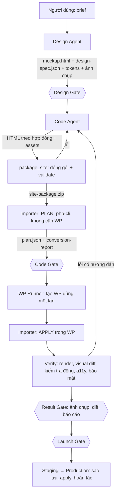

# Kế hoạch: Design Agent → Code Agent → Gói HTML (zip) → WordPress động

Bản này thay thế phần "Phase 4: Website Connector" của kế hoạch cũ. Nền tảng đích đã chốt là **WordPress + custom theme có importer**. Các phase kiểm soát/bảo mật trước đó vẫn là điều kiện đi trước (mục 9).

---

## 1. Mục tiêu và giả định

**Mục tiêu:** người dùng mô tả website → Design Agent ra mockup → Code Agent ra HTML/CSS/JS tĩnh đóng gói thành `site-package.zip` → importer của theme tự chuyển thành theme WordPress động (menu, bài viết, trường chỉnh sửa, form, SEO) → xem trước và kiểm chứng trong môi trường WordPress dùng một lần → người dùng duyệt → triển khai lên staging/production có sao lưu và hoàn tác.

**Giả định (đổi nếu sai, vì ảnh hưởng thiết kế):**
1. Theme là **PHP cổ điển** (không phải block theme). Block theme có thể làm sau bằng một adapter khác, dùng chung phần phân tích.
2. Nội dung trang do **khách hoặc bạn sửa trong WP admin** sau khi import, nên import lại không được ghi đè phần đã sửa.
3. AI **không bao giờ viết PHP**. AI chỉ viết HTML theo một hợp đồng; PHP do bộ sinh xác định tạo ra.
4. Có thể thêm container (WordPress, MariaDB) vào hệ thống Hub.

---

## 2. Nguyên tắc thiết kế

1. **HTML là nguồn sự thật, vẫn chạy được khi mở trực tiếp.** Phần động được khai báo bằng thuộc tính `data-wp-*`. Không có thuộc tính nghĩa là tĩnh. Nhờ vậy cùng một file làm mockup, làm bản xem trước tĩnh và làm đầu vào cho importer.
2. **Không sinh PHP bằng LLM.** Importer là mã xác định, có test vàng (golden). Template sinh ra chỉ chứa HTML và lời gọi hàm của theme gốc đã được review (`hub_field()`, `hub_menu()`, `hub_loop()`), và mọi giá trị đều được escape trong các hàm đó.
3. **Tách `plan` và `apply`.** Phân tích HTML tạo ra `plan.json` mô tả sẽ tạo gì (trang, menu, trường, template). `plan` được kiểm tra, hiển thị cho người duyệt, rồi mới `apply` vào WordPress.
4. **Tương đương là phép thử chính.** Nội dung mẫu trong HTML tĩnh được nạp làm dữ liệu thật trong WordPress, nên trang WP phải giống bản tĩnh (visual diff thấp). Sau đó sửa dữ liệu trong WP và kiểm tra trang đổi theo, để chứng minh nó thực sự động.
5. **Mọi bước có kiểm chứng máy kiểm được và một cổng duyệt người.** Không dựa vào lời dặn trong prompt.
6. **Import an toàn lặp lại:** idempotent, giữ nội dung người đã sửa, luôn có dry-run và hoàn tác.

---

## 3. Tổng quan luồng



Các artifact có phiên bản và liên kết nhau: `design-mockup vN` → `site-package vN` → `wp-theme-build vN` → `deployment vN`.

---

## 4. Hợp đồng HTML → WordPress (phần lõi)

### 4.1 Cấu trúc gói zip

```
site-package.zip
├─ manifest.json            # contract_version, slug, tên, danh sách trang, template, menu, post types, options
├─ pages/                   # mỗi file là một tài liệu HTML đầy đủ
│   ├─ index.html           # front page
│   ├─ about.html
│   ├─ blog.html            # trang danh sách bài viết
│   ├─ post.html            # mẫu bài viết đơn
│   ├─ contact.html
│   └─ 404.html
├─ partials/                # header.html, footer.html dùng chung
├─ assets/                  # css/, js/, img/, fonts/
├─ content/seed.json        # (tuỳ chọn) bài viết, trang, mục menu mẫu lấy từ HTML tĩnh
├─ tokens/design-tokens.json
└─ provenance.json          # id artifact thiết kế, run id, sha256
```

`manifest.json` gán file với loại template của WordPress (`front-page`, `page`, `home`, `single:<post_type>`, `archive:<post_type>`, `search`, `404`) và khai báo menu, post type tuỳ chỉnh, vùng widget, các tuỳ chọn toàn site. Có trường `contract_version`; importer hỗ trợ phiên bản hiện tại và phiên bản liền trước.

### 4.2 Các chỉ thị `data-wp-*` (bản MVP)

| Mục đích | Chỉ thị | Importer sinh ra |
|---|---|---|
| Phần chung | `<header data-wp-part="header">` | `header.php`, `footer.php`, gọi `wp_head()`, `wp_footer()`, `body_class()` |
| Văn bản sửa được | `data-wp-field="hero.title"` | `<?php echo hub_field('hero.title', '<mặc định>'); ?>`. Giá trị mặc định là chữ trong HTML, được nạp vào DB lúc import |
| Văn bản có định dạng | `data-wp-field="hero.body" data-wp-type="richtext"` | như trên, lọc qua `wp_kses_post` |
| Ảnh | `data-wp-img="hero.image"` | ảnh mặc định lấy từ `assets/`; nếu editor đổi ảnh thì dùng ảnh trong thư viện media |
| Liên kết | `data-wp-link="hero.cta"` | cặp text/href sửa được |
| Menu | `<nav data-wp-menu="primary">` | đăng ký menu, tạo mục từ các `<a>` có sẵn, render bằng walker giữ nguyên class của markup gốc |
| Danh sách bài/loại bài | `data-wp-loop="post"` + `data-wp-query="posts_per_page=6;orderby=date"` | `WP_Query` với tham số trong danh sách cho phép. Phần tử con đầu tiên có `data-wp-item` là khuôn; các thẻ mẫu còn lại được chuyển thành bài viết mẫu |
| Trường trong vòng lặp | `data-wp-field="title|excerpt|permalink|thumbnail|date|category|meta:<khoá>"` | hàm tương ứng, đã escape |
| Phân trang | `data-wp-pagination` | liên kết phân trang của WP, giữ class gốc |
| Form | `data-wp-form="contact"` | trình xử lý có sẵn: nonce, honeypot, giới hạn tần suất, gửi mail, lưu lại thành bản ghi |
| Tuỳ chọn toàn site | `data-wp-option="site.phone"` | trang tuỳ chọn trong Customizer/Admin |
| SEO | `<title>`, `meta description`, `canonical` | lấy từ WP và từ trường SEO của từng trang |

Ví dụ:

```html
<h1 data-wp-field="hero.title">Thiết kế website chuẩn SEO</h1>
<section data-wp-loop="post" data-wp-query="posts_per_page=3">
  <article data-wp-item class="card">
    
    <h3><a data-wp-field="permalink" href="#"><span data-wp-field="title">Tiêu đề mẫu</span></a></h3>
  </article>
  <article class="card">…thẻ mẫu thứ hai, sẽ thành bài viết mẫu…</article>
</section>
```

sinh ra trong template:

```php
<h1><?php echo hub_field('hero.title', 'Thiết kế website chuẩn SEO'); ?></h1>
<section><?php hub_loop('post', ['posts_per_page'=>3], function($item){ ?>
  <article class="card">… <?php echo hub_item('title'); ?> …</article>
<?php }); ?></section>
```

### 4.3 "Tự động chuyển" hiểu như thế nào

Hai lớp, tách bạch:
1. **Chính:** Code Agent gắn chỉ thị theo hợp đồng dựa trên `design-spec.json` (Design Agent đã nói rõ phần nào là danh sách, form, menu).
2. **Gợi ý:** importer quét cấu trúc (một `<nav>` trong header, nhóm thẻ anh em lặp lại, thẻ `<form>`) và đưa vào `conversion-report.json` kèm độ tin cậy. Gợi ý **không tự áp dụng**; Code Agent hoặc người duyệt xác nhận. Mục chưa chắc chắn được giữ ở dạng tĩnh. Cách này giữ được kết quả dự đoán được, thay vì đoán sai âm thầm.

### 4.4 Lý do không cho AI viết PHP trực tiếp

PHP do LLM sinh có thể có lỗi cú pháp, thiếu escape, và chạy với quyền của website. Importer xác định cho kết quả lặp lại, test được bằng fixture, và chỉ có một chỗ (theme gốc) cần review bảo mật.

---

## 5. Kiến trúc thành phần

### 5.1 Cấu trúc thư mục đề xuất

```
packages/wp/
├─ importer-lib/        # thư viện PHP độc lập WordPress: parse HTML, validate, tạo plan.json
├─ hub-theme/           # theme gốc đã review: hàm hub_*, walker, form handler, trang options
├─ hub-importer-plugin/ # adapter WP: apply plan, WP-CLI (wp hub import|plan|rollback), REST có xác thực
├─ runner/              # dịch vụ điều khiển môi trường WP dùng một lần (Python)
├─ contracts/           # JSON Schema: manifest, plan, conversion_report, design_spec
└─ fixtures/            # gói mẫu + kết quả mong đợi (golden)
```

Lý do tách `importer-lib` khỏi WordPress: chạy được trong một container `php-cli` nhỏ, không cần DB, nên Code Agent nhận phản hồi trong vài giây. Chỉ có **một** bộ phân tích, không nhân đôi giữa Python và PHP.

### 5.2 Theme gốc và theme sinh ra

- `hub-theme` (cố định, được review): cung cấp `hub_field`, `hub_menu`, `hub_loop`, `hub_item`, form handler, tuỳ chọn, hỗ trợ SEO. Mọi escape nằm ở đây (`esc_html`, `esc_url`, `wp_kses_post`).
- Theme con sinh cho từng dự án: template, partial, `assets/`, `theme.json`/CSS biến từ design tokens, mapping trường. Mã PHP trong đó chỉ là lời gọi hàm của theme gốc.

### 5.3 Plan / Apply

- `plan`: phân tích thuần, không tác dụng phụ. Đầu ra: `plan.json` (trang, template, menu, post type, trường, bài viết mẫu, tệp sẽ ghi) và `conversion-report.json` (tỉ lệ phần tử động/tĩnh, cảnh báo, gợi ý chưa áp dụng).
- `apply`: ghi file theme con, tạo trang/menu/bài mẫu, nạp giá trị mặc định, kích hoạt theme. Idempotent. Mỗi giá trị nhập vào lưu `source_hash`.
- **Import lại an toàn:** chỉ cập nhật một trường nếu giá trị hiện tại vẫn bằng giá trị đã nhập lần trước (tức chưa ai sửa). Nội dung đã sửa được giữ lại và liệt kê trong báo cáo xung đột.
- `rollback`: khôi phục thư mục theme và (ở staging/production) bản sao DB đã lưu trước khi apply.

### 5.4 Môi trường WordPress dùng một lần

- Một run = một bộ container (WordPress với PHP/WP đã ghim phiên bản + MariaDB + WP-CLI), mạng nội bộ riêng, mật khẩu admin ngẫu nhiên, không công bố cổng ra host, có TTL và giới hạn CPU/RAM.
- Khởi động nhanh bằng ảnh chụp DB nền (WP đã cài sẵn) và mount theme cần thử.
- **Không** cho API mount `docker.sock` (tương đương quyền root). `runner` là dịch vụ riêng chỉ nhận vài lệnh cố định: `create`, `import`, `render`, `mutate` (để kiểm tra động), `destroy`. Agent chỉ gọi các tool này, không có shell.
- Sandbox Playwright đi vào WP qua mạng nội bộ; mạng này không ra Internet nội bộ của Hub (kế thừa SEC-07/08).
- Xem trước cho người dùng: MVP gồm ảnh chụp 3 viewport + bản chụp HTML đã render. Xem trực tiếp qua reverse proxy có xác thực cần đặt `WP_HOME`/`WP_SITEURL` theo URL proxy, để làm sau.
- Phương án nhẹ thay Docker: WordPress Playground (PHP chạy trong WASM/Node, DB SQLite). Khởi động nhanh và dễ cô lập, nhưng độ trung thực kém hơn MariaDB và plugin thật. Nên dùng cho vòng lặp nhanh, Docker cho bước kiểm chứng cuối.

### 5.5 Tool và quyền cho agent

| Tool | Agent được dùng | Ghi chú |
|---|---|---|
| `submit_result(schema, data)` | design, code | Kiểm schema (`design_spec`, `site_package`, `conversion_report`); sai thì trả lỗi để sửa, tối đa 2–3 lần |
| `package_site(spec)` | code-builder | Gom file, kiểm hợp đồng, tạo zip và `provenance.json` |
| `wp_plan(package)` | code-builder, quality-auditor | php-cli, nhanh, không DB |
| `wp_env_create/import/render/mutate/destroy` | code-builder (create/import/render), quality-auditor (render, đọc) | Chạy qua `runner`, có TTL |
| `compare_screenshots` | code-builder, quality-auditor | Trả % lệch và ảnh diff (VER-04) |
| `open_gate` | design, code-builder | Gate dừng run như hiện nay |
| **Triển khai staging/production** | **không có tool cho LLM** | Chỉ `ApprovalService` gọi sau khi người dùng duyệt |

---

## 6. Vai trò từng agent

**Design Agent** ra: `mockup.html` (đã dùng tokens), `design-spec.json` (trang, phần, thành phần lặp lại, form, menu, mô hình nội dung sơ bộ), `design-tokens.json`, ảnh chụp 390/768/1440 px. Kết thúc bằng Design Gate.

**Code Agent** nhận `design-spec` và mockup, viết các trang/partial theo hợp đồng bằng skill mới `wp-ready-html` (chỉ thị, quy ước đường dẫn, những điều cấm). Vòng tự sửa: `package_site` → đọc lỗi → sửa → `wp_plan` → đọc `conversion-report` → sửa. Sau đó mở Code Gate, rồi chạy môi trường WP, đọc báo cáo kiểm chứng và sửa đến khi đạt định nghĩa hoàn thành.

**Quality Auditor** (agent độc lập, model khác, không có quyền ghi) chạy lại phần kiểm chứng và chấm theo danh mục trước khi Result Gate mở.

Giới hạn cứng: số lần sửa tối đa cho mỗi giai đoạn; vượt thì dừng ở trạng thái `needs_input` kèm báo cáo, tránh vòng lặp tốn tiền.

---

## 7. Ma trận kiểm chứng

| Giai đoạn | Kiểm tra | Tiêu chí đạt |
|---|---|---|
| V1 Thiết kế | HTML hợp lệ, ảnh chụp 3 viewport, a11y cơ bản, token dùng đúng | Không lỗi chặn |
| V2 Gói | JSON Schema cho manifest; lint chỉ thị (chỉ thị lạ, vòng lặp thiếu `data-wp-item`, khoá trùng); mọi đường dẫn tương đối trỏ được tới file; không `<?php`/`<?=`; không `.php` trong zip; allowlist CDN; giới hạn kích thước | 0 lỗi, cảnh báo được giải thích |
| V3 Plan | Chạy `plan` trong php-cli; báo cáo độ phủ (% phần tử động) và gợi ý chưa áp dụng | 0 lỗi; mọi trang trong manifest ánh xạ được |
| V4 Apply | `php -l` mọi file sinh ra; theme kích hoạt; `debug.log` không có warning/notice; trang/menu/bài mẫu đã tạo | Sạch |
| V5 Render | HTTP 200 mọi trang; không lỗi console; chụp 390/768/1440; visual diff giữa **bản tĩnh dựng trực tiếp từ zip** và **trang WP** | Lệch ≤ ngưỡng cấu hình (đề xuất 2% toàn trang, từng vùng ≤ 5%) |
| V6 Động | Dùng WP-CLI: đổi một trường, đổi tên mục menu, thêm một bài viết → render lại → thay đổi xuất hiện đúng chỗ | Mọi trường/loop/menu khai báo đều phản ứng |
| V7 Bảo mật | Đặt `<script>` vào tiêu đề bài và trường văn bản → không thực thi; form cần nonce và chặn honeypot; không còn mã PHP lạ ngoài lời gọi `hub_*` | Đạt |
| V8 Chất lượng | Axe/a11y, heading, alt, hiệu năng cơ bản, SEO (title, meta, canonical, một H1) | Theo ngưỡng của dự án |
| V9 Import lại | Chạy `apply` lần hai không đổi gì (idempotent); sửa tay một trường rồi import lại → trường giữ nguyên, có báo cáo xung đột | Đạt |

Ổn định cho visual diff: tắt animation/transition, đợi font tải xong, cố định viewport và thời gian, che các vùng động (ngày giờ, ảnh ngẫu nhiên).

---

## 8. Cổng duyệt và máy trạng thái

- Dùng lại máy trạng thái pause/resume hiện có; các tác vụ dài (khởi động WP, import, render) chạy ở worker và run chuyển `waiting_job` rồi tiếp tục khi xong, không giữ HTTP.
- **Design Gate:** mockup + `design-spec`.
- **Code Gate:** `plan`, `conversion-report`, danh sách gợi ý chưa áp dụng cần người xác nhận.
- **Result Gate:** ảnh chụp WP, visual diff, báo cáo V1–V9, bản diff theme so với phiên bản trước, các bước tự kiểm tra.
- **Launch Gate:** nơi đến (staging hay production), danh sách tệp/nội dung sẽ đổi, xung đột nội dung đã sửa, vị trí bản sao lưu.
- Rework từ bất kỳ cổng nào tạo run con với ngữ cảnh phản hồi (cần sửa lỗi N-06 trước: agent phải thấy quyết định và comment).

---

## 9. Điều kiện đi trước (từ đợt kiểm tra repo)

Chuỗi này thêm container, quyền ghi và triển khai lên website thật, nên các mục sau phải xong trước khi bật bất kỳ phần nào chạm vào WordPress:

| Mục | Lý do |
|---|---|
| N-01, N-02, N-03 (auth đủ router, bỏ đăng nhập theo tên, bí mật bắt buộc) | WP runner và triển khai không được mở cho người lạ |
| N-04 (`.gitignore` loại `lib/api.ts`), N-05 (baseline migration) | Cần repo build được và DB nâng cấp được vì sẽ thêm bảng |
| N-06 (agent thấy kết quả duyệt), N-07 (reaper), N-08 (chạy trùng) | Cả chuỗi dựa vào pause/resume và worker |
| SEC-07/08 (cô lập sandbox, không nhận đường dẫn tự do) | Sandbox sẽ nói chuyện với WP |
| N-16 (phát hành signed URL thật), VER-04 (visual diff có %) | Dùng cho xem trước và bước V5 |
| VER-05 (`submit_result` + JSON Schema) | Hợp đồng giữa các agent |
| BUG-15, BUG-16 | Chuỗi nhiều bước tốn token; cần giới hạn ngữ cảnh và chi phí thật |

---

## 10. Dữ liệu và schema mới

- Bảng `site_packages` (project, phiên bản, đường dẫn zip, sha256, trạng thái, `manifest`, `provenance`).
- Bảng `wp_envs` (project, run, trạng thái, URL nội bộ, hết hạn lúc).
- Bảng `conversion_reports` (package, độ phủ, cảnh báo, gợi ý, kết quả V1–V9).
- Bảng `deployments` (package, đích, trạng thái, vị trí sao lưu, người duyệt).
- JSON Schema trong `packages/wp/contracts/`: `manifest`, `plan`, `conversion_report`, `design_spec`; nối vào thư mục `schemas/` hiện đang bị bỏ không.
- Mọi bảng đi kèm migration Alembic có test nâng cấp từ DB cũ.

---

## 11. Lộ trình

Ước lượng cho một người; có thể chạy song song **Track A** (sửa nền Hub) và **Track B** (lõi WordPress), vì Track B không phụ thuộc agent.

| Phase | Nội dung | Thời gian | Kết quả nghiệm thu |
|---|---|---|---|
| **A0** Nền Hub | Mục 9 | 1–2 tuần (song song B1) | Tất cả điều kiện đi trước xanh |
| **B1** Hợp đồng và importer cốt lõi | Schema, thư viện `importer-lib` (parse, validate, plan), `hub-theme`, `apply`, fixture vàng; chưa có agent | 2 tuần | Gói mẫu → theme chạy trong WP, V2–V4 và V9 đạt trên fixture |
| **B2** Môi trường WP và kiểm chứng | `runner`, ảnh chụp DB nền, tool `wp_*`, visual diff, các kiểm tra V5–V8 | 1,5 tuần | Zip mẫu → ảnh chụp + báo cáo tự động trong < 2 phút |
| **C1** Tích hợp agent | Skill `wp-ready-html`, `design-spec`, `submit_result`, `package_site`, vòng tự sửa, Design/Code/Result Gate | 1,5–2 tuần | Từ brief ra WP preview đạt V1–V8 trên bộ ≥ 10 brief mẫu |
| **C2** Phần động mở rộng | Post type và taxonomy tuỳ chỉnh, trường lồng nhau, form nâng cao, SEO theo trang, tuỳ chọn toàn site, gợi ý heuristic | 2 tuần | Bộ fixture mở rộng đạt V6, V7 |
| **D1** Triển khai | Launch Gate, staging trước, sao lưu DB + theme, apply có dry-run, hoàn tác, phát hành bằng git/zip | 1–1,5 tuần | Triển khai staging và hoàn tác thành công trong kiểm thử |
| **E1** Đánh giá và củng cố | Bộ eval (độ phủ, tỉ lệ đạt, số lần sửa, chi phí mỗi site), ma trận phiên bản WP/PHP, bảo mật, tài liệu | 1 tuần | Báo cáo eval; ngưỡng được chốt |

Tổng: khoảng 9–11 tuần cho một người, khoảng 6–8 tuần nếu hai người chạy song song hai track. Phase đầu tiên có giá trị dùng được là **B1 + B2**: tự bạn tạo gói HTML cũng đã có công cụ chuyển và kiểm chứng.

### MVP (sau C1)
Menu, văn bản/ảnh/liên kết sửa được, một vòng lặp bài viết, một form liên hệ, SEO cơ bản, xem trước bằng ảnh chụp. **Hoãn:** post type tuỳ chỉnh, WooCommerce, đa ngôn ngữ, block theme, xem trực tiếp qua proxy.

---

## 12. Bộ test chấp nhận mới (TC-W)

1. Zip chứa đường dẫn `../` hoặc tuyệt đối → bị từ chối (zip-slip); vượt giới hạn dung lượng hoặc số tệp → từ chối.
2. Zip có `.php`, `<?php`, `<?=`, `.htaccess` hoặc phần mở rộng ngoài allowlist → từ chối.
3. Chỉ thị lạ, thiếu `data-wp-item`, khoá trùng, tham số `data-wp-query` ngoài danh sách cho phép → lỗi rõ ràng, kèm vị trí.
4. `plan` không có tác dụng phụ (không ghi file, không đụng DB) và cho cùng kết quả khi chạy hai lần.
5. `apply` hai lần liên tiếp → không thay đổi (idempotent).
6. Sửa tay một trường trong WP rồi import lại → trường giữ nguyên, báo cáo ghi xung đột.
7. Trang không có chỉ thị nào render giống bản tĩnh (≤ ngưỡng, 3 viewport).
8. Đổi trường, tên mục menu, thêm bài viết bằng WP-CLI → trang thay đổi đúng chỗ (V6).
9. Tiêu đề bài viết chứa `<script>` → không thực thi; form thiếu nonce → bị từ chối.
10. Sinh ra file PHP không qua được `php -l` hoặc chứa mã ngoài `hub_*` → bước build thất bại (mã sinh luôn qua kiểm tra).
11. FakeLLM trả gói sai hợp đồng → nhận lỗi từ validator → sửa trong ≤ 3 lần, nếu không thì run chuyển `needs_input` kèm báo cáo.
12. Môi trường WP không truy cập được `api`, `postgres`, metadata cloud; hết TTL → bị huỷ; mật khẩu admin khác nhau mỗi run.
13. Hoàn tác triển khai khôi phục đúng theme và DB về trước lần apply.
14. Mỗi cổng dừng run, và run resume thấy quyết định cùng comment của người duyệt.
15. Chi phí và số bước của một chuỗi Design → Code → Verify không vượt ngân sách cấu hình; vượt thì dừng với `limit_reached`.

---

## 13. Rủi ro và cách giảm

| Rủi ro | Giảm thiểu |
|---|---|
| Chỉ thị sai/thiếu từ LLM | Validator có thông báo cụ thể, vòng sửa tự động có giới hạn, bộ eval để đo tỉ lệ đạt khi đổi model |
| Lệch hình giữa tĩnh và WP | Nạp nội dung mẫu làm dữ liệu thật; walker giữ class; visual diff theo vùng; ổn định ảnh chụp |
| Quyền cao của runner (Docker) | Dịch vụ runner riêng với lệnh cho phép cố định, không `docker.sock` trong API, rootless nếu được, giới hạn tài nguyên và TTL |
| Trôi phiên bản WordPress/PHP | Ghim phiên bản trong ảnh, ma trận kiểm thử cho phiên bản đích, kiểm tra tương thích khi nâng cấp |
| Ghi đè nội dung khách đã sửa | `source_hash`, import lại theo quy tắc không ghi đè, báo cáo xung đột, sao lưu trước khi apply |
| JS phức tạp/SPA trong gói | Hợp đồng chỉ nhận HTML/CSS/JS tĩnh; thư viện JS phải nằm trong `assets/`, không tải từ nguồn ngoài allowlist |
| Phạm vi phình to (WooCommerce, đa ngôn ngữ) | MVP khoá phạm vi, mọi mở rộng đi qua phiên bản hợp đồng mới |
| Chi phí chuỗi nhiều bước | Phân tầng model (Design/Code mạnh, kiểm tra/sửa lỗi nhẹ), prompt caching, giới hạn số lần sửa, ngân sách theo run |

---

## 14. Quyết định cần bạn xác nhận

1. **Loại theme:** PHP cổ điển (giả định) hay block theme?
2. **Quyền sửa nội dung:** khách có sửa trong WP admin không? (quyết định mức ưu tiên cho import lại an toàn và trang tuỳ chọn.)
3. **Ngưỡng tương đương:** chấp nhận visual diff bao nhiêu giữa bản tĩnh và trang WP (đề xuất 2%)?
4. **Môi trường đích:** có sẵn staging WordPress để triển khai thử không, và truy cập bằng cách nào (SSH/WP-CLI, git, REST với Application Password)?
5. **Phạm vi MVP:** có cần form liên hệ và bài viết ngay từ đầu không, hay chỉ trang tĩnh sửa được văn bản/ảnh/menu?
6. **Tài nguyên:** máy chạy Hub có đủ RAM/CPU cho 2–3 môi trường WP + MariaDB chạy cùng lúc không? (quyết định chọn Docker hay Playground cho vòng lặp nhanh.)
