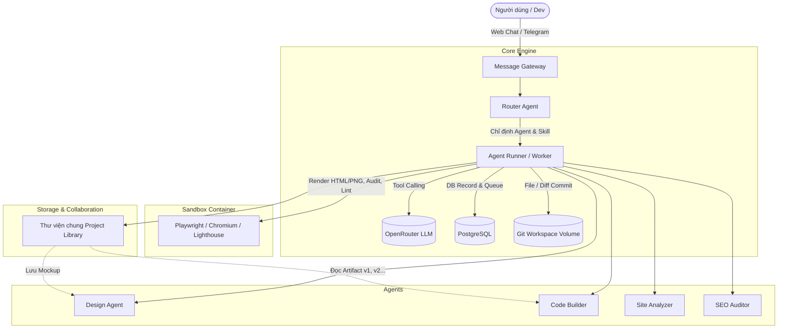

# Tài liệu Kiến trúc Hệ thống (System Architecture)

Hub AI Agent là nền tảng quản trị và cộng tác đa agent phục vụ công việc thiết kế, xây dựng website, tối ưu SEO và phân tích chất lượng cho Align.

## 1. Các thành phần chính

### Message Gateway (`packages/api/app/services/gateway.py`)
- Tiếp nhận tin nhắn từ Web UI và Telegram Webhook.
- Chuẩn hóa payload tin nhắn (văn bản, URL, file upload) thành cấu trúc chuẩn `MessagePayload`.
- Tự động lưu các file đính kèm vào thư viện dự án (`library_items`).

### Router Agent (`packages/api/app/services/router_agent.py`)
- Nhận diện mục đích yêu cầu của người dùng.
- Chọn ra Agent và Skill thích hợp, kèm hệ số tin cậy (`confidence`).
- Nếu người dùng tag trực tiếp `@design`, `@code`, `@analyzer`, `@seo`, Router sẽ bỏ qua phân loại tự động và chuyển thẳng.
- Không có quyền gọi công cụ ghi hoặc sửa đổi dữ liệu.

### Agent Runner & Worker (`packages/api/app/services/agent_runner.py`)
- Vòng lặp ReAct: Dựng prompt ngữ cảnh $\rightarrow$ Gọi LLM qua OpenRouter $\rightarrow$ Trích xuất tool call $\rightarrow$ Thực thi tool $\rightarrow$ Cập nhật trạng thái vào Postgres $\rightarrow$ Lặp lại cho đến khi hoàn thành hoặc chạm ngưỡng limits.
- Cơ chế bảo vệ: Giới hạn tối đa bước chạy (`max_steps`), thời gian (`max_minutes`), và ngân sách (`max_cost_usd`).

### Thư viện chung (Project Library)
- Kho lưu trữ trung tâm của từng Project.
- Nơi trao đổi dữ liệu giữa các Agent:
  - Design Agent xuất bản mockup HTML/CSS $\rightarrow$ lưu thành Artifact v1.
  - Code Builder tham chiếu đúng Artifact v1 để chuyển đổi sang mã nguồn hoàn chỉnh.
- Mọi dữ liệu chỉ đọc giữa các Agent, không gọi chéo qua lại.

### Sandbox Container
- Môi trường cô lập độc lập dành riêng cho các tác vụ cần trình duyệt hoặc audit code:
  - Chụp ảnh màn hình website (Desktop 1440px, Mobile 390px).
  - Render file HTML mockup sang ảnh PNG.
  - Đo lường hiệu năng Core Web Vitals với Lighthouse CLI.
  - Lint HTML/CSS/A11y.
- Container không chứa bất kỳ secret hay quyền truy cập DB nào.

## 2. Vòng đời dữ liệu và tương tác (Data Flow)
1. **Request**: Người dùng gửi yêu cầu trên Chat UI hoặc Telegram.
2. **Normalize**: Gateway chuẩn hóa và lưu tin nhắn vào bảng `messages` thuộc `threads`.
3. **Route**: Router xác định `agent_key`.
4. **Queue & Pick**: Worker nhận job qua PostgreSQL (`SELECT ... FOR UPDATE SKIP LOCKED`).
5. **Execute Loop**: Agent gọi các tools tương ứng, lưu artifact và commit vào Git Workspace.
6. **Output & Stream**: Server truyền tiến trình từng bước theo thời gian thực (SSE) về giao diện chat cho người dùng theo dõi.
