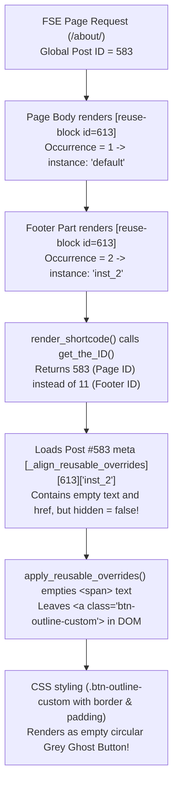

# 🛡️ Reusable Block Template Part Isolation & Anti-Ghost Button Architecture

> **Context**: Case study and architectural standard based on resolving the footer ghost button issue on `http://palmetto.local/about/` (Reusable Block `#613` reused across page body and `footer` template part).

---

## 1. Problem Overview & Visual Symptom

### 1.1. The Setup
- **Master Reusable Block `#613` (`cta-banner`)**: A reusable CTA section with background image, title, description, and two CTA buttons:
  - Button 1 (`ov-btn-1`): Primary solid button (`.btn-primary-custom`).
  - Button 2 (`ov-btn-2`): Outline button (`.btn-outline-custom`).
- **Reuse on `/about/` (Post #583)**:
  - **Location 1 (Page Body)**: Custom content *"Explore Products, Build Your Kit"* with both buttons active (`BUILD YOUR INTERIOR KIT` and `EXPLORE ALL CATEGORIES`).
  - **Location 2 (Footer Part, Post #11)**: Custom content *"Have a Custom Interior Request?"* with Button 1 set to `"REQUEST A CUSTOM QUOTE"` (`/contact-us/`) and Button 2 (`ov-btn-2`: `"START INTERIOR KIT BUILDER"`) set to **Hide** (`[hidden] => 1`) in Align Builder (`tp_id=tp_align-child//footer`).

### 1.2. The Anomaly (Ghost Button)
- On pages that did **not** reuse block `#613` in their body (e.g. `/shop/`, `/the-garage/`), the footer rendered perfectly with only 1 button.
- On `/about/`, the footer rendered with an empty, circular/oval grey button next to `"REQUEST A CUSTOM QUOTE"`.

---

## 2. Root Cause Analysis (RCA)

Four cascading factors caused this issue:



### Factor 1: WordPress FSE Global Query Context Bleed
In Full Site Editing block themes, template parts (`wp_template_part` like `header` and `footer`) are evaluated inside the main page loop.
Calling `get_the_ID()` or `$GLOBALS['post']->ID` inside `footer` returns the outer page ID (`583`), **never** the template part ID (`11`). Consequently, any meta query directed at `get_the_ID()` reads from the page's metadata table rather than the template part's metadata table.

### Factor 2: Unscoped Request-Wide Instance Counter
Before this fix, `Align_Reusable_Block` maintained a static counter `$instance_counts[$post_id]`:
- Body occurrence: Count = 1 -> key `'default'`.
- Footer occurrence: Count = 2 -> key `'inst_2'`.
The footer reusable block was incorrectly classified as the second instance of the page's reusable blocks.

### Factor 3: Align Builder Page Save Bleed
When saving Page #583 in Align Builder (`wp-save-handler.js`), `frameDoc.querySelectorAll('[data-component-shortcode]')` scanned the entire canvas DOM (including `<footer>`).
It identified the footer block as instance 2 and serialized its visual state into Post #583's `_align_reusable_overrides` with `ov-btn-2: { content: "", href: "" }` without preserving the `hidden: 1` flag stored in Post #11.

### Factor 4: DOM Remnant of Empty Links
When an overwrite replaces text with an empty string `""`, `apply_reusable_overrides()` emptied the inner `<span>` text. However, the outer `<a class="btn-outline-custom">` remained in the DOM. Due to CSS padding, border, and border-radius, this empty tag appeared visually as a ghost oval/circle.

---

## 3. Architectural Solution

### 3.1. Template Part Stack Tracking (`class-align-reusable-block.php`)
We introduced an active template part stack that tracks the rendering lifecycle of `core/template-part`:

```php
// Hooked to core/template-part block lifecycle
add_filter( 'pre_render_block', array( __CLASS__, 'on_pre_render_block' ), 10, 2 );
add_filter( 'render_block', array( __CLASS__, 'on_render_block' ), 10, 2 );

public static function on_pre_render_block( $pre_render, $parsed_block ) {
    if ( ! empty( $parsed_block['blockName'] ) && 'core/template-part' === $parsed_block['blockName'] ) {
        $slug = ! empty( $parsed_block['attrs']['slug'] ) ? $parsed_block['attrs']['slug'] : '';
        self::$active_template_part_stack[] = array(
            'slug' => $slug,
            'id'   => ( $slug ? self::resolve_template_post_id( $slug, 'template_part' ) : 0 ),
        );
    }
    return $pre_render;
}

public static function on_render_block( $content, $parsed_block ) {
    if ( ! empty( $parsed_block['blockName'] ) && 'core/template-part' === $parsed_block['blockName'] ) {
        array_pop( self::$active_template_part_stack );
    }
    return $content;
}
```

In `render_shortcode()`:
1. **Target Post ID Resolution**: If `self::$active_template_part_stack` is not empty, `$current_page_id` is derived from the template part on top of the stack (`Post #11`), completely bypassing `get_the_ID()`.
2. **Context-Scoped Instance Keys**:
   ```php
   $inst_ctx = $in_tpl_part ? ( 'tp_' . $cur_tp['slug'] . '_' . $current_page_id ) : ( 'page_' . $current_page_id );
   self::$instance_counts[ $inst_ctx ][ $post_id ] = ( self::$instance_counts[ $inst_ctx ][ $post_id ] ?? 0 ) + 1;
   ```
   Blocks in template parts are counted in their own isolated namespace, starting from 1 (`default`).

### 3.2. Anti-Ghost Button / Link DOM Sanitizer
In `apply_reusable_overrides()`:
If an `<a>` or `<button>` element has:
- Empty trimmed text content, AND
- No valid `href` attribute (empty, `#`, or missing), AND
- No child visual elements (`<svg>`, ``, `<i>`, `<picture>`)

The element is cleanly stripped from the DOM:
```php
if ( ( 'a' === $t_name || 'button' === $t_name ) && '' === $c_text && ! $has_icon && ! $has_href ) {
    if ( $target_node->parentNode ) {
        $target_node->parentNode->removeChild( $target_node );
    }
}
```

### 3.3. Builder Page Save Boundary & Pruning (`wp-save-handler.js`)
When saving a standard post/page (`activePostId && !activeTpId`):
1. **Template Part Exclusion**: Skip any block wrapper nested within `header, footer, [data-component-template-part], .wp-block-template-part, [data-template-part]`.
2. **Instance Pruning**: Any instance key in `reusable_overrides` that was not detected in the page body is deleted before sending the JSON payload to `/save`.

---

## 4. Developer & AI Agent Rules to Prevent Regression

1. **Never use `get_the_ID()` in Shortcodes without Context Verification**:
   In FSE themes, always verify if execution is occurring inside a template part or custom query before reading post meta.
2. **Always Partition Instance Counters by Context**:
   Never use global static counters for instance numbering without scoping them to container ID (`tp_{slug}_{id}`).
3. **Respect Builder Save Boundaries**:
   Page saving must strictly operate on page content. Never allow canvas helpers or template parts (header/footer) to inject overrides into page meta.
4. **Enforce Coding Standards (< 500 lines/file)**:
   - `class-align-reusable-block.php`: 498 lines.
   - `wp-save-handler.js`: 492 lines.
   Both files must strictly remain under 500 lines upon future modifications.

---

## 5. Verification Proof

- **DOM Check**: Verified on `http://palmetto.local/about/` via PHP DOM parser and curl.
  - Page body CTA: 2 buttons (`BUILD YOUR INTERIOR KIT`, `EXPLORE ALL CATEGORIES`).
  - Footer CTA: 1 button (`REQUEST A CUSTOM QUOTE`), ghost button completely eliminated.
- **Visual Check**: Verified via headless Chrome DevTools protocol screenshot (`footer_fixed.png`).
