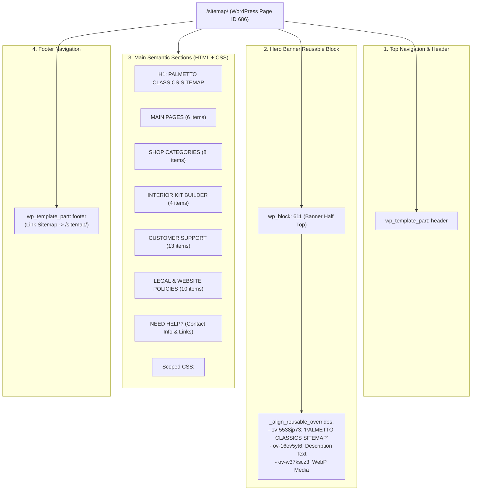

# Kiến Trúc Trang Sitemap & Chuẩn Quản Trị Trang Qua WordPress CMS

> [!NOTE]
> Tài liệu này mô tả chi tiết kiến trúc kỹ thuật của trang **Sitemap** (`/sitemap/`), quy chuẩn đồng bộ giữa Full Site Editing (FSE), Reusable Blocks (`wp_block`) và cơ chế quản lý nội dung linh hoạt 100% thông qua WordPress CMS.

---

## 1. Tổng Quan Kiến Trúc Trang Sitemap (`/sitemap/`)

Trang Sitemap được xây dựng theo hệ thống nhận diện và cấu trúc layout thống nhất của Palmetto Classics (tương đồng với các trang Policy như `return-and-refund-policy`, `made-to-order-policy`, `privacy-policy`).



---

## 2. Cấu Trúc Mã Nguồn & Assets

### 2.1 File Stylesheet & Script Cục Bộ
- **Stylesheet**: [`assets/builder/style-page-sitemap.css`](file:///Volumes/JoeSSD/SymLinks/Local_Sites_Home/palmetto/app/public/wp-content/themes/align-child/assets/builder/style-page-sitemap.css)
  ```css
  .sitemap-section {
    background-color: var(--color-10);
    border-radius: var(--radius-none);
  }
  .sitemap-block,
  .sitemap-content {
    width: 100%;
  }
  .sitemap-list {
    list-style-type: disc;
    padding-left: 24px;
    margin-top: 0;
  }
  .sitemap-list.list-unstyled,
  .sitemap-list.contact-list {
    list-style: none !important;
    list-style-type: none !important;
    padding-left: 0 !important;
  }
  .sitemap-list li {
    margin-bottom: var(--sp-4xs);
  }
  .sitemap-list li:last-child {
    margin-bottom: 0;
  }
  .sitemap-list a {
    color: var(--color-3);
    text-decoration: none;
    transition: color 0.2s ease;
  }
  .sitemap-list a:hover {
    color: var(--color-7);
    text-decoration: underline;
  }
  .sitemap-block p br {
    display: inline;
  }
  @media (max-width: 490px) {
    .sitemap-list:not(.list-unstyled) {
      padding-left: 18px;
    }
  }
  ```
- **Script**: [`assets/builder/script-page-sitemap.js`](file:///Volumes/JoeSSD/SymLinks/Local_Sites_Home/palmetto/app/public/wp-content/themes/align-child/assets/builder/script-page-sitemap.js)
- **Policy Template Import**: Bổ sung selector `.sitemap-section` và `.sitemap-list` vào [`assets/src/template/template-policy/css/important.css`](file:///Volumes/JoeSSD/SymLinks/Local_Sites_Home/palmetto/app/public/wp-content/themes/align-child/assets/src/template/template-policy/css/important.css).

---

## 3. Quy Chuẩn Quản Trị Trang Chuẩn Qua WordPress CMS (Dynamic Post Content)

### 3.1 Nguyên Tắc Vàng: Tránh Tạo Template Tĩnh Không Chứa `post-content`
Trong mô hình WordPress Full Site Editing (FSE) và Align Builder:
1. **Template Mặc Định (`templates/page.html`)**:
   - Phải luôn chứa `<!-- wp:post-content {"layout":{"type":"constrained"}} /-->` (hoặc `the_content()` nếu dùng PHP template).
   - Tuyệt đối không hardcode nội dung hoặc shortcode tĩnh vào file template con (như `templates/page-interior-kit-builder.html`), vì điều này sẽ vô hiệu hóa toàn bộ nội dung mà người dùng soạn thảo trong WordPress Editor / Align Visual Builder.
2. **Khắc Phục Trường Hợp Interior Kit Builder**:
   - Đã loại bỏ các file template riêng biệt `page-interior-kit-builder.php` và `templates/page-interior-kit-builder.html`.
   - Trang `/interior-kit-builder/` tự động kế thừa `templates/page.html` chuẩn, cho phép chèn và hiển thị linh hoạt cả `[align_kit_builder]` lẫn các Reusable Block như `[reuse-block slug='newsletter-box']` trực tiếp từ CMS.

### 3.2 Cơ Chế Lưu Dữ Liệu & Bảo Toàn Thẻ `<style>` (KSES Bypass)
- Khi cập nhật nội dung trang từ PHP/CLI hoặc REST API nội bộ, nếu không có phiên đăng nhập của Admin mang capability `unfiltered_html`, bộ lọc `wp_filter_post_kses()` của WordPress sẽ tự động bóc tách thẻ `<style>` và để lộ chuỗi CSS dạng text thô.
- **Giải pháp**:
  - Khi lưu qua script lập trình: Sử dụng `$wpdb->update()` hoặc thiết lập `wp_set_current_user(1)` trước khi cập nhật `post_content`.
  - Cấu trúc lưu trữ chuẩn:
    ```html
    <!-- wp:align/custom-html {"blockId":"align-xxxx","enableShortcode":true} -->
    <style id="style-page-sitemap">...</style>
    <div data-component-shortcode="" data-shortcode="[reuse-block id='611']">[reuse-block id='611']</div>
    <main>...</main>
    <script id="script-page-sitemap">...</script>
    <!-- /wp:align/custom-html -->
    ```
