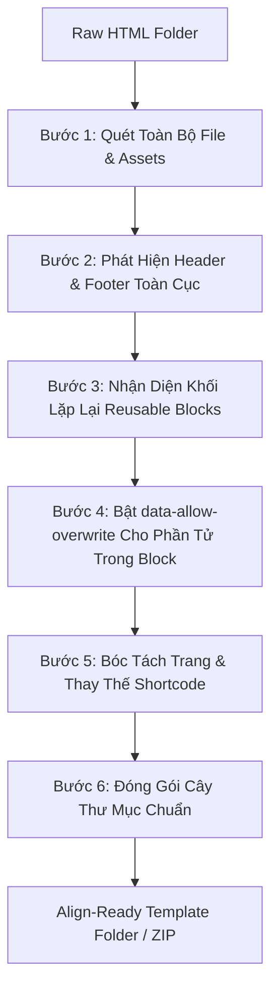

# 🛠️ Skill: Align HTML Template Refactor & Structure Normalizer

Skill này hướng dẫn AI Agent cách tiếp nhận một thư mục template HTML tĩnh thô (Flat HTML, HTML tải về từ ThemeForest/Webflow/Figma, hoặc thư mục mã nguồn chưa phân cấp) và **tự động phân tích, bóc tách, tái cấu trúc** thành thư mục chuẩn **Align Theme ZIP Importer** mà không làm thay đổi bản chất CSS hay viết thêm code thừa.

---

## 🎯 Mục Tiêu & Nguyên Tắc Cốt Lõi

1. **Refactor Only (Chỉ Tái Cấu Trúc, Không Bịa Code)**:
   - Giữ nguyên 100% class, id, attribute, style inline và cấu trúc DOM bên trong.
   - Không can thiệp sửa đổi các file CSS/JS lớn dùng chung trong thư mục `assets/`.
2. **Tách Biệt Header & Footer**:
   - Trích xuất phần đầu trang chung vào `header/index.html`.
   - Trích xuất phần chân trang chung vào `footer/index.html`.
3. **Phát Hiện & Bóc Tách Reusable Blocks**:
   - Nhận diện các khối section lặp lại ở nhiều trang (hoặc các khối độc lập: CTA, Pricing, Testimonials, FAQ, Newsletter...).
   - Bóc tách vào `reuse-blocks/{slug}/index.html`.
   - Thay thế vị trí cũ trong trang bằng shortcode: `[reuse-block slug="{slug}"]`.
4. **Tự Động Bật Data Overwrite (`data-allow-overwrite`) Cho Reusable Blocks**:
   - Tự động gắn cờ `data-allow-overwrite="true"` và định danh `data-overwrite-id="ov-..."` cho các phần tử chữ, nút bấm, liên kết và hình ảnh quan trọng trong block mẫu.
   - Giúp Visual Builder nhận diện và mở bảng **Content Overwrite** ở thanh Inspector bên phải để người dùng có thể đổi chữ/ảnh/link trên từng trang riêng biệt mà không làm đổi giao diện gốc.
5. **Chuẩn Hóa Cấu Trúc Trang (Folder-Per-Page)**:
   - Cắt bỏ thẻ bao bọc ngoài (`<!DOCTYPE>`, `<html>`, `<head>`, `<body>`, `header`, `footer`).
   - Đưa nội dung thân trang vào `{slug}/index.html` (ví dụ `home/index.html`, `about-us/index.html`).

---

## 🗺️ Quy Trình Thực Hiện 6 Bước



---

## 📝 Chi Tiết Từng Bước Thực Hiện

### BƯỚC 1: Quét & Kiểm Kê File Nguồn (Inventory)
1. Liệt kê toàn bộ các file `.html` hoặc `.htm` trong thư mục nguồn:
   - `index.html` ➡️ Trang chủ (`home`).
   - `about.html`, `about-us.html` ➡️ Trang Giới thiệu (`about-us`).
   - `contact.html` ➡️ Trang Liên hệ (`contact`).
   - `services.html`, `pricing.html`, `blog.html`...
2. Xác định các thư mục tài nguyên dùng chung:
   - `css/`, `js/`, `fonts/`, `img/` / `images/`, `lib/`, `vendor/`, `assets/`.
   - Gom tất cả vào thư mục đích: `assets/`.

---

### BƯỚC 2: Phát Hiện & Bóc Tách Global Header & Footer

#### 1. Global Header (`header/index.html`):
- **Dấu hiệu nhận biết**:
  - Thẻ `<header ...> ... </header>`.
  - Hoặc thẻ `<nav class="navbar ..."> ... </nav>`.
  - Hoặc các khối Topbar + Menu + Logo nằm ở đầu thẻ `<body>` trước phần main content.
- **Hành động**:
  - Trích xuất toàn bộ khối này và lưu vào `header/index.html`.
  - Xóa bỏ khối này khỏi tất cả các file HTML trang con.

#### 2. Global Footer (`footer/index.html`):
- **Dấu hiệu nhận biết**:
  - Thẻ `<footer ...> ... </footer>`.
  - Hoặc khối copyright, links cuối trang trước thẻ `</body>`.
- **Hành động**:
  - Trích xuất toàn bộ khối này và lưu vào `footer/index.html`.
  - Xóa bỏ khối này khỏi tất cả các file HTML trang con.

---

### BƯỚC 3: Phát Hiện & Bóc Tách Reusable Blocks

#### 1. Tiêu chí xác định Reusable Block:
- **Khối lặp lại giữa các trang**: Section xuất hiện nguyên vẹn hoặc tương đồng ở từ 2 trang trở lên (ví dụ: CTA banner ở cuối trang Home và trang About).
- **Các khối thành phần độc lập**:
  - **CTA Banner**: Khối kêu gọi hành động (`.cta-section`, `.cta-banner`).
  - **Pricing Table**: Bảng giá dịch vụ/gói cước (`.pricing-table`).
  - **Testimonials / Reviews**: Đánh giá của khách hàng (`.testimonials`, `.reviews`).
  - **Newsletter / Subscribe**: Form nhận tin (`.newsletter`, `.subscribe-box`).
  - **FAQ / Accordion**: Câu hỏi thường gặp (`.faq-section`).
  - **Brand / Partner Logos**: Dải logo đối tác (`.brand-carousel`).

#### 2. Quy tắc đặt `slug` cho Block:
- Đặt tên tiếng Anh hoặc không dấu, viết thường, dùng dấu gạch ngang (`kebab-case`).
- Ví dụ: `cta-banner`, `pricing-table`, `testimonial-slider`, `newsletter-box`, `faq-accordion`.

---

### BƯỚC 4: Tự Động Bật Data Overwrite Trong Reusable Block (`data-allow-overwrite`)

> [!IMPORTANT]
> **Cơ Chế Data Overwrite Trong Align Theme**:
> Khi một phần tử trong Reusable Block có `data-allow-overwrite="true"`, người dùng có thể nhúng block này ở nhiều trang khác nhau và chỉnh sửa chữ/ảnh/link riêng cho từng trang trong thanh **Content Overwrite** của Visual Builder mà không làm thay đổi bản thiết kế gốc!

#### Heuristics (Quy tắc phát hiện và gán cờ cho AI):
Khi AI bóc tách HTML vào `reuse-blocks/{slug}/index.html`, duyệt qua các thẻ bên trong và tự động gán thuộc tính theo bảng sau:

| Thẻ HTML | Vị Trí / Vai Trò | Thuộc tính thêm vào | Mục Đích |
| :--- | :--- | :--- | :--- |
| `<h1>` - `<h6>` | Tiêu đề chính, tiêu đề phụ | `data-allow-overwrite="true"`<br>`data-overwrite-id="ov-title-1"` (hoặc `ov-subtitle`) | Cho phép đổi tiêu đề trên từng trang nhúng |
| `<p>`, `<span>`, `<blockquote>` | Đoạn mô tả, đoạn giới thiệu, câu trích dẫn | `data-allow-overwrite="true"`<br>`data-overwrite-id="ov-desc-1"` | Cho phép đổi đoạn text mô tả |
| `<a>`, `<button>` | Nút CTA, nút bấm hành động, link liên kết | `data-allow-overwrite="true"`<br>`data-overwrite-id="ov-btn-1"` (hoặc `ov-link-1`) | Cho phép đổi nhãn nút, link `href` và `target` |
| ``, `<picture>` | Ảnh banner chính, ảnh minh họa, avatar | `data-allow-overwrite="true"`<br>`data-overwrite-id="ov-img-1"` | Cho phép chọn ảnh mới từ WordPress Media Library |

#### ⚠️ Các phần tử KHÔNG ĐƯỢC gán `data-allow-overwrite`:
- Các thẻ bọc layout: `<div>`, `<section>`, `<div class="container">`, `<div class="row">`, `<div class="col-...">`.
- Icon tĩnh hoặc icon trang trí: `<i class="fa ..."></i>`, `<svg>`.
- Danh sách bullet points cố định hoặc menu điều hướng.

#### Ví dụ Mẫu Trước & Sau Khi AI Gán Data Overwrite:

**Trước khi gán (HTML gốc)**:
```html
<section class="cta-banner-section">
  <div class="container">
    <h2 class="cta-title">Ready to build fast with Align?</h2>
    <p class="cta-desc">Standardized HTML import directly to WordPress FSE.</p>
    <a href="/contact/" class="btn-cta">Get Started Today ↗</a>
  </div>
</section>
```

**Sau khi AI tối ưu hóa (Lưu vào `reuse-blocks/cta-banner/index.html`)**:
```html
<section class="cta-banner-section">
  <div class="container">
    <h2 class="cta-title" data-allow-overwrite="true" data-overwrite-id="ov-title-1">Ready to build fast with Align?</h2>
    <p class="cta-desc" data-allow-overwrite="true" data-overwrite-id="ov-desc-1">Standardized HTML import directly to WordPress FSE.</p>
    <a href="/contact/" class="btn-cta" data-allow-overwrite="true" data-overwrite-id="ov-btn-1">Get Started Today ↗</a>
  </div>
</section>
```

---

### BƯỚC 5: Chuẩn Hóa Trang & Thay Thế Shortcode

Tại các file HTML trang (ví dụ `index.html`, `about.html`, `contact.html`):
1. **Thay thế khối Reusable Block**:
   - Xóa bỏ đoạn mã HTML của khối đã bóc tách.
   - Thay thế bằng cấu trúc Shortcode Component chuẩn của Align Builder:
     ```html
     <div class="site-{slug}-wrapper">
       <div data-component-shortcode="" data-shortcode="[reuse-block slug='{slug}']" data-preview-state="rendered">[reuse-block slug="{slug}"]</div>
     </div>
     ```
     *(Nếu trang cần ghi đè instance cụ thể, có thể dùng `[reuse-block slug="{slug}" instance="{page_slug}-{slug}"]`)*.
2. **Loại bỏ thẻ khung HTML ngoài**:
   - Xóa `<!DOCTYPE html>`, `<html>`, `<head>...</head>`, `<body>`, `</body>`, `</html>`.
3. **Loại bỏ Header & Footer** đã bóc tách ở Bước 2.
4. **Lưu nội dung thân trang**:
   - Lưu vào `{page_slug}/index.html` (ví dụ `home/index.html`, `about-us/index.html`).

---

### BƯỚC 6: Đóng Gói Cấu Trúc Thư Mục Chuẩn

```text
my-refactored-template/
│
├── 📁 assets/                          <--- Toàn bộ CSS, JS, Images, Fonts dùng chung
│   ├── 📁 css/style.css
│   ├── 📁 js/main.js
│   ├── 📁 fonts/
│   └── 📁 img/ (hoặc images/)
│
├── 📁 header/                          <--- 🔷 Global Header
│   └── 📄 index.html
│
├── 📁 footer/                          <--- 🔷 Global Footer
│   └── 📄 index.html
│
├── 📁 reuse-blocks/                    <--- 🧱 Reusable Blocks (Đã trang bị data-allow-overwrite)
│   ├── 📁 cta-banner/
│   │   └── 📄 index.html
│   └── 📁 pricing-table/
│       └── 📄 index.html
│
├── 📁 home/                            <--- 📄 Trang Chủ (Đã nhúng shortcode [reuse-block slug="..."])
│   └── 📄 index.html
│
├── 📁 about-us/                        <--- 📄 Trang Giới Thiệu
│   └── 📄 index.html
│
└── 📁 contact/                         <--- 📄 Trang Liên Hệ
    └── 📄 index.html
```

---

## ⚡ Hướng Dẫn Sử Dụng Helper Script Tự Động

Trong thư mục skill có trang bị script Node.js tự động quét, gán `data-allow-overwrite` và tái cấu trúc:

```bash
# Chạy script tự động refactor:
node .agents/skills/align-template-refactor/scripts/scan-and-refactor.js "<path-to-raw-template-folder>" "<path-to-output-folder>"
```

---

## ⚠️ Quy Tắc Bắt Buộc Đối Với AI (Strict Guardrails)

- ❌ **CẤM TỰ BỊA ID DATABASE**: Luôn luôn dùng `[reuse-block slug="ten-block"]`, không dùng số ID MySQL ngẫu nhiên.
- ❌ **CẤM XÓA HOẶC ĐỔI CLASS/ID CSS**: Mọi class CSS (`class="col-lg-6 hero-title"`) phải được giữ nguyên 100%.
- ❌ **CẤM TỰ Ý SỬA CSS/JS**: Không can thiệp phân rã file CSS lớn.
- ✅ **ĐẶT TÊN `data-overwrite-id` RÕ RÀNG**: Sử dụng tiền tố `ov-` kèm vai trò (`ov-title-1`, `ov-desc-1`, `ov-btn-1`, `ov-img-1`).
