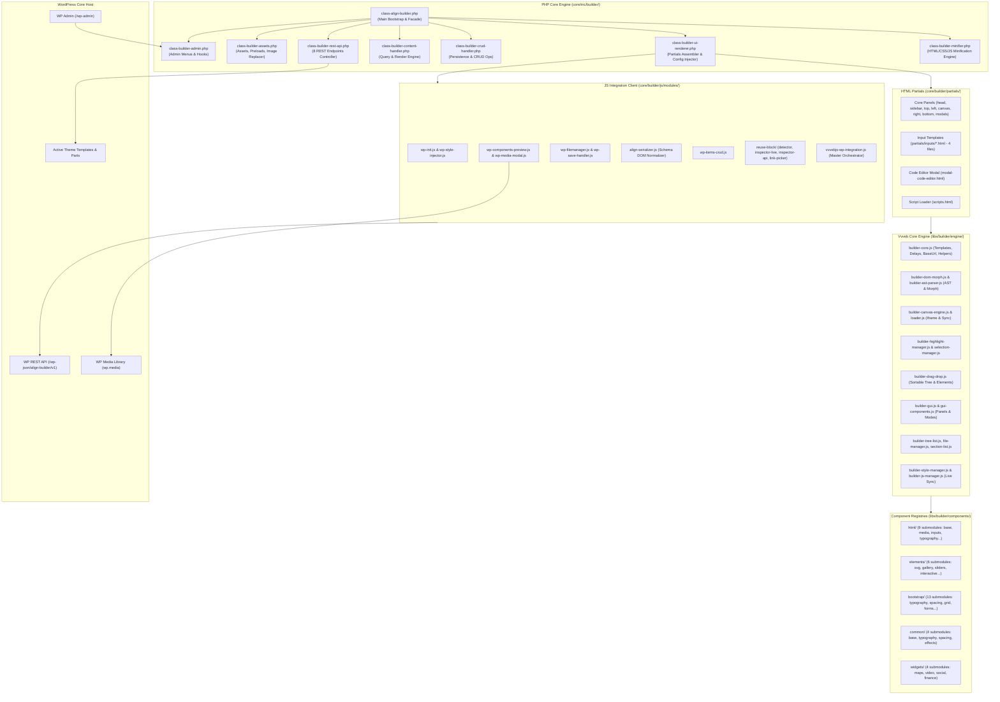
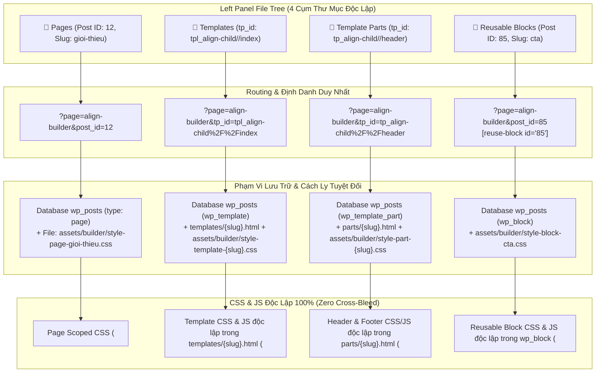

# 🏛️ Align Theme Builder Architecture Manifest

Tài liệu này cung cấp sơ đồ phân rã (decomposition manifest), kiến trúc hệ thống module hóa, bản đồ trách nhiệm và hướng dẫn bảo trì cho toàn bộ hệ sinh thái **Align Visual Builder**. Toàn bộ file mã nguồn tùy biến đã được chuẩn hóa theo quy chuẩn **< 500 dòng/file**, đặt tên tự mô tả chức năng (self-descriptive semantic naming), hợp nhất Code Editor CodeMirror 6 + Lezer AST và phân bổ theo từng folder chức năng rõ ràng. Ngoài tài liệu Markdown này, hệ thống còn cung cấp cơ sở dữ liệu tri thức và công cụ tìm kiếm 360 độ máy đọc tại thư mục [`manifest/`](./manifest/README.md).

---

## 1. Sơ Đồ Kiến Trúc Tổng Thể (System Architecture)

---

## 2. Bản Đồ Phân Cụm & Trách Nhiệm Chi Tiết (Modular Breakdown Matrix)

Tất cả các file tùy biến trong hệ thống đều tuân thủ nghiêm ngặt chuẩn **< 500 dòng/file**.

### Cụm 1: PHP Backend Engine (`core/inc/builder/`)

| File | Trách nhiệm chính (Single Responsibility) | Dòng code |
| :--- | :--- | :--- |
| [`class-align-builder.php`](file:///Volumes/JoeSSD/SymLinks/Local_Sites_Home/trusted-union/app/public/wp-content/themes/align/core/inc/class-align-builder.php) | Khởi tạo hằng số, nạp các submodule, cung cấp class Facade `Align_Core_Vvveb_Builder` tương thích ngược. | ~82 dòng |
| [`class-builder-assets.php`](file:///Volumes/JoeSSD/SymLinks/Local_Sites_Home/trusted-union/app/public/wp-content/themes/align/core/inc/builder/class-builder-assets.php) | Thu thập CSS/JS theme & custom assets, tạo thẻ `<link rel="preload" as="font">`, chuyển đổi URL động, bộ lọc 2-Case Dummy Image sang `https://picsum.photos/seed/align/600/400` bằng `WP_HTML_Tag_Processor` và bảo vệ tuyệt đối dynamic components. | ~480 dòng |
| [`class-builder-admin.php`](file:///Volumes/JoeSSD/SymLinks/Local_Sites_Home/trusted-union/app/public/wp-content/themes/align/core/inc/builder/class-builder-admin.php) | Đăng ký headless admin page cho Gutenberg embedded iframe, quản lý nạp tập trung 6 assets Gutenberg & Site Editor Integration (`core/builder/gutenberg/`), tinh gọn các nút thừa (Admin Bar & Row Actions) do đã tích hợp trực tiếp vào Gutenberg Edit. | ~299 dòng |
| [`class-builder-rest-api.php`](file:///Volumes/JoeSSD/SymLinks/Local_Sites_Home/trusted-union/app/public/wp-content/themes/align/core/inc/builder/class-builder-rest-api.php) | Đăng ký 8 REST API endpoints (Pages, Content, Save, Block/Shortcode Render, Create/Delete, Search-links). | ~91 dòng |
| [`class-builder-content-handler.php`](file:///Volumes/JoeSSD/SymLinks/Local_Sites_Home/trusted-union/app/public/wp-content/themes/align/core/inc/builder/class-builder-content-handler.php) | Lấy danh sách Pages, Templates, Template Parts và Reusable Blocks (`wp_block`), Ajax search links, resolve permalinks, server-side preview canvas engine với bộ lọc regex strip `wp:template-part` và render placeholder sạch cho `data-component-post-content`. | ~471 dòng |
| [`class-builder-crud-handler.php`](file:///Volumes/JoeSSD/SymLinks/Local_Sites_Home/trusted-union/app/public/wp-content/themes/align/core/inc/builder/class-builder-crud-handler.php) | Xử lý lưu, tạo mới, xóa Pages/Templates/Reusable Blocks (`wp_block`), lưu `_align_reusable_overrides` cho cả Page và Template, cơ chế Dual-Write ghi đồng thời vào DB và file đĩa `align-child/templates/`, render shortcodes và Gutenberg blocks. | ~490 dòng |
| [`class-builder-ui-renderer.php`](file:///Volumes/JoeSSD/SymLinks/Local_Sites_Home/trusted-union/app/public/wp-content/themes/align/core/inc/builder/class-builder-ui-renderer.php) | Tự động ghép nối các HTML partials (kèm 4 sub-partials từ `partials/inputs/`), inject WordPress scripts/styles/media, site icon favicon động và `window.VvvebWpConfig` (`dummyImgUrl` an toàn cú pháp qua `json_encode`). | ~302 dòng |
| [`class-builder-image-resolver.php`](file:///Volumes/JoeSSD/SymLinks/Local_Sites_Home/trusted-union/app/public/wp-content/themes/align/core/inc/builder/class-builder-image-resolver.php) | Tự động phân giải `srcset`, `sizes`, `width`, `height`, `alt` và 3-tier art-direction `<picture>` breakpoints từ WordPress attachment metadata trong Canvas Editor, in-memory caching, dọn dẹp inline style thừa (`width: 100%; height: auto;`), chuẩn hóa relative URL `/wp-content/uploads/...` với zero-frontend overhead. | ~492 dòng |
| [`class-builder-minifier.php`](file:///Volumes/JoeSSD/SymLinks/Local_Sites_Home/trusted-union/app/public/wp-content/themes/align/core/inc/builder/class-builder-minifier.php) | Nén và chuẩn hóa an toàn HTML (bảo toàn pre/code/svg/Gutenberg comments), CSS & JS (ưu tiên nén sâu qua Align Cloud API `/api/minify` kèm Heuristic Bypass, Two-Tier Cache và Local Tokenized Fallback), đóng gói payload có scoped IDs và ghi log Observability. | ~347 dòng |

---

### Cụm 2: CSS Stylesheet Hierarchy (`core/builder/css/`)

Tất cả stylesheet mô-đun được import qua master aggregator [`editor.css`](file:///Volumes/JoeSSD/SymLinks/Local_Sites_Home/trusted-union/app/public/wp-content/themes/align/core/builder/css/editor.css) (36 dòng) và canvas helper stylesheet [`vvvebjs-editor-helpers.css`](file:///Volumes/JoeSSD/SymLinks/Local_Sites_Home/trusted-union/app/public/wp-content/themes/align/core/builder/css/vvvebjs-editor-helpers.css):

| Folder / File | Chức năng chi tiết | Dòng code |
| :--- | :--- | :--- |
| `base/editor-layout.css` | Layout tổng thể builder, reset, typography hệ thống. | ~252 dòng |
| `base/editor-sidebar.css` | Thanh điều hướng bên trái (sidebar-nav), icon tabs. | ~215 dòng |
| `base/editor-panels.css` | Bố cục top panel (khóa cứng max-height 38px, overflow: hidden), left panel, right panel, bottom panel, tabs container. | ~444 dòng |
| `base/editor-canvas.css` | Iframe wrapper, responsive canvas scales, loading overlay & blob animation. | ~250 dòng |
| `components/editor-tree-navigator.css` | Cây phân cấp DOM `#tree-list`, folder tree styles, active item highlight, hover action buttons (Duplicate & Delete với cơ chế row pinning và isolated per-element hover), chuẩn hóa 100% single-line nowrap và text-overflow ellipsis chống tràn dòng đè chữ. | ~400 dòng |
| `components/editor-highlight-box.css` | Khung hover xanh `#highlight-box`, nhãn phần tử `#highlight-name`, `#iframe-layer` khóa cứng absolute overlay, căn giữa middle preview canvas (`align-items: center`, `transform-origin: center center`, `overflow: clip`). | ~291 dòng |
| `components/editor-select-actions.css` | Khung viền chọn `#select-box`, thanh công cụ `#select-actions` căn giữa top-panel. | ~285 dòng |
| `components/editor-drag-elements.css` | Hiệu ứng kéo thả element, drag ghost, placeholder. | ~210 dòng |
| `components/editor-sortable-drop.css` | Chỉ báo vị trí thả sortable drop indicator, target line. | ~215 dòng |
| `components/editor-inputs-base.css` | Input fields cơ bản trong tab properties (text, number, toggle, range, link input states). | ~442 dòng |
| `components/editor-inputs-select.css` | Dropdowns, radio groups, button group selectors, color pickers. | ~280 dòng |
| `components/editor-inputs-autocomplete.css` | Autocomplete dropdown, Google fonts search dropdown, link lookup. | ~235 dòng |
| `components/editor-modals-toolbar.css` | Hộp thoại modals, code editor popup, toast alerts. | ~173 dòng |
| `theme/editor-sections-theme.css` | Theme styles cho section presets và block templates. | ~210 dòng |
| `theme/editor-dark-theme.css` | Tùy chỉnh Dark theme toàn diện, bảng màu `#23272e` và dark mode cho inspector controls. | ~280 dòng |
| `vvvebjs-editor-helpers.css` | Stylesheet cách ly Canvas iframe, floating action dock fixed bottom (`#vvvebjs-new-section`), shortcode/block preview wrappers. | ~474 dòng |
| `vendor/line-awesome.css` | Bộ icon Line Awesome (được cô lập riêng trong vendor). | ~11.2k dòng |
| `vendor/bootstrap-custom.css` | Core Bootstrap CSS với asset URLs chuẩn `../../libs/builder/icons/`. | ~13.7k dòng |

---

### Cụm 3: Vvveb Core Engine (`core/builder/libs/builder/engine/`)

Tất cả module độc lập có cú pháp chuẩn và phối hợp qua namespace toàn cục `window.Vvveb`.

| File Module | Vai trò & Trách nhiệm | Dòng code |
| :--- | :--- | :--- |
| `builder-core.js` | Templating engine Resig `tmpl()`, độ trễ timer, helpers, element generator, cấu hình `baseUrl` & `imgBaseUrl`, hàm `Vvveb.scrollToNode()` cuộn cô lập trong viewport iframe và `offset()` chuẩn hóa scroll fallback. | ~226 dòng |
| `builder-dom-morph.js` | Engine DOM Morphing so sánh và vá DOM Iframe Canvas mượt mà, loại bỏ 100% chớp trắng (zero flicker), bảo toàn video, animations và helper tags. | ~268 dòng |
| `builder-ast-parser.js` | Engine Virtual AST Parser chuyển đổi 2 chiều Code <-> AST, bảo toàn Stable AST IDs (`data-ast-id`) và tự động disambiguate duplicate IDs khi `syncDom`, xử lý `moveNode` (chống vòng lặp circular nesting), `cloneNode`, `removeNode`, tự động format bằng `js-beautify`. | ~448 dòng |
| `builder-components-registry.js` | Quản lý registry component (`Vvveb.Components.add/extend/get/render`), cơ chế DOM-First Strict Hooking và Global Safety Guard 3 tầng tự động ẩn thuộc tính Text thô (`innerHTML`) khi phần tử chứa thẻ con (`children.length > 0`), bảo toàn 100% cây DOM con. | ~441 dòng |
| `builder-groups-registry.js` | Khởi tạo nhóm Blocks, Sections, Styles groups. | ~56 dòng |
| `builder-wysiwyg-editor.js` | Bộ điều khiển soạn thảo văn bản trực tiếp inline bằng Double-Click trên canvas; khóa vĩnh viễn floating toolbar `#wysiwyg-editor`, tự động dọn dẹp khi blur và ghi nhận `characterData` Undo mutation có chọn lọc. | ~309 dòng |
| `builder-canvas-engine.js` | Khởi tạo canvas iframe, kích thước viewport Desktop 1920x1080 mặc định và căn giữa tuyệt đối, `runJsOnSetHtml: true`, realtime tracking `selectBoxPosition` qua `getBoundingClientRect()`, bảo vệ khóa cố định cuộn canvas (`canvas.scrollTop=0`). | ~398 dòng |
| `builder-canvas-loader.js` | Đồng bộ nội dung HTML/CSS iframe, sự kiện `_frameLoaded`, `selectNode()` định vị viewport chính xác bằng `getBoundingClientRect()`, kích hoạt tự động `TreeList`, `SectionList`, `StyleManager`, `JsManager`. | ~333 dòng |
| `builder-highlight-manager.js` | Điều khiển khung highlight hover chuột, tag badge, resize handles và inline text edit định vị chuẩn xác theo viewport `getBoundingClientRect()`. | ~353 dòng |
| `builder-selection-manager.js` | Điều khiển chọn phần tử, tính tọa độ `#select-box`, kích hoạt toolbar hành động, thao tác DOM-first `cloneSelectedNodes` và `deleteSelectedNodes` có ghi nhận Undo và tích hợp `Vvveb.scrollToNode()`. | ~437 dòng |
| `builder-drag-drop.js` | Xử lý kéo thả phần tử từ sidebar vào canvas, `setHtml()` dùng `Vvveb.DomMorph.morph()` realtime sync với TreeList/SectionList, bóc tách CSS/JS an toàn và loại bỏ triệt để helper tags. | ~485 dòng |
| `builder-code-editors.js` | Hợp nhất CodeMirror 6 Multi-Tab Editor (HTML/CSS/JS), Lezer AST Live Sync, isDirty tracking, độc lập debounce timer và `scheduleSync(300)` khi thao tác DOM. | ~493 dòng |
| `builder-js-manager.js` | Quản lý mã JavaScript tùy biến theo trang, tự động inject & thực thi trong Iframe canvas (tự hủy khi rỗng). | ~134 dòng |
| `builder-gui.js` | Bộ điều khiển giao diện chính (undo, redo, saveModal, viewport chuẩn Full HD 1920x1080 với icon sync và select-box auto-reflow, transform translate(-50%, -50%) scale, window resize listener, Content Mode guards). | ~482 dòng |
| `builder-gui-components.js` | Quản lý toggle panels, Dark mode, Content Mode, thuật toán tự động tính tỉ lệ zoom `calcFitZoom(targetW, targetH)` và đổi kích thước màn hình `setViewport(breakpoint)`. | ~262 dòng |
| `builder-style-manager.js` | Quản lý thuộc tính CSS style, class styling, media queries breakpoint parsing chuẩn xác và inject `<style id="vvvebjs-styles">` realtime (100ms debounce, tự hủy khi rỗng), vô hiệu hóa quét `_getCssStyle` tự động để bảo toàn style thực tế. | ~353 dòng |
| `builder-content-manager.js` | Quản lý nội dung text/HTML của phần tử, gắn `astId` cho Tree Navigator, lọc non-visual tags (`SCRIPT`, `STYLE`, `LINK`), cô lập atomic components, đóng gói thống nhất nhãn Tree Node (`.tree-node-text > .tree-node-name + .tree-node-title`) kèm tooltip `title` đầy đủ và tự động co giãn ellipsis. | ~255 dòng |
| `builder-section-list.js` | Accordion danh sách Sections và chèn section vào canvas, tích hợp `Vvveb.scrollToNode()`. | ~383 dòng |
| `builder-style-list.js` | Accordion quản lý style presets. | ~68 dòng |
| `builder-tree-list.js` | Cây DOM Tree Navigator điều khiển chọn nhiều phần tử (Normal, Ctrl/Cmd Toggle, Shift Range Select), tự động khôi phục node sống qua `_astId` khi click/hover, quản lý `expandedAstIds` và `_selectComponentImmediate`. | ~409 dòng |
| `builder-tree-render.js` | Bộ lập lịch Coalesced Render (`requestAnimationFrame`) cho `Vvveb.TreeList.loadComponents()`, gộp nhiều lời gọi trong 1 frame thành 1 lần `_renderTree()`, bảo toàn vị trí cuộn `scrollTop` của `.tree`, khôi phục `expandedAstIds`, hỗ trợ `{ sync: true }` và hàng đợi `_pendingSelectNode`. | ~169 dòng |
| `builder-tree-sortable.js` | Module kéo thả SortableJS cho Tree Navigator, 3-Zone Trigger (trên Label 26px: Before/Inside/After), thao tác DOM-first (`insertBefore`/`appendChild`), chặn circular move, ghi nhận Undo `move` và chọn node theo tham chiếu DOM. | ~246 dòng |
| `builder-file-manager.js` | Quản lý danh sách trang, routing và chuyển trang, tích hợp `Vvveb.scrollToNode()` & container scroll. | ~361 dòng |
| `builder-breadcrumb.js` | Thanh breadcrumb hiển thị phân cấp thẻ HTML dưới chân canvas, tích hợp `Vvveb.scrollToNode()`. | ~75 dòng |
| `builder-fonts-manager.js` | Quản lý và nạp Google Fonts động. | ~80 dòng |
| `builder-color-palette.js` | Quản lý bảng màu Color Palette hệ thống. | ~135 dòng |
| `builder-new-section.js` | Hộp thoại và widget chèn Section/Component mới (`Vvveb.NewSection`). | ~78 dòng |
| `builder-config.js` | Cấu hình mặc định cho builder engine (đã dọn dẹp hàm `launchFullScreen` dư thừa). | ~60 dòng |

---

### Cụm 4: Inspector Inputs Controller (`core/builder/libs/builder/inputs/`)

| File | Kiểu Input điều khiển | Dòng code |
| :--- | :--- | :--- |
| `input-base.js` | Lớp cơ sở `Input` làm nền tảng cho mọi inspector input controls, hỗ trợ `setValue` nhận diện rỗng chuẩn xác. | ~55 dòng |
| `input-text.js` | Text input, Textarea input (`setValue` reset rỗng an toàn), Hidden input. | ~70 dòng |
| `input-selection.js` | Select input, RadioButton input, Toggle input, Checkbox input, HtmlListSelectInput (an toàn kháng lỗi 404 mạng). | ~207 dòng |
| `input-toggle-checkbox.js` | Toggle Switch input, Boolean checkbox controls (tự động gán mặc định on/off an toàn, kháng ReferenceError). | ~74 dòng |
| `input-number-range.js` | Number input, Range slider input, Step controls. | ~105 dòng |
| `input-media-image.js` | Proxy tương thích ngược chuyển tiếp về `components/media/media-inputs.js`. | ~10 dòng |
| `input-link.js` | Link input, URL target picker, Search links autocomplete integration, compact locked card. | ~297 dòng |
| `input-grid-layout.js` | Grid layout selector, Column span picker. | ~54 dòng |
| `input-advanced.js` | Color picker, Unit selector (px, rem, %, vh), TagsInput đồng bộ class rỗng/nhiều class, CSS Property inputs. | ~305 dòng |

---

### Cụm 5: Component Registries (`core/builder/libs/builder/components/`)

Phân bổ thành 7 thư mục chức năng:

- **`wordpress/` (5 files - WordPress Component Ecosystem)**:
  - `wp-base.js` (30 dòng): Đăng ký nhóm `WordPress` vào `ComponentsGroup` & `BlocksGroup` và quản lý các placeholder dùng chung.
  - `wp-shortcode.js` (98 dòng): Khai báo độc lập component **WP Shortcode**, `icons/code.svg`, live preview trigger và thuộc tính tùy chỉnh `instance`.
  - `wp-live-search.js` (679 dòng): Khai báo độc lập component **WP Live Search** (`align/live-search`), `icons/search.svg`, Live REST/AJAX Preview (Shadow DOM). Clone 1:1 toàn bộ 4 nhóm Inspector Controls từ Gutenberg (Enable Live Search AJAX toggle, Search & Query Settings, Enable Query by Categories với cơ chế Auto-Detect Taxonomy E-Commerce và Conditional Visibility, Display Options, Technical & Redirection, Gutenberg Block Markup 2-way sync) với thiết kế Stacked Full-Width (`col: 12, inline: false`), dynamic taxonomy getters, lọc Post Types, Taxonomy & Terms, Range Slider Max Results, Mode Toggle và Flex Row Toggle Switch layout.
- **`media/` (6 files - Chuyên trách Media & Asset Ecosystem)**:
  - `media-image.js` (231 dòng): Component Image, Picture 3-Tier Art-Direction, Figure, Featured eager/lazy switch, căn lề Align, link wrapper an toàn (`linkComponentProperties`), và Unwrap Dummy.
  - `media-size-tags.js` (330 dòng): Subsystem Tag/Chip Media Size Picker (tối đa 3 tags) cho phép chọn thủ công sub-sizes từ WordPress Media Library, tự động sort tăng dần và map tương ứng vào Mobile `<source>`, Tablet `<source>`, Desktop ``, hỗ trợ cả ảnh component lẫn raw HTML paste.
  - `media-video.js` (194 dòng): Component Video & Embed Video (`widgets/embed-video` cho YouTube, Vimeo và HTML5 `<video>`).
  - `media-audio.js` (44 dòng): Component Audio player HTML5 với các điều khiển Autoplay, Loop.
  - `media-embeds.js` (106 dòng): Component OEmbed (hỗ trợ 27 providers: Spotify, TikTok, Soundcloud...) và PDF embed.
  - `media-inputs.js` (239 dòng): Inspector Controls cho `ImageInput`, `VideoInput`, `SvgInput`, `FileUploadInput`, URL normalizers và gallery upload handlers (khai báo an toàn với `let` và fallback `(typeof Input !== "undefined" ? Input : {})`).
- **`html/` (9 files)**: 
  - `html-base.js` (145 dòng): Div, Span, Heading (H1-H6 kèm Text & Size), Link (Url, Rel, Text, Target).
  - `html-media.js` (15 dòng): Proxy tương thích ngược chuyển tiếp về `components/media/media-image.js`.
  - `html-inputs-basic.js` (371 dòng): Textinput, Textareainput, Selectinput, Fileinput.
  - `html-inputs-choice.js` (184 dòng): Checkbox, Radio button, Switch.
  - `html-typography.js` (258 dòng): Button, Paragraph (Text & Text align), Blockquote, List (`ul`/`ol`), List item (`li` kèm Text).
  - `html-forms.js` (87 dòng): Form, Fieldset, Label.
  - `html-tables.js` (251 dòng): Table, Table header, Table row, Table cell.
  - `html-embeds.js` (133 dòng): Iframe, Code block, Embed container.
  - `html-semantic.js` (86 dòng): Header, Footer, Main, Nav, Article, Aside.
- **`elements/` (6 files)**: `element-svg-icons.js` (316 dòng), `element-gallery-figure.js` (313 dòng), `element-navigation-tabs.js` (252 dòng), `element-interactive.js` (264 dòng), `element-sliders.js` (380 dòng), `element-content-boxes.js` (129 dòng).
- **`bootstrap/` (13 files)**: `bootstrap-base-typography.js` (463 dòng), `bootstrap-base-spacing.js` (392 dòng), `bootstrap-grid.js` (51 dòng), `bootstrap-buttons.js` (172 dòng), `bootstrap-cards-media.js` (118 dòng), `bootstrap-navbars.js` (274 dòng), `bootstrap-forms.js` (290 dòng), `bootstrap-tables.js` (244 dòng), `bootstrap-grid-columns.js` (167 dòng), `bootstrap5-grid-buttons.js` (242 dòng), `bootstrap5-cards-badges.js` (211 dòng), `bootstrap5-navbars-pagination.js` (277 dòng), `bootstrap5-layout-columns.js` (318 dòng).
- **`common/` (4 files)**: `common-base-component.js` (390 dòng), `common-typography-properties.js` (294 dòng), `common-spacing-properties.js` (334 dòng), `common-effects-visibility.js` (172 dòng).
- **`widgets/` (4 files)**: `widget-maps.js` (165 dòng), `widget-media-video.js` (209 dòng), `widget-social.js` (139 dòng), `widget-finance-charts.js` (344 dòng).

---

### Cụm 6: Sections & Blocks Presets (`core/builder/libs/builder/sections/` & `blocks/`)

- **`sections/` (5 files)**: `section-inspector-properties.js` (385 dòng), `section-inspector-background.js` (434 dòng), `section-inspector-advanced.js` (374 dòng), `section-presets-headers.js` (285 dòng), `section-presets-content.js` (285 dòng).
- **`blocks/` (5 files)**: `block-hero-headers.js` (340 dòng), `block-cards-teams.js` (493 dòng), `block-features-services.js` (341 dòng), `block-content-pricing.js` (316 dòng), `block-team-testimonials.js` (254 dòng).

---

### Cụm 7: Media Modal Ecosystem (`core/builder/libs/media/`)

- **`modules/` (3 JS modules)**:
  - `media-modal-controller.js` (408 dòng): Class `MediaModal`, modal constructor, lifecycle `init()`, `open()`, `save()`.
  - `media-file-manager.js` (127 dòng): Điều hướng thư mục, AJAX fetch scan, breadcrumbs generator, path search.
  - `media-upload-manager.js` (319 dòng): Dropzone tải lên file, xóa/đổi tên file, render file item cards.
- **`css/` (2 CSS stylesheets)**:
  - `media-modal-layout.css` (317 dòng): Bố cục modal Media, toolbar tìm kiếm và breadcrumbs.
  - `media-grid-thumbnails.css` (318 dòng): Grid hiển thị thumbnail file, hover effects, item actions.

---

### Cụm 8: WordPress Client Integration (`core/builder/js/modules/`)

| File / Thư mục | Chức năng tích hợp WordPress | Dòng code |
| :--- | :--- | :--- |
| `wp-init.js` | Khởi tạo favicon, site title, link site logo, pre-load metadata. | ~79 dòng |
| `wp-style-injector.js` | Bơm CSS Theme vào iframe canvas, normalize unwrap picture, bộ lọc 2-Case Dummy Image (`https://picsum.photos/seed/align/600/400`) loại trừ Shortcodes/Blocks và triệt tiêu vòng lặp vô tận. | ~254 dòng |
| `wp-components-preview.js` | Open Shadow DOM Live Preview Engine cho shortcodes, Gutenberg blocks, và Post Content placeholder, Scoped styles, Pointer-Events guard, Fast-Path Idempotency Guard chống reload ảnh, Script sanitization, Dynamic Block Widget Bootstrapper (`AlignLiveSearch.bootstrap`) và Zero-Preview-Persistence. | ~495 dòng |
| `wp-filemanager.js` | Danh sách Pages/Templates/Reusable Blocks và URL pushState không reload trang. | ~212 dòng |
| `align-serializer.js` | Bộ chuẩn hóa DOM theo Luật (Schema-driven DOM Normalizer), Whitelist HTML5 & SVG specs, bảo toàn Animation datasets (`data-aos`, `data-swiper`, `data-gsap`...), dọn sạch 100% rác Extension (`bis_*`, `data-gr-*`, `data-lastpass*`...), enforce Zero-Preview-Persistence. | ~329 dòng |
| `wp-save-handler.js` | Bắt sự kiện lưu, quản lý cơ chế Always-On Save (nút luôn sẵn sàng bấm lưu không phụ thuộc dirty check, trạng thái `Saving...` / `Saved` / `Save`), tích hợp `AlignSerializer`, đóng gói Custom CSS & JS, xử lý `data-allow-overwrite` đa instance (`reusable_overrides`), nhận diện thẻ `<button>` (`type: 'button'`), invalidate cache khi lưu thành công và gửi REST API. | ~447 dòng |
| `wp-media-modal.js` | Cầu nối gọi WordPress Media Library chuẩn (`wp.media`) trực tiếp từ builder, chuẩn hóa thumbnail preview URL tuyệt đối, tự động trích xuất toàn bộ sub-sizes thực tế sắp xếp theo width để tạo chuỗi `srcset` chuẩn HTML5, gán class định danh `wp-image-{id}` và `data-id`. | ~217 dòng |
| `wp-items-crud.js` | Modals tạo trang mới, tạo template, xóa trang qua REST API. | ~229 dòng |
| `reuse-block/reuse-block-detector.js` | Phát hiện Reusable Block khi chọn node trên canvas hoặc nhập shortcode (hỗ trợ `node.closest`, textarea selector, `instance="name"`), truyền context page/template (`tp_id`, `template_type`), nạp True Master Defaults kèm `hidden: false` từ API, selection guard chống race-condition và điều phối Live/API Inspector. | ~485 dòng |
| `reuse-block/reuse-block-inspector-live.js` | Render accordion "Content Overwrite" (mở mặc định) theo DOM nodes `data-allow-overwrite="true"` trên canvas, bố cục adaptive `flex-wrap: wrap` kháng bẻ dòng (`white-space: nowrap`), loại bỏ icon rườm rà, hỗ trợ toàn diện Link (`href`, `content`, `target` với Smart Child-Preserving giữ nguyên icon SVG, tích hợp `reuse-block-link-picker.js`), Button (`<button>`), Media (`src`, `alt`, `width`, `height`, `align`), Typography, phân tách state theo instance key, nút Hide/Unhide text-only tráo đổi comment placeholder `<!--align-hidden:${ovId}-->` (Zero `display: none`), phục hồi server-stripped elements, Reset từng field và Reset All to Default về giá trị gốc của Master Template. | ~498 dòng |
| `reuse-block/reuse-block-inspector-api.js` | Render accordion "Content Overwrite" (mở mặc định) theo dữ liệu trả về từ REST API khi edit trang con, hỗ trợ đa instance, bố cục adaptive `flex-wrap: wrap` không bẻ dòng, loại bỏ icon dư thừa, Modified/Hidden badges, nút Hide/Unhide text-only tráo comment placeholder canvas, bộ 3 input cho Link (`Text` với Smart Child-Preserving giữ nguyên icon SVG, `Url` với Ajax Search, `Target`), Button (`<button>`), Media, Typography, phân tách state theo instance key, Reset từng field và Reset All to Default. | ~486 dòng |
| `reuse-block/reuse-block-link-picker.js` | Component Ajax Link Picker debounced cho Content Overwrite: hỗ trợ tìm kiếm bài viết/trang/sản phẩm qua `/wp-json/align-builder/v1/search-links`, Unlocked/Locked views, lưu và khóa `link_id` (`data-align-link-id`) phục vụ phân giải Dynamic Permalink Resolution. | ~254 dòng |
| `wp-reuse-block-overwrite.js` | Facade kết nối và điều phối các module Reusable Block. | ~19 dòng |
| `vvvebjs-wp-integration.js` | Master orchestrator khởi chạy tuần tự các module tích hợp WordPress. | ~55 dòng |

---

### Cụm 9: Gutenberg & Site Editor Builder Integration (`core/builder/gutenberg/`)

Tập trung 100% các tài nguyên kết nối giữa WordPress Block Editor / Site Editor (FSE) và Align Visual Builder:

| File | Trách nhiệm chính (Single Responsibility) | Dòng code |
| :--- | :--- | :--- |
| `align-editor-overlay.css` | Stylesheet hiển thị overlay và nút *"Edit with Align Builder"* trong Gutenberg Page/Post Editor và Site Editor (FSE). | ~130 dòng |
| `align-site-editor-integration.js` | Script điều hướng ngữ cảnh 5 tầng từ Gutenberg / FSE sang Visual Builder, xử lý chọn template/part/page và inject action buttons. | ~328 dòng |
| `sidebar-common.css` | Stylesheet chuẩn hóa Gutenberg Inspector Controls (Inputs, Selects, Buttons, Typography) và Tab Panels (`.align-tab-panel`, `.align-media-tabs`) của các dynamic builder blocks. | ~250 dòng |
| `align-editor-blocks.css` | Stylesheet hiển thị block layout, selection outline, badges và layered z-index cho Align blocks trên Canvas Gutenberg. | ~107 dòng |
| `editor-duplicate-handler.js` | Higher-Order Component tự động gán ID duy nhất khi duplicate block (`align/element`, `align/media`) trong Block Editor. | ~93 dòng |
| `block-tree-auto-focus.js` | Script tự động mở và focus List View / Block Tree khi chọn block trong editor. | ~37 dòng |

---

### Cụm 10: Align Studio - Reusable Block Micro-Workspace (`core/builder/studio/` & `core/inc/builder/`)

Hệ thống micro-workspace chuyên biệt, độc lập dùng để biên tập, xem trước realtime và xuất bản Reusable Block (`wp_block`) với CodeMirror 6:

| File | Trách nhiệm chính (Single Responsibility) | Dòng code |
| :--- | :--- | :--- |
| `class-builder-dynamic-studio.php` | Controller PHP backend: Đăng ký menu trang `admin.php?page=align-studio`, cung cấp các REST endpoints (`/studio-draft`, `/studio-canvas`, `/export-studio-block`), lọc sạch Lenis smooth scroll và xuất bản tài liệu HTML canvas độc lập. | ~470 dòng |
| `class-builder-dynamic-renderer.php` | Engine Server-Side Rendering (SSR) phân giải token động: Hydrate dữ liệu bài viết thật vào các tokens (`{{ post.* }}`, `{{ site.* }}`, `{{ loop_items }}`), xử lý query động theo `posts_per_page="N"`, tính toán `loop.index` và phân trang `{{ max_pages }}`. | ~352 dòng |
| `class-builder-dynamic-ai-binder.php` | REST endpoint `/studio-ai-bind` kết nối AI Microservice: System Role Prompt gán token bảo toàn 100% cấu trúc HTML, đếm card lặp động, nhận diện ranking `#{{ loop.index }}`, tối ưu tốc độ OpenRouter (throughput, low reasoning). | ~280 dòng |
| `studio/index.php` | Markup cấu trúc giao diện Align Studio: Topbar header, viewport switcher (Desktop 100%, Tablet 768px, Mobile 375px), canvas viewport, drawer code editor 3 tab (HTML/CSS/JS) và Dynamic Tokens sidebar. | ~341 dòng |
| `studio/studio.js` | Controller điều phối chính: Khởi tạo canvas iframe, đồng bộ DOM 2 chiều, loại bỏ khoảng trắng thừa (Fit 100%), gắn cơ chế chuyển tiếp cuộn chuột (Wheel Forwarding) và gọi REST API xuất bản/cập nhật in-place block. | ~495 dòng |
| `studio/studio-tokens.js` | Registry quản lý 32 tokens động (Post, Loop, ACF, Site): Tìm kiếm real-time, copy token với timer cleanup chống kẹt, chèn vào CodeMirror 6, và kích hoạt chuyển đổi AI auto-bind. | ~469 dòng |
| `studio/studio-tokens.css` | Stylesheet giao diện Dynamic Tokens drawer và sidebar trong Studio: Token badges, animation hiệu ứng copy, modal AI convert. | ~372 dòng |
| `studio/studio.css` | Stylesheet layout Studio: Chuẩn hóa `#studio-canvas-viewport` (Fit 100% không gian, `box-sizing: border-box`), responsive device wrappers, header topbar và sidebar settings. | ~452 dòng |
| `studio/studio-editor.js` | Module quản lý CodeMirror 6 (`cm6-lezer.bundle.min.js`): Khởi tạo 3 tab độc lập (HTML, CSS, JS), debounced 100ms sync ngược vào iframe stage và tính năng Format HTML beautifier. | ~374 dòng |
| `studio/studio-editor.css` | Stylesheet thanh điều khiển và drawer Code Editor bên dưới màn hình, hỗ trợ toggle hiển thị mượt mà. | ~231 dòng |
| `js/modules/wp-dynamic-block-converter.js` | Nút bấm "Dynamic Block Studio" trên toolbar của Align Builder, gửi draft REST API và điều hướng người dùng sang trang Align Studio (hỗ trợ tạo mới và edit in-place). | ~329 dòng |

---

## 3. Quy Tắc Bảo Trì & Phát Triển Mở Rộng (Developer Guidelines)

1. **Giới hạn kích thước file**: Mọi file mới hoặc tính năng mới thêm vào phải được chia tách sao cho **không vượt quá 500 dòng code**.
2. **Quy tắc đặt tên file**:
   - Sử dụng kebab-case, bắt đầu bằng tiền tố chức năng (ví dụ: `builder-*`, `input-*`, `html-*`, `element-*`, `bootstrap-*`, `section-*`, `block-*`, `media-*`, `reuse-block-*`).
   - Tên file phải thể hiện trực tiếp đối tượng hoặc hành vi mà file đó quản lý.
3. **Kiến trúc Code-First AST, Lezer & Incremental DOM Morphing**:
   - **Single Source of Truth (SSOT)**: Mọi cấu trúc giao diện HTML đều được ánh xạ 1-1 giữa chuỗi mã nguồn trong Code Editor (quản lý bởi **CodeMirror 6 + Lezer AST Engine** tại `builder-code-editors.js`) và cây **`Vvveb.AstParser`**.
   - **Đóng Dấu DOM Tự Động & Bảo Toàn `data-ast-id` (`AstParser.syncDom`)**: Khi canvas nạp nội dung hoặc cập nhật, `Vvveb.AstParser.syncDom(doc.body)` tự động duyệt DOM và bảo toàn các `data-ast-id="ast_X"` hợp lệ đã tồn tại, chỉ cấp ID mới cho node chưa có hoặc khử trùng lặp trên node vừa nhân bản (`duplicatesFixed`), giúp Tree Navigator luôn giữ nguyên trạng thái đóng/mở (`expandedAstIds`) và không bao giờ bị lệch ID.
   - **Thao tác trên Tree Navigator theo cơ chế DOM-First & Coalesced Render**: Các hành động kéo thả SortableJS (`builder-tree-sortable.js`), nhân bản/xóa (`builder-selection-manager.js`) và dán (`wp-context-menu.js`) thao tác trực tiếp trên DOM thật của canvas (`insertBefore`, `appendChild`, `cloneNode`, `remove`), ghi nhận đầy đủ lịch sử `Vvveb.Undo.addMutation`, gom nhóm (coalesce) các lệnh vẽ lại cây qua `requestAnimationFrame` (`builder-tree-render.js`) bảo toàn vị trí cuộn `.tree` `scrollTop` + `expandedAstIds`, và đồng bộ debounced sang CodeMirror 6 qua `Vvveb.CodeEditor.scheduleSync()` khi trình sửa mã đang mở.
   - **Tự động Format bằng `js-beautify`**: Mọi chuỗi mã HTML xuất ra từ `AstParser.toHtml()` hoặc nạp vào `CodeEditor.setValue()` đều tự động được format thụt lề 2 khoảng trắng sạch đẹp qua thư viện `js-beautify` tích hợp sẵn trong bundle CM6.
   - **Vá DOM Iframe không chớp trắng (`Vvveb.DomMorph`)**: Hàm `Vvveb.Builder.setHtml()` áp dụng thuật toán Morphdom diffing trực tiếp vào `frameBody`, bảo toàn 100% video, slider Swiper, animations và các thẻ helper của builder mà không gây giật lag hoặc reload iframe.
   - **Intent-Based SOT (Dirty Tracking)**: Modal Code Editor theo dõi cờ `isDirty` và `_timer`. Nếu lập trình viên chỉ mở modal xem code rồi đóng mà không gõ phím, hàm `flush()` tự động bỏ qua (không chạy lại `setHtml()`), bảo toàn nguyên vẹn trạng thái Tree Navigator.
   - **Zero-Preview-Persistence**: Bộ chuẩn hóa `AlignSerializer` tự động strip sạch `data-ast-id`, `bis_*`, `data-vvveb-*` và helper tags trước khi lưu vào Database WordPress.
4. **Cơ chế Live Sync thời gian thực & Tối giản mã nguồn**:
   - Mọi chỉnh sửa CSS trong Code Editor đều inject tức thời vào `<style id="vvvebjs-styles">` trong `<head>` iframe với độ trễ tối ưu **100ms**, hỗ trợ `flush()` tức thời khi chuyển tab/Save (tự hủy thẻ khi mã rỗng).
   - Mọi chỉnh sửa JS trong Code Editor đều inject và thực thi tự động trong `<script id="vvvebjs-scripts">` trong `<head>` iframe với độ trễ tối ưu **200ms**, hỗ trợ `flush()` tức thời khi chuyển tab/Save (tự hủy thẻ khi mã rỗng, cách ly trong `<head>` chống mất mã khi body re-render).
   - Tuyệt đối không lưu rác helper (`<newsection>`, `[Add component] [Add section]`) hoặc thẻ CSS/JS rỗng vào Database.
5. **Kiểm tra cú pháp**: Sau mỗi lần refactor hoặc thêm mới, luôn chạy kiểm tra syntax JS (`node vm.Script`) và PHP (`php -l`) để đảm bảo 100% không phát sinh lỗi.

---

## 4. Ma Trận Cách Ly Dữ Liệu, Định Danh ID/tp_id & Độc Lập CSS/JS Tuyệt Đối (Data & Asset Isolation Matrix)

Để đảm bảo toàn bộ 4 danh mục quản lý trên cây thư mục Left Panel (**Pages**, **Templates**, **Template Parts**, **Reusable Blocks**) hoạt động hoàn toàn độc lập, không trùng lặp ID, không xung đột dữ liệu (zero conflict/bleed), và có CSS/JS độc lập 100% không dùng chung, hệ thống áp dụng cơ chế phân lập 4 cấp độ:

---

### 4.1 Bảng Tham Chiếu Định Danh & Phân Lập Chi Tiết

| Danh mục (Folder) | Định danh Client (`id` / `tpId`) | Cú pháp URL Admin / REST | WordPress Post Type | Vị trí Lưu Trữ | Phạm vi Cách Ly & Độc Lập CSS/JS |
| :--- | :--- | :--- | :--- | :--- | :--- |
| **Pages** | Numeric ID (VD: `12`), Name: `page_12`, Slug: `gioi-thieu` | `?page=align-builder&post_id=12` `/page-content?id=12` | `page` | `wp_posts` (DB) + `assets/builder/style-page-{slug}.css` | Cập nhật strictly theo `post_id`, payload `{ post_id: 12, tp_id: null, template_type: 'page' }`. CSS/JS độc lập với scoped ID `style-page-{slug}` và `script-page-{slug}`. |
| **Templates** | `tpl_{theme}//{slug}` (VD: `tpl_align-child//index`), Name: `tpl_index` | `?page=align-builder&tp_id=tpl_...` `/page-content?tp_id=tpl_...` | `wp_template` | `wp_posts` (DB) + `templates/{slug}.html` + `assets/builder/style-template-{slug}.css` | Cập nhật strictly CPT `wp_template` theo `post_name__in` và ghi ra `templates/`. Không can thiệp sang `parts/`. CSS/JS độc lập cho template `style-template-{slug}`. |
| **Template Parts** | `tp_{theme}//{slug}` (VD: `tp_align-child//header`), Name: `tp_header` | `?page=align-builder&tp_id=tp_...` `/page-content?tp_id=tp_...` | `wp_template_part` | `wp_posts` (DB) + `parts/{slug}.html` + `assets/builder/style-part-{slug}.css` | Cập nhật strictly CPT `wp_template_part` + taxonomy `wp_template_part_area` theo `post_name__in` và ghi ra `parts/`. Header và Footer tách biệt 100%, không dùng chung CSS/JS (`style-part-{slug}`). |
| **Reusable Blocks** | Numeric ID (VD: `85`), Name: `block_85`, Slug: `cta-banner` | `?page=align-builder&post_id=85` `/page-content?id=85` | `wp_block` | `wp_posts` (DB) + `assets/builder/style-block-{slug}.css` | Cập nhật strictly theo `post_id`, cung cấp shortcode `[reuse-block id="85"]` độc lập. CSS/JS gói gọn trong master block (`style-block-{slug}`), không ảnh hưởng style toàn trang. |

---

### 4.2 Các Quy Chuẩn Cách Ly & Định Danh Độc Lập Bắt Buộc (Strict Scoping Rules):

1. **Chuẩn Đặt Tên Scoped ID Trung Tính Cho Style & Script (Neutral Scoped ID Standard)**:
   - Nhằm triệt tiêu 100% xung đột DOM ID khi nhiều thành phần (Header + Content + Reusable Blocks + Footer) cùng render trên một trang WordPress:
     - **Pages**: `<style id="style-page-{slug}">` & `<script id="script-page-{slug}">` (Fallback: `{post_id}` nếu chưa có slug).
     - **Template Parts**: `<style id="style-part-{slug}">` & `<script id="script-part-{slug}">`
     - **Templates**: `<style id="style-template-{slug}">` & `<script id="script-template-{slug}">`
     - **Reusable Blocks**: `<style id="style-block-{slug}">` & `<script id="script-block-{slug}">` (Fallback: `{post_id}`).
2. **Cơ Chế Tương Thích Ngược 4 Tầng & Tự Động Nâng Cấp (4-Tier Backward Compatibility & Auto-Migration)**:
   - Backend PHP nạp dữ liệu (`class-builder-content-handler.php`): Trích xuất cả các họ ID (`style-*` / `script-*`, `align-style-*` / `align-script-*`, `vvvebjs-styles` / `vvvebjs-scripts`, `align-custom-css` / `align-custom-js`) đưa vào `<head>` canvas với ID scoped tương ứng.
   - Frontend Manager (`builder-style-manager.js` & `builder-js-manager.js`): Nhận diện và tự động nâng cấp ID cũ sang Scoped ID trung tính mới ngay trong bộ nhớ canvas DOM.
   - Backend PHP lưu dữ liệu (`class-builder-crud-handler.php`): Tự động bóc tách sạch các thẻ cũ khỏi Body HTML trước khi nối chuỗi, đóng gói thành Scoped ID mới, chống nhân bản thẻ.
   - Serializer & Save Handler (`align-serializer.js` & `wp-save-handler.js`): Làm sạch đầy đủ cả danh mục selector cũ và mới trong `HELPER_SELECTORS`.
3. **Trải Nghiệm Trực Quan Nút Save & Tự Động Ẩn Checkmark (Save UX State)**:
   - Nút Save luôn hiển thị trên Top Panel toolbar (`Save` ở trạng thái `disabled` khi `clean`).
   - Khi có thao tác chỉnh sửa (`dirty`), nút tự động kích hoạt `enabled`.
   - Khi bấm Save: Hiển thị loading spinner `Saving...`.
   - Khi lưu thành công (`saved`): Hiển thị `✓ Saved` trong **đúng 1 giây (1000ms)**, sau đó icon checkmark `✓` tự động ẩn đi và chữ chuyển về lại `Save` (ở trạng thái `disabled`).
4. **Query DB Đơn Phân & Chuẩn Tham Số `WP_Query`**:
   - Khi load hoặc save `wp_template_part`, `get_posts` chỉ truy vấn duy nhất `post_type => 'wp_template_part'`. Khi load hoặc save `wp_template`, chỉ truy vấn `post_type => 'wp_template'`. Tuyệt đối không truy vấn mảng trộn lẫn `array('wp_template', 'wp_template_part')`.
   - **Bắt buộc dùng `post_name__in`** (hoặc `name`) trong `get_posts()` khi lọc theo danh sách slug (`array( get_stylesheet() . '//' . $slug, get_template() . '//' . $slug, $slug )`). **Tuyệt đối không dùng `name__in`** vì WordPress core không hỗ trợ tham số này.
5. **Loại Trừ ID Chéo (Mutually Exclusive Save Payload)**:
   - Khi lưu từ client (`wp-save-handler.js`), nếu đang edit Page/Reusable Block thì gửi `{ post_id: ID, tp_id: null, template_type: 'page' | 'reusable_block' }`.
   - Nếu đang edit Template/Template Part thì gửi `{ post_id: null, tp_id: 'tpl_...' | 'tp_...', template_type: 'template' | 'template_part' }`.
6. **Phân Vùng File Tĩnh Chuẩn Xác (Disk Storage Scoping)**:
   - Template Parts luôn đọc/ghi tại thư mục `parts/` (hoặc `templates/parts/` làm fallback).
   - Templates luôn đọc/ghi tại thư mục `templates/`.
   - Pages và Reusable Blocks lưu trữ trong Database `wp_posts` và sinh file tĩnh tại `assets/builder/` khi bật tùy chọn External Assets.
7. **Chuẩn Blank-Canvas (Zero Hardcoded Presets)**:
   - Mọi trang, template và template part khi rỗng hoặc tạo mới đều giữ nguyên chuỗi rỗng `""` (0 bytes).
8. **Điều Hướng Ngữ Cảnh 5 Tầng Gutenberg & Site Editor (Context-Aware Deep Linking)**:
   - Thẻ Card placeholder `align/custom-html` và nút Topbar "Edit with Align Builder" tự động phân giải mục tiêu theo 5 tầng ưu tiên (`props.context` -> Block Hierarchy Tree -> FSE Store -> Block Editor Store -> URL Query Fallback).
9. **Chuẩn Clean Semantic DOM & Zero-Wrapper Mode (`align/custom-html`)**:
   - Khi render ngoài Frontend (`render.php`), block `align/custom-html` xuất trực tiếp `$html` sạch sẽ không qua thẻ wrapper `
`, đảm bảo HTML phẳng (flatter DOM), chuẩn Semantic HTML5 và tối ưu 100% cho SEO/ADA.
   - Backend `class-builder-crud-handler.php` và `render.php` tự động bóc tách (unwrap) các wrapper legacy khi nạp/lưu dữ liệu.
10. **Chuẩn Phẳng Zero-Child Cho Shortcode & Gutenberg Block Components**:
   - Shortcode và Gutenberg Block components là các Atomic/Leaf nodes, chỉ quản lý thông qua Sidebar.
   - Thẻ wrapper `
` và `
` **tuyệt đối không chứa bất kỳ thẻ `div`/`span` con nào bên trong**.
   - Giao diện badge icon (`[/] Shortcode`, `{} Block`) và layout khung hiển thị trong canvas được điều khiển 100% qua CSS Pseudo-elements (`::before`) tại `vvvebjs-editor-helpers.css`.
   - Cây AST chỉ sinh duy nhất 1 ID (`ast_X`), triệt tiêu 100% rác AST con trong Code Editor và tối ưu hóa tối đa payload gửi về Backend.
11. **Chuẩn Xử Lý HTML Phía Backend Bằng WordPress 6.x HTML API (`WP_HTML_Tag_Processor`)**:
   - Toàn bộ các tác vụ đọc/sửa thuộc tính thẻ HTML (`align_convert_internal_to_relative`, `Align_Lazyload`, `Align_Reusable_Block` fast-path) ưu tiên sử dụng `WP_HTML_Tag_Processor` của WordPress core.
   - Tăng tốc độ phân tích cú pháp dạng stream, tiết kiệm 70-80% bộ nhớ RAM, chống lỗi encoding UTF-8 tiếng Việt và loại bỏ hoàn toàn các lỗi false-positive do Regular Expression gây ra.
12. **Nguyên Tắc Lưu Trữ 100% WordPress Native Database & Dual-Write An Toàn (100% Pure WP Database Persistence & Dual-Write Fallback)**:
   - Hệ thống hoạt động theo chuẩn **Database-First, File-Fallback** nguyên bản của WordPress Full Site Editing (FSE):
     1. **Lưu trữ CSDL 100%**: Mọi thao tác Tạo, Sửa, Xóa Template (`wp_template`) hoặc Template Part (`wp_template_part`) từ Visual Builder hoặc Gutenberg Site Editor đều ghi nhận trực tiếp vào bảng CSDL `wp_posts` kèm taxonomy terms (`wp_theme`, `wp_template_part_area`).
     2. **Dual-Write An Toàn**: Khi bật tính năng External Assets, CSDL vẫn luôn lưu trữ bản sao minified HTML/CSS/JS để phòng ngừa rủi ro I/O hosting hoặc mất file đĩa.
     3. **File Baseline Tĩnh Chỉ Làm Fallback**: Các file `.html` tĩnh trong theme con (`align-child/templates/` và `align-child/parts/`) đóng vai trò là bản mẫu mặc định ban đầu khi CSDL chưa có dữ liệu tùy biến của người dùng.
13. **Chuẩn Nén An Toàn Backend (Safe Minification Engine & Align Cloud API Integration)**:
   - Khi thực hiện lưu trang qua `save_page` tại `class-builder-crud-handler.php`, hệ thống gọi `Align_Builder_Minifier::minify_payload()` trước khi đóng gói comment block Gutenberg `<!-- wp:align/custom-html -->`:
     1. **HTML**: Nén an toàn bằng Tokenized Engine nội bộ (bảo toàn thẻ nhạy cảm `<pre>`, `<code>`, `<textarea>`, `<svg>`, khoảng trắng đơn giữa các thẻ inline `` / `<a>`, và comment Gutenberg).
     2. **CSS & JS**: Ưu tiên nén sâu qua Align Cloud API (`https://convertb.alignvn.cloud/api/minify`) với 3 tầng phòng thủ:
        - **Heuristic Bypass**: Tự động nhận diện CSS/JS đã minified để bỏ qua, không gửi request dư thừa.
        - **Two-Tier Cache**: Memory Cache trong vòng đời request + WordPress Transient Cache 12 giờ theo MD5 hash (`align_min_{md5}`), giảm 100% roundtrip cho cùng một đoạn mã.
        - **Local Fallback**: Tự động fallback về Local Tokenized Engine trong < 2ms nếu Cloud API timeout (3s) hoặc gặp sự cố mạng.
14. **Chuẩn Phân Tầng Ghi Đè Khối Reusable Blocks (Cascading Reusable Block Overwrite Hierarchy & Multi-Instance Strict Isolation)**:
   - Hệ thống hỗ trợ tính năng Content Overwrite (`_align_reusable_overrides`) đa tầng cho cả Pages, Templates (`wp_template`) và Template Parts (`wp_template_part`).
   - **Hỗ trợ đầy đủ các nhóm thuộc tính ghi đè (Full Overwrite Types)**:
     1. **Media Elements (``, `<video>`, `<picture>`)**: URL ảnh/video (`src`), `alt`, `width`, `height`, `align` kèm tích hợp WP Media Library.
     2. **Link Elements (`<a>`)**: Hỗ trợ 3 trường đồng thời gồm **Text Link** (Anchor content), **URL** (`href`), và **Target** (`Default _self` / `New window _blank`).
     3. **Button Elements (`<button>`)**: Nhận diện phần tử `<button>`, hiển thị khối **Button Overwrite [ID]** kèm icon nút bấm, quản lý nhãn và text content.
     4. **Typography Elements (`h1`-`h6`, `p`, `span`, `blockquote`...)**: Ghi đè văn bản thuần túy hoặc đa dòng (`textarea`).
   - **Cơ chế cô lập đa thực thể (Multi-Instance Strict Isolation)**:
     - Hỗ trợ tham số `instance="name"` (ví dụ: `instance="top"` và `instance="bottom"`) khi nhúng nhiều Reusable Block cùng ID trên cùng 1 trang.
     - Hàm `resolve_block_overrides()` tuyệt đối **không fallback** sang instance khác (`$first = reset($data)`) khi một instance chưa có dữ liệu ghi đè riêng; luôn trả về `array()` để hiển thị đúng giá trị mặc định của Master Template.
     - Bộ điều phối `reuse-block-detector.js` trang bị Selection Guard đa tầng (`currentSelected !== node || currentBlockId !== blockId || currentInstId !== instanceId`) loại bỏ 100% race-condition khi người dùng chuyển đổi nhanh giữa các block.
     - Dữ liệu client (`_alignActiveReuseOverrides`) và Save Handler (`wp-save-handler.js`) lưu trữ chuẩn hóa theo cấu trúc 2 tầng `_alignActiveReuseOverrides[blockId][instanceKey]`.
   - **Thứ tự ưu tiên phân tầng (Cascading Priority)**:
     1. **Page-level Overrides**: Ghi đè riêng cho từng bài viết/trang cụ thể (`is_singular()`).
     2. **Template-level Overrides**: Ghi đè áp dụng khi render qua Template (`archive`, `404`, `search`, `home`, `front-page`, `index`, hoặc khi Page không có override riêng).
     3. **Template Part Overrides**: Ghi đè cho các thành phần dùng chung (`header`, `footer`).
     4. **Master Reusable Block Default**: Dữ liệu gốc của khối `wp_block`.
   - REST API `/align-reuse/v1/fields` tự động phân giải context qua `page_id`, `tp_id`, `template_type`, trả về đầy đủ saved values và master template baseline để hiển thị chính xác trạng thái Modified và hỗ trợ Reset to Default.
15. **Chuẩn Chẩn Đoán Sức Khỏe Đa Endpoint Tập Trung (Unified Multi-Endpoint Health Check Engine & Diagnostics)**:
   - Tập trung hóa toàn bộ việc kiểm tra kết nối Cloud API tại Tab 1: *Visual Builder & API* (`tab-builder.php`).
   - Class `Align_Endpoint_Tester` (`core/includes/core/class-align-endpoint-tester.php`) kiểm thử tuần tự 6 microservices (`/health`, `/api/convert-image-to-webp`, `/api/scss-to-css`, `/api/minify`, `/api/unminify`, `/api/convert`), đo microtime latency (ms), ghi log có tag `[Align API]`, cô lập lỗi độc lập và bảo vệ phân quyền quản trị qua Nonce `align_settings_nonce` + `manage_options`.
   - Tab 2 (`tab-webp.php`) được tinh gọn, loại bỏ hoàn toàn hàng Endpoint Connection thừa để tập trung cho cấu hình nén ảnh WebP.
16. **Chuẩn Quản Lý Tài Nguyên Tĩnh Ngoài Đĩa & Thu Gom Rác Tự Động (External Static Assets Engine, Cache-Busting & Zero-Orphan Cleaner)**:
   - Cung cấp tùy chọn `align_builder_external_assets` (0/1) trong WP Admin Settings Tab Builder.
   - Thư mục lưu trữ: `wp-content/themes/align-child/assets/builder/` (tự động khởi tạo qua `wp_mkdir_p`).
   - Quy chuẩn đặt tên: `style-{prefix}-{slug}.css` và `script-{prefix}-{slug}.js` (trung tính, không chứa thương hiệu `align-`).
   - **3 Cam Kết Vòng Đời Bắt Buộc**:
     1. **Xóa File Cũ Tức Thì**: Tích hợp hook WordPress `before_delete_post` và REST API `delete_item()` để tự động dọn sạch file `.css`, `.js` (và `.html` template đĩa) khi thực thể bị xóa; tự động dọn file slug/ID cũ khi đổi tên; tự động `unlink()` khi CSS/JS bị xóa trắng.
     2. **Cache-Busting Thời Gian Thực**: Gọi `clearstatcache(true, $file)` tại 100% các điểm thao tác file (`file_put_contents`, `unlink`, `rename`, và trước `filemtime`). URL enqueue ngoài frontend tự động gắn `?ver=filemtime`, triệt tiêu stale cache của browser/CDN.
     3. **Chống Rác Ổ Đĩa (Zero Orphan Files)**: Tự động dọn dẹp biến thể legacy khi Save qua `clean_legacy_files()` và tiện ích đối soát CSDL `Align_Builder_Asset_Cleaner::purge_orphaned_assets()`.
   - Module chuyên trách `Align_Builder_Asset_Cleaner` (`core/inc/builder/class-builder-asset-cleaner.php`) đảm bảo phân tách trách nhiệm (SRP) và duy trì 100% file PHP < 500 dòng.
17. **Chuẩn Phân Tách Giao Diện Tĩnh Bằng AI & Batch Importer (2-Stage AI Refactor Specialist Pipeline, OpenRouter Cloud API & Dual-Mode Importer Engine)**:
   - Tích hợp hệ thống phân tách mẫu giao diện HTML tĩnh thành Gutenberg Block Theme hoàn chỉnh với 2 chế độ:
     1. **Chế độ Mặc định (Standard/Flattened Fallback - Không dùng AI)**:
        - Tiết kiệm 100% token, tốc độ import tức thì.
        - Nhận diện trực tiếp thư mục chuẩn (`header/`, `footer/`, `reuse-blocks/`, `pages/`) hoặc tự động làm phẳng (flatten) các file HTML tự do trong thư mục gốc (`index.html`, `about.html`, `contact.html`...).
     2. **Chế độ AI Semantic Refactor (2-Stage Specialist Pipeline qua OpenRouter Cloud API)**:
        - Tách biệt 2 pass độc lập: Stage 1 chuyên trách Header/Footer Global, Stage 2 chuyên trách Reusable Blocks & Overwrite Layers.
        - Tự động tiêm thuộc tính `data-allow-overwrite="true"` và `data-overwrite-id="ov-..."` trên toàn bộ các thẻ tiêu đề, đoạn văn, nút bấm, link và ảnh.
        - Tự động bọc khối bằng shortcode component `
[reuse-block slug="..."]
`.
        - Nâng cấp endpoint REST API `/align-reuse/v1/fields` và bộ nhận diện `reuse-block-detector.js` hỗ trợ trực tiếp cả `slug` và `id` số, độc lập môi trường 100%.
        - Tự động dọn dẹp macOS resource fork (`__MACOSX`, `._*`, `.DS_Store`) trước khi import để ngăn chặn duplicate pages và slug rác.
18. **Chuẩn Khởi Tạo Thư Viện JS Bất Đồng Bộ & Phòng Ngừa Race Condition (Deferred JS Library Polling & Splide/Swiper Initialization Standard)**:
   - **Bản chất vấn đề**: Khi các thư viện UI bên ngoài (`splide.min.js`, `swiper.min.js`, v.v.) được enqueue ở footer có thuộc tính `defer`, script khởi tạo của từng page/block (`assets/builder/script-*.js` hoặc inline scripts) có thể thực thi trước khi thư viện được parse xong.
   - **Quy chuẩn bắt buộc**:
     1. **Polling Handler (`onSplideReady` / `onLibraryReady`)**: Không dùng guard clause thoát ngang (`if (typeof Lib === "undefined") return;`). Bắt buộc bọc logic trong hàm polling kiểm tra lặp với tần số 50ms và timeout 10 giây kết hợp `DOMContentLoaded`.
     2. **Phòng Ngừa WordPress Entity Encoding**: Tránh viết chuỗi toán tử `&&` inline dễ bị hàm `the_content` / `wptexturize` của WordPress tự động mã hóa thành `&#038;&#038;` gây lỗi `SyntaxError`. Sử dụng các khối `if` lồng hoặc lưu code vào file asset riêng.
     3. **Tính Toán Lại Kích Thước Khi Tab Thay Đổi**: Các slider nằm trong tab ẩn (`display: none`) bắt buộc phải gọi `.refresh()` trong `requestAnimationFrame` ngay sau khi tab panel tương ứng nhận class `.active`.
19. **Quy Chuẩn Điều Tra & Debug Cho AI: Cơ Chế Dual-Storage (Database `wp_posts` & File Cứng `assets/builder/`)**:
   - **Bản chất lưu trữ kép**: Align Builder lưu trữ đồng thời trong Cơ sở dữ liệu (`wp_posts.post_content` - SOT render) và File vật lý trên đĩa (`wp-content/themes/align-child/assets/builder/` - Static assets).
   - **Quy trình 3 bước bắt buộc cho AI**:
     1. **Truy vấn Database (`wp_posts`)**: Luôn truy vấn trường `post_content` qua PHP/MySQL để xem HTML/CSS/JS thực tế được render ra frontend.
     2. **Đối soát File đĩa (`assets/builder/`)**: Kiểm tra các file `style-*.css` và `script-*.js` tương ứng. Khi sửa code, **bắt buộc cập nhật đồng bộ cả DB và file tĩnh trên đĩa**.
     3. **Kiểm chứng Live Output Frontend**: Gửi request HTTP (`curl` / `Invoke-WebRequest`) để kiểm tra HTML kết quả, phát hiện lỗi mã hóa thực thể của WordPress (`&#038;&#038;`) và kiểm tra tính hợp lệ cú pháp JS.
20. **Chuẩn Hỗ Trợ Tải Tệp SVG An Toàn & Trực Quan Hóa Media Modal (Secure SVG Upload, XML Sanitization & Media Modal Integration Engine)**:
   - Module `Align_SVG_Support` (`core/includes/core/class-align-svg-support.php`) tích hợp toàn diện 6 tầng bảo vệ và hiển thị:
     1. **Đăng ký MIME Type**: Cho phép upload đuôi `.svg` và `.svgz` (`image/svg+xml`) qua hook `upload_mimes`.
     2. **Khắc phục Kiểm Tra Lõi WP**: Ghi đè `wp_check_filetype_and_ext` giúp WordPress 4.7.1+ không từ chối file vector SVG.
     3. **Bảo Mật Tự Động (Sanitization Engine)**: Quét và loại bỏ toàn bộ mã độc hại (`<script>`, `<iframe>`, `<object>`, `<embed>`, inline event handlers `onload/onerror/onclick`, và pseudo-protocol `javascript:`).
     4. **Trích Xuất Kích Thước Vector**: Tự động phân giải thuộc tính `viewBox` hoặc `width`/`height` để gắn metadata chuẩn xác cho attachment.
     5. **Hiển Thị Trực Quan Media Modal**: Tích hợp hook `wp_prepare_attachment_for_js` và CSS admin giúp icon SVG hiển thị sắc nét trong Media Modal và Visual Builder Image Picker.

