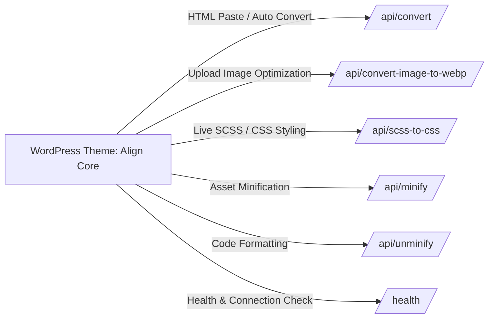

# Align Cloud & Converter API Reference

> [!NOTE]
> **Align Cloud API Service** (`https://convertb.alignvn.cloud`) là dịch vụ microservice backend độc lập viết bằng Node.js / Express, chịu trách nhiệm xử lý các tác vụ nặng như chuyển đổi HTML sang Block Gutenberg, nén/giải nén mã nguồn CSS/JS/SCSS, biên dịch SCSS và tối ưu nén ảnh WebP cho Theme **Align**.

---

## 1. Tổng Quan Kiến Trúc & Cấu Hình

### 1.1 Thông Tin Máy Chủ & Cấu Hình Mặc Định
- **Base Production URL:** `https://convertb.alignvn.cloud`
- **Tùy chọn cấu hình trong WP Admin:** `align_minify_api_url` (tại *Align Settings > Visual Builder & API*)
- **Content-Type:** `application/json` (cho tất cả các POST request)



---

## 2. Chi Tiết Danh Sách API Endpoints & Payload

### 2.1 Health Check (`/health`)
Kiểm tra trạng thái kết nối và khả năng hoạt động của dịch vụ API.

- **Method:** `GET`
- **URL:** `https://convertb.alignvn.cloud/health`
- **Headers:** None
- **Request Body:** None

#### Response thành công (`200 OK`):
```json
{
  "status": "ok",
  "timestamp": "2026-08-17T09:47:22.227Z"
}
```

---

### 2.2 Convert HTML sang Align Blocks (`/api/convert`)
Chuyển đổi chuỗi HTML thô (Raw HTML hoặc HTML copy từ Word) thành cấu trúc Align Custom Blocks (`align/element`) và mã Gutenberg Comment Markup chuẩn.

- **Method:** `POST`
- **URL:** `https://convertb.alignvn.cloud/api/convert`
- **Headers:** `Content-Type: application/json`

#### Request Payload:
```json
{
  "html": "<section class=\"hero\"><h1>Tiêu đề trang</h1><p>Mô tả chi tiết bài viết với <strong>chữ đậm</strong>.</p></section>",
  "wordMode": false
}
```

#### Tham số Request:
| Thuộc tính | Kiểu dữ liệu | Bắt buộc | Mô tả |
| :--- | :--- | :--- | :--- |
| `html` | `string` | **Có** | Đoạn mã HTML cần chuyển đổi sang Gutenberg blocks. |
| `wordMode` | `boolean` | Không | Đặt `true` để kích hoạt bộ lọc làm sạch rác định dạng đặc thù copy từ Microsoft Word. Mặc định `false`. |

#### Response thành công (`200 OK`):
```json
{
  "success": true,
  "data": {
    "originalLength": 105,
    "sanitizedLength": 105,
    "sanitized": "<section class=\"hero\"><h1>Tiêu đề trang</h1><p>Mô tả chi tiết bài viết với <strong>chữ đậm</strong>.</p></section>",
    "blocks": [
      {
        "name": "align/element",
        "attrs": {
          "dataEditId": "edit-abc12345",
          "tag": "section",
          "type": "container"
        },
        "htmlAttrs": {
          "class": "hero"
        },
        "children": [
          {
            "name": "align/element",
            "attrs": {
              "dataEditId": "edit-def67890",
              "tag": "h1",
              "content": "Tiêu đề trang",
              "type": "text"
            },
            "htmlAttrs": {},
            "children": []
          },
          {
            "name": "align/element",
            "attrs": {
              "dataEditId": "edit-ghi13579",
              "tag": "p",
              "type": "text"
            },
            "htmlAttrs": {},
            "children": [
              {
                "name": "align/element",
                "attrs": {
                  "dataEditId": "edit-jkl24680",
                  "tag": "span",
                  "content": "Mô tả chi tiết bài viết với ",
                  "type": "text"
                },
                "htmlAttrs": {},
                "children": []
              },
              {
                "name": "align/element",
                "attrs": {
                  "dataEditId": "edit-mno97531",
                  "tag": "strong",
                  "content": "chữ đậm",
                  "type": "text"
                },
                "htmlAttrs": {},
                "children": []
              }
            ]
          }
        ]
      }
    ],
    "markup": "<!-- wp:align/element {\"dataEditId\":\"edit-abc12345\",\"tag\":\"section\",\"type\":\"container\"} -->\n<!-- wp:align/element {\"dataEditId\":\"edit-def67890\",\"tag\":\"h1\",\"content\":\"Tiêu đề trang\",\"type\":\"text\"} /-->\n<!-- wp:align/element {\"dataEditId\":\"edit-ghi13579\",\"tag\":\"p\",\"type\":\"text\"} -->\n<!-- wp:align/element {\"dataEditId\":\"edit-jkl24680\",\"tag\":\"span\",\"content\":\"Mô tả chi tiết bài viết với \",\"type\":\"text\"} /-->\n<!-- wp:align/element {\"dataEditId\":\"edit-mno97531\",\"tag\":\"strong\",\"content\":\"chữ đậm\",\"type\":\"text\"} /-->\n<!-- /wp:align/element -->\n<!-- /wp:align/element -->",
    "validation": {
      "valid": true,
      "errors": []
    }
  }
}
```

---

### 2.2.1 Tự chuyển HTML khi dán trong Gutenberg

- **Phạm vi:** Visual editor của Post, Page, Template và Template Part, gồm canvas iframe. Theo yêu cầu cập nhật, Align blocks được phép dùng trong Blog Post; không còn filter riêng loại bỏ `align/*` ở Post.
- **Luồng:** Clipboard HTML hoặc mã HTML trong `text/plain` → `POST /wp-json/align/v1/convert-pasted-html` → `Align_Block_Converter::convert()` → API `/api/convert` theo URL đã cấu hình → `wp.blocks.parse()` → chèn vào editor. Settings converter dùng chung service PHP này.
- **Quyền:** WordPress REST cookie nonce và quyền sửa đối tượng; template mới cần quyền tương ứng của post type. Không nhận URL converter từ clipboard/editor. Người dùng không có `unfiltered_html` được lọc HTML bằng WordPress KSES.
- **Hành vi:** Với paragraph/heading, chia tại vùng chọn và giữ nội dung hai phía. Với block phức tạp, chèn sau block hiện tại; vùng chọn nhiều block được thay thế khi không khóa. Văn bản thuần, clipboard Gutenberg đã serialize, title/inspector và code/HTML textarea giữ cách dán mặc định.
- **An toàn nội dung:** Mỗi lần chỉ chạy một conversion; kiểm tra block đích còn nguyên, quyền chèn và template lock trước khi chèn. API lỗi, output không hợp lệ hoặc vị trí đã thay đổi: thông báo lỗi, không tự chèn dữ liệu. Dùng Undo để hoàn tác; chỉ lưu bài khi người dùng chủ động Save.
- **Giới hạn:** 1 MB HTML/request, timeout API 20 giây. Không tự lưu bài hoặc template.
- **Mã nguồn:** `core/builder/gutenberg/editor-html-paste.js`, `class-align-editor-paste.php`, `core/includes/core/class-align-block-converter.php`.

---

### 2.3 Nén Mã Nguồn - Minify (`/api/minify`)
Tối ưu hóa và nén mã nguồn (CSS, JavaScript, SCSS hoặc SASS).

- **Method:** `POST`
- **URL:** `https://convertb.alignvn.cloud/api/minify`
- **Headers:** `Content-Type: application/json`

#### Request Payload:
```json
{
  "code": ".align-container { width: 100%; display: flex; justify-content: space-between; }",
  "type": "css"
}
```
*(Bạn cũng có thể truyền trực tiếp key `{ "css": "..." }`, `{ "js": "..." }`, hoặc `{ "scss": "..." }` thay vì truyền `type`).*

#### Tham số Request:
| Thuộc tính | Kiểu dữ liệu | Bắt buộc | Mô tả |
| :--- | :--- | :--- | :--- |
| `code` | `string` | **Có** | Đoạn mã cần nén (hoặc truyền alias: `css`, `js`, `scss`, `sass`). |
| `type` | `string` | Không | Loại mã nguồn: `css`, `js`, `scss`, `sass` (Mặc định: `css`). |
| `options` | `object` | Không | Cấu hình nâng cao cho CleanCSS / Terser. |

#### Response thành công (`200 OK`):
```json
{
  "success": true,
  "code": ".align-container{width:100%;display:flex;justify-content:space-between}",
  "css": ".align-container{width:100%;display:flex;justify-content:space-between}",
  "result": ".align-container{width:100%;display:flex;justify-content:space-between}",
  "output": ".align-container{width:100%;display:flex;justify-content:space-between}",
  "data": {
    "type": "css",
    "originalLength": 76,
    "minifiedLength": 64,
    "code": ".align-container{width:100%;display:flex;justify-content:space-between}",
    "css": ".align-container{width:100%;display:flex;justify-content:space-between}",
    "result": ".align-container{width:100%;display:flex;justify-content:space-between}",
    "output": ".align-container{width:100%;display:flex;justify-content:space-between}",
    "stats": {
      "efficiency": 0.1578947368421053,
      "minifiedSize": 64,
      "originalSize": 76,
      "timeSpent": 5
    }
  }
}
```

---

### 2.4 Format / Beautify Mã Nguồn - Unminify (`/api/unminify`)
Định dạng lại mã nguồn (CSS, JS, SCSS, SASS) thành dạng thụt dòng chuẩn, dễ đọc cho lập trình viên.

- **Method:** `POST`
- **URL:** `https://convertb.alignvn.cloud/api/unminify`
- **Headers:** `Content-Type: application/json`

#### Request Payload:
```json
{
  "code": ".align-container{width:100%;display:flex;justify-content:space-between}",
  "type": "css"
}
```

#### Response thành công (`200 OK`):
```json
{
  "success": true,
  "code": ".align-container {\n  width: 100%;\n  display: flex;\n  justify-content: space-between;\n}",
  "css": ".align-container {\n  width: 100%;\n  display: flex;\n  justify-content: space-between;\n}",
  "result": ".align-container {\n  width: 100%;\n  display: flex;\n  justify-content: space-between;\n}",
  "output": ".align-container {\n  width: 100%;\n  display: flex;\n  justify-content: space-between;\n}",
  "data": {
    "type": "css",
    "originalLength": 64,
    "unminifiedLength": 82,
    "code": ".align-container {\n  width: 100%;\n  display: flex;\n  justify-content: space-between;\n}",
    "css": ".align-container {\n  width: 100%;\n  display: flex;\n  justify-content: space-between;\n}",
    "result": ".align-container {\n  width: 100%;\n  display: flex;\n  justify-content: space-between;\n}",
    "output": ".align-container {\n  width: 100%;\n  display: flex;\n  justify-content: space-between;\n}"
  }
}
```

---

### 2.5 Biên Dịch SCSS sang CSS (`/api/scss-to-css` & `/api/sass-to-css`)
Biên dịch cú pháp SCSS/SASS sang CSS tiêu chuẩn, hỗ trợ tự động nén (auto-minify) và trả về song song cả CSS nén lẫn CSS thô (raw CSS).

- **Method:** `POST`
- **URL:** `https://convertb.alignvn.cloud/api/scss-to-css` *(Alias: `/api/sass-to-css`)*
- **Headers:** `Content-Type: application/json`

#### Request Payload:
```json
{
  "code": "$primary-color: #0073aa; .card { padding: 20px; .title { color: $primary-color; font-weight: bold; } }",
  "minify": true
}
```

#### Tham số Request:
| Thuộc tính | Kiểu dữ liệu | Bắt buộc | Mô tả |
| :--- | :--- | :--- | :--- |
| `code` | `string` | **Có** | Đoạn mã SCSS/SASS cần biên dịch (hoặc dùng key `scss`, `sass`). |
| `minify` | `boolean` | Không | `true` để nén CSS đầu ra (Mặc định: `true`). |
| `options` | `object` | Không | Cấu hình tùy chọn cho Dart Sass compiler. |

#### Response thành công (`200 OK`):
```json
{
  "success": true,
  "code": ".card{padding:20px}.card .title{color:#0073aa;font-weight:bold}",
  "css": ".card{padding:20px}.card .title{color:#0073aa;font-weight:bold}",
  "result": ".card{padding:20px}.card .title{color:#0073aa;font-weight:bold}",
  "output": ".card{padding:20px}.card .title{color:#0073aa;font-weight:bold}",
  "rawCss": ".card {\n  padding: 20px;\n}\n.card .title {\n  color: #0073aa;\n  font-weight: bold;\n}",
  "data": {
    "code": ".card{padding:20px}.card .title{color:#0073aa;font-weight:bold}",
    "css": ".card{padding:20px}.card .title{color:#0073aa;font-weight:bold}",
    "result": ".card{padding:20px}.card .title{color:#0073aa;font-weight:bold}",
    "output": ".card{padding:20px}.card .title{color:#0073aa;font-weight:bold}",
    "rawCss": ".card {\n  padding: 20px;\n}\n.card .title {\n  color: #0073aa;\n  font-weight: bold;\n}",
    "type": "css",
    "stats": {
      "efficiency": 0.31,
      "minifiedSize": 58,
      "originalSize": 84,
      "timeSpent": 4
    }
  }
}
```

---

### 2.6 Chuyển Đổi & Nén Ảnh Sang WebP (`/api/convert-image-to-webp` & `/api/convert-image`)
Nhận dữ liệu hình ảnh (chuỗi Base64 hoặc Data URI `data:image/...;base64,...`) và nén sang định dạng WebP hiện đại với mức chất lượng tùy chỉnh.

- **Method:** `POST`
- **URL:** `https://convertb.alignvn.cloud/api/convert-image-to-webp` *(Alias: `/api/convert-image`)*
- **Headers:** `Content-Type: application/json`

#### Request Payload:
```json
{
  "image": "data:image/png;base64,iVBORw0KGgoAAAANSUhEUgAAAAEAAAABCAYAAAAfFcSJAAAADUlEQVR42mNk+M9QDwADhgGAWjR9awAAAABJRU5ErkJggg==",
  "quality": 80,
  "width": 800,
  "height": 600,
  "lossless": false,
  "effort": 4
}
```

#### Tham số Request:
| Thuộc tính | Kiểu dữ liệu | Bắt buộc | Mô tả |
| :--- | :--- | :--- | :--- |
| `image` | `string` | **Có** | Chuỗi Base64 hoặc Data URI của ảnh nguồn (PNG, JPG, JPEG, GIF, TIFF). |
| `quality` | `number` | Không | Mức chất lượng nén từ `1` đến `100` (Mặc định: `80`). |
| `width` | `number` | Không | Chiều rộng resize ảnh (pixel). Bỏ trống nếu muốn giữ nguyên. |
| `height` | `number` | Không | Chiều cao resize ảnh (pixel). Bỏ trống nếu muốn giữ nguyên. |
| `lossless` | `boolean` | Không | Nén không mất dữ liệu (lossless). Mặc định: `false`. |
| `effort` | `number` | Không | Mức độ nỗ lực nén CPU (`0` đến `6`). Mặc định: `4`. |

#### Response thành công (`200 OK`):
```json
{
  "success": true,
  "data": "data:image/webp;base64,UklGRloAAABXRUJQVlA4WAoAAAAQAAAAAAAAAAAAQUxQSAIAAAAAf1ZQOCAyAAAA0AEAnQEqAQABAAFAJiWgAnS6AfgAA7AA/ukiH/vPn7nz9z5/0Z//lP3yOP5HH/ygQAA=",
  "base64": "UklGRloAAABXRUJQVlA4WAoAAAAQAAAAAAAAAAAAQUxQSAIAAAAAf1ZQOCAyAAAA0AEAnQEqAQABAAFAJiWgAnS6AfgAA7AA/ukiH/vPn7nz9z5/0Z//lP3yOP5HH/ygQAA=",
  "format": "webp",
  "info": {
    "originalFormat": "png",
    "width": 1,
    "height": 1,
    "originalSize": 70,
    "compressedSize": 98,
    "savingsBytes": -28,
    "savingsPercentage": "-40.00%",
    "quality": 80
  }
}
```

---

## 3. Cách Tích Hợp Trong Mã Nguồn Align Theme (PHP Examples)

### 3.1 Gọi API Chuyển Đổi HTML trong WordPress / PHP
*Ví dụ tích hợp PHP trong Theme:*

```php
<?php
/**
 * Convert HTML to Align Blocks via Cloud API
 *
 * @param string $html Raw HTML content.
 * @return array|WP_Error
 */
function align_cloud_convert_html( $html ) {
    $api_domain = get_option( 'align_minify_api_url', 'https://convertb.alignvn.cloud' );
    $clean_url  = preg_replace( '#/api/(convert|minify|unminify|scss2css|scss-to-css|sass-to-css)$#i', '', rtrim( trim( $api_domain ), '/' ) );
    $endpoint   = $clean_url . '/api/convert';

    $response = wp_remote_post( $endpoint, array(
        'headers' => array( 'Content-Type' => 'application/json' ),
        'body'    => wp_json_encode( array(
            'html'     => $html,
            'wordMode' => false,
        ) ),
        'timeout' => 15,
    ) );

    if ( is_wp_error( $response ) ) {
        return $response;
    }

    $body = json_decode( wp_remote_retrieve_body( $response ), true );
    return $body;
}
```

---

### 3.2 Tối Ưu Ảnh Sang WebP
*File tham chiếu: `core/includes/core/class-align-webp.php`*

```php
<?php
/**
 * Convert image Base64 to WebP via Cloud API
 *
 * @param string $image_base64 Base64 string of the image.
 * @param int    $quality      WebP compression quality (1-100).
 * @return string|false WebP base64 data on success, false on failure.
 */
function align_cloud_convert_image_webp( $image_base64, $quality = 80 ) {
    $api_domain = get_option( 'align_minify_api_url', 'https://convertb.alignvn.cloud' );
    $clean_url  = preg_replace( '#/api/(convert-image-to-webp|convert|minify|unminify|scss2css|scss-to-css|sass-to-css)$#i', '', rtrim( trim( $api_domain ), '/' ) );
    $endpoint   = $clean_url . '/api/convert-image-to-webp';

    $response = wp_remote_post( $endpoint, array(
        'headers' => array( 'Content-Type' => 'application/json' ),
        'body'    => wp_json_encode( array(
            'image'   => $image_base64,
            'quality' => (int) $quality,
        ) ),
        'timeout' => 30,
    ) );

    if ( is_wp_error( $response ) || 200 !== wp_remote_retrieve_response_code( $response ) ) {
        return false;
    }

    $result = json_decode( wp_remote_retrieve_body( $response ), true );
    return ( ! empty( $result['success'] ) && ! empty( $result['data'] ) ) ? $result['data'] : false;
}
```

---

### 3.3 Nén / Biên Dịch SCSS Trực Tiếp
```php
<?php
/**
 * Compile SCSS to Minified CSS via Cloud API
 *
 * @param string $scss_code SCSS source code.
 * @return string|false Compiled CSS on success.
 */
function align_cloud_compile_scss( $scss_code ) {
    $api_domain = get_option( 'align_minify_api_url', 'https://convertb.alignvn.cloud' );
    $clean_url  = preg_replace( '#/api/(convert|minify|unminify|scss2css|scss-to-css|sass-to-css)$#i', '', rtrim( trim( $api_domain ), '/' ) );
    $endpoint   = $clean_url . '/api/scss-to-css';

    $response = wp_remote_post( $endpoint, array(
        'headers' => array( 'Content-Type' => 'application/json' ),
        'body'    => wp_json_encode( array(
            'code'   => $scss_code,
            'minify' => true,
        ) ),
        'timeout' => 15,
    ) );

    if ( is_wp_error( $response ) || 200 !== wp_remote_retrieve_response_code( $response ) ) {
        return false;
    }

    $result = json_decode( wp_remote_retrieve_body( $response ), true );
    return ! empty( $result['code'] ) ? $result['code'] : false;
}
```

---

### 3.4 Nén Asset CSS/JS trong Builder Backend qua Minify API
*File tham chiếu: `core/inc/builder/class-builder-minifier.php`*

```php
<?php
/**
 * Minify CSS/JS via Cloud API with 2-Tier Caching & Local Fallback
 *
 * @param string $code Raw CSS or JS source code.
 * @param string $type Asset type ('css' or 'js').
 * @return string Minified code.
 */
function align_builder_minify_asset( $code, $type = 'css' ) {
    return Align_Builder_Minifier::minify_css( $code ); // or minify_js()
}
```

#### Các cơ chế bảo vệ tích hợp:
1. **Heuristic Bypass**: Tự động phát hiện code đã minified sẵn để bỏ qua request.
2. **Two-Tier Cache**: Memory Cache trong request + WordPress Transient Cache 12 giờ theo MD5 hash (`align_min_{md5}`).
3. **Non-blocking Local Fallback**: Timeout 3 giây, tự động fallback sang PHP Local Tokenizer nếu Cloud API không phản hồi.
