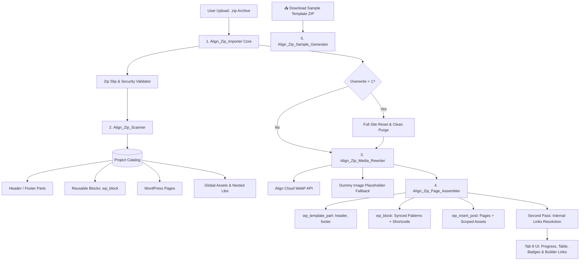

# 📦 Hướng Dẫn Kỹ Thuật: HTML Project ZIP Importer Engine

> [!NOTE]
> **HTML Project ZIP Importer** (`core/includes/admin/importer/` & `tab-import-zip.php`) là hệ thống tự động hóa toàn diện giúp chuyển đổi các project giao diện HTML tĩnh thuần túy (HTML, CSS, JS, Media) thành các trang WordPress, Template Parts và Reusable Blocks (`wp_block`) hoàn chỉnh trong hệ sinh thái Gutenberg FSE của Theme Align.

---

## 🗺️ 1. Kiến Trúc & Sơ Đồ Khối Module

Toàn bộ hệ sinh thái ZIP Importer được module hóa theo nguyên tắc Single Responsibility Principle (SRP), duy trì mọi file nguồn < 500 dòng:



### Danh Sách Module & File Mã Nguồn:
1. [**`class-align-zip-importer.php`**](../../core/includes/admin/importer/class-align-zip-importer.php): Điều phối toàn bộ luồng import, AJAX endpoints, bảo mật Zip Slip và Factory Reset.
2. [**`class-align-zip-scanner.php`**](../../core/includes/admin/importer/class-align-zip-scanner.php): Quét cấu trúc đệ quy, nhận diện Template Parts, Reusable Blocks, Pages, CDN links và nested assets (`lib/`, `mail/`, `vendor/`).
3. [**`class-align-zip-media-rewriter.php`**](../../core/includes/admin/importer/class-align-zip-media-rewriter.php): Sideload hình ảnh vào Media Library, convert WebP Cloud API, rewrite `src`/`srcset`/`url(...)`, chèn dummy placeholder cho ảnh thiếu và ánh xạ internal links.
4. [**`class-align-zip-media-index.php`**](../../core/includes/admin/importer/class-align-zip-media-index.php): Chỉ mục media theo đường dẫn tương đối (`rel_path`), O(1) resolve, rewrite toàn diện `srcset`/`data-*`/`url()` và quản trị an toàn Reading Settings (`apply_front_page`).
5. [**`class-align-zip-page-assembler.php`**](../../core/includes/admin/importer/class-align-zip-page-assembler.php): Đóng gói HTML vào block `<!-- wp:align/custom-html -->`, tạo post `page`/`wp_block`/`wp_template_part`, lưu scoped CSS/JS và đăng ký dynamic assets.
6. [**`class-align-zip-page-tree.php`**](../../core/includes/admin/importer/class-align-zip-page-tree.php): Quét đệ quy cây trang phân cấp cha/con (`max_depth = 5`), sinh placeholder draft trang cha, phân loại post/page trong thư mục blog.
7. [**`class-align-zip-post-assembler.php`**](../../core/includes/admin/importer/class-align-zip-post-assembler.php): Đóng gói bài viết blog WordPress (`post_type = 'post'`), khóa mode Align Builder, bóc tách tiêu đề/ngày đăng, chống đụng độ slug page/post.
8. [**`class-align-zip-lang-resolver.php`**](../../core/includes/admin/importer/class-align-zip-lang-resolver.php): Nhận diện thư mục ngôn ngữ cấp gốc, whitelist `KNOWN_LANGS`, tự động thêm ngôn ngữ, lắp ráp Root Lang Page và clone template parts đa ngôn ngữ.
9. [**`class-align-zip-link-resolver.php`**](../../core/includes/admin/importer/class-align-zip-link-resolver.php): Phân giải liên kết nội bộ theo bản đồ 2 tầng cô lập theo ngôn ngữ (`link_map[lang][key]`), hỗ trợ alias, ngăn chặn tuyệt đối nhảy link chéo ngôn ngữ.
10. [**`class-align-zip-pairing.php`**](../../core/includes/admin/importer/class-align-zip-pairing.php): Ghép cặp nhóm bản dịch song ngữ O(N) bộ nhớ qua DOMDocument hero image matcher, manifest tùy chọn và alias dựng sẵn.
11. [**`class-align-zip-sample-generator.php`**](../../core/includes/admin/importer/class-align-zip-sample-generator.php): Tự động tạo và stream file ZIP mẫu chuẩn `align-sample-template.zip` trực tiếp cho lập trình viên.
12. [**`tab-import-zip.php`**](../../core/includes/admin/views/tab-import-zip.php): Giao diện quản trị Tab 8, Live Progress Bar, Terminal logs, nút Download Sample và bảng kết quả trực quan.

---

## 📁 2. Cấu Trúc Thư Mục ZIP Chuẩn (Standard Folder Hierarchy)

Hệ thống hỗ trợ cấu trúc thư mục phân cấp rõ ràng, đồng thời tự động thích ứng thông minh với các project HTML phẳng hoặc lồng nhau:

```text
my-project.zip
├── 📁 assets/                    (CSS, JS, Fonts, Images dùng chung toàn site)
│   ├── 🎨 css/style.css
│   ├── ⚡ js/main.js
│   └── 🖼️ img/logo.png
│
├── 📁 header/                    (🔷 Global Header Part -> parts/header.html)
│   ├── 📄 index.html             (Mã HTML thanh menu, logo, CTA header)
│   └── 🎨 style.css              (Scoped CSS riêng cho Header)
│
├── 📁 footer/                    (🔷 Global Footer Part -> parts/footer.html)
│   ├── 📄 index.html             (Mã HTML chân trang, copyright, links)
│   └── 🎨 style.css              (Scoped CSS riêng cho Footer)
│
├── 📁 reuse-blocks/              (🧱 Reusable Blocks / Gutenberg Synced Patterns)
│   ├── 📁 cta-banner/            (-> Sinh shortcode: [reuse-block id="..."])
│   │   ├── 📄 index.html
│   │   ├── 🎨 style.css
│   │   └── ⚡ script.js
│   └── 📁 pricing-table/
│       ├── 📄 index.html
│       └── 🎨 style.css
│
├── 📁 home/                      (📄 WordPress Page -> /)
│   ├── 📄 index.html
│   ├── 🎨 style.css              (Scoped CSS cho trang chủ)
│   └── 🖼️ banner.jpg             (Ảnh riêng của trang -> tự động sideload)
│
├── 📁 about-us/                  (📄 WordPress Page -> /about-us/)
│   ├── 📄 index.html
│   └── 🎨 style.css
│
└── 📁 contact/                   (📄 WordPress Page -> /contact/)
    ├── 📄 index.html
    └── 🎨 style.css
```

> [!TIP]
> **Các Tên Thư Mục Được Hỗ Trợ Nhận Diện Tự Động**:
> - **Header Parts**: `header/`, `headers/`, `template-header/`, hoặc file `header.html`.
> - **Footer Parts**: `footer/`, `footers/`, `template-footer/`, hoặc file `footer.html`.
> - **Reusable Blocks**: `reuse-blocks/`, `reuse-block/`, `reusable-blocks/`, `blocks/`, `patterns/`, `sections/`, `components/`, hoặc file tiền tố `block-*.html`, `reuse-*.html`.
> - **Pages**: Bất kỳ thư mục nào chứa file `index.html` (trừ các thư mục assets/lib).
>
> 📖 *Xem tài liệu đặc tả chi tiết toàn diện tại [**`template-zip-rules.md`**](./template-zip-rules.md).*

---

## ⚡ 3. Các Tính Năng Nổi Bật

### 3.1 Tự Động Phân Tách Reusable Blocks (`wp_block`) & Sinh Shortcode
- Khi phát hiện các khối trong thư mục `reuse-blocks/`, hệ thống không tạo thành các trang page đơn lẻ mà tạo post chuẩn `wp_block` (Synced Pattern).
- Tự động tạo và lưu trữ scoped CSS/JS tĩnh tại `assets/builder/style-block-{slug}.css` và `script-block-{slug}.js`.
- Sinh mã shortcode: `[reuse-block id="{post_id}"]` để dev có thể nhúng linh hoạt vào bất kỳ trang nào.
- Trên giao diện kết quả, hiển thị badge tím 🟣 **Reusable Block**, mã shortcode sao chép 1 chạm và nút dẫn thẳng vào Visual Builder (`admin.php?page=align-builder&post_id={post_id}`).

### 3.2 Tự Động Phân Tách Global Header & Footer
- Tự động nhận diện thư mục `header/` và `footer/` và xuất trực tiếp vào các file Gutenberg Block Theme Template Parts:
  - `wp-content/themes/align-child/parts/header.html`
  - `wp-content/themes/align-child/parts/footer.html`
- Cho phép chỉnh sửa trực tiếp trong WordPress Site Editor (FSE) hoặc thông qua Custom HTML blocks.

### 3.3 Sideload Media & Dự Phòng Dummy Image Placeholder
- **Tự động chuyển WebP**: Toàn bộ ảnh JPG, PNG, GIF được đưa lên Cloud API để chuyển đổi sang WebP chuẩn với fallback an toàn.
- **Dummy Image Placeholder Fallback**: Nếu mã HTML/CSS chứa thẻ ``, `<source>`, `background-image` trỏ tới các đường dẫn media không tồn tại trong ZIP, hệ thống tự động thay thế bằng dummy placeholder SVG/PNG chất lượng cao, giữ nguyên kích thước để tránh vỡ layout.
- **Bảo Vệ Thẻ `<script>` Tuyệt Đối**: Áp dụng bộ lọc đuôi file nghiêm ngặt (`.js`, `.mjs`, `.css`, `.json`, `.woff`...) để ngăn ngừa tình trạng các thẻ `<script src="...">` bị rewrite nhầm thành ảnh dummy.

### 3.4 Quét Nested Assets & Ưu Tiên Nạp jQuery Đồng Bộ
- **Nhận diện thư viện lồng sâu**: Quét sạch mọi thư mục lồng nhau như `lib/easing/`, `lib/owlcarousel/`, `mail/`, `vendor/` và nạp vào hệ thống asset.
- **Độ ưu tiên jQuery**: Khi phát hiện jQuery hoặc jQuery CDN, hệ thống tự động gán vị trí `header` và chiến lược tải `normal` (đồng bộ), ngăn chặn triệt để lỗi `Uncaught ReferenceError: jQuery is not defined`.

### 3.5 Tự Động Nhúng CDN & Project Không Đúng Chuẩn Vào Tab Load Asset
- Đối với các file ZIP không theo cấu trúc chuẩn hoặc chứa các link CDN bên ngoài (Font Awesome, Google Fonts, Bootstrap CDN, OwlCarousel CDN...), hệ thống tự động bóc tách và đăng ký vào bảng quản lý của tab **Load Asset**, đảm bảo giao diện hiển thị đúng 100%.

### 3.6 Cơ Chế Pre-Import Full Site Data Wipe
- Trước khi import dự án mới, tùy chọn **Fresh Re-create** mặc định được kích hoạt để dọn dẹp sạch toàn bộ dữ liệu trang cũ, post, reusable block, template part, media attachments và menu, mang lại một website hoàn toàn tinh sạch.

### 3.7 Nút Tải File ZIP Mẫu (Starter Template Generator)
- Tích hợp class `Align_Zip_Sample_Generator` cho phép lập trình viên tải ngay file `align-sample-template.zip` chỉ với 1 click để làm mẫu phát triển.

### 3.8 2-Stage Specialist AI Refactor Pipeline (OpenRouter Cloud API)
- **Stage 1 (Header/Footer Specialist)**: Tách riêng Global Header và Footer, lưu vào `header/` và `footer/`, tự động strip khỏi trang con.
- **Stage 2 (Dedicated Reusable Block Specialist)**: Nhận diện các khối section lặp lại (CTA, Pricing, Testimonials, FAQs...) từ thân trang thuần túy.
- **DOM Deterministic Content Overwrite Layer**: Tự động gán `data-allow-overwrite="true"` và `data-overwrite-id="ov-..."` trên các thẻ tiêu đề, đoạn văn, nút bấm, ảnh.
- **Token Hóa SVG Siêu Nhẹ**: Thay thế vector SVG bằng token `data-align-svg="align-svg-token-N"` trước khi gửi AI và khôi phục 100% vector nguyên bản sau khi parse.
- **Component Shortcode Chuẩn Align**: Bọc Reusable Block bằng `<div data-component-shortcode="" data-shortcode="[reuse-block slug='...']" data-preview-state="rendered">[reuse-block slug="..."]</div>` hỗ trợ nhận diện cả `slug` lẫn `id` số.

### 3.9 Cơ Chế Dual-Mode Import (Standard Fallback vs AI Semantic Refactor)
- **Mặc Định (AI Checkbox Un-checked)**: Nhận diện trực tiếp ZIP có cấu trúc chuẩn Align hoặc tự động làm phẳng (flatten) các file HTML tự do trong thư mục gốc mà không tốn token AI.
- **Kích Hoạt AI (AI Checkbox Checked)**: Tự động kết nối OpenRouter Cloud API (`https://openrouter.ai/api/v1/chat/completions`) để tái cấu trúc toàn diện các mẫu HTML thô/lộn xộn.

### 3.10 Chuẩn Hóa Vật Lý Ra Root & Thu Thập Media Đệ Quy Tuyệt Đối
- **Physical Directory Normalization (`normalize_directory_to_root`)**: Tự động bóc tách các lớp thư mục bọc ngoài (single top-level wrappers), quét các thư mục phân phối phổ biến (`dist/`, `site/`, `public/`, `html/`, `pages/`, `build/`) và di chuyển toàn bộ file HTML cùng assets trực tiếp ra thư mục gốc session trước khi quét catalog.
- **Recursive Media Discovery (`collect_all_media_files`)**: Quét đệ quy 100% các file ảnh/video (`png`, `jpg`, `jpeg`, `webp`, `svg`, `gif`, `ico`, `mp4`, `webm`, `avif`, `bmp`) trên toàn bộ cây thư mục đã giải nén để đảm bảo số lượng media sideload luôn chính xác và đầy đủ.

### 3.11 Phân Loại Asset Tuyệt Đối & Bảo Toàn Trạng Thái Kích Hoạt
- **Deterministic Asset Type Enforcement (`register_loaded_asset` & `sanitize_loaded_assets`)**:
  - **Font (`.woff2`, `.woff`, `.ttf`, `.otf`, `.eot`)**: 100% được gán `type = 'font'`, vị trí `header`, chiến lược `normal` để tự động kích hoạt **Font Preload TOP 1 (`wp_head`, priority 1)**.
  - **JS (`.js`, `/api/js`, `.js?`)**: 100% được gán `type = 'js'`, tự động gán `header` cho thư viện cốt lõi (`jquery`, `bootstrap`, `maps.googleapis.com`) và `footer` + `defer` cho các script khác.
  - **CSS (`.css`, `fonts.googleapis.com`)**: 100% được gán `type = 'css'`, vị trí `header`.
- **Bảo toàn trạng thái Enabled (`enabled = 1`)**: Mọi file asset import từ ZIP được tự động bật mặc định để hiển thị và thực thi ngay lập tức ngoài frontend và iframe canvas preview.

### 3.12 Cây Trang Phân Cấp Cha/Con (Page Hierarchy Engine & Link Resolution)
- **Tự động liên kết Page Cha/Con (`post_parent`)**:
  - Quét đệ quy cấu trúc thư mục lồng nhau (`max_depth = 5`) thông qua `Align_Zip_Page_Tree`.
  - Quy ước: `services/index.html` -> page cha `services`; `services/web-design/index.html` -> page con `web-design` (với `post_parent` trỏ tới ID của `services`).
  - Thư mục chứa nhiều file HTML trực tiếp (`services/web.html`, `services/seo.html`) sẽ tự động được nhận diện thành các page con của thư mục đó: URL `/services/web/`, `/services/seo/` (D-2).
- **Tự Động Sinh Placeholder Draft Cho Trang Cha Bị Thiếu (D-1)**:
  - Khi xuất hiện thư mục con lồng sâu (vd: `services/web-design/index.html` hoặc `products/item-a.html`) nhưng thiếu file `index.html` của trang cha, hệ thống tự động sinh trang cha placeholder ở trạng thái `draft` với nội dung rỗng và meta `_align_zip_placeholder = 1`.
  - Trang con vẫn xuất bản `publish` và truy cập bình thường qua permalink `/products/item-a/`. Trang cha draft trả về 404 cho khách truy cập cho đến khi người dùng vào biên tập và xuất bản.
- **Ánh Xạ Link Nội Bộ Đa Cấp (`Align_Zip_Media_Rewriter::rewrite_internal_links`)**:
  - Hỗ trợ giải quyết đường dẫn tương đối (`../`, `./`, relative URLs) dựa trên `path_key` và thư mục nguồn.
  - Tự động chuyển đổi các thẻ `<a href="web-design/">` hoặc `<a href="../about.html">` thành permalink chuẩn của WordPress và gắn kèm thuộc tính `data-align-link-id="{post_id}"`.
- **Breaking Change (Thay đổi hành vi so với bản cũ)**:
  - Các file HTML độc lập nằm trong thư mục con (vd: `services/web.html`) trước đây bị ép thành URL phẳng cấp gốc `/web/`. Kể từ phiên bản này, hệ thống bảo toàn cấu trúc phân cấp thành URL `/services/web/`.

### 3.13 Tự Động Nhận Diện Blog Posts (`post_type = 'post'`) & Align Builder (v2)
- **Nhận diện thư mục Blog cấp gốc (`BLOG_DIRS`)**:
  - Hỗ trợ các tên thư mục blog cấp gốc: `blog`, `blogs`, `posts`, `post`, `news`, `articles`, `tin-tuc`, `bai-viet`.
  - Thư mục cùng tên ở cấp sâu hơn (`services/news/`) vẫn được xử lý như Page phân cấp bình thường.
- **Quy tắc phân tách Post vs Page Blog (D-3, D-4)**:
  - `blog/index.html` → tạo duy nhất 1 Page `blog` tĩnh (HTML nguyên bản). Không thay đổi cấu hình `page_for_posts` và `show_on_front`. Thiếu `index.html` sẽ không sinh placeholder cho thư mục blog.
  - Mọi file `blog/*.html` hoặc `blog/sub-dir/index.html` → tạo bài viết WordPress chuẩn (`post_type = 'post'`), trạng thái `publish`, `post_parent = 0`.
  - Tự động bóc tách tiêu đề (`<h1>` đầu tiên hoặc `<title>`) và ngày đăng (`article:published_time` hoặc thẻ `<time datetime>`).
- **Tích hợp Align Builder (D-3)**:
  - Bài viết được đóng gói trực tiếp vào Gutenberg block `<!-- wp:align/custom-html -->` với scoped CSS/JS độc lập (`style-post-{slug}.css`, `script-post-{slug}.js`).
  - Khóa chế độ editor cho bài viết sang Align Builder: `Align_Editor_Mode_Lock::set_mode_and_lock( $post_id, 'builder', true )`.
- **Chống đụng độ Slug với Page (`/%postname%/`) (REQ-14)**:
  - Do cấu trúc permalink mặc định là `/%postname%/`, nếu bài viết blog có slug trùng với một page đã có sẵn (vd: `blog/contact.html` vs `contact.html`), hệ thống tự động gắn hậu tố `-post` (vd: `contact-post`) để đảm bảo không xung đột routing URL.

### 3.14 Hỗ Trợ Đa Ngôn Ngữ Chuẩn Align (Multilingual Architecture v3)
- **Nhận diện thư mục ngôn ngữ cấp gốc (`Align_Zip_Lang_Resolver`)**:
  - Hỗ trợ các thư mục ngôn ngữ cấp gốc khớp với mã/slug trong `align_languages` hoặc danh sách whitelist `KNOWN_LANGS` (vd: `vi`, `zh`, `ja`, `fr`...).
  - Thư mục trùng mã ngôn ngữ mặc định (vd: `en/` khi default là `en`) sẽ được unwrap ra cấp gốc (REQ-20).
- **Tự động thêm ngôn ngữ (D-5 = A)**:
  - Nếu thư mục ngôn ngữ chưa có trong cài đặt Align, hệ thống tự động đăng ký qua `Align_Language_Manager::add_language()`.
  - Tự động liên kết và sửa chữa Root Lang Page (`ensure_root_lang_page`) với đầy đủ meta `_align_lang_root`, `_align_lang`, `_align_hide_from_nav = 1`.
  - Giữ nguyên `vi` làm ngôn ngữ phụ ngay cả khi ZIP chỉ có thư mục `vi/` (D-6 = A).
- **Cấu trúc phân cấp và nội dung trong thư mục ngôn ngữ**:
  - `<lang>/index.html` → Cập nhật trực tiếp nội dung vào Root Lang Page của ngôn ngữ đó, khóa chế độ Builder.
  - `<lang>/services/index.html` → Tạo page `services` có `post_parent` là Root Lang Page, gán `_align_lang = <lang>`.
  - `<lang>/blog/*.html` → Tạo bài viết `post`, gán `_align_lang = <lang>`, tự động phân giải slug trùng thành `<slug>-<lang>`.
  - `<lang>/header/`, `<lang>/footer/` → Tạo template part tương ứng `header-<lang>`, `footer-<lang>`.
  - Bỏ qua reusable blocks theo ngôn ngữ (`<lang>/blocks/`) và ghi log cảnh báo.
- **Ghép nhóm bản dịch (Translation Groups) & Flush Rewrite**:
  - Tự động ghép nối thực thể giữa ngôn ngữ mặc định và phụ theo khoá tương đối chuẩn hoá qua `_align_lang_group` và `_align_lang_parent`.
  - Tự động kích hoạt `flush_rewrite_rules( false )` một lần duy nhất tại bước `finalize_session` khi phát hiện ngôn ngữ mới hoặc bài viết ngôn ngữ phụ.
  - Link nội bộ trong thực thể ngôn ngữ phụ tự động ánh xạ đúng tiền tố `/<lang>/...`.

### 3.15 Khắc Phục Liên Kết Đa Ngôn Ngữ, Ghép Cặp Bài Viết & Toàn Vẹn Template Parts (v4)
- **Bản đồ liên kết 2 tầng độc lập (`Align_Zip_Link_Resolver`)**:
  - Quản lý `link_map[lang][key] = post_id`. Tuyệt đối cô lập ngữ cảnh ngôn ngữ, ngăn chặn việc link `/about` trong trang tiếng Anh bị fallback nhảy sang ID trang tiếng Việt.
- **Chuẩn hóa Root Page Tiếng Việt & Nhóm Trang Chủ**:
  - Gán tiêu đề `post_title = "Home"` cho trang Root tiếng Việt (loại bỏ chữ "Vietnamese Root").
  - Chuẩn hóa khóa trang chủ (`home`, `front-page`, `index`, `is_home`) về khóa rỗng `''` để ghép chung `_align_lang_group` với Home mặc định.
- **Bảo toàn bài viết đa ngôn ngữ không bị xóa đè**:
  - Tìm kiếm bài viết trùng slug và xử lý `overwrite` trong phạm vi cùng một ngôn ngữ (`_align_lang`). Slug bài viết trùng với ngôn ngữ khác được gắn hậu tố `-<lang>` (vd: `what-is-mascot-vi`), đảm bảo bảo toàn 100% bài viết của cả hai ngôn ngữ.
- **Thuật toán ghép cặp bài viết song ngữ qua DOMDocument Hero Image Matcher (`Align_Zip_Pairing`)**:
  - Tự động bóc tách slug tiếng Anh từ đường dẫn ảnh hero banner của bài viết tiếng Việt (`/assets/img/blog/<slug>/hero...`), ghép nối 1:1 chính xác giữa bài viết tiếng Anh và tiếng Việt vào cùng một `_align_lang_group`.
  - Hỗ trợ ghép cặp trang qua danh sách alias dựng sẵn (vd: `about` ↔ `about-us`) và manifest tùy chọn `align-translations.json`.
- **Tự động clone và đồng bộ Template Parts ngôn ngữ phụ**:
  - Tự động nhân bản `header-<lang>.html` và `footer-<lang>.html` từ bản gốc nếu ZIP chưa có, sau đó chạy qua rewrite media và rewrite link nội bộ với các ID của ngôn ngữ phụ.
- **Mở rộng Core Đa Ngôn Ngữ**:
  - Tự động phát hiện và gán `<html lang="vi">` khi truy cập URL ngôn ngữ phụ.
  - Thống nhất duy nhất 1 bộ in thẻ SEO Hreflang tại `Align_Hreflang`, gỡ bỏ bộ in trùng lặp trong `Align_Language_URL_Localizer`, hỗ trợ fallback chuẩn BCP 47.
  - Bổ sung module `Align_Page_Language_Admin` thêm cột Languages và tab lọc ngôn ngữ trên màn hình `edit.php?post_type=page`.
  - Xuất chính xác `og:locale = vi_VN` cho tiếng Việt.

### 3.16 Toàn Vẹn Tệp Tin Media & Quản Trị Cài Đặt Reading (v5)
- **Định danh Media bằng đường dẫn tương đối (`rel_path`) & Chống ghi đè trùng tên (`Align_Zip_Media_Index`)**:
  - Khóa media theo đường dẫn tương đối trong ZIP (`assets/img/cases/alkf/02.webp`) và lưu vết qua meta `_align_zip_rel`.
  - Xóa bỏ triệt để hàm xóa attachment theo tên file không đuôi (`delete_existing_attachment_by_name`), cho phép các tệp trùng tên ở các thư mục khác nhau và các tệp cùng tên khác phần mở rộng (như `.svg` và `.webp`) cùng tồn tại độc lập.
  - Tối ưu hóa tra cứu media đạt độ phức tạp O(1) qua bảng băm trực tiếp `url_mapping` và `unique_basenames`.
- **Bao phủ toàn diện thuộc tính Media Rewrite**:
  - Tự động bóc tách và viết lại từng ứng viên trong `srcset`, `data-srcset`, `imagesrcset`, giữ nguyên descriptor độ phân giải (`480w`, `720w`, `2x`) và loại bỏ chuỗi query `?v=`.
  - Nhận diện và viết lại các thuộc tính media tùy biến dạng `data-*` (như `data-cursor-img`).
  - Nâng cấp regex `url()` trong inline/scoped CSS hỗ trợ cả 3 dạng cú pháp: không nháy, nháy đơn, nháy kép.
  - Tự động rewrite media cho các template parts ngôn ngữ phụ được nhân bản trước khi rewrite link.
- **Quản trị an toàn Cài Đặt Reading (`apply_front_page`)**:
  - Gỡ bỏ hoàn toàn việc gán `page_on_front` rải rác trong `assemble_page()`.
  - Xử lý tập trung duy nhất một lần tại `finalize_session()`:
    - Khi `overwrite = true`: Đặt `show_on_front = 'page'` và `page_on_front` trỏ tới ID trang Home.
    - Khi `overwrite = false`: Giữ nguyên trang chủ đang xuất bản của người dùng (`status = kept`).
    - Khi ZIP chỉ có thư mục con (như `vi/`): Không tự nhận nhầm trang con thành home gốc (`status = none`).

---

## 🔒 4. Tiêu Chuẩn Kỹ Thuật & Bảo Mật

1. **Bảo Mật Zip Slip**: Kiểm tra 100% tên file trong archive, từ chối ngay lập tức nếu phát hiện ký tự path traversal `../` hoặc `..\`.
2. **Chặn Executable Files**: Tự động từ chối và hủy upload nếu archive chứa file thực thi nguy hiểm (`.php`, `.phtml`, `.phar`, `.exe`, `.sh`, `.cgi`, `.py`, `.htaccess`).
3. **Dọn Rác macOS Resource Forks**: Tự động quét sạch `__MACOSX`, `._*`, `.DS_Store` ngay sau giải nén để ngăn chặn duplicate pages.
4. **Deterministic Memory Cleanup**: Xóa sạch thư mục tạm sau khi import hoàn tất; tự động flush theme.json cache (`wp_clean_theme_json_cache()`).
5. **Chuẩn Mã Nguồn**: 100% tuân thủ [**`AGENTS.md`**](../../AGENTS.md) (< 500 dòng/file, log tiếng Anh có cấu trúc, SRP).
