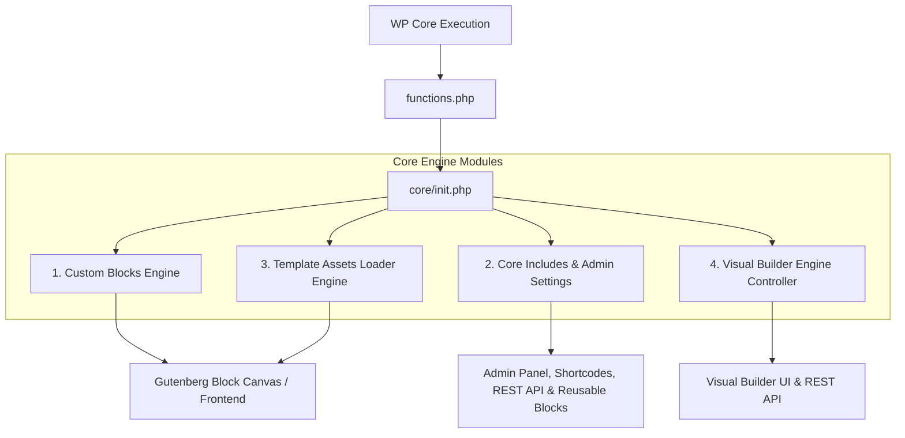
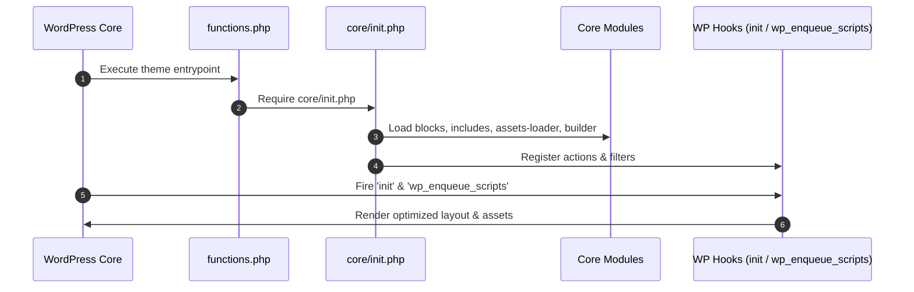

# Tổng Quan Kiến Trúc Theme Align (Align Theme Architecture)

> [!NOTE]
> **Align Theme** là một WordPress Hybrid / Block Theme thế hệ mới được thiết kế theo tư duy kiến trúc module hóa cao, tập trung vào hiệu năng tối đa (PageSpeed 95+), trải nghiệm lập trình linh hoạt (Developer Experience), và khả năng mở rộng với Visual Builder.

---

## 1. Tổng Quan Hệ Thống

Theme Align được thiết kế để tách biệt hoàn toàn giữa logic xử lý giao diện tĩnh, các khối Gutenberg động, và hệ thống Visual Builder. Toàn bộ nhân xử lý nằm trong thư mục `core/`, được khởi tạo thông qua `functions.php` -> `core/init.php`.



---

## 2. Các Module Lõi Hàng Đầu (Core Architecture Modules)

Theme Align bao gồm các khối kiến trúc độc lập chuyên biệt:

| Module | Thư Mục Chính | Vai Trò & Chức Năng |
| :--- | :--- | :--- |
| **1. Custom Blocks Engine** | `core/blocks/` | Quản lý đăng ký các Gutenberg Custom Blocks (`align/custom-html`, `align/query-builder`, `align/media`, `align/element`, `align/live-search`), inspector panel controls, và render callbacks. |
| **2. Visual Builder & Asset Engine** | `core/inc/` & `core/builder/` | Bộ nạp tài nguyên thông minh `TemplateAssetsLoader` kết hợp `Align_Builder` controller phục vụ kéo thả live canvas và đồng bộ REST API. |
| **3. Admin Settings & Performance Engine** | `core/includes/` | Trung tâm quản lý Admin (`Align_Admin_Settings`), Quản trị Tài nguyên Tùy biến (`Align_Admin_Assets`), WebP Image Engine, Source Code Minify, Custom Image Sizes (Auto-Slug Engine), Breakpoints Manager, Reusable Blocks (`Align_Reusable_Block` cho `wp_block`) và Dev Tools. |
| **4. Align Cloud Microservice API** | `docs/api/align-cloud-api-reference.md` | Dịch vụ backend API chuyển đổi Gutenberg blocks, WebP image compression, SCSS compilation, Minify & Unminify code. |

---

## 3. Chi Tiết Kiến Trúc Module Lõi

### Module 1: Custom Blocks Engine (`core/blocks/`)
Quản lý toàn bộ vòng đời block trong Gutenberg editor và ngoài Frontend:
- **Editor Assets & Styles**: Nạp CSS/JS tùy chỉnh cho Gutenberg canvas (`css/align-editor-blocks.css`).
- **Dynamic Render Callbacks**: Xử lý logic render server-side cho các block động như Query Builder, Live Search.
- **Inspector Panels**: Phân chia các thanh công cụ thiết lập block thành các tab trực quan (Editor, SEO/ADA, Technical).

```php
<?php
/**
 * Register dynamic custom block callback example
 *
 * @package Align
 */

if ( ! defined( 'ABSPATH' ) ) {
	exit;
}

// Register custom dynamic block render function
register_block_type(
	'align/query-builder',
	array(
		'render_callback' => 'align_query_builder_render_callback',
		'attributes'      => array(
			'postType' => array(
				'type'    => 'string',
				'default' => 'post',
			),
		),
	)
);
```

### Module 2: Visual Builder & Asset Engine (`core/inc/builder/` & `core/builder/`)
Cung cấp giải pháp nạp tài nguyên theo yêu cầu (Demand-Driven Asset Engine) kết hợp cùng hệ thống Visual Builder module hóa cao (100% file tùy biến < 500 dòng):
- **TemplateAssetsLoader**: Tự động phát hiện các block/template có mặt trên trang để chỉ nạp đúng file CSS/JS cần thiết. Inline critical CSS/JS pipeline đã được loại bỏ hoàn toàn (`align-critical-css`/`align-critical-js`) để giảm `<head>` payload.
- **`data-align="optimize"`**: Trì hoãn thực thi các script nặng (Lenis, Splide, Device Detector) cho đến khi người dùng tương tác.
- **Modularized Builder Engine (`core/inc/builder/` & `core/builder/`)**: Phân rã toàn diện thành 8 cụm module độc lập (PHP Engine, Modular CSS, Vvveb Engine, Inspector Inputs, Component Registries, Presets & Blocks, Media Ecosystem, WP Client Modules) với tất cả các file đều < 500 dòng, đặt tên rõ nghĩa và phân folder chức năng chuẩn mực, chi tiết tại [MANIFEST.md](../../core/builder/MANIFEST.md).
- **Phân Lập 4 Danh Mục Tree File & Độc Lập CSS/JS 100%**: Phân định rõ ràng **Pages** (post_id numeric), **Templates** (`tpl_id`), **Template Parts** (`tp_id`), và **Reusable Blocks** (`wp_block` post_id numeric). Từng nơi quản lý mã CSS (`<style id="vvvebjs-styles">`) và JS (`<script id="vvvebjs-scripts">`) độc lập tuyệt đối, không chia sẻ hay dùng chung mã, triệt tiêu hoàn toàn nguy cơ xung đột ID hoặc rò rỉ CSS/JS khi chuyển trang.

### Module 3: Admin Settings, Reusable Blocks & Performance Engine (`core/includes/`)
Hệ thống quản trị và tối ưu hiệu năng toàn diện, được tổ chức thành **6 Tab chính** với cơ chế **Tab State Persistence** (lưu trạng thái tab qua `localStorage` và URL Hash):
- **1. Visual Builder & API (`tab-builder.php` & `api-sync.php`)**: Quản lý API endpoint đồng bộ với Cloud Services (`https://convertb.alignvn.cloud`) và bộ chẩn đoán sức khỏe tập trung `Align_Endpoint_Tester`.
- **2. Unified Media Settings (`tab-media.php`, `part-webp-converter.php`, `part-media-sizes-table.php` & `part-thumbnail-regenerator.php`)**: Hợp nhất bộ chuyển đổi On-the-fly WebP Media Converter (`class-align-webp.php`), bảng kích thước ảnh tùy chỉnh với instant AJAX Add/Delete (`class-align-image-sizes.php`), và công cụ Force Thumbnail Regenerator tái tạo tuần tự an toàn (`class-align-thumbnail-regenerator.php`).
- **3. Minify Output (`tab-minify.php` & `minify.php`)**: Quản lý nén HTML output ngoài frontend với option guard check an toàn.
- **4. Custom Code Engine (`tab-custom-code.php` & `class-align-custom-css-js.php`)**: Tùy biến mã nguồn chèn Header CSS, Custom JS và Tracking Code (Google Analytics, GTM, Meta Pixel) gọn gàng ngoài frontend.
- **5. Dynamic Load Asset & Font Preload Engine (`tab-load-assets.php`, `class-align-admin-assets.php` & `class-align-custom-css-js.php`)**: Quản lý nạp file CSS, JS và Font tùy chỉnh trực tiếp vào theme con (`align-child/assets/`) với Native OS File Picker, cơ chế xóa vĩnh viễn file vật lý trên đĩa (`unlink` + Sandbox bảo mật), tự động đồng bộ sang Gutenberg Block Editor / FSE Site Editor (`enqueue_block_editor_assets`), hỗ trợ Visual Builder Live Canvas Preview, cùng với cơ chế nạp **Font Preload TOP 1 (`wp_head`, priority 1)** ở đầu thẻ `<head>` giúp xóa bỏ hoàn toàn FOUT/FOIT.
- **6. LCP & Featured Image Preload Engine (`class-align-lcp-preload.php`)**: Tự động phát hiện các phần tử ảnh Hero / Featured Image được đánh dấu trong Align Builder (`data-align-preload="1"` hoặc `fetchpriority="high"`) hoặc WordPress Native Featured Image (`has_post_thumbnail()`), tự động inject thẻ `<link rel="preload" as="image" href="..." fetchpriority="high">` kèm `imagesrcset` và `imagesizes` ở **Priority 1** trong thẻ `<head>`, tối ưu hóa vượt bậc chỉ số Core Web Vitals (LCP).
- **7. Native Reusable Blocks Engine (`class-align-reusable-block.php`)**:
  - Tích hợp trực tiếp với WordPress standard `wp_block` (Synced Patterns).
  - Cung cấp Shortcode `[reuse-block id="123"]` (và các alias `[reuse_block]`, `[align_block]`, `[align_reusable_block]`, `[reusable_block]`).
  - Hỗ trợ REST API `GET /align-reuse/v1/fields` và ghi đè nội dung theo từng trang (`_align_reusable_overrides`) mà không làm thay đổi CSS class hay thẻ HTML master template.
- **8. Built-in Lightweight SEO Engine (`class-align-seo.php`)**:
  - Đăng ký 7 khóa post meta `_align_seo_*` (`_align_seo_title`, `_align_seo_description`, `_align_seo_focus_keyword`, `_align_seo_canonical`, `_align_seo_robots`, `_align_seo_og_title`, `_align_seo_og_image`) vào REST API cho mọi public post type.
  - Cung cấp metabox SEO gọn nhẹ, tự động xuất `<title>`, `<meta name="description">`, `<link rel="canonical">`, `wp_robots`, và thẻ OpenGraph / Twitter Card kèm cơ chế fallback thông minh.
  - Tự động nhường quyền (tắt metabox và head output) khi phát hiện `RANK_MATH_VERSION` hoặc `WPSEO_VERSION` đang hoạt động, đồng thời cung cấp API `Align_Seo::save_for_post()` cho plugin Align Agent (`save_seo_theme_default`).
- **Head Priority Policy**: Tracking Code (chứa `<link rel="preconnect">` & Google Fonts), Font Preloads và LCP Image Preload hook ở **priority 1** — đảm bảo browser khởi tạo DNS/TLS connection và tải trước các tài nguyên quan trọng nhất ngay từ mili-giây đầu tiên. `AlignBreakpoints` CSS/JS variables output đã được loại bỏ khỏi `<head>` (không còn `align-breakpoints-css`/`align-breakpoints-js`).

---

## 4. Quy Trình Khởi Động Theme (Bootstrap Lifecycle)

Thứ tự ưu tiên khi nạp hệ thống Align Theme:



> [!IMPORTANT]
> **Quy tắc bảo trì**: Mọi tùy biến hoặc tính năng mới bổ sung vào Theme Align đều phải tuân thủ việc đăng ký qua `core/init.php` và giữ nguyên tính kế thừa tương thích ngược (Backwards Compatibility). Chi tiết quy trình commit và push code lên GitHub xem tại [Hướng Dẫn Git Workflow](./git-workflow.md).
