# 🎨 Align Studio - Reusable Block Studio Technical Guide

> **Dedicated Architectural & Technical Documentation**
> Hệ thống không gian làm việc chuyên biệt, độc lập dùng để biên tập, xem trước theo thời gian thực và xuất bản Reusable Blocks (`wp_block`) cho Align Builder & AI Agent.

---

## 📌 1. Tổng Quan & Mục Tiêu (Overview & Philosophy)

### 1.1 Vấn Đề Của Quy Trình Cũ
Trước khi có Align Studio, việc chuyển đổi một section hoặc khối HTML từ Visual Builder sang Reusable Block gặp phải nhiều rào cản:
1. **Nặng nề & Gián đoạn**: Người dùng phải mở toàn bộ môi trường Visual Builder cồng kềnh (hàng trăm component, bảng điều khiển, tree list, modal).
2. **Thiếu khả năng biên tập trực quan độc lập**: Không có sandbox chuyên biệt để lập trình viên hoặc AI Agent tinh chỉnh trực tiếp HTML, Scoped CSS, và Scoped JS với phản hồi trực tiếp (Live Preview) theo tỷ lệ thực tế của website.
3. **Phụ thuộc vào Gutenberg core editor**: Khối Gutenberg Reusable Block mặc định không tối ưu cho mã HTML tùy biến cao kèm theo stylesheet và script riêng biệt.

### 1.2 Mục Tiêu Của Align Studio
**Align Studio** (`admin.php?page=align-studio`) được thiết kế theo triết lý **Micro-Workspace**:
- **Độc lập tuyệt đối**: Chạy trên trang riêng biệt, không tải giao diện Visual Builder cũ hay Gutenberg canvas.
- **Biên tập thời gian thực (Live 2-Way Sync)**: Tích hợp trình soạn thảo CodeMirror 6 với 3 tab (HTML, CSS, JS) đồng bộ tức thì vào iframe sandbox.
- **Tương thích 100% Theme Assets**: Iframe sandbox tự động nạp toàn bộ stylesheets, fonts và dynamic block assets của theme để hiển thị chính xác như trang thực tế.
- **Thân thiện với AI (AI-Ready)**: Cung cấp API và cấu trúc mã nguồn tối giản, chuẩn hóa, không phụ thuộc hover/drag-drop phức tạp để AI Agent dễ dàng đọc và tinh chỉnh block.
- **1-Click Export Reusable Block**: Đóng gói chuẩn mã thành `wp_block` với shortcode `[reuse-block id="..."]` sẵn sàng nhúng vào bất kỳ trang nào.

---

## 🗂️ 2. Cấu Trúc File & Module (File Structure)

Hệ thống Align Studio được module hóa chặt chẽ theo nguyên tắc **Single Responsibility Principle (SRP)** và tuân thủ giới hạn nghiêm ngặt **dưới 500 dòng/file** theo `AGENTS.md`:

```text
align/
├── core/
│   ├── inc/builder/
│   │   ├── class-builder-dynamic-studio.php   <-- Backend REST API & Canvas Controller (483 lines)
│   │   ├── class-builder-dynamic-ai-binder.php <-- AI Token Binding Engine & 0-roundtrip preview (288 lines)
│   │   └── class-builder-dynamic-renderer.php  <-- Server-Side Token SSR & Preview Resolver (385 lines)
│   │
│   └── builder/
│       ├── studio/                            <-- Frontend Studio Workspace
│       │   ├── index.php                      (Markup giao diện Studio Workspace, 357 lines)
│       │   ├── studio.js                      (Controller điều phối chính & Sync Canvas, 488 lines)
│       │   ├── studio-preview.js              (Controller Live Preview, Mode Toggle & Debounce Sync, 232 lines)
│       │   ├── studio.css                     (Bố cục layout Studio, Viewport, Mode Switcher & Panels, 476 lines)
│       │   ├── studio-editor.js               (Tích hợp CodeMirror 6 & Format Code, 375 lines)
│       │   ├── studio-editor.css              (Styles cho Drawer Code Editor bên dưới, 231 lines)
│       │   ├── studio-tokens.js               (Whitelisted Dynamic Tokens & AI Auto-Bind, 473 lines)
│       │   └── studio-tokens.css              (Styles cho Sidebar Tokens & Custom Prompt, 372 lines)
│       │
│       └── js/modules/
│           └── wp-dynamic-block-converter.js  (Nút bấm Convert / Edit Dynamic trong Builder, 329 lines)
```

---

## 🔄 3. Luồng Dữ Liệu & Vận Hành (Data Flow & Architecture)

```mermaid
sequenceDiagram
    autonumber
    actor User as User / AI Agent
    participant Builder as Align Builder
    participant StudioUI as Align Studio UI
    participant CM as CodeMirror 6 Editor
    participant Canvas as Iframe Canvas Sandbox
    participant REST as Studio REST API
    participant DB as WordPress Database (wp_block)

    User->>Builder: Nhấn "Dynamic Block Studio" trên Section
    Builder->>REST: POST /studio-draft (payload: html, css, js)
    REST-->>Builder: Trả về draft_id & canvas_url
    Builder->>StudioUI: Chuyển hướng sang admin.php?page=align-studio&draft_id=...

    StudioUI->>Canvas: Nạp iframe src="/studio-canvas?draft_id=..."
    Canvas-->>StudioUI: Sự kiện iframe onload kích hoạt
    StudioUI->>CM: Nạp mã HTML/CSS/JS ban đầu vào Editor

    rect rgb(20, 25, 35)
        Note over CM,Canvas: Quá Trình Live Preview 2 Chiều
        User->>CM: Chỉnh sửa mã HTML, CSS hoặc JS
        CM->>Canvas: Inject tức thì vào #align-studio-stage & style tags (debounce 100ms)
        Canvas-->>User: Hiển thị giao diện mới ngay lập tức
    end

    User->>StudioUI: Nhấn "Export Reusable Block"
    StudioUI->>REST: POST /export-studio-block (title, slug, html, css, js)
    REST->>DB: Tạo bài viết mới post_type='wp_block', trạng thái 'publish'
    REST-->>StudioUI: Trả về post_id, shortcode [reuse-block id="..."]
    StudioUI-->>User: Tự động copy shortcode vào clipboard & hiển thị toast thành công
```



---

## 🖥️ 4. Chi Tiết Các Phân Hệ Lõi (Core Subsystems)

### 4.1 Backend Controller (`class-builder-dynamic-studio.php`)
Chịu trách nhiệm khởi tạo menu trang quản trị, xử lý REST API và sinh mã HTML cho iframe sandbox:

1. **Menu Trang Độc Lập**:
   - Đăng ký trang ẩn `admin.php?page=align-studio` thông qua hook `admin_menu`.
   - Kiểm tra quyền truy cập `edit_pages` hoặc `edit_posts`.
   - Gửi header chống cache (`Cache-Control: no-store, no-cache`, `DONOTCACHEPAGE`).

2. **REST Endpoints Chuẩn**:
   - `POST /wp-json/align-builder/v1/studio-draft`: Lưu tạm payload HTML/CSS/JS vào Transient (`12 * HOUR_IN_SECONDS`).
   - `GET /wp-json/align-builder/v1/studio-canvas`: Xuất bản tài liệu HTML hoàn chỉnh nạp vào `iframe.src`.
   - `POST /wp-json/align-builder/v1/export-studio-block`: Đóng gói và lưu Reusable Block vào bảng `wp_posts`.

3. **Cơ Chế Cách Ly Cuộn (Scroll Isolation & Lenis Exclusion)**:
   - Tự động lọc bỏ `lenis.min.js` ra khỏi danh sách script nạp vào iframe để ngăn chặn hoàn toàn hiện tượng thư viện smooth scroll can thiệp hoặc khóa cứng sự kiện lăn chuột (`wheel`).
   - Gắn thuộc tính `data-lenis-prevent="true"` lên `<html>`, `<body>`, và `#align-studio-stage`.
   - Bổ sung đoạn mã tự hủy dự phòng `if (window.lenis) window.lenis.destroy();`.

### 4.2 Iframe Canvas Sandbox & Chuẩn Hóa Cuộn (Canvas Scrolling Standard)
Iframe Canvas được xây dựng để mô phỏng hoàn hảo môi trường thật mà không bị ảnh hưởng bởi thanh cuộn kép hoặc khoảng trắng ảo:

1. **Chuẩn Hóa Fit 100% Khung Nhìn ([`studio.css`](file:///Volumes/JoeSSD/SymLinks/Local_Sites_Home/palmetto/app/public/wp-content/themes/align/core/builder/studio/studio.css))**:
   - Khung chứa ngoài `#studio-canvas-viewport`: `flex: 1; overflow: hidden; padding: 0; box-sizing: border-box;`.
   - Khung bao `.canvas-wrapper`: `width: 100%; height: 100%; box-sizing: border-box;`.
   - Thẻ `#studio-canvas-iframe`: `width: 100%; height: 100%; min-height: 0; border: none; box-sizing: border-box;`.

2. **Quy Tắc Cuộn Tự Nhiên Bên Trong Iframe**:
   - Đặt CSS điều khiển cuộn ở cuối thẻ `<head>` để tránh bị stylesheet của theme ghi đè:
     ```css
     html {
       margin: 0 !important;
       padding: 0 !important;
       width: 100% !important;
       height: 100% !important;
       overflow-y: auto !important;
       overflow-x: hidden !important;
       scroll-behavior: auto !important;
       scrollbar-width: thin !important;
       scrollbar-color: rgba(100, 116, 139, 0.45) transparent !important;
     }
     body {
       margin: 0 !important;
       padding: 0 !important;
       width: 100% !important;
       min-height: 100% !important;
       height: auto !important;
       overflow-y: visible !important;
       overflow-x: hidden !important;
     }
     #align-studio-stage {
       width: 100%;
       min-height: 100%;
       box-sizing: border-box;
     }
     ```

3. **Chuyển Tiếp Cuộn Chuột (Wheel Forwarding)**:
   - Trong [`studio.js`](file:///Volumes/JoeSSD/SymLinks/Local_Sites_Home/palmetto/app/public/wp-content/themes/align/core/builder/studio/studio.js), gắn listener trên `#studio-canvas-viewport`. Khi người dùng lăn chuột ở các khoảng đệm bên ngoài (ví dụ ở chế độ Tablet 768px hoặc Mobile 375px), sự kiện cuộn được chuyển tiếp mượt mà vào bên trong tài liệu iframe thông qua `iframe.contentWindow.scrollBy({ top: e.deltaY, behavior: 'auto' })`.

### 4.3 Trình Soạn Thảo Code (CodeMirror 6 Tri-Tab Editor)
Được đóng gói trong [`studio-editor.js`](file:///Volumes/JoeSSD/SymLinks/Local_Sites_Home/palmetto/app/public/wp-content/themes/align/core/builder/studio/studio-editor.js) và [`studio-editor.css`](file:///Volumes/JoeSSD/SymLinks/Local_Sites_Home/palmetto/app/public/wp-content/themes/align/core/builder/studio/studio-editor.css):

- **Bundle CodeMirror 6**: Sử dụng gói độc lập `cm6-lezer.bundle.min.js`, hỗ trợ highlight cú pháp chuẩn xác cho HTML, CSS, và JavaScript.
- **3 Tab Chuyên Biệt**:
  - `HTML`: Đồng bộ trực tiếp vào `stage.innerHTML`.
  - `CSS`: Đồng bộ vào thẻ `<style id="align-studio-scoped-css">`.
  - `JS`: Đồng bộ vào thẻ `<script id="align-studio-scoped-js">`.
- **Cơ Chế Debounce**: Trì hoãn 100ms trước khi cập nhật canvas, tránh giật lag khi người dùng gõ phím liên tục.
- **Nút Format Code**: Tự động căn chỉnh thụt lề chuẩn (indentation 2 spaces) cho tài liệu HTML.

### 4.4 Chuyển Đổi Kích Thước Viewport (Responsive Switcher)
Trên Topbar hỗ trợ 3 chế độ xem nhanh:
- **Desktop (100%)**: Chiều rộng tràn 100% không gian canvas.
- **Tablet (768px)**: Căn giữa với kích thước chiều rộng cố định 768px, viền bo tròn 8px và bóng đổ nổi bật.
- **Mobile (375px)**: Căn giữa với kích thước chiều rộng 375px chuẩn màn hình điện thoại.

### 4.5 Danh Sách Dynamic Tokens & Whitelist Registry (`studio-tokens.js`)
Quản lý tập trung toàn bộ các token động được hệ thống Align hỗ trợ:
- **Phân loại theo Category**:
  - `Post Data Fields`: `{{ post.title }}`, `{{ post.permalink }}`, `{{ post.thumbnail }}`, `{{ post.thumbnail_alt }}`, `{{ post.excerpt }}`, `{{ post.date }}`, `{{ post.category }}`, `{{ post.category_url }}`, `{{ post.tag }}`, `{{ post.tag_url }}`, `{{ post.tags }}`, `{{ post.author_name }}`.
  - `Loop & Pagination`: `{{ loop_items }}...{{ /loop_items }}`, `{{ max_pages }}`.
  - `Custom Fields & ACF`: `{{ acf.field_name }}`, `{{ meta.key }}`.
  - `Site & Global`: `{{ site.name }}`, `{{ site.url }}`.
- **Tìm kiếm & Lọc thời gian thực**: Lọc theo category buttons (All, Post, Loop, ACF, Site) và ô search text có cơ chế debounce 100ms.
- **Thao tác 1-Click an toàn**:
  - **Copy Token**: Thuộc tính `data-token` đóng vai trò nguồn chân lý bất biến (source of truth). Hỗ trợ visual feedback trên cả pill và copy button (đổi icon `la-check`, nền xanh lá), tự động revert về đúng chuỗi token gốc sau 1.5s, tích hợp timer cleanup chống kẹt trạng thái khi double click.
  - **Insert Token**: Tự động mở drawer Code Editor (nếu đang đóng) và chèn token trực tiếp vào vị trí con trỏ chuột trong CodeMirror 6.

### 4.6 Chuyển Đổi Dynamic Tự Động Bằng AI & Tùy Biến Yêu Cầu (`class-builder-dynamic-ai-binder.php`)
Tích hợp microservice AI chuyên biệt giúp tự động gán token động vào HTML tĩnh với độ chuẩn xác tuyệt đối:
- **Bảo toàn cấu trúc HTML 100% (Rule #1)**: AI chỉ nhận diện dummy text, link href, ảnh thumbnail và danh sách lặp để thay bằng tokens. Tuyệt đối không thay đổi thẻ HTML, class CSS, ID hoặc phân cấp DOM.
- **Custom Dynamic Requirement (Tùy chọn)**: Hỗ trợ ô nhập liệu `.tokens-custom-prompt` để người dùng mô tả mục đích (ví dụ: *"Product card with price, loop 4 items"* hoặc *"Blog grid with author avatar on top"*). Hướng dẫn này được backend sanitise và đưa vào prompt ngữ cảnh cho AI.
- **REST Endpoint**: `POST /wp-json/align-builder/v1/studio-ai-bind` nhận payload `{ html, tokens, user_instruction }` và trả về `{ status: 'success', bound_html: '...' }`.

### 4.7 SSR Dynamic Token Hydration Engine (`class-builder-dynamic-renderer.php`)
Giải quyết việc hiển thị dữ liệu động ngoài frontend và trong canvas:
- **Server-Side Rendering (SSR)**: Tự động hook vào shortcode `[reuse-block id="..."]` và filter `the_content`.
- **Phân giải dữ liệu trực tiếp từ Database**:
  - Lấy post context hiện tại (hoặc bài viết blog mới nhất làm mẫu khi preview).
  - Thay thế token đơn lẻ (`{{ post.title }}`, `{{ post.thumbnail }}`, `{{ site.name }}`...) bằng dữ liệu thật từ WordPress database.
  - Khởi tạo `WP_Query` để render repeater loop `{{ loop_items }}...{{ /loop_items }}` với đúng số lượng bài viết và phân trang `{{ max_pages }}`.

---

## 📦 5. Quy Trình Xuất Bản & Cập Nhật Reusable Block (`wp_block`)

### 5.1 Chế Độ Tạo Mới (Export New Reusable Block)
Khi người dùng truy cập từ section tĩnh mới:
1. Thu thập giá trị HTML, Scoped CSS, Scoped JS từ editor.
2. Gọi `POST /wp-json/align-builder/v1/export-studio-block`.
3. Backend gọi `wp_insert_post()` tạo bài viết mới với `post_type = 'wp_block'`, `post_status = 'publish'`.
4. Trả về `post_id` và shortcode `[reuse-block id="{id}"]`.

### 5.2 Chế Độ Cập Nhật Tại Chỗ (In-Place Update Mode)
Khi người dùng mở một Dynamic Block đang có từ Align Builder (`admin.php?page=align-studio&post_id={id}`):
1. **Phát hiện thông minh trong Align Builder**: Khi chọn một reusable block trên canvas, nút `#convert-dynamic-btn` tự động đổi tooltip thành `"Edit dynamic block in Align Studio"` và highlight màu cyan.
2. **Không sinh ID / Slug trùng lặp**: Studio nạp trực tiếp nội dung block cũ, giữ nguyên tiêu đề và slug ban đầu. Nút xuất bản hiển thị `"Update Reusable Block"`.
3. **Cập nhật in-place**: Backend thực hiện `wp_update_post($post_id)` và cập nhật post meta `_align_custom_css`, compile lại file asset `style-block-{slug}.css`, trả về trạng thái `mode: update` mà không tạo thêm block rác.

---

## 🔍 6. Hướng Dẫn Debug & Quan Sát (Observability & Troubleshooting)

Toàn bộ hệ thống được trang bị logging có cấu trúc bằng tiếng Anh chuẩn:

### 6.1 Backend Logs (`error_log`)
- `[Align Studio] Serving independent Align Studio page`: Xác nhận trang Studio đã được nạp độc lập.
- `[Align Studio] Draft saved: {draft_id} | HTML len: {length}`: Xác nhận lưu tạm draft thành công.
- `[Align DynamicStudio:Preview] Rendered preview in {ms} ms | in={in} bytes -> out={out} bytes`: Ghi nhận render preview thành công.
- `[Align Studio] Exported Reusable Block ID: {id} ("{title}") | Shortcode: [reuse-block id="{id}"]`: Xác nhận tạo mới Reusable Block thành công.
- `[Align Studio] Updated Reusable Block ID: {id} ("{title}") | Shortcode: [reuse-block id="{id}"]`: Xác nhận cập nhật in-place thành công.
- `[Align DynamicRenderer] Hydrated tokens for Post #{id} | Block #{block_id} | Len: {before} -> {after} bytes`: Ghi nhận quá trình SSR token hydration.
- `[Align DynamicStudio:AI] AI token binding completed in {time} ms`: Ghi nhận hoàn tất AI bind và 0-roundtrip preview.

### 6.2 Frontend Console Logs (`console.log`)
- `[Align Studio] Initializing Align Studio Workspace`: Khởi động giao diện Studio.
- `[Align Studio] Iframe canvas ready: {url}`: Iframe đã sẵn sàng tương tác DOM.
- `[Align DynamicPreview] Switched preview mode to: {live|template}`: Chuyển đổi qua lại giữa Live Data và Template View.
- `[Align DynamicPreview] Hydrated canvas stage (length: {bytes} bytes) in {ms} ms`: Hydrate nội dung canvas thành công mà không gián đoạn scroll.
- `[Align DynamicPreview] Load More tested: Page {next} of {max}`: Kiểm thử tương tác nút Load More trong preview canvas.
- `[Align Tokens] Copied token to clipboard: {token}`: Ghi nhận sao chép token thành công.
- `[Align Tokens] Inserted token into StudioCodeEditor: {token}`: Ghi nhận chèn token vào editor.
- `[Align Tokens] Sending HTML, tokens & requirements to AI...`: Bắt đầu tiến trình AI bind.
- `[Align Tokens:AI] AI conversion completed successfully`: AI hoàn tất gắn token.

---

## ✅ 7. Checklist Kiểm Tra & Quy Chuẩn (Compliance Checklist)

- [x] **File Line Limit (< 500 lines)**:
  - `class-builder-dynamic-studio.php`: 483 dòng (< 500)
  - `class-builder-dynamic-ai-binder.php`: 288 dòng (< 500)
  - `class-builder-dynamic-renderer.php`: 385 dòng (< 500)
  - `studio.js`: 488 dòng (< 500)
  - `studio-preview.js`: 232 dòng (< 500)
  - `studio-tokens.js`: 473 dòng (< 500)
  - `studio.css`: 476 dòng (< 500)
  - `studio-tokens.css`: 372 dòng (< 500)
  - `studio-editor.js`: 375 dòng (< 500)
  - `studio-editor.css`: 231 dòng (< 500)
  - `index.php`: 357 dòng (< 500)
  - `wp-dynamic-block-converter.js`: 329 dòng (< 500)
- [x] **Zero Emoji Policy**: Không chứa emoji trong giao diện người dùng, tiêu đề, nút bấm hay thông báo.
- [x] **Button Standard Compliance**: 100% các nút bấm trên Topbar và Sidebar tuân thủ quy chuẩn Align Settings UI: nền transparent, viền mảnh 1px, bo góc 6px, hover đổi màu nhẹ nhàng, không dùng màu xám thô mặc định của WordPress.
- [x] **100% English Comments & Logs**: Toàn bộ ghi chú code, console log và error log đều dùng tiếng Anh chuẩn.
- [x] **Zero Hallucination & Fact-Based**: Sử dụng chuẩn API của WordPress (`wp_insert_post`, `wp_update_post`, `set_transient`, `register_rest_route`) và thư viện CodeMirror 6 thực tế.
- [x] **Scroll Integrity**: Nội dung dài bất kỳ đều có thể cuộn tự nhiên và mượt mà, không giật lag, không sinh khoảng trắng thừa.
