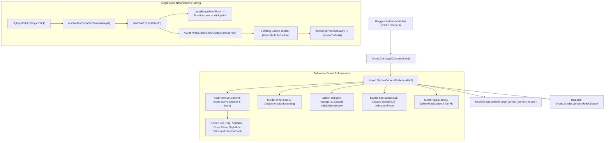

# 🏗️ Align Builder — Deep Dive Documentation

> **Purpose**: Technical documentation for AI Agents and Developers. Reading this file gives full understanding of Builder: all classes, methods, files, data flows, and locations to find/modify anything.

---

## 📍 Quick Location Map

| What to find | Path |
|---|---|
| PHP Bootstrap / Constants | `core/inc/class-align-builder.php` |
| PHP Admin Hooks | `core/inc/builder/class-builder-admin.php` |
| PHP Asset Management | `core/inc/builder/class-builder-assets.php` |
| PHP REST API Routes | `core/inc/builder/class-builder-rest-api.php` |
| PHP REST Handlers (Read) | `core/inc/builder/class-builder-content-handler.php` |
| PHP REST Handlers (Write) | `core/inc/builder/class-builder-crud-handler.php` |
| PHP Custom Templates Handler | `core/inc/builder/class-builder-custom-templates-handler.php` |
| PHP Minifier & Cloud API Engine | `core/inc/builder/class-builder-minifier.php` |
| PHP Post Content Engine | `core/includes/core/class-align-post-content.php` |
| PHP UI Assembler | `core/inc/builder/class-builder-ui-renderer.php` |
| HTML Partials (UI layout) | `core/builder/partials/` |
| HTML Input Templates | `core/builder/partials/inputs/*.html` |
| HTML Code Editor Modal | `core/builder/partials/modal-code-editor.html` |
| Vvveb Engine Modules | `core/builder/libs/builder/engine/*.js` (28 modules) |
| Inspector Input Modules | `core/builder/libs/builder/inputs/*.js` (9 modules) |
| Component Registries | `core/builder/libs/builder/components/{html,elements,bootstrap,common,widgets}/` |
| Sections & Blocks | `core/builder/libs/builder/{sections,blocks}/*.js` |
| Media Modal Ecosystem | `core/builder/libs/media/{modules,css}/` |
| Reusable Block Modules | `core/builder/js/modules/reuse-block/*.js` |
| Custom Templates Plugin | `core/builder/libs/builder/plugin-custom-templates.js` |
| JS WordPress Integration | `core/builder/js/modules/*.js` |
| JS Orchestrator entry | `core/builder/js/vvvebjs-wp-integration.js` |
| Modular CSS Architecture | `core/builder/css/{base,components,theme,vendor}/` |
| Master CSS Aggregator | `core/builder/css/editor.css` |
| Monolithic Fallback HTML | `core/builder/editor.html` |

---

## 1. System Architecture

```
WordPress Admin (/wp-admin)
  └─▶ Align_Builder_Admin (PHP)
        ├─ Register headless admin page "align-builder" for Gutenberg embedded iframe
        ├─ Enqueue Gutenberg block editor assets & iframe bridge controller
        └─ Call Align_Builder_Ui_Renderer::render_builder_ui() → output Builder SPA inside iframe or standalone

Builder SPA (HTML + JS, runs full-screen)
  ├── head.html             → <head>, viewport, editor.css
  ├── sidebar-nav.html      → logo, vertical navigation tabs
  ├── top-panel.html        → viewport switcher, undo/redo, save, #align-page-indicator pill (current page/template name)
  ├── left-panel.html       → Pages tree, Components/Sections lists
  ├── canvas.html           → <iframe> WYSIWYG center
  ├── right-panel.html      → CSS Style + Component Properties
  ├── bottom-panel.html     → DOM breadcrumb + Code Editor toggle
  ├── tmpl-inputs.html      → <script> templates for all input types
  ├── tmpl-filemanager.html → <script> templates for file/page tree
  ├── modals.html           → create/delete page modals + toast
  └── scripts.html          → load vendor libs + Vvveb engine

JS Integration Layer (runs after DOMContentLoaded)
  vvvebjs-wp-integration.js → Orchestrator, calls .init() for each module
  ├── wp-init.js              → default Dark Mode initialization (localStorage sync) & favicon/title sync from WP
  ├── wp-style-injector.js   → inject theme CSS into iframe
  ├── wp-components-preview.js → REST preview shortcodes/blocks
  ├── wp-filemanager.js      → load Pages tree from REST API
  ├── align-serializer.js    → Schema-driven DOM Normalizer (Zero extension junk & shortcode preservation)
  ├── wp-save-handler.js     → intercept Save → POST REST API
  ├── wp-media-modal.js      → bridge wp.media for image picker
  ├── wp-items-crud.js       → create/delete pages modal
  ├── wp-toolbar-tooltips.js → Centralized Bootstrap tooltips, zero-dangling lifecycle & browser tooltip suppression
  └── wp-context-menu.js     → Floating right-click context menu (Copy, Paste, Duplicate, Move, Hide, Delete) in Canvas & Navigator

WP REST API (/wp-json/align-builder/v1)
  ├── GET  /pages             → list Pages + Templates
  ├── GET  /page-content      → full HTML for iframe canvas
  ├── POST /save-page         → save HTML → DB + file .html
  ├── POST /render-shortcode  → do_shortcode() → HTML
  ├── POST /render-block      → do_blocks() → HTML
  ├── POST /create-item       → create new Page/Template
  └── POST /delete-item       → delete Page/Template + file
```

---

## 2. PHP Backend — Class and Method Details

### 2.1 Bootstrap: `class-align-builder.php`
**File**: `core/inc/class-align-builder.php`
**Class**: `Align_Core_Vvveb_Builder`
**Role**: Central boot file. Defines constants, loads submodules, creates backward-compat facade.

#### Constants defined here:
| Constant | Value | Meaning |
|---|---|---|
| `ALIGN_BUILDER_SLUG` | `'align-builder'` | Admin page URL slug |
| `ALIGN_BUILDER_TITLE` | `'Align Builder'` | Display name |
| `ALIGN_BUILDER_REST_NS` | `'align-builder/v1'` | REST API namespace |
| `ALIGN_BUILDER_PATH` | `get_template_directory() . '/core/builder/'` | Physical path to builder assets |
| `ALIGN_BUILDER_URL` | `get_template_directory_uri() . '/core/builder/'` | URL to builder assets |

#### Methods (Facade / Backward-Compat):
| Method | Signature | Function |
|---|---|---|
| `__construct()` | `public` | Init `$this->admin` and `$this->rest_api` |
| `resolve_asset_url()` | `public static ($url)` | Proxy → `Align_Builder_Assets::resolve_asset_url()` |
| `is_asset_enabled()` | `public static (array $asset)` | Proxy → `Align_Builder_Assets::is_asset_enabled()` |
| `get_builder_css_urls()` | `public static ()` | Proxy → `Align_Builder_Assets::get_builder_css_urls()` |
| `get_builder_js_assets()` | `public static ($target_location = 'all')` | Proxy → `Align_Builder_Assets::get_builder_js_assets()` |
| `replace_dummy_images()` | `public static ($html)` | Proxy → `Align_Builder_Assets::replace_dummy_images()` |
| `render_builder_ui()` | `public ()` | Proxy → `Align_Builder_Ui_Renderer::render_builder_ui()` |

---

### 2.2 Admin Menus and Hooks: `class-builder-admin.php`
**File**: `core/inc/builder/class-builder-admin.php`
**Class**: `Align_Builder_Admin`
**Role**: Register all WordPress Admin UI integration points.

#### WordPress Hooks registered:
| Hook | Callback | Priority |
|---|---|---|
| `admin_init` | `handle_standalone_builder_page()` | default |
| `admin_menu` | `register_builder_menu()` | default |
| `default_content` | `filter_default_page_content()` | 10 |
| `enqueue_block_editor_assets` | `enqueue_site_editor_assets()` | default |

#### Methods:
| Method | Signature | Function |
|---|---|---|
| `handle_standalone_builder_page()` | `public` | Catch `?page=align-builder` → check permission → render Builder UI full page → `exit` |
| `register_builder_menu()` | `public` | Register headless admin page (`add_submenu_page( null, ... )`) so `admin.php?page=align-builder` remains valid for embedded iframes without cluttering menus |
| `add_admin_bar_builder_link()` | `public ($wp_admin_bar)` | *(Deprecated)* Previously added Admin Bar node; unhooked as Builder is embedded directly in Gutenberg edit screens |
| `add_row_actions()` | `public ($actions, $post)` | *(Deprecated)* Previously added row actions; unhooked as standard Edit opens embedded Builder |
| `enqueue_site_editor_assets()` | `public` | Enqueue 6 Gutenberg & Site Editor integration assets from `core/builder/gutenberg/` (`align-editor-overlay.css`, `sidebar-common.css`, `align-editor-blocks.css`, `align-site-editor-integration.js`, `editor-duplicate-handler.js`, `block-tree-auto-focus.js`) + inject `AlignVvvebConfig` |

---

### 2.3 Asset Management: `class-builder-assets.php`
**File**: `core/inc/builder/class-builder-assets.php`
**Class**: `Align_Builder_Assets` (all static, no hooks)
**Role**: Collect, resolve, filter all asset URLs for builder canvas.

#### Methods:
| Method | Signature | Function |
|---|---|---|
| `resolve_asset_url()` | `public static ($url)` | Convert relative path → absolute URL. Delegates to `Align_Custom_CSS_JS::resolve_asset_url()` if that class exists |
| `is_asset_enabled()` | `public static (array $asset)` | Check `$asset['enabled']`: accepts `true`, `1`, `'1'`, `'true'`, `'on'` |
| `get_builder_css_urls()` | `public static ()` | Collect CSS: theme `style.css`, child theme `style.css`, and option `align_loaded_assets` (type=css, enabled=true). Returns unique sanitized URL array |
| `get_builder_js_assets()` | `public static ($target_location = 'all')` | Get JS from option `align_loaded_assets` (type=js, enabled=true), filter by `header`/`footer`/`all`. Returns array of `{url, location, loading}` |
| `get_font_preloads()` | `public static ()` | Get fonts from option `align_loaded_assets` (type=font), generate `<link rel="preload" as="font" ...>` with correct mime type (woff2/woff/ttf/otf/eot) |
| `replace_dummy_images()` | `public static ($html)` | Replace dummy image `src`, `data-src`, `<source srcset>`, and CSS `url(...)` with `https://picsum.photos/200/300` using `WP_HTML_Tag_Processor` (WP 6.2+) and fallback regex. Strictly preserves `wp-content/`, `data:`, `blob:`, and SVG fragment IDs (`#...`). |

> **WP Option used**: `align_loaded_assets` (array of `{type, url, enabled, location, loading}`)

---

### 2.4 REST API Router: `class-builder-rest-api.php`
**File**: `core/inc/builder/class-builder-rest-api.php`
**Class**: `Align_Builder_Rest_Api`
**Role**: Register 7 REST endpoints, delegate to Content/CRUD handlers.

#### 8 REST Endpoints registered:
| HTTP Method | Endpoint | PHP Handler | Function |
|---|---|---|---|
| `GET` | `/align-builder/v1/pages` | `Align_Builder_Content_Handler::get_pages` | Get Pages + Templates list |
| `GET` | `/align-builder/v1/page-content` | `Align_Builder_Content_Handler::get_page_content` | Get iframe canvas HTML |
| `GET` | `/align-builder/v1/search-links` | `Align_Builder_Content_Handler::search_links` | Real-time Ajax search for posts/pages/CPTs |
| `POST` | `/align-builder/v1/save-page` | `Align_Builder_Crud_Handler::save_page` | Save HTML → DB + file |
| `POST` | `/align-builder/v1/render-shortcode` | `Align_Builder_Crud_Handler::render_shortcode` | Render shortcode preview |
| `POST` | `/align-builder/v1/render-block` | `Align_Builder_Crud_Handler::render_block` | Render Gutenberg block preview |
| `POST` | `/align-builder/v1/create-item` | `Align_Builder_Crud_Handler::create_item` | Create new Page/Template |
| `POST` | `/align-builder/v1/delete-item` | `Align_Builder_Crud_Handler::delete_item` | Delete Page/Template |
| `GET`/`POST`/`DELETE` | `/align-builder/v1/custom-templates` | `Align_Builder_Custom_Templates_Handler` | Quản lý Custom Layout Templates (HTML, CSS, JS) lưu Database |

#### Permission Check (`check_permission()`):
- Require `current_user_can('edit_pages')`
- Validate nonce: `x_wp_nonce` header or `_wpnonce` query param → `wp_verify_nonce($nonce, 'wp_rest')`

---

### 2.5 Content Handler (Read): `class-builder-content-handler.php`
**File**: `core/inc/builder/class-builder-content-handler.php`
**Class**: `Align_Builder_Content_Handler` (all static, no hooks)
**Role**: Handle REST read operations — list, search, resolve dynamic permalinks, and render content.

#### Methods:

**`get_pages($request)`** — `public static`
- Query `get_posts(post_type=page, status=[publish,draft,private], orderby=title)` → icon 📄, `template_type: 'page'`
- Query `get_block_templates(wp_template)` → icon 🎨, `template_type: 'template'`, prefix `tpl_`
- Query `get_block_templates(wp_template_part)` → icon 📌/🦶/🧩 by area, `template_type: 'template_part'`, prefix `tp_`
- Query `get_posts(post_type=wp_block)` → icon 🧱, `template_type: 'reusable_block'`
- Each item returns: `{id, name, title, type, template_type, folder, status, url, editor_url, file}`
- `file` = REST URL `/page-content?id=...` or `/page-content?tp_id=...` (with nonce)

**`search_links($request)`** — `public static`
- Param: `search` (sanitized query string, max 100 chars)
- Query all public post types (excluding `attachment`) with `post_status = publish`, limit 20 items.
- Return format: `[{ id, title, url, type, type_label }]` with optimized query (`no_found_rows=true`, no term/meta preload).

**`resolve_dynamic_links($html)`** — `public static`
- Scan all `<a ... data-align-link-id="(\d+)" ...>` elements.
- Retrieve latest dynamic permalink via `get_permalink($id)` (preserves existing href if post is deleted/trashed).
- Dynamically update or append `href` attribute so links never break even when post titles or slugs change.

**`get_page_content($request)`** — `public static`
- Param: `id` (int, for Pages/Blocks) OR `tp_id` (string, for Templates/Parts)
- If `tp_id`: Determines `$type` (`wp_template` vs `wp_template_part`) and `$sub_dir` (`templates` vs `parts`).
  - Query DB strictly with `post_type => $type` and `post_name__in => [child//slug, parent//slug, slug]` (never mixed query, never `name__in`).
  - Physical file fallback strictly checks `$sub_dir` first (`parts/` for parts, `templates/` for templates).
  - **Pure Blank-Canvas**: If content is empty, returns empty string `""` without injecting dummy placeholder HTML.
- Calls `Align_Builder_Assets::replace_dummy_images()` to replace images
- Calls `self::resolve_dynamic_links()` to resolve real-time permalinks for locked links
- Calls `render_builder_components_for_preview()` to render shortcode/block placeholders
- Injects into HTML: font preloads, theme CSS URLs, header/footer JS, custom CSS/JS, tracking code
- Output: `Content-Type: text/html` → `exit`

**`render_builder_components_for_preview($content)`** — `public static`
- Input: HTML that may contain `data-component-shortcode` or `data-component-wp-block` attributes
- Use `DOMDocument + DOMXPath` to find those elements
- Insert visual placeholder badge (blue for shortcode, green for block) showing component name
- **Does NOT actually render** — only shows placeholder so user sees component position

---

### 2.6 CRUD Handler (Write): `class-builder-crud-handler.php`
**File**: `core/inc/builder/class-builder-crud-handler.php`
**Class**: `Align_Builder_Crud_Handler` (all static, no hooks)
**Role**: Handle all write operations with strict post_type scoping, `post_name__in` slug queries, and anti-bleed guarantees.

#### Methods:

**`save_page($request)`** — `public static`
- Params: `post_id` (int) OR `tp_id` (string), `template_type` (string), `html` (string)
- **Mutually Exclusive Isolation**:
  - If saving Page/Block: Client sends `post_id: ID, tp_id: null`. Backend strictly scopes to `wp_update_post( array('ID' => $post_id, ...) )` and never touches theme files.
  - If saving Template/Part: Client sends `post_id: null, tp_id: 'tp_slug', template_type: 'template_part'`. Backend strictly queries with `post_name__in`, updates matching `wp_template_part` in DB, attaches taxonomies `wp_theme` + `wp_template_part_area`, and writes directly to `parts/{slug}.html`. Header and Footer are strictly isolated.- **HTML cleanup pipeline**:
  1. Extract content inside `<body>...</body>`
  2. Remove DOCTYPE, html/head/body tags
  3. Remove `<style id="wp-global-styles">` and any `[script|style|link]` with `data-align-preview="1"`
  4. Normalize URL: `https://domain/wp-content/` → `/wp-content/`
  5. `strip_component_preview_html()` — remove preview placeholders
- Wrap into: `<!-- wp:align/custom-html {"blockId":"align-XXXXXXXX","enableShortcode":true} -->`
- Save Reusable Block Overrides:
  - If `reusable_overrides` payload present: `update_post_meta($post_id, '_align_reusable_overrides', $reusable_overrides)`
- Call `wp_clean_theme_json_cache()` after saving template

**`strip_component_preview_html($html)`** — `public static`
> **Zero-Preview-Persistence rule**: Preview content must NOT be saved to DB.
- Phase 1 (DOMDocument/XPath): find `[data-component-shortcode]`, `[data-component-wp-block]`, `.shortcode-preview-content`, `.block-preview-content` → remove child nodes
- Phase 2 (regex fallback): clean up remnants
- Also remove junk attributes: `bis_skin_checked`, `bis_register`, `data-preview-loading`

**`render_shortcode($request)`** — `public static`
- Param: `shortcode` (string)
- `wp_unslash()` → `align_normalize_shortcode()` (if exists) → `do_shortcode()`
- Return: `{shortcode, rendered}`

**`render_block($request)`** — `public static`
- Param: `block_content` (string)
- `wp_unslash()` → `do_blocks()`
- Return: `{block_content, rendered}`

**`generate_default_custom_html_block($title = '')`** — `public static`
- Create `blockId = 'align-' + 8 char MD5`
- Return: `<!-- wp:align/custom-html {"blockId":"...","enableShortcode":true} -->\n<div class="container py-5">...</div>\n<!-- /wp:align/custom-html -->`

**`create_item($request)`** — `public static`
- JSON params: `{type, title, slug}`
- `type = 'template'`: create `wp_template` DB + file `child/templates/{slug}.html` + clear cache
- `type = 'page'` (default): create `post_type=page` DB → `wp_insert_post()`
- Returns REST URL for new content

**`delete_item($request)`** — `public static`
- JSON params: `{post_id}` or `{tp_id}`
- `post_id`: `wp_delete_post(id, true)` (force delete)
- `tp_id`: find DB entry → `wp_delete_post()` + delete physical file `templates/{slug}.html`

---

### 2.7 UI Assembler: `class-builder-ui-renderer.php`
**File**: `core/inc/builder/class-builder-ui-renderer.php`
**Class**: `Align_Builder_Ui_Renderer` (all static)
**Role**: Assemble UI from partials + inject WordPress environment + output Builder HTML app.

**`assemble_builder_html()`** — `public static`
- Check all 11 partials exist → assemble in order:
  `head.html` → `sidebar-nav.html` → `top-panel.html` → `left-panel.html` → `canvas.html` → `right-panel.html` → `bottom-panel.html` → `tmpl-inputs.html` → `tmpl-filemanager.html` → `scripts.html` → `modals.html`
- Fallback: `editor.html` monolithic if partials missing

**`render_builder_ui()`** — `public static`
- Read `$_GET['post_id']` and `$_GET['tp_id']`
- Create REST nonce + build 7 REST URLs with nonce
- `wp_enqueue_media()` → `wp_print_styles()` → `wp_print_scripts()` + `wp_print_media_templates()`
- Inject `window.VvvebWpConfig` object with all config properties (see Section 3)
- Load 8 JS module scripts
- `echo $editor_html` → browser

---

### 2.8 Minifier & Cloud API Engine: `class-builder-minifier.php`
**File**: `core/inc/builder/class-builder-minifier.php`
**Class**: `Align_Builder_Minifier` (all static)
**Role**: Nén và chuẩn hóa an toàn HTML, CSS, JS trước khi bọc vào comment block Gutenberg `<!-- wp:align/custom-html -->` và lưu Database.

#### Methods:
- **`minify_payload($html, $css, $js, $style_id, $script_id)`**: Điều phối nén 3 luồng dữ liệu, bọc thẻ scoped `<style>` và `<script>`, ghi log Observability chi tiết.
- **`minify_html($html)`**: Tokenized Local Engine an toàn, bảo vệ 100% `<pre>`, `<code>`, `<textarea>`, `<svg>`, inline spacing `<span>` / `<a>`, và Gutenberg block comments.
- **`minify_css($css)` & `minify_js($js)`**: Điều phối nén qua Align Cloud API (`/api/minify`) với cơ chế:
  1. **Heuristic Bypass** (`is_already_minified_*`): Nhận diện code đã minified để bỏ qua, tránh gọi API lặp lại.
  2. **Two-Tier Cache**: Memory Cache trong request + WordPress Transient Cache 12 giờ theo MD5 hash (`align_min_{md5}`).
  3. **Local Fallback**: Tự động fallback về `local_minify_css()` và `local_minify_js()` khi timeout 3s hoặc gặp sự cố mạng.

---

### 2.9 Dynamic Image Resolver & Slot-Aware Engine: `class-builder-image-resolver.php`
**File**: `core/inc/builder/class-builder-image-resolver.php`
**Class**: `Align_Builder_Image_Resolver` (all static)
**Role**: Tự động bóc tách và chuyển đổi các thẻ `` / `<picture>` trong live HTML sang cấu trúc Responsive Art Direction đa tầng tối ưu hóa Core Web Vitals (LCP) và tiết kiệm băng thông.

#### Core Features & Methods:
- **`resolve_dynamic_image_srcset($html)`**: Quét toàn bộ thẻ `` và `<picture>` trong chuỗi HTML. Trích xuất Attachment ID (`data-id` hoặc class `wp-image-{id}` hoặc `attachment_url_to_postid`). Đọc thuộc tính `data-slot-width` hoặc `width` để nội suy các sub-size chuẩn WordPress.
- **`find_closest_size($sizes, $target_width)`**: Thuật toán tiệm cận khoảng cách (Closest Distance Scoring) với trọng số phạt ảnh thiếu kích thước:
  $$\text{score} = (|w - \text{target}| \times \text{penalty}) + \text{aspect\_diff}$$
  trong đó $\text{penalty} = 1.25$ nếu $w < \text{target}$ (phạt nhẹ ảnh thiếu kích thước nhằm ngăn vỡ hạt / mờ trên màn hình Retina), và $\text{aspect\_diff} = |w - h| \times 0.01$ (ưu tiên ảnh vuông $1:1$ khi các sub-size có cùng độ rộng).
- **`compute_slot_aware_breakpoints($sizes, $full_width, $slot_width)`**:
  1. Loại bỏ các thumbnail swatches li ti (`MIN_VALID_SIZE = 150px`).
  2. Mobile breakpoint (`max-width: 599px`): Tiệm cận tối ưu với $\min(\text{slot}, 599\text{px})$ (hoặc $599\text{px}$ nếu không có slot).
  3. Tablet breakpoint (`max-width: 992px`): Tiệm cận tối ưu với $\min(\text{slot}, 992\text{px})$ (hoặc $992\text{px}$ nếu không có slot).
  4. Desktop fallback (` src`): Tiệm cận tối ưu với $\min(\text{full\_width}, \max(\text{slot} \times 2, 1440\text{px}))$ nếu có slot (chuẩn 2x Retina), hoặc $1440\text{px}$ khi không có slot. Triệt tiêu hoàn toàn hiện tượng phình tải trọng khi thẻ `` trỏ về file ảnh gốc 4096px khổng lồ.

---

### 2.10 Custom Templates Handler: `class-builder-custom-templates-handler.php`
**File**: `core/inc/builder/class-builder-custom-templates-handler.php`
**Class**: `Align_Builder_Custom_Templates_Handler` (all static)
**Role**: Xử lý lưu trữ, truy xuất và xóa các mẫu layout dựng sẵn (Custom Layout Templates gồm HTML, CSS, JS) vào cơ sở dữ liệu WordPress (`wp_options`), thay thế các file preset cứng và cho phép người dùng/admin tự do tạo layout mẫu.

#### Option & Structure:
- **WP Option Key**: `align_builder_custom_templates`
- **Template Object Structure**:
  ```json
  {
    "id": "custom_layout_1710000000_abcde",
    "name": "Hero Section Modern",
    "group": "Layout",
    "html": "<section class=\"hero-section\">...</section>",
    "css": ".hero-section { ... }",
    "js": "console.log('Hero init');",
    "image": "",
    "icon": "la la-code",
    "created_at": 1710000000,
    "isCustom": true
  }
  ```

#### REST Methods:
- **`get_templates($request)`** (`GET /align-builder/v1/custom-templates`): Trả về danh sách templates đã lưu trong DB.
- **`save_template($request)`** (`POST /align-builder/v1/custom-templates`): Nhận payload `{id, name, group, html, css, js, image}`. Tự động sinh ID duy nhất nếu tạo mới. Validate trường name/html bắt buộc, sanitize và lưu an toàn vào `align_builder_custom_templates`.
- **`delete_template($request)`** (`DELETE /align-builder/v1/custom-templates`): Nhận `{id}`. Xóa template tương ứng khỏi DB `wp_options`.

---

## 3. `window.VvvebWpConfig` — Full Reference

Generated in `class-builder-ui-renderer.php::render_builder_ui()`, injected into Builder HTML before `</body>`.

| Property | Type | Source | Used by |
|---|---|---|---|
| `builderSlug` | `string` | `ALIGN_BUILDER_SLUG` constant | WpFilemanager |
| `builderTitle` | `string` | `ALIGN_BUILDER_TITLE` constant | WpInit |
| `restNamespace` | `string` | `ALIGN_BUILDER_REST_NS` constant | WpFilemanager |
| `activePostId` | `int` | `$_GET['post_id']` | WpFilemanager, WpSaveHandler |
| `activeTpId` | `string` | `$_GET['tp_id']` | WpFilemanager, WpSaveHandler |
| `restSaveUrl` | `string` | REST URL + nonce | WpSaveHandler |
| `restPagesUrl` | `string` | REST URL + nonce | WpFilemanager |
| `restRenderShortcodeUrl` | `string` | REST URL + nonce | WpComponentsPreview |
| `restRenderBlockUrl` | `string` | REST URL + nonce | WpComponentsPreview |
| `restCreateItemUrl` | `string` | REST URL + nonce | WpItemsCrud |
| `restDeleteItemUrl` | `string` | REST URL + nonce | WpItemsCrud |
| `restCustomTemplatesUrl` | `string` | REST URL + nonce | AlignCustomTemplates |
| `themeCssUrls` | `string[]` | `Align_Builder_Assets::get_builder_css_urls()` | WpStyleInjector |
| `customCss` | `string` | `get_option('align_custom_css')` | WpStyleInjector |
| `siteIconUrl` | `string` | `get_site_icon_url(64)` | WpInit |
| `themeScreenshotUrl` | `string` | `screenshot.png` or `.jpeg` | WpInit |
| `siteTitle` | `string` | `get_bloginfo('name')` | WpInit |
| `restNonce` | `string` | `wp_create_nonce('wp_rest')` | All modules |
| `pluginUrl` | `string` | `ALIGN_BUILDER_URL` | WpStyleInjector, WpFilemanager |
| `dummyImgUrl` | `string` | `https://picsum.photos/200/300` | WpStyleInjector |

---

## 4. JavaScript Modules — Detailed Reference

**Entry point**: `core/builder/js/vvvebjs-wp-integration.js`

### Startup sequence (`DOMContentLoaded`):
```
0. Vvveb.Builder.loadControlGroups()   // load Components sidebar
1. Vvveb.Builder.loadBlockGroups()     // load Blocks
2. Vvveb.Builder.loadSectionGroups()   // load Sections
3. Vvveb.Builder.loadStylesGroups()    // load Styles
4. AlignBuilderModules.WpInit.init()
5. AlignBuilderModules.WpMediaModal.init()
6. AlignBuilderModules.WpSaveHandler.init()
7. AlignBuilderModules.WpItemsCrud.init()
8. AlignBuilderModules.WpFilemanager.init()
```

---

### Module: `wp-init.js`
**Namespace**: `window.AlignBuilderModules.WpInit`

| Function | Params | Function description | Events | REST calls |
|---|---|---|---|---|
| `init()` | none | Initialize Dark Mode default (`data-bs-theme="dark"` / `localStorage` sync) and toggle icon. Sync site icon/favicon from `VvvebWpConfig.siteIconUrl` or `themeScreenshotUrl` to `#wp-site-icon`. Update browser tab `<title>` as `{builderTitle} < {siteTitle}`. Pre-populate `window._alignActiveReuseOverrides` from `VvvebWpConfig.savedReusableOverrides` to preserve saved multi-instance overrides across builder boots. Hide `#fallback-align-badge` if icon found. | none | none |

**VvvebWpConfig properties used**: `themeScreenshotUrl`, `siteIconUrl`, `builderTitle`, `siteTitle`, `savedReusableOverrides`

---

### Module: `wp-style-injector.js`
**Namespace**: `window.AlignBuilderModules.WpStyleInjector` (+ global `window.replaceDummyImagesInIframe`)

| Function | Params | Function description | Events | REST calls |
|---|---|---|---|---|
| `injectThemeStylesIntoIframe()` | none | Inject `<link rel="stylesheet">` tags from `themeCssUrls` into iframe `<head>`. Inject `<style id="align-custom-css">` with `customCss`. Start `MutationObserver` on `frameDoc.body` to auto-replace dummy images on DOM changes. | `Vvveb.iframe.loaded` | none |
| `replaceDummyImagesInIframe()` | none | Scan iframe elements for src/data-src/CSS url(...). Skip `wp-content/`, `data:`, `blob:`, `#...`. Replace non-`wp-content` dummy images with `https://picsum.photos/200/300`. Protected by re-entrancy lock `_isReplacingImages`. | MutationObserver trigger | none |

**VvvebWpConfig properties used**: `themeCssUrls`, `customCss`, `dummyImgUrl`, `pluginUrl`

---

### Module: `wp-components-preview.js`
**Namespace**: `window.AlignBuilderModules.WpComponentsPreview`

| Function | Params | Function description | Events | REST calls |
|---|---|---|---|---|
| `escapeHtml(str)` | `str:string` | Escape HTML special chars (`&`, `<`, `>`, `"`, `'`) to prevent XSS | none | none |
| `sanitizeRenderedHtml(html)` | `html:string` | Strip `<script>` tags from rendered HTML to prevent canvas script injection | none | none |
| `getOrCreateShadowRoot(node)` | `node:HTMLElement` | Attach or return open `ShadowRoot` on component wrapper node | none | none |
| `renderShadowDOM(node, state, payload)` | `node, state, payload` | Render status badge/placeholder or success preview HTML into Open Shadow DOM | none | none |
| `fetchShortcodePreview(shortcodeVal, instanceId)` | `shortcodeVal, instanceId` | Fetch rendered HTML from `/wp-json/align-builder/v1/render-shortcode` with request deduplication (`_inFlight`) and instance-keyed caching (`sc:val:inst:pageId:tpId`). | none | `POST` `shortcodeUrl` with `{shortcode, instance_id, page_id, tp_id, template_type}` |
| `fetchBlockPreview(blockVal)` | `blockVal:string` | Fetch rendered Gutenberg block markup from REST API | none | `POST` `blockUrl` |
| `renderNodePreview(node, forceRefresh, debounceMs)` | `node, forceRefresh, debounceMs` | Auto-disambiguates reusable block instances (`default`, `inst_2`, `inst_3`), stamps `data-instance-id` onto node and shortcode, segregates preview cache key with `instanceId`, and renders isolated preview into Shadow DOM. | `selectNode` | `POST` `shortcodeUrl` |
| `triggerWpComponentsPreviewInIframe(forceRefresh)` | `forceRefresh:boolean` | Query and render live preview for all shortcode, Gutenberg block, and post-content nodes in canvas iframe | none | none |
| `clearCache()` | none | Invalidate and clear all in-memory preview caches | none | none |
| `init()` | none | Register lifecycle listeners to refresh preview on iframe load, page switch, and selection | `Vvveb.iframe.loaded`, `Vvveb.FileManager.loadPage`, `Vvveb.Builder.selectNode` | none |

**VvvebWpConfig properties used**: `restRenderShortcodeUrl`, `restRenderBlockUrl`, `restNonce`, `activePostId`, `activeTpId`

---

### Module: `wp-filemanager.js`
**Namespace**: `window.AlignBuilderModules.WpFilemanager`

| `copyTextToClipboard(text, onSuccess)` | `text:string, onSuccess:function` | Universal clipboard copy utility with modern `navigator.clipboard` and legacy `execCommand('copy')` fallback for non-HTTPS/restricted environments. | none | none |
| `init()` | none | Setup router between sidebar FileManager and browser URL. On page switch: update URL via `history.pushState`, update `activePostId`/`activeTpId`, trigger component preview refresh. **Unsaved Changes Guard**: Before navigating to a different page/template, checks `Vvveb.Undo.undoIndex > 0` — if unsaved changes exist, shows a native `window.confirm()` dialog warning the user. Navigation proceeds only if confirmed. Manage Top Panel Header Bar shortcode badge (`#top-panel-shortcode-container`): display shortcode `[reuse-block id="X"]` on Reusable Block selection, hide on standard Pages/Templates, and provide 1-click copy handler. **Page Indicator Pill**: Calls `updatePageIndicator(pageData)` on every `Vvveb.FileManager.loadPage` event to keep `#align-page-indicator` in sync. Attach 1-click copy listener to sidebar Reusable Block items (`.copy-id` button and `.align-tree-tag-id` badge) supporting normal click (`[reuse-block id="X"]`) and Alt/Shift click (raw ID). Listen `popstate` for back/forward navigation. Schedule `loadWpPages()` after 300ms. | `Vvveb.FileManager.loadPage`, `popstate`, `click` on `.copy-id` / `.align-tree-tag-id` | none |
| `updatePageIndicator(pageData)` | `pageData:object` | Updates the `#align-page-indicator` pill in the top panel to always show the name and type of the currently active editing target. Reads `pageData.templateType` / `pageData.folder` to determine variant: **Page** (amber, `la-file-alt`), **Template** (blue, `la-file-code`), **Template Part** (indigo, `la-puzzle-piece`), **Reusable Block** (cyan, `la-cubes`). Sets the text, badge label, icon class, and CSS variant class (`is-template` / `is-template-part` / `is-reusable`). Called from the `Vvveb.FileManager.loadPage` event and directly from the dynamic-fallback branch in `loadWpPages()` (when `loadPage` event doesn't fire). | none | none |
| `loadWpPages()` | none | Fetch Pages+Templates+Reusable Blocks (`wp_block`) from REST API. Parse JSON, group by folder (Pages/Templates/Template Parts/Reusable Blocks - all rendered closed default). Ensure Reusable Blocks folder is rendered in tree even if 0 items exist. Load into `Vvveb.FileManager.addPages()`. Determine active page from URL or config. Call `Vvveb.Builder.init(file, callback)` to load canvas. After init, calls `updatePageIndicator()` in the dynamic-fallback path. | none | `GET` `restPagesUrl` with `X-WP-Nonce` |

**VvvebWpConfig properties used**: `builderSlug`, `activeTpId`, `activePostId`, `restPagesUrl`, `restNonce`, `restNamespace`, `pluginUrl`


---

### Module: `wp-save-handler.js`
**Namespace**: `window.AlignBuilderModules.WpSaveHandler`

| Function | Params | Function description | Events | REST calls |
|---|---|---|---|---|
| `cleanPreviewContent(html)` | `html:string` | Zero-Preview-Persistence mechanism. Clear innerHTML of preview wrappers. | none | none |
| `setButtonState(state, text)` | `state:string, text?:string` | Manage 4-state visual indicator directly on topbar `.save-btn` (`saving` -> `saved` -> `dirty` / `error`). | none | none |
| `init()` | none | Pre-serialization pass: disambiguates reusable blocks on live DOM, stamps `data-instance-id` and `instance="inst_X"` onto shortcodes, and collects isolated overrides. Next calls `AlignSerializer.serialize(frameBody)` preserving instance attributes in DB `post_content`. Dispatches payload with `reusable_overrides: {[blockId]: {[instanceKey]: ...}}`. On success, invalidates preview caches and re-renders components. | `click` on `.save-btn`, `vvveb.undo.add`, `input` | `POST` `restSaveUrl` with `{post_id, tp_id, html, css, js, reusable_overrides}` |

**VvvebWpConfig properties used**: `activePostId`, `activeTpId`, `activePostType`, `restSaveUrl`, `restNonce`

---

### Module: `wp-media-modal.js`
**Namespace**: `window.AlignBuilderModules.WpMediaModal`

| Function | Params | Function description | Events | REST calls |
|---|---|---|---|---|
| `init()` | none | Monkey-patch `MediaModal.prototype.open()`. Khi click input chọn ảnh → mở hộp thoại `wp.media()` chuẩn WordPress. Khi user chọn ảnh (`select`): trích xuất metadata attachment, chuyển URL về đường dẫn tương đối. **Tự động đo Slot & Art Direction Real-time**: Đo kích thước thực tế của container ảnh trên canvas (`getBoundingClientRect().width` / `offsetWidth` / container classes `.is-small` -> 312px, `.is-large` -> 644px). Gán `data-slot-width` lên thẻ `<picture>`, tự động tạo các thẻ `<source>` cho Mobile (`max-width: 599px`) và Tablet (`max-width: 992px`), chọn sub-size sắc nét chuẩn Retina 2x gán vào ` src` fallback Desktop thay vì ảnh gốc khổng lồ. Cập nhật canvas element, dispatch `change`/`input`. Fallback về `origMediaModalOpen` nếu `wp.media` không khả dụng. | `select` on wp.media frame, `change`/`input` dispatch | none (uses WP Media JS SDK) |

**VvvebWpConfig properties used**: none directly

---

### Module: `wp-items-crud.js`
**Namespace**: `window.AlignBuilderModules.WpItemsCrud`

| Function | Params | Function description | Events | REST calls |
|---|---|---|---|---|
| `openCreateModal(type)` | `type:'page'\|'template'\|'reusable_block'` | Open `#align-create-item-modal`, set title text, reset inputs, focus title field | none | none |
| `closeCreateModal()` | none | Close modal, reset input values | none | none |
| `hookDeleteButtons()` | none | Attach `click` event to `.delete` buttons in `#filemanager .tree li.file`. Identify `postId`/`tpId` from data attributes. Confirm → POST delete. | `click` on `.delete` | `POST` `restDeleteItemUrl` with `{post_id}` or `{tp_id}` |
| `init()` | none | Setup all CRUD UI: dropdown toggle `#new-item-toggle`, modal open/close, auto-slug from title input, confirm create → POST API. Setup `MutationObserver` on `#filemanager .tree ol` to re-hook delete buttons when tree re-renders. | Multiple click/input events + MutationObserver | `POST` `restCreateItemUrl` with `{type, title, slug}` |

**VvvebWpConfig properties used**: `restCreateItemUrl`, `restDeleteItemUrl`, `restNonce`

---

### Module: Reusable Block Subsystem (`core/builder/js/modules/reuse-block/`)
**Namespace**: `window.AlignBuilderModules.WpReuseBlockOverwrite`

| Module / Component | Responsibility & Architecture |
|---|---|
| `reuse-block-detector.js` | Detects selected Reusable Block nodes on Canvas / Tree Navigator. Extracts `blockId` (ID or slug) and `instanceId` (`data-instance-id`, `instance="..."` or DOM sibling index disambiguation). Validates `hasValidContent` to prevent false-positive early returns when the accordion interior is missing. Listens for `Align.WpComponentsPreview.rendered` to automatically render the overwrite inspector upon asynchronous Shadow DOM completion. |
| `reuse-block-inspector-live.js` | Renders the "Content Overwrite" Accordion for live Canvas elements. Scopes all DOM target queries (`getLiveTarget`) strictly to `blockNode` (shadowRoot or subtree), prohibiting global `FrameDocument` query selector bleed. Features a streamlined, no-icon header with adaptive `flex-wrap: wrap` layout and strict `white-space: nowrap` preventing text breaklines in narrow sidebars. Provides text-only Hide/Unhide toggle for each field row: replaces target/picture in Canvas DOM with comment placeholder `<!--align-hidden:${ovId}-->` (zero `display:none`), unhides seamlessly, and handles Reset. Stores client overrides in `_alignActiveReuseOverrides[blockId][instanceKey]`. |
| `reuse-block-inspector-api.js` | Handles fallback REST API fetch `/align-reuse/v1/fields` when DOM elements are not directly editable. Scopes mutations strictly to the active `blockEl`. Features matching streamlined no-icon, no-breakline header layout. Includes text-only Hide/Unhide toggle, `syncCache`, and comment placeholder toggling via `toggleCanvasElementHidden`. |
| `reuse-block-link-picker.js` | Renders and binds the debounced Ajax Link Picker for Link Overwrites. Supports Unlocked state (debounced search via `/wp-json/align-builder/v1/search-links`, manual URL typing) and Locked state (card with `#<ID>` badge, post title, and disconnect button). Ensures post IDs (`data-align-link-id`) are stored for accurate dynamic permalink resolution. |
| `builder-selection-manager.js` | On AST or DOM clone (`cloneSelectedNodes`), automatically disambiguates reusable blocks by generating a fresh unique `data-instance-id="inst_X"` and updating shortcode `instance="..."` attributes. |
| `wp-shortcode.js` | When inserting or typing a Reusable Block shortcode on Canvas, checks for existing instances of the same ID. If a duplicate is inserted without an instance, automatically generates and sets `instance="inst_X"`. |
| `wp-save-handler.js` | Pre-serialization pass runs before `AlignSerializer.serialize(frameBody)`, ensuring live DOM nodes and shortcodes receive explicit `data-instance-id` and `instance="inst_X"`. Collects overrides with per-field deep merge preserving `hidden: true` into `reusableOverrides[blockId][instanceKey]`. |
| `align-serializer.js` | Whitelists `data-instance-` in `ALLOWED_PREFIXES` and `data-instance-id`, `data-instance`, `data-reuse-block-id` in `ALLOWED_EXACT_DATA_ATTRS` to prevent attribute stripping during HTML serialization. |
| `class-align-reusable-block.php` | Server-side shortcode engine (`render_shortcode()`). Tracks `$post_occurrences[$post_id]` per request lifecycle. Maps omitted instances to `inst_$occ`. Isolates render cache with composite key `${post_id}_${instance_key}_${occurrence}`. In `apply_reusable_overrides()`, removes hidden nodes completely via `DOMDocument` (`removeChild`, bypasses fast-path) ensuring zero rendered HTML output when `hidden: true`. |
| `class-builder-ui-renderer.php` | Injects `savedReusableOverrides` into `window.VvvebWpConfig` so existing post meta overrides are loaded upon builder boot. |
| `class-builder-crud-handler.php` | Accepts `instance_id` in REST `render_shortcode()` and injects `instance="{$instance_id}"` for accurate preview generation. |

**VvvebWpConfig properties used**: `restReuseFieldsUrl`, `savedReusableOverrides`, `activePostId`, `activePostType`, `restNonce`

---

### Module: `wp-toolbar-tooltips.js`
**Namespace**: `window.AlignBuilderModules.WpToolbarTooltips`

| Function | Params | Function description | Events | REST calls |
|---|---|---|---|---|
| `init()` | none | Scans all elements in `#select-actions` (`#up-btn`, `#down-btn`, `#toggle-hide-btn`, `#change-img-btn`, `#clone-btn`, `#delete-btn`, `#toggle-overwrite-btn`, `#top-select-element-badge`, `#convert-dynamic-btn`, `#translate-section-btn`, `#copy-original-section-btn`) and `#top-panel` elements with `title`. Strips `title` into `data-bs-original-title` to completely eliminate browser native tooltips. Binds Bootstrap 5 Tooltip with `delay: { show: 100, hide: 50 }`, `placement: 'bottom'`, `container: 'body'`. Registers capture click handler on `#top-panel` (`hide(btn)` + `btn.blur()`), canvas iframe click/scroll listeners, window scroll, and keydown `Escape` listener. Attaches `MutationObserver` on `#top-panel`. | `click` capture on `#top-panel`, `Vvveb.Builder.selectNode`, `scroll`, `keydown` (Esc), canvas iframe `click`/`scroll`/`keydown` | none |
| `initElement(el, titleOverride)` | `el:HTMLElement, titleOverride?:string` | Initializes or updates a single element's tooltip, moves `title` -> `data-bs-original-title`, strips `title` attribute, and configures Popper instance with `.align-toolbar-tooltip`. | none | none |
| `updateTitle(elOrSelector, newTitle)` | `elOrSelector:HTMLElement\|string, newTitle:string` | Synchronizes tooltip text dynamically for toggle states (e.g. Hide/Unhide, Overwrite, AI Translation tags). Updates `data-bs-original-title`, ensures `title` is stripped, and calls `tip.setContent({ '.tooltip-inner': newTitle })`. | none | none |
| `hide(elOrSelector)` | `elOrSelector:HTMLElement\|string` | Hides the tooltip for a specific element. | none | none |
| `hideAll()` | none | Zero-Dangling Tooltip mechanism. Hides all active tooltips across all tracked elements and performs defensive cleanup by detaching any orphaned `.tooltip.align-toolbar-tooltip.show` DOM nodes left in `document.body`. | none | none |
| `destroy()` | none | Full symmetrical teardown: disconnects `MutationObserver`, unbinds all top-panel/canvas/window listeners, and disposes all Bootstrap Tooltip instances to prevent memory leaks. | none | none |

---

### Module: `plugin-custom-templates.js`
**Namespace**: `Vvveb.AlignCustomTemplates`
**File**: `core/builder/libs/builder/plugin-custom-templates.js`

| Function | Params | Function description | Events | REST calls |
|---|---|---|---|---|
| `init()` | none | Khởi tạo hệ thống quản lý Custom Templates: tải danh sách từ REST API `/custom-templates` (đồng thời backup LocalStorage), đăng ký các section vào `Vvveb.Sections`, bọc hook render để inject nút `+ Create` ở header nhóm Layout và nút xóa thùng rác `.delete-custom-tpl-btn` (góc trên phải `top:8px; right:8px; z-index:10`) trên từng card template. | `DOMContentLoaded`, `loadSectionsGroups` | `GET` `restCustomTemplatesUrl` |
| `openCreateModal(data)` | `data?:object` | Mở `#customTemplateModal` để tạo hoặc chỉnh sửa template gồm các trường: Tên, Nhóm (mặc định Layout), HTML, Scoped CSS, JS. Cung cấp nút `Use Selected Canvas Element` để tự động bóc tách outerHTML và CSS của phần tử đang chọn trên canvas. | `click` trên `.add-custom-template-header-btn` | none |
| `saveCustomTemplate()` | none | Thu thập dữ liệu từ modal, gửi payload lên REST API endpoint `/align-builder/v1/custom-templates` để lưu vĩnh viễn vào `wp_options`. Tự động đăng ký section mới vào `Vvveb.SectionsGroup['Layout']` và reload danh sách sections trong popup mà không cần tải lại trang. | `click` `#save-custom-template-btn` | `POST` `restCustomTemplatesUrl` |
| `deleteCustomTemplate(id)` | `id:string` | Xác nhận xóa và gửi lệnh REST DELETE lên endpoint `/custom-templates`. Gỡ bỏ section khỏi bộ nhớ Vvveb, xóa khỏi LocalStorage và render lại danh sách. | `click` `.delete-custom-tpl-btn` | `DELETE` `restCustomTemplatesUrl` |

**VvvebWpConfig properties used**: `restCustomTemplatesUrl`, `restNonce`

---

### Module: `wp-context-menu.js`
**Namespace**: `window.AlignBuilderModules.WpContextMenu`
**Stylesheet**: `align/core/builder/css/components/editor-context-menu.css`

| Function | Params | Function description | Events | REST calls |
|---|---|---|---|---|
| `init()` | none | Creates `#align-builder-context-menu` DOM container, binds global click outside listener, window scroll/resize dismissal, Escape key listener, Navigator (`#tree-list`) contextmenu capture listener, selection box (`#select-box`) contextmenu listener, and registers canvas iframe event hooks (`Vvveb.iframe.loaded`, `vvveb.iframe.loaded`, and iframe element `load`). Sets up polling retries (300ms, 1000ms, 2500ms) for asynchronous canvas load. | `click` capture on `document`, `contextmenu` capture on `#tree-list` and `#select-box`, `keydown` (Esc, Ctrl+C, Ctrl+V, Ctrl+D), `Vvveb.iframe.loaded`, `vvveb.iframe.loaded` | none |
| `attachCanvas(frameDoc)` | `frameDoc:Document` | Attaches high-priority capture-mode listeners (`capture: true`) to the iframe document and window for `contextmenu`, `click`, `scroll`, and `keydown`. Calling `e.preventDefault()`, `e.stopPropagation()`, and `e.stopImmediatePropagation()` completely suppresses the browser/extension native context menu and invokes custom contextual menu for the clicked element. | `contextmenu` (capture), `click`, `scroll`, `keydown` inside iframe | none |
| `show(x, y, targetNode)` | `x:number, y:number, targetNode?:HTMLElement` | Computes screen position with viewport boundary clamping (prevents offscreen overflow). Populates Header with element Tag and Class/ID. Updates availability states for Copy, Paste After, Paste Inside, Move Up, Move Down, Hide/Unhide, AI Translate, Restore Original, Dynamic Convert, and Delete. Displays the menu with smooth fade-in animation. | none | none |
| `hide()` | none | Immediately hides the floating context menu. | none | none |
| `copy()` | none | Copies currently selected node (`Vvveb.Builder.selectedEl`) into internal builder clipboard (`Vvveb.Builder.clipboard`) and writes HTML string to system clipboard via `navigator.clipboard.writeText()`. Triggers a green toast confirmation `<tag> copied to clipboard`. | none | none |
| `paste(inside)` | `inside:boolean` | Clones node from clipboard, runs `Vvveb.Builder._disambiguateReuseBlockDom()` to ensure unique shortcode/reusable block instance IDs, and inserts into DOM (either `targetNode.after(newNode)` or `targetNode.appendChild(newNode)`). Registers an Undo mutation, reloads TreeList and SectionList, selects the new node, and displays success toast. | none | none |

**Keyboard Shortcuts Handled**:
- `Ctrl + C` / `Cmd + C`: Copy selected element.
- `Ctrl + V` / `Cmd + V`: Paste copied element after current selection (or into container).
- `Ctrl + D` / `Cmd + D`: Duplicate selected element immediately.
- `Del` / `Backspace`: Delete selected element.
- `Escape`: Dismiss open context menu.

---

## 5. HTML Partials — UI Structure Reference

**Directory**: `core/builder/partials/`

### Partial Assembly Order (DOM layout by `assemble_builder_html()`):
```html
<!DOCTYPE html>
<html lang="en" data-bs-theme="dark">
  [head.html]                     <!-- <head>, CSS link -->
  <body style="overflow:hidden">
    <div id="container" class="small-nav">
      [sidebar-nav.html]           <!-- logo, vertical tabs -->
      <div class="main">
        <div id="vvveb-builder">
          [top-panel.html]         <!-- toolbar top -->
          <div id="left-panel">
            [left-panel.html]      <!-- pages tree, components -->
          </div>
          [canvas.html]            <!-- iframe WYSIWYG -->
          <div id="right-panel">
            [right-panel.html]     <!-- properties, CSS style -->
          </div>
          [bottom-panel.html]      <!-- breadcrumb, code editor -->
        </div>
      </div>
    </div>
    [tmpl-inputs.html]             <!-- <script> input templates -->
    [tmpl-filemanager.html]        <!-- <script> file tree templates -->
    [scripts.html]                 <!-- vendor JS loads -->
    [modals.html]                  <!-- modal UI -->
  </body>
</html>
```

### Key Element IDs by Panel:

**`top-panel.html`**:
| ID / Class | Purpose |
|---|---|
| `#top-panel` | Root container |
| `#back-to-cms-btn` | Nút điều hướng góc trái ngoài cùng quay về WordPress CMS Dashboard (`admin_url()` / dynamic `adminDashboardUrl`), thiết kế 100% trong suốt, zero-border, zero-shadow |
| `#top-panel-site-icon` | Thẻ ảnh `` (22x22px) hiển thị favicon/site icon của website, bo góc nhẹ 4px, bảo vệ không bị đảo màu trong Dark Mode |
| `#top-panel-site-icon-fallback` | Icon fallback WordPress (`la-wordpress`, 22px, màu `#38bdf8`) tự động hiển thị khi site chưa cài favicon hoặc ảnh lỗi (`onerror`) |
| `#select-actions` | Centered element action toolbar |
| `#top-select-element-badge` | Dynamic selected element type & class selector badge |
| `#toggle-overwrite-btn` | Toggle allow overwrite on live page for typography & media elements (strictly visible only when editing Reusable Blocks) |
| `#up-btn` | Move element up |
| `#down-btn` | Move element down |
| `#change-img-btn` | Quick change image button (triggers WP Media Modal for ``) |
| `#clone-btn` | Clone element |
| `#delete-btn` | Delete element |
| `.btn-dark-mode` | Toggle Dark/Light Mode button (defaults to Dark Mode with moon icon, calls `Vvveb.Gui.darkMode()`) |
| `#undo-btn`, `#redo-btn` | Undo / Redo buttons |
| `#toggle-file-manager-btn` | Toggle file manager |
| `#toggle-left-column-btn` | Toggle left panel |
| `#toggle-right-column-btn` | Toggle right panel (Properties) |
| `#mobile-view`, `#tablet-view`, `#desktop-view` | Responsive viewport buttons (Mobile: 375x812px, Tablet: 768x1024px, Desktop: 1920x1080px Full HD default with auto-fit zoom) |
| `#zoom` | Zoom percentage input |
| `.save-btn` | Save button (JS binds click here) |
| `.loading`, `.button-text` | Loading state containers |
| `data-vvveb-shortcut="ctrl+s"` | Save keyboard shortcut |

**`left-panel.html`**:
| ID / Class | Purpose |
|---|---|
| `#filemanager` | Pages/Templates tree container |
| `#new-item-toggle`, `#add-item-menu` | Add new dropdown popover menu (`.add-item-menu` / `.add-item-menu-btn` styled for Dark Mode & compact 11.5px font) |
| `#add-wp-page-btn` | Open create Page modal |
| `#add-wp-template-btn` | Open create Template modal |
| `#tree-list` | DOM Navigator tree (sử dụng block-flow `width: 100%`, `box-sizing: border-box`, triệt tiêu hoàn toàn thanh scrollbar ngang giả do subpixel overflow; chỉ xuất hiện scrollbar khi nội dung lồng thực sự vượt panel) |
| `.components-list` | Components list |
| `.sections-list` | Sections list |
| `.component-search` | Component search input |

**`canvas.html`**:
| ID / Class | Purpose |
|---|---|
| `#iframe1` | Main WYSIWYG iframe |
| `#iframe-wrapper`, `#iframe-layer` | Iframe container layers |
| `.loading-message` | Canvas loading overlay (3-dot SVG goo-blob animation đối xứng 120°) |
| `#highlight-box` | Element hover outline |
| `#select-box` | Selected element outline |
| `#wysiwyg-editor` | Quick text formatting toolbar (Bold, Italic, etc.) |
| `#add-section-box` | Quick component/section insert overlay |

**`right-panel.html`**:
| ID / Class | Purpose |
|---|---|
| `#right-panel` | Root container |
| `#content-tab` | Content properties tab |
| `#style-tab` | CSS style properties tab |
| `#advanced-tab` | Advanced properties tab |
| `data-section="content|style|advanced"` | Tab section identifiers |

**`sidebar-nav.html`**:
| ID / Class | Purpose |
|---|---|
| `#wp-site-icon` | Site icon/favicon image |
| `#fallback-align-badge` | Fallback badge if no icon |
| `#elements-tabs` | Vertical navigation tabs |
| `#pages-tab`, `#components-tab` | Tab buttons linking to left-panel |

**`modals.html`**:
| ID / Class | Purpose |
|---|---|
| `#align-create-item-modal` | Create Page/Template modal |
| `#align-item-title`, `#align-item-slug` | Title and slug inputs |
| `#align-modal-cancel`, `#align-modal-confirm` | Cancel / Confirm buttons |
| `#top-toast`, `#bottom-toast` | Save result toast notifications |
| `#heartBeatLogin` | Session expired modal |
| `#customBlockModal` | Custom Block creator modal |
| `#customTemplateModal` | Modal tạo & quản lý Custom Layout Template (HTML, CSS, JS, Name, Group) |

### `tmpl-inputs.html` — Input Type Templates:
| Template ID | Input Type |
|---|---|
| `vvveb-input-textinput` | Text input |
| `vvveb-input-textareainput` | Textarea |
| `vvveb-input-checkboxinput` | Checkbox |
| `vvveb-input-radioinput` | Radio group |
| `vvveb-input-radiobuttoninput` | Radio button group `.btn-group` |
| `vvveb-input-toggle` | Switch toggle `.form-switch` |
| `vvveb-input-header` | Section header `<h6>` |
| `vvveb-input-select` | Select dropdown |
| `vvveb-input-icon-select` | Icon picker grid |
| `vvveb-input-html-list-select` | HTML list with search dropdown |
| `vvveb-input-rangeinput` | Range/slider input |
| `vvveb-input-imageinput` | Image picker (triggers wp.media) |

### `scripts.html` — Script Load Order:
1. `popper.min.js`, `bootstrap.min.js`, `sortable.complete.min.js`
2. `cm6-lezer.bundle.min.js` (CodeMirror 6 + Lezer AST Bundle)
3. 28 Engine Core modules (`libs/builder/engine/`): `builder-core.js`, `builder-dom-morph.js`, `builder-ast-parser.js`, `builder-code-editors.js`, `builder-drag-drop.js`, `builder-tree-list.js`, `builder-tree-render.js`, `builder-tree-sortable.js`, `builder-style-manager.js`, `builder-js-manager.js`, etc.
4. `undo.js`, Inspector Inputs modules (`libs/builder/inputs/input-*.js` - 9 files)
5. Media Gallery (`libs/media/modules/*.js`), Coloris (`libs/coloris/`), Google Fonts (`plugin-google-fonts.js`), AOS (`plugin-aos.js`)
6. Component Registries (`libs/builder/components/` - Common, HTML, Elements, Bootstrap, Widgets)
7. Sections & Block Presets (`libs/builder/sections/`, `libs/builder/blocks/`, `plugin-custom-blocks.js`)
8. Plugins (`plugin-ai-assistant.js`, `autocomplete.js`)
9. Inline initialization script: `Vvveb.Gui.init()`, `FileManager.init()`, `SectionList.init()`, `TreeList.init()`, `CssEditor.init()`, etc.
10. WordPress Integration modules loaded via Renderer: `wp-init.js`, `wp-style-injector.js`, `align-serializer.js`, `wp-save-handler.js`, etc.

---

## 6. Data Flow Diagrams

### 6.1 Open Builder and Load a Page
```
User → WP Admin Menu "Align Builder"
  └─▶ admin_init → Align_Builder_Admin::handle_standalone_builder_page()
        └─▶ Align_Builder_Ui_Renderer::render_builder_ui()
              ├─ assemble_builder_html() → assemble 11 partials
              ├─ inject window.VvvebWpConfig
              └─ echo HTML → browser

Browser: load Builder SPA
  └─▶ scripts.html: load vendor libs
        └─▶ DOMContentLoaded → vvvebjs-wp-integration.js
              ├─ Vvveb.Builder.load*Groups()
              ├─ WpInit.init() → sync favicon/title
              ├─ WpMediaModal.init()
              ├─ WpSaveHandler.init()
              ├─ WpItemsCrud.init()
              └─ WpFilemanager.init()
                    └─▶ GET /wp-json/align-builder/v1/pages
                          └─▶ PHP: get_pages() → JSON array
                          └─▶ render sidebar file tree
                          └─▶ if activePostId → auto-load page
                                └─▶ GET /page-content?id=123
                                      └─▶ PHP: get_page_content() → full HTML
                                      └─▶ iframe.src = URL → load HTML into canvas
```

### 6.2 Save a Page
```
User click "Save" (.save-btn)
  └─▶ WpSaveHandler: get iframe.body.innerHTML
        ├─ cleanPreviewContent() [Zero-Preview-Persistence]
        ├─ normalize img paths → /wp-content/
        ├─ append custom CSS/JS
        └─▶ POST /wp-json/align-builder/v1/save-page
              Body: {post_id, html}
              └─▶ PHP: save_page()
                    ├─ Strip <body> wrapper
                    ├─ Remove data-align-preview elements
                    ├─ strip_component_preview_html()
                    ├─ Wrap → <!-- wp:align/custom-html {...} -->
                    ├─ wp_update_post() → DB
                    └─ file_put_contents() → .html file (templates only)
              └─ return {status:'success'}
        └─▶ update button state: "<i class='la la-check'></i> Saved" (disabled)
```

### 6.3 Preview Shortcode/Block
```
User drops "WP Shortcode" component on canvas
  └─▶ canvas shows: [/] WP Shortcode placeholder (client-side card)
      User types shortcode in sidebar Properties
        └─▶ WpComponentsPreview.triggerWpComponentsPreviewInIframe()
              └─▶ Read data-shortcode attribute
              └─▶ buildShortcodePlaceholder() → blue badge HTML
              └─▶ inject HTML into element in iframe
              [NOTE: Does NOT call REST API in normal flow]
```

---

## 7. WordPress Options Used

| Option Key | Type | Purpose |
|---|---|---|
| `align_loaded_assets` | `array` | Asset list: CSS, JS, font from Asset Loader tab |
| `align_custom_css` | `string` | Global custom CSS injected into canvas |
| `align_custom_js` | `string` | Global custom JS injected into canvas |
| `align_tracking_code` | `string` | Tracking code (GA, GTM, etc.) injected into canvas |

**Structure of one entry in `align_loaded_assets`**:
```php
[
  'type'     => 'css' | 'js' | 'font',
  'url'      => '/path/to/file.css',
  'enabled'  => true | 1 | '1' | 'true' | 'on',
  'location' => 'header' | 'footer',    // JS only
  'loading'  => 'normal' | 'defer' | 'async',  // JS only
]
```

---

## 8. Critical Rules and Conventions

### 8.1 Zero-Preview-Persistence
> When saving, ALL dynamic preview content (shortcode render, block render) is stripped from HTML before writing to DB. Only save the wrapper container with data attributes.

**Mechanism**: `strip_component_preview_html()` in PHP + `cleanPreviewContent()` in JS (wp-save-handler.js)

### 8.2 `data-align-preview="1"` Convention
> Every CSS/JS/link tag injected by builder for preview purposes (not actual content) is marked `data-align-preview="1"`. On save, these tags are removed completely.

**PHP cleanup**: `preg_replace('/..data-align-preview="1"../', '', $clean_html)` in `save_page()`

### 8.3 Block Format: `wp:align/custom-html`
> All content from Align Builder is saved in Gutenberg block format:
```
<!-- wp:align/custom-html {"blockId":"align-XXXXXXXX","enableShortcode":true} -->
[actual HTML content]
<!-- /wp:align/custom-html -->
```
When reading, `class-builder-content-handler.php` extracts HTML from inside this block.

### 8.5 Image Replacement Rules
`replace_dummy_images()` and `replaceDummyImagesInIframe()` replace dummy images ONLY when:
- URL does NOT contain `wp-content/`
- URL is NOT a `data:` URI (e.g. SVG placeholders) or `blob:` URI
- URL is NOT an SVG/CSS fragment identifier (`#...`)

Replacement target: `https://picsum.photos/200/300` (All user-uploaded and theme media under `wp-content/` are strictly preserved 100%).

### 8.6 Data & Asset Isolation Matrix (4 Categories, IDs, and 100% CSS/JS Independence)

Hệ thống Builder duy trì tính độc lập 100% giữa 4 cụm thực thể trên cây thư mục Left Panel:

| Category (Folder) | Client ID / `tpId` | Query URL Pattern | WordPress Post Type | Storage Location | CSS & JS Isolation |
| :--- | :--- | :--- | :--- | :--- | :--- |
| **Pages** | Numeric ID (e.g. `12`), Name: `page_12` | `?page=align-builder&post_id=12`<br/>`/page-content?id=12` | `page` | Database `wp_posts` | Scoped trong block `align/custom-html` của page đó. `<style id="vvvebjs-styles">` và `<script id="vvvebjs-scripts">` độc lập. |
| **Templates** | `tpl_{theme}//{slug}` (e.g. `tpl_align-child//index`), Name: `tpl_index` | `?page=align-builder&tp_id=tpl_...`<br/>`/page-content?tp_id=tpl_...` | `wp_template` | `wp_posts` + `templates/{slug}.html` | Scoped trong `templates/{slug}.html`. Không can thiệp sang `parts/`. |
| **Template Parts** | `tp_{theme}//{slug}` (e.g. `tp_align-child//header`), Name: `tp_header` | `?page=align-builder&tp_id=tp_...`<br/>`/page-content?tp_id=tp_...` | `wp_template_part` | `wp_posts` + `parts/{slug}.html` | Header và Footer hoàn toàn độc lập 100%, không dùng chung CSS/JS. |
| **Reusable Blocks** | Numeric ID (e.g. `85`), Name: `block_85` | `?page=align-builder&post_id=85`<br/>`/page-content?id=85` | `wp_block` | Database `wp_posts` | Gói gọn trong master block `post_content`. Khi nhúng qua `[reuse-block id="85"]` tự động kế thừa master classes. |

**Anti-Collision & Independence Rules**:
1. **Mutually Exclusive Save Payload**: Page/Reusable Block gửi `{ post_id: ID, tp_id: null }`. Template/Part gửi `{ post_id: null, tp_id: 'tpl_...' | 'tp_...' }`.
2. **Strict Query Scoping**: Dùng `post_name__in` cho CPT templates/parts, không bao giờ dùng `name__in`.
3. **Zero Shared CSS/JS**: Chuyển trang reset `StyleManager` và `JsManager`, chỉ nạp đúng CSS/JS của thực thể đang mở.
4. **Reusable Block Image Overwrites**: Khi ghi đè ảnh trong Reusable Block (`data-allow-overwrite="true"`), hệ thống duyệt ngược ancestor tìm `<picture>` (tránh cạm bẫy libxml HTML4 parser coi `<source>` là container), dọn sạch toàn bộ `<source>` của master block và kích hoạt `Align_Builder_Image_Resolver` để tự động tái tạo responsive breakpoint sources cho ảnh ghi đè.

### 8.7 Smart Slot-Aware Responsive Picture Protocol (`data-slot-width`) & Closest-to-Media Algorithm

Nhằm tối ưu hóa triệt để điểm số Core Web Vitals (LCP) và tiết kiệm băng thông mạng, Align Visual Builder áp dụng cơ chế Slot-Aware Art Direction kết hợp thuật toán tiệm cận khoảng cách (Closest Distance Scoring):
- **Tự động đo kích thước Slot**: Khi user chèn hoặc thay ảnh qua Media Modal, JS đo `getBoundingClientRect().width` hoặc `offsetWidth` trên canvas và gắn `data-slot-width="{width}"` lên thẻ `<picture>` (ví dụ `data-slot-width="312"` cho small cards, `644` cho wide cards).
- **Tránh phình tải trọng Desktop Fallback**: Trên Desktop (> 992px), trình duyệt bỏ qua media queries của `<source>` và tải thuộc tính `src` của thẻ ``. Thay vì gán URL ảnh gốc 4096px / 1.5 MB, hệ thống tự động chọn sub-size chuẩn Retina 2x (`slot * 2`, ví dụ `624x624`) làm fallback, giúp giảm hơn 66% tổng dung lượng tải của trang.
- **Thuật toán Tiệm Cận Khoảng Cách (Closest-to-Media Scoring)**: Thay vì dùng bộ lọc cứng (`<= 599`, `<= 992`) dễ loại bỏ nhầm các sub-size tối ưu (ví dụ loại bỏ `1024x1024` trên tablet chỉ vì $1024 > 992$ khiến hụt tới 348px), hệ thống tính điểm theo khoảng cách tiệm cận:
  $$\text{score} = (|w - \text{target}| \times \text{penalty}) + (|w - h| \times 0.01)$$
  với $\text{penalty} = 1.25$ khi $w < \text{target}$ (ưu tiên lấy ảnh lớn hơn một chút để chống mờ hạt trên màn hình sắc nét Retina).
- **Aspect Ratio Tie-Breaker**: Bộ lọc tự động loại bỏ các thumbnail swatches li ti (`< 150px`) và ưu tiên sub-size có tỷ lệ khung hình vuông gần `1:1` khi các sub-size có cùng độ rộng.

### 8.8 Canvas Viewport Engine & Full HD 1920x1080 Centering Architecture

Visual Builder chuẩn hóa kích thước thiết bị theo tỷ lệ chuẩn công nghiệp, với độ phân giải Desktop mặc định đạt chuẩn **Full HD 1920 x 1080**:

#### 1. Bảng Thông Số Viewport Breakpoints
| Thiết bị | Breakpoint ID | Kích Thước (W x H) | CSS Target / Media Query | Trạng Thái Mặc Định |
|---|---|---|---|---|
| **Desktop** | `desktop` / `none` | **1920px x 1080px** | `@media (min-width: 992px)` | Active mặc định khi mở Builder |
| **Tablet** | `tablet` | **768px x 1024px** | `@media (max-width: 991.98px)` | Thao tác chuyển đổi qua Top Panel |
| **Mobile** | `mobile` | **375px x 812px** | `@media (max-width: 575.98px)` | Thao tác chuyển đổi qua Top Panel |

#### 2. Kiến Trúc Căn Giữa Tuyệt Đối (Absolute Coordinate Centering Architecture)
- **Hạn chế của Flexbox cũ**: Trước đây, `#canvas` sử dụng `display: flex; align-items: center; justify-content: center;` với `#iframe-wrapper { margin: auto; height: 1080px; }`. Khi chiều cao màn hình khả dụng của người dùng nhỏ hơn 1080px (thường là 650px - 850px trên laptop/màn hình ngoài), cơ chế Flexbox của trình duyệt tự động fallback căn lề về `flex-start` ($y = 0$) để chống mất nội dung phía trên. Khi áp dụng `transform: scale(0.55)` với `transform-origin: center center`, mép trên của canvas bị kéo lùi xuống $540 \times (1 - 0.55) = 243\text{px}$, tạo ra khoảng trống lớn ở đỉnh màn hình, trong khi mép dưới bị đẩy tràn xuống dưới và bị cắt mất nội dung.
- **Giải pháp Căn Giữa Tọa Độ Tuyệt Đối (`editor-highlight-box.css`)**:
  ```css
  #vvveb-builder #canvas #iframe-wrapper {
    position: absolute;
    top: 50%;
    left: 50%;
    transform: translate(-50%, -50%);
    transform-origin: center center;
    transition: transform 0.2s ease 0s, width 0.2s ease 0s, height 0.2s ease 0s;
    box-shadow: 0 10px 30px rgba(0, 0, 0, 0.25);
    background-color: #ffffff;
    margin: 0 !important;
    flex-shrink: 0;
  }
  ```
- **Hợp nhất Transform Matrix trong JS**: Mọi thao tác zoom hoặc đổi viewport (`builder-gui.js`, `builder-gui-components.js`, `builder-canvas-engine.js`) luôn áp dụng chuỗi transform thống nhất:
  ```javascript
  wrapper.style.transform = "translate(-50%, -50%)" + ((scale < 1) ? " scale(" + scale + ")" : "");
  ```
  Nhờ đó, tâm của `#iframe-wrapper` luôn khóa chặt tại trung tâm hình học của `#canvas`, loại bỏ triệt để hiện tượng lệch mép trên/dưới.

#### 3. Thuật Toán Tự Động Fit Zoom (`calcFitZoom`) & Window Resize Reactive Loop
- **`Vvveb.Gui.calcFitZoom(targetW = 1920, targetH = 1080)`** (`builder-gui-components.js`):
  Tự động đọc `canvas.clientWidth` và `canvas.clientHeight`, trừ đi 60px lề an toàn (padding margin), tính toán tỉ lệ scale tối đa:
  $$\text{scale} = \min\left(\frac{\text{availW}}{\text{targetW}}, \frac{\text{availH}}{\text{targetH}}\right)$$
  Làm tròn về phần trăm và cập nhật tự động vào ô input `#zoom` trên toolbar.
- **Window Resize Reactive Loop** (`builder-gui.js`):
  Đăng ký sự kiện `window.addEventListener("resize", ...)` với tùy chọn `{ passive: true }`. Khi người dùng co kéo cửa sổ trình duyệt hoặc đóng/mở panel thanh công cụ, khung canvas Desktop tự động tính toán lại zoom tỉ lệ để luôn hiển thị vừa vặn trọn vẹn màn hình.
- **Độ Ổn Định Tuyệt Đối Cho Selection & Highlight Overlay**:
  Vì `#select-box`, `#highlight-box` và `#iframe-layer` đều nằm bên trong container `#iframe-wrapper`, toàn bộ hệ tọa độ thao tác chuột và viền chọn phần tử đều kế thừa nguyên vẹn ma trận transform, đảm bảo độ chính xác tới từng pixel khi kéo thả hoặc chọn component.

---

## 9. Code Editor — CodeMirror 6, Lezer AST Engine & DOM Morphing (`builder-code-editors.js`)

Kiến trúc Code Editor được nâng cấp toàn diện lên **CodeMirror 6 + Lezer Incremental AST + js-beautify + Incremental DOM Morphing**. Hệ thống hợp nhất Tree Navigator và Code Editor thành một thể thống nhất dựa trên Virtual AST và được quản lý trực tiếp tại [`builder-code-editors.js`](../../core/builder/libs/builder/engine/builder-code-editors.js).

### 8.1 Entry Points

| Trigger | Handler | Hành vi |
|---|---|---|
| User nhấn `Ctrl+E` | `bottom-panel.html` button → `#codeEditorModal` toggle | Mở modal, sync AST/Canvas → CodeMirror 6 |
| `shown.bs.modal` event | `builder-code-editors.js` handler | Sync HTML = `Vvveb.Builder.getHtml()`, CSS = `StyleManager.getCss()`, JS = `JsManager.getJs()`, đặt `isDirty = false` |
| `hidden.bs.modal` event | `builder-code-editors.js` handler | Kiểm tra `isDirty`: Nếu user chỉ xem code thì bỏ qua 100% không chạy `setHtml()` |
| User nhấn `Shift+Alt+F` | `cm6-lezer.bundle.min.js` | Tự động format toàn bộ document qua `js-beautify` chuẩn 2 spaces |

### 8.2 CodeMirror 6 → Canvas Sync (Editor → Iframe)

```
User keypress in CodeMirror 6 HTML tab
  → cm.on("change", fn) [origin !== "setValue"]
  → isDirty = true, dedicated debounce 500ms (hoặc flush() tức thời khi chuyển tab / Save)
  → Vvveb.Builder.setHtml(currentCode)
      → Vvveb.DomMorph.morph(frameBody, bodyHtml)  ← Patch DOM vi phẫu không chớp trắng
      → Vvveb.AstParser.parse(bodyHtml)            ← Đồng bộ Virtual AST
      → Vvveb.TreeList.loadComponents()            ← Tree Navigator realtime
      → Vvveb.SectionList.loadSections()           ← Sections list realtime
      → WpStyleInjector.replaceDummyImagesInIframe() ← Dummy images restored

User keypress in CodeMirror 6 CSS tab
  → cm.on("change", fn)
  → dedicated debounce 100ms (hoặc flush() tức thời khi chuyển tab / Save)
  → Vvveb.StyleManager.setCss(currentCss)
      → FrameDocument.querySelector('#vvvebjs-styles').textContent = css

User keypress in CodeMirror 6 JS tab
  → cm.on("change", fn)
  → dedicated debounce 200ms (hoặc flush() tức thời khi chuyển tab / Save)
  → Vvveb.JsManager.setJs(currentJs)
      → FrameDocument.querySelector('#vvvebjs-scripts').textContent = js
```

### 8.3 Tree Navigator → DOM-First Mutation & Coalesced Render (`builder-tree-render.js`)

```
Tree Navigator drag-and-drop (SortableJS onEnd) / Duplicate / Paste / Delete
  → Direct DOM manipulation on Canvas (insertBefore / appendChild / node.after(clone) / node.remove())
  → Vvveb.Undo.addMutation({ type: 'move' | 'childList', ... }) ← Full Ctrl/Cmd+Z & Ctrl/Cmd+Shift+Z Undo/Redo
  → Vvveb.CodeEditor.scheduleSync(300)                          ← Debounced 300ms sync when CodeEditor is active
  → Vvveb.TreeList.loadComponents()                             ← Coalesced via requestAnimationFrame (1 render/frame)
      → Vvveb.AstParser.syncDom(doc.body)                       ← Stable AST IDs (reuses existing data-ast-id, disambiguates clones)
      → Preserves .tree scrollTop & expandedAstIds state
      → Executes queued selectComponent(node) by direct DOM reference
```

### 8.4 Removed Legacy Code

| Removed | Lý do |
|---|---|
| `window.addEventListener("vvveb.ModalCodeEditor.save", onSave)` trong `builder-selection-manager.js` | Listener không bao giờ bị remove → chồng handler mỗi lần click `< >` → ghi đè `innerHTML` sai |
| `plugin-codemirror.js` | Hợp nhất hoàn toàn vào `libs/builder/engine/builder-code-editors.js` |
| `libs/codemirror/lib/` & `theme/` | Thư viện CM5 cũ đã được thay thế bằng `cm6-lezer.bundle.min.js` |

### 8.5 Key Objects

| Object | File | Vai trò |
|---|---|---|
| `Vvveb.CodeEditor` | `builder-code-editors.js` | Container cho 3 CodeMirror instances (HTML/CSS/JS), expose `getValue()`, `setValue()`, `setSelection()`, `scheduleSync()` |
| `Vvveb.ModalCodeEditor` | `builder-code-editors.js` | Delegate wrapper (deprecated trực tiếp sử dụng, dùng `Vvveb.CodeEditor` thay thế) |
| `Vvveb.Builder.setHtml(html)` | `builder-drag-drop.js` | Parse và apply HTML vào iframe + broadcast xuống TreeList/SectionList/StyleInjector |
| `Vvveb.Builder.getHtml()` | `builder-drag-drop.js` | Trả về HTML hiện tại của canvas (body + head) |

### 8.6 DOM Tree Navigator Multi-Selection, Stable IDs & Coalesced Render

Cây phân cấp DOM Tree Navigator (`#tree-list`) hỗ trợ quản lý cấu trúc trang trực quan với các cơ chế tương tác:

| Hành vi | Module / File | Cơ chế xử lý |
|---|---|---|
| **Stable AST IDs (`syncDom`)** | `builder-ast-parser.js` | Giữ nguyên `data-ast-id` hiện có trên các phần tử DOM khi `stampDom = true`; tự động phát hiện và cấp ID mới (`ast_N`) cho phần tử chưa có ID hoặc phần tử nhân bản bị trùng ID (`duplicatesFixed`), đảm bảo `expandedAstIds` không bao giờ bị lệch khi thêm/xóa/di chuyển node |
| **Coalesced Render Scheduler (`loadComponents`)** | `builder-tree-render.js` | Gộp mọi lời gọi `loadComponents()` trong cùng 1 frame qua `requestAnimationFrame` thành đúng 1 lần `_renderTree()`, bảo toàn vị trí cuộn `scrollTop` của `.tree`, giữ trạng thái mở `expandedAstIds`, hỗ trợ `{ sync: true }` và hàng đợi `_pendingSelectNode` |
| **Hover Hiện Nút Tác Vụ** | `editor-tree-navigator.css` | Hover trên `label` kích hoạt `.tree-node-actions` cố định tại `top: 1px; right: 6px; height: 22px`, cô lập hover riêng biệt cho từng dòng phần tử (sử dụng `label:hover + .tree-node-actions` & `:has(> label:hover)`) |
| **Chọn Đơn Lẻ (Normal Click)** | `builder-tree-list.js` | Reset lựa chọn cũ, đặt item làm Anchor (`_lastClickedLi`), highlight Canvas & mở Inspector |
| **Chọn Từng Phần Tử (Ctrl/Cmd + Click)** | `builder-tree-list.js` | Bật/tắt trạng thái chọn của phần tử trong `selectedLis` và `Vvveb.Builder.selectedEls` mà không xóa nhóm đã chọn |
| **Chọn Dải Liên Tiếp (Shift + Click)** | `builder-tree-list.js` | Trích xuất dải các dòng `<li>` hiển thị liên tiếp từ Anchor (`_lastClickedLi`) đến target `li`, gắn class `.multi-selected` |
| **Xóa Hàng Loạt (Batch Deletion)** | `builder-selection-manager.js` (`deleteSelectedNodes`) | Lọc quan hệ cha - con qua `pruneDescendantElements`, xóa DOM-first kèm ghi nhận `childList` mutation vào `Vvveb.Undo` |
| **Nhân Bản Hàng Loạt (Batch Clone)** | `builder-selection-manager.js` (`cloneSelectedNodes`) | Lọc quan hệ cha - con, nhân bản DOM-first (`node.after(clone)`), disambiguate Reusable Block (`_disambiguateReuseBlockDom`), ghi nhận Undo `childList` và chọn trực tiếp các bản clone |
| **Phím Tắt Delete & Backspace** | `builder-gui.js` | Lắng nghe phím `Delete` và `Backspace` với multi-layer Input Guard (chống xóa nhầm khi gõ văn bản/code) |
| **Kéo Thả 3 Vùng & Zero Live-Mutation (SortableJS)** | `builder-tree-sortable.js` & `editor-tree-navigator.css` | Cấu hình `group: { name: 'tree-navigator', pull: false, put: false }`, `sort: false` và `onMove` trả về `false` để SortableJS không bao giờ tự di chuyển `<li>` trong DOM lúc đang kéo. Kiểm tra `canAcceptChildren(targetNode)` (`_leafTags` + blackbox attributes): thẻ container (`div`, `section`, `blockquote`, `ul`, `ol`, `li`...) dùng 3 vùng (Top 25% `before`, Middle 50% `inside` + tự mở nhánh cha, Bottom 25% `after`); thẻ văn bản/media/blackbox (`p`, `h1`–`h6`, `span`, `a`, `button`, `img`, `[data-component-shortcode]`...) chia 2 vùng 50/50 (`before`/`after`). Hiển thị vạch đích bằng `box-shadow: inset 0 ±2px 0 0 #0d6efd` (0px xê dịch dòng). Thao tác DOM-first (`insertBefore`/`appendChild`), chặn circular move, ghi nhận Undo `move` và chọn node theo tham chiếu DOM |
| **Chống Tràn Dòng & Cuộn Ngang (Horizontal Scroll)** | `builder-content-manager.js` & `editor-tree-navigator.css` | Đóng gói toàn bộ text trong wrapper `<span class="tree-node-text">`, hỗ trợ `white-space: nowrap; width: max-content;` và `overflow-x: auto;` trên cây Navigator, giúp người dùng cuộn ngang đọc trọn vẹn 100% tên thẻ và tiêu đề ở mọi cấp độ sâu mà không làm co hẹp Canvas |
| **Media Leaf Node Isolation** | `builder-content-manager.js` (`getNodeTree`) & `builder-tree-list.js` (`_selectComponentImmediate`) | ``, `<picture>`, `<source>` được xử lý như blackbox — children bên trong bị ẩn khỏi tree. Khi click Image trên Canvas, `selectComponent` thực hiện DOM ancestor walk-up để tìm node cha gần nhất có trong tree, sau đó expand + scroll + highlight đúng vị trí. |

### 8.7 Content Mode Architecture & State Enforcement

Hệ thống Builder cung cấp cơ chế phân quyền trực quan theo trạng thái **Content Mode**:



| Thành phần | File | Trách nhiệm thực thi |
|---|---|---|
| **State Controller** | `builder-gui-components.js` (`setContentMode`, `toggleContentMode`) | Quản lý boolean state `Vvveb.Builder.contentMode`, sync `localStorage`, cập nhật UI badge và dispatch event |
| **Top Panel Button** | `top-panel.html` (`#toggle-content-mode-btn`) | Nút bấm chuyển chế độ với icon `la-pen-fancy` và badge `ON`/`OFF` |
| **Single-Click Text Editing** | `builder-highlight-manager.js` (`highlightClick`) | Nhận diện phần tử chữ qua `resolveTextEditableElement`, tự động vào `startTextEdit` khi single-click, đặt con trỏ caret tự nhiên tại điểm click (không `sel.modify`), gọi `WordEditor.showBubbleToolbar` |
| **Floating Bubble Toolbar** | `builder-word-editor.js` (`showBubbleToolbar`, `_onSelectionChange`) | Neo `#word-bubble-toolbar` phía trên khối chữ đang active khi collapsed selection, trượt theo selection khi bôi đen text, chặn mất focus qua `mousedown preventDefault()`, đồng bộ `queryCommandState` |
| **WYSIWYG State Bridge** | `builder-wysiwyg-editor.js` (`edit`, `destroy`) | Điều phối contenteditable, quản lý `_blurHandler` (trì hoãn kiểm tra focus toolbar), kích hoạt `WordEditor.hideBubbleToolbar` khi destroy |
| **Shortcut & Action Guards** | `builder-gui.js` | Chặn `Delete`/`Backspace` xóa node, chặn `Ctrl+E` mở Code Editor, chặn `newPage`, `newSection`, `newComponent` |
| **Drag & Drop Guards** | `builder-drag-drop.js` & `builder-selection-manager.js` | Chặn kéo component từ sidebar (`mousedown`) và di chuyển node canvas (`#drag-btn`, Up/Down) |
| **Navigator Sortable Guards** | `builder-tree-sortable.js` & `builder-tree-list.js` | Chặn SortableJS reorder trên cây phân cấp, chặn nút clone/delete node |
| **CSS Mode Isolation** | `editor-layout.css` | Ẩn toàn bộ nút can thiệp code/layout (`#code-editor-btn`, `#add-section-box`, `.components-tab`, `#style-tab`, `#advanced-tab`) |

---

## 9. Extension Guide

### Add a new REST API endpoint:
1. Write static method in `class-builder-content-handler.php` (read) or `class-builder-crud-handler.php` (write)
2. Register route in `class-builder-rest-api.php::register_rest_routes()` using `$ns = ALIGN_BUILDER_REST_NS`
3. Add URL to `window.VvvebWpConfig` in `class-builder-ui-renderer.php::render_builder_ui()`
4. Add `<script>` tag in `render_builder_ui()` if needed by a new module

### Add a new JS module:
1. Create `core/builder/js/modules/wp-yourfeature.js` with namespace `window.AlignBuilderModules.WpYourFeature`
2. Export `.init()` method
3. Call `.init()` in `vvvebjs-wp-integration.js` inside `DOMContentLoaded` block
4. Add `<script src="js/modules/wp-yourfeature.js">` in `class-builder-ui-renderer.php::render_builder_ui()`

### Add a new Input Type:
1. Add `<script id="vvveb-input-yourtype" type="text/html">` to `core/builder/partials/tmpl-inputs.html`
2. Register JS handler in `core/builder/libs/builder/inputs.js`

### Add a new WordPress Component:
1. Open `core/builder/libs/builder/components-wordpress.js`
2. Add component object definition with `name`, `attributes`, `html` template
3. Use `data-component-shortcode` or `data-component-wp-block` attribute in HTML template for auto-preview

---

## 10. File Size Reference

| File | Size | Notes |
|---|---|---|
| `libs/builder/builder.js` | 167 KB | VvvebJs core WYSIWYG engine (updated v6.4.1) |
| `libs/builder/plugin-codemirror.js` | ~18 KB | Unified Code Editor two-way sync pipeline |
| `css/editor.css` | 499 KB | Full editor stylesheet |
| `editor.html` | 122 KB | Monolithic fallback |
| `libs/builder/components-bootstrap4.js` | 62 KB | Bootstrap 4 components |
| `libs/builder/components-elements.js` | 46 KB | HTML elements |
| `libs/builder/blocks-bootstrap4.js` | 46 KB | Bootstrap 4 blocks |
| `partials/tmpl-inputs.html` | 39 KB | Input templates |
| `core/inc/builder/class-builder-crud-handler.php` | 15 KB | CRUD write handler |
| `core/inc/builder/class-builder-content-handler.php` | 16 KB | Content read handler |
| `core/inc/builder/class-builder-assets.php` | 10 KB | Asset resolver |

---

*This document was generated by analyzing the full source code of the Align Builder module. Update this file whenever adding new methods, endpoints, or modules.*
