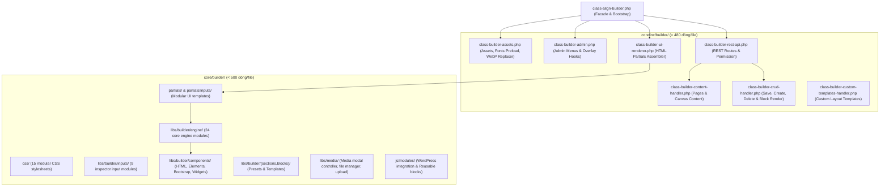
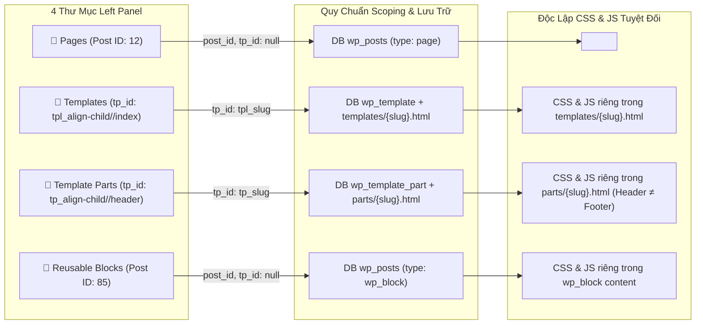
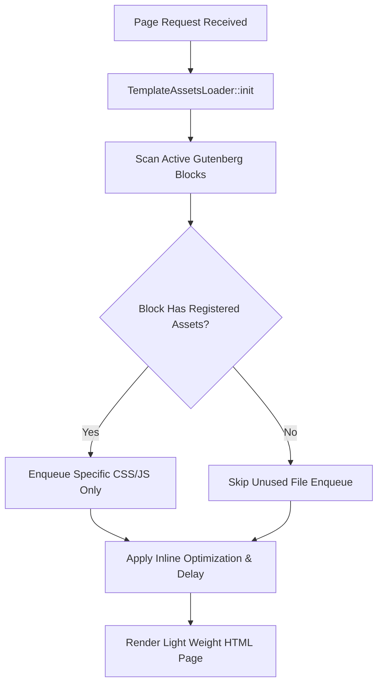
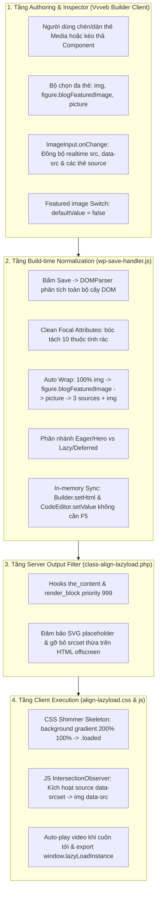

# Hướng Dẫn Visual Builder & Template Assets Loader Engine

> [!NOTE]
> Bộ đôi **Visual Builder Engine** (`core/inc/class-align-builder.php`) và **Template Assets Loader Engine** (`core/inc/template-assets-loader.php`) là hai trụ cột chịu trách nhiệm về trải nghiệm dựng trang trực quan và khả năng tối ưu hóa tốc độ nạp trang đỉnh cao của Theme Align.

---

## 1. Visual Builder Engine (`core/inc/class-align-builder.php` & `core/inc/builder/`)

### 1.1 Chức Năng Chính & Kiến Trúc Module Hóa
Hệ thống Builder đã được tái cấu trúc toàn diện thành 8 cụm chức năng độc lập, với 100% các file tùy biến đạt chuẩn **< 500 dòng/file**, đặt tên tự mô tả chức năng và phân bổ theo từng folder rõ ràng:



- **Facade Bootstrap (`class-align-builder.php`)**: Khởi tạo các module con và cung cấp các static proxy methods giữ nguyên 100% tương thích ngược (`resolve_asset_url`, `is_asset_enabled`, `get_builder_css_urls`, `get_builder_js_assets`, `replace_dummy_images`).
- **Asset Resolver (`class-builder-assets.php`)**: Quản lý nạp CSS/JS theme, Fonts preload tag ở đầu `<head>`, chuyển đổi URL động và thay thế ảnh dummy sang WebP.
- **Admin & Menus (`class-builder-admin.php`)**: Đăng ký menu admin WordPress, shortcut trên Admin Bar, quick actions trên danh sách bài viết/trang, và enqueue overlay script cho Gutenberg Site Editor.
- **REST API Router (`class-builder-rest-api.php`)**: Định tuyến 8 REST endpoints với namespace `align-builder/v1` (Pages, Page-content, Save, Render Block/Shortcode, Create/Delete, Search-links).
- **Content Handler (`class-builder-content-handler.php`)**: Truy vấn danh sách Pages/Templates và render HTML canvas preview kèm font preloads và dynamic stylesheets.
- **CRUD Handler (`class-builder-crud-handler.php`)**: Xử lý lưu nội dung (`/save-page`), tạo mới (`/create-item`), xóa (`/delete-item`), render shortcodes và Gutenberg blocks.
- **Custom Templates Handler (`class-builder-custom-templates-handler.php`)**: Quản lý lưu trữ, trích xuất và xóa các mẫu layout dựng sẵn (`align_builder_custom_templates`) trong DB `wp_options`, hỗ trợ lưu cả HTML, Scoped CSS và JS.
- **UI Renderer (`class-builder-ui-renderer.php`)**: Tự động ghép các HTML partials từ `core/builder/partials/` và `partials/inputs/` thành giao diện hoàn chỉnh (thiết lập giao diện Dark Mode mặc định `data-bs-theme="dark"`), đồng bộ trạng thái theme qua `localStorage` và inject WordPress scripts/styles.

> [!TIP]
> Chi tiết toàn bộ sơ đồ kiến trúc 8 cụm, bản đồ ma trận file và luồng dữ liệu xem tại [MANIFEST.md](../../core/builder/MANIFEST.md).

### 1.2 Cấu Trúc REST API Đồng Bộ

Visual Builder giao tiếp qua REST API chuẩn WordPress:

| Method | Endpoint | Mục Đích |
| :--- | :--- | :--- |
| `GET`/`POST`/`DELETE` | `/wp-json/align-builder/v1/custom-templates` | CRUD các mẫu template dựng sẵn (HTML, CSS, JS) lưu DB `wp_options` |
| `GET` | `/wp-json/align/v1/builder/data` | Truy vấn toàn bộ cấu trúc block dữ liệu của bài viết / trang |
| `POST` | `/wp-json/align/v1/builder/save` | Lưu và cập nhật thuộc tính block cùng mã HTML đã render |
| `GET` | `/wp-json/align/v1/builder/templates` | Lấy danh sách Gutenberg Block Templates & Patterns có sẵn |

### 1.3 Ví Dụ Đăng Ký REST Endpoint Trong Controller

```php
<?php
/**
 * Register Visual Builder REST API Route Example
 *
 * @package Align
 */

if ( ! defined( 'ABSPATH' ) ) {
	exit;
}

class Align_Builder_API {

	/**
	 * Initialize REST API hooks
	 */
	public static function init() {
		add_action( 'rest_api_init', array( __CLASS__, 'register_routes' ) );
	}

	/**
	 * Register API routes for Visual Builder
	 */
	public static function register_routes() {
		register_rest_route(
			'align/v1',
			'/builder/data',
			array(
				'methods'             => 'GET',
				'callback'            => array( __CLASS__, 'get_builder_data' ),
				'permission_callback' => function() {
					// Verify user permissions for builder access
					return current_user_can( 'edit_posts' );
				},
			)
		);
	}

	/**
	 * Get builder content data
	 *
	 * @param WP_REST_Request $request REST request instance.
	 * @return WP_REST_Response
	 */
	public static function get_builder_data( $request ) {
		$post_id = $request->get_param( 'id' );
		$content = get_post_field( 'post_content', $post_id );

		return new WP_REST_Response(
			array(
				'success' => true,
				'content' => parse_blocks( $content ),
			),
			200
		);
	}
}
```

### 1.4 Code Editor Modal & Custom JS/CSS Live Sync

Visual Builder hỗ trợ cửa sổ Code Editor Modal chuyên nghiệp (mở bằng nút **Code Editor** ở chân canvas hoặc phím tắt `Ctrl + E`), trang bị 3 tab độc lập và huy hiệu **Live Sync** thời gian thực:
- **HTML Tab (`#code-tab`)**: Chỉnh sửa mã nguồn HTML trực tiếp của Canvas, tự động lọc sạch thẻ helper và đồng bộ hai chiều với Iframe DOM, Tree Navigator và Sections List qua `Vvveb.Builder.setHtml()`.
- **CSS Tab (`#csscode-tab`)**: Quản lý `Vvveb.StyleManager`, inject tức thời mọi rule CSS vào thẻ `<style id="vvvebjs-styles">` trong `<head>` iframe với độ trễ 100ms (tự động gỡ bỏ thẻ khỏi DOM khi mã rỗng).
- **JS Tab (`#jscode-tab`)**: Quản lý `Vvveb.JsManager`, inject và thực thi tự động mã JavaScript tùy biến trong thẻ `<script id="vvvebjs-scripts">` với độ trễ 200ms (tự động gỡ bỏ thẻ khi mã rỗng).
- **Cơ chế Flush & Cách Ly Dữ Liệu**:
  - Mỗi tab sở hữu bộ đếm debounce độc lập `this._timer`, loại bỏ hoàn toàn hiện tượng hủy chéo timer khi thao tác đồng thời.
  - Khi chuyển tab (`hide.bs.tab`), đóng modal (`hidden.bs.modal`), hoặc bấm **Save**, hệ thống tự động kích hoạt `flush()` đẩy ngay lập tức mọi thay đổi đang chờ vào Canvas.
  - Khi chuyển sang tab HTML, hệ thống tự động cách ly và bảo toàn 100% mã CSS/JS hiện có, không bị xóa trắng hay ghi đè.
  - Khi xóa rỗng mã HTML trong tab HTML, `setHtml("")` làm rỗng Canvas body tức thì, không bị khôi phục lại mã cũ khi chuyển tab.

```php
<?php
// Saved builder HTML is automatically encapsulated in default custom dynamic block:
// <!-- wp:align/custom-html {"blockId":"align-1a2b3c4d","enableShortcode":true} -->
// <style id="vvvebjs-styles">
//   .my-container { background: #f8f9fa; }
// </style>
// <div class="my-container">...</div>
// <script id="vvvebjs-scripts">
//   console.log("Custom script executed from Align Builder!");
// </script>
// <!-- /wp:align/custom-html -->
```

### 1.5 Chế Độ Chỉnh Sửa Nội Dung An Toàn (Content Mode)

Visual Builder trang bị tính năng **Content Mode** (bật/tắt qua nút **Content Mode** trên thanh công cụ Top Panel hoặc qua hàm `Vvveb.Gui.toggleContentMode()`). Khi được kích hoạt, hệ thống sẽ chuyển sang chế độ biên tập an toàn dành cho Content Editor / Copywriter, ngăn chặn hoàn toàn rủi ro vỡ bố cục giao diện hoặc can thiệp sai mã nguồn:

- **Trạng thái & Lưu trữ (`localStorage`)**: Trạng thái được lưu trong key `align_builder_content_mode` và tự động áp dụng class `.content-mode-active` lên container `#vvveb-builder` và `document.body`.
- **Phát sự kiện (Event Bus)**: Kích hoạt custom event `Vvveb.Builder.contentModeChange` để các module và plugin mở rộng phản hồi đồng bộ.
- **Inline & Panel Content Editing**:
  - Khi nhấp đơn (single click) vào text element trên Canvas, Builder lập tức kích hoạt inline editing và đặt con trỏ soạn thảo tại vị trí click.
  - Hover chuột vào text element hiển thị đường viền nét đứt (dashed blue outline) và badge "Click to edit"; các component đóng gói (shortcode, block) hiển thị con trỏ khóa (not-allowed).
  - Người dùng có thể chỉnh sửa trực tiếp trên Canvas (inline) hoặc qua tab "Page Content" (biểu mẫu danh sách gom theo section ở thanh điều hướng trái) hoặc qua tab Content Inspector bên phải.
  - Phím tắt bàn phím tiện lợi: `Escape` để hủy thay đổi mà không lưu vào Undo stack; `Tab` / `Shift+Tab` để chuyển nhanh sang phần tử văn bản kế tiếp / trước đó.
- **Bảng ma trận quyền hạn chi tiết**:

| Tính năng | Design Mode (Toàn quyền) | Content Mode (`.content-mode-active`) |
| :--- | :---: | :---: |
| **Sửa Text trực quan (Inline WYSIWYG)** | ✅ Có (Double click) | ✅ Có (Single click trực quan) |
| **Sửa Text / Content Inspector** | ✅ Có | ✅ Có (Auto-grow textarea, plain-text view) |
| **Sửa Link & URL (Properties Panel)** | ✅ Có | ✅ Có (Qua tab Content / Link Input) |
| **Thay đổi ảnh / Media Library (`#change-img-btn`)** | ✅ Có | ✅ Có (Mở WP Media Library) |
| **Undo / Redo / Revisions / Save / Viewport** | ✅ Có | ✅ Có |
| **Nút Thêm Component Dock / Canvas (`#add-section-box`)** | ✅ Có | 🚫 **Ẩn hoàn toàn (Edit-only mode)** |
| **Kéo thả component từ Sidebar (Drag & Drop)** | ✅ Có | 🚫 **Khóa & Ẩn hoàn toàn** |
| **Di chuyển phần tử trên Canvas / Sắp xếp Up/Down** | ✅ Có | 🚫 **Khóa & Ẩn hoàn toàn** |
| **Thêm Section mới (`#add-section-box`)** | ✅ Có | 🚫 **Khóa & Ẩn hoàn toàn** |
| **Nhân bản / Xóa khối cấu trúc (Clone/Delete)** | ✅ Có | 🚫 **Khóa & Ẩn hoàn toàn** |
| **Sắp xếp kéo thả trên DOM Tree Navigator** | ✅ Có | 🚫 **Khóa & Vô hiệu hóa SortableJS** |
| **Mở Code Editor Modal (`Ctrl + E`)** | ✅ Có | 🚫 **Khóa & Ẩn nút Code Editor** |
| **Tab Style & Advanced trong Inspector** | ✅ Có | 🚫 **Ẩn hoàn toàn (Chỉ mở tab Content)** |
| **Tabs Components, Sections, Styles ở Left Sidebar** | ✅ Có | 🚫 **Ẩn hoàn toàn (Chỉ mở tab Pages)** |

### 1.6 Cơ Chế Tự Động Đóng Gói Custom Block `align/custom-html`
Mỗi khi một Page hoặc FSE Template được chỉnh sửa và lưu từ **Align Builder**:
1. **Tự động trích xuất CSS & JS**: `WpSaveHandler` tự động trích xuất mã CSS từ `Vvveb.StyleManager.getCss()` (bọc `<style id="vvvebjs-styles">`) và mã JS từ `Vvveb.JsManager.getJs()` (bọc `<script id="vvvebjs-scripts">`) đính kèm cùng HTML body.
2. **Tự động chuyển đổi & Làm sạch**: `api_save_page()` sẽ dọn dẹp các thẻ preview tạm (`data-align-preview="1"`) và tự động đóng gói toàn bộ HTML, CSS và Inline JS thành một Gutenberg Dynamic Block chuẩn:
   ```html
   <!-- wp:align/custom-html {"blockId":"align-xxxxxx","enableShortcode":true} -->
   <style id="vvvebjs-styles">
   /* Custom Page Styles */
   </style>
   ... [HTML Canvas Content] ...
   <script id="vvvebjs-scripts">
   // Custom Page Script
   </script>
   <!-- /wp:align/custom-html -->
   ```
3. **Khóa DOM Gutenberg & Placeholder Card (Context-Aware Deep Linking)**: Trong CMS Block Editor (Gutenberg) và Site Editor (FSE), block `align/custom-html` tự động hiển thị thẻ card placeholder chuyên nghiệp với logo Align SVG và nút **"Edit with Align Builder"**. Khối tự động phân giải mục tiêu ngữ cảnh (Page ID cụ thể `&post_id=...`, FSE Template `&tp_id=tpl_...`, Template Part `&tp_id=tp_...`, hoặc Reusable Block) qua 5 tầng dữ liệu (`props.context`, block hierarchy cha `core/template-part`, store `core/edit-site`, store `core/editor`, và URL parameters). Thuộc tính `supports.html = false` giúp khóa cứng DOM, chống Gutenberg làm xáo trộn cấu trúc HTML/CSS. Hàm `save()` trong `editor.js` trả về `wp.element.RawHTML(attributes.content)` giúp vượt qua 100% cơ chế kiểm tra Gutenberg Block Validation mà không bao giờ bị báo lỗi *"Block contains invalid content"*.
4. **Frontend Dynamic Rendering (Zero-Wrapper Clean Semantic DOM)**: Ngoài Frontend, file `render.php` xuất thẳng nội dung `$html` sạch sẽ ra trang web mà không bọc thêm bất kỳ thẻ wrapper `<div>` trung gian nào (trừ khi có `className` tùy biến trong Gutenberg Inspector), tự động unwrap thẻ wrapper legacy, thực thi Shortcodes (`do_shortcode()`) và render các đoạn script chuẩn xác, bảo toàn 100% cấu trúc Semantic HTML5 tối ưu cho SEO và ADA/WCAG.
5. **Đồng bộ 2 chiều (Round-trip Sync)**: Khi mở lại trang trong Align Builder, `api_get_page_content()` trích xuất nội dung bên trong block `align/custom-html` nạp trực tiếp lên Canvas. `Vvveb.StyleManager` và `Vvveb.JsManager` tự động quét các thẻ `#vvvebjs-styles` và `#vvvebjs-scripts` để nạp ngược lại vào Code Editor (`Ctrl + E`), hỗ trợ live evaluation trực tiếp trên iframe.

### 1.6 Tinh Chỉnh Giao Diện Visual Builder (UI Cleanups & Topbar Toolbar)

Để tối ưu không gian hiển thị và trải nghiệm người dùng, giao diện thanh Top Panel và các nút thao tác đã được tinh chỉnh tối giản:
- **Ẩn nhóm nút layout top-left**: Nhóm nút chuyển đổi bố cục sidebar/panel thừa (`toggleSidebar`, `toggleFileManager`, `toggleLeftColumn`, `toggleRightColumn`) được ẩn bằng lớp `d-none`.
- **Rút gọn nút Save**: Đổi nhãn nút từ `Save to Align Theme` thành `Save` ngắn gọn và loại bỏ nút mũi tên sổ xuống (`#showChangesBtn` dropdown toggle split).
- **Loại bỏ triệt để 6 tùy chọn thừa tại Topbar**:
  - Gỡ bỏ cụm nút: **Designer Mode** (`#designer-mode-btn`), **Preview** (`#preview-btn`), **Fullscreen** (`#fullscreen-btn`), **Show hidden elements** (`#toggle-hidden`), **Toggle Navigator** (`#toggle-tree-list`), và **Download** (`#download-btn`).
  - Gỡ bỏ sạch các hàm JS xử lý đi kèm: `Vvveb.Gui.download()`, `Vvveb.Gui.toggleHidden()`, `Vvveb.Gui.preview()`, `Vvveb.Gui.fullscreen()`, `Vvveb.Gui.setDesignerMode()`, `launchFullScreen()`, và `Vvveb.Builder.setDesignerMode()`.
  - Gỡ bỏ các thư viện phụ thuộc không còn sử dụng: `JSZip` (`jszip.min.js`), `filesaver.min.js`, và plugin `plugin-jszip.js`.
- **Nút Back về WordPress CMS Dashboard (`#back-to-cms-btn`)**: Đặt ở góc trái ngoài cùng Topbar (trước cụm Undo/Redo), hiển thị trực tiếp Site Icon / Logo (22x22px) của trang web (hoặc fallback icon WordPress `la-wordpress` màu `#38bdf8` nếu site chưa cài favicon). Thiết kế 100% trong suốt (zero-border, zero-shadow, không text thừa), hiệu ứng hover phóng to nhẹ nhàng (`scale(1.05)`), click để điều hướng nhanh về CMS Dashboard (`admin_url()`).
- **Thanh công cụ phần tử căn giữa Topbar (`#select-actions`)**: Chuyển toàn bộ thanh công cụ thao tác phần tử từ vị trí đè trôi nổi trên canvas về nằm cố định ở chính giữa Topbar (`#top-panel`), loại bỏ hoàn toàn tình trạng che khuất phần tử khi dựng trang.
- **Cập nhật động theo phần tử được chọn (`selectNode`)**:
  - **Badge định danh phần tử (`#top-select-element-badge`)**: Hiển thị tên thẻ HTML / Class / Shortcode (vd: `DIV .container`, `H1`, `IMG`, `wordpress/shortcode`).
  - **Tự động kiểm tra giới hạn vị trí**: Tự động vô hiệu hóa nút `Move Up` (`#up-btn`) khi là phần tử đầu tiên trong container và nút `Move Down` (`#down-btn`) khi là phần tử cuối cùng.
  - **Nút công cụ ngữ cảnh động**:
    - **Nút Overwrite Toggle (`#toggle-overwrite-btn`)**: Chỉ hiển thị khi đang biên tập **Reusable Block** (`wp_block` / thư mục Reusable Blocks) và người dùng chọn thẻ **Typography** (`h1`-`h6`, `p`, `span`, `a`...) hoặc **Media** (`img`, `video`, `picture`...). Với các loại bài khác (`page`, `wp_template`, `wp_template_part`), nút này được ẩn hoàn toàn để tránh nhầm lẫn. Bấm để bật/tắt quyền ghi đè nội dung trên trang live (`data-allow-overwrite="true"` + `data-overwrite-id="ov-xxx"`). Nút hiển thị màu cyan active khi cờ Overwrite bật.
    - **Thẻ `IMG`**: Hiển thị nút **Change Image** (`#change-img-btn`) mở trực tiếp popup WordPress Media Library (`wp.media`) để cập nhật URL ảnh thời gian thực.
  - **Bộ công cụ tinh gọn**: Giữ lại bộ công cụ chuẩn gồm: `Element Badge`, `Convert Dynamic Block` (🪄), `AI Translate Section` (🌐), `Restore Section from Original` (🕒), `Overwrite Toggle` (chỉ ở Reusable Block), `Up`, `Down`, `Toggle Hide/Unhide`, `Change Image`, `Clone`, `Delete`.
  - **Hệ thống Custom Hover Tooltips Tập Trung (`wp-toolbar-tooltips.js`)**: Toàn bộ các nút trên thanh `#select-actions` và Topbar được trang bị custom Bootstrap 5 Tooltips hiển thị tức thì (`delay: { show: 100, hide: 50 }`, nhanh gấp 10 lần độ trễ 1s mặc định của trình duyệt). Toàn bộ thuộc tính `title` HTML được bóc tách và xóa sạch khỏi DOM (`data-bs-original-title`), triệt tiêu 100% browser native tooltip. Tự động đồng bộ nội dung khi đổi trạng thái (Hide/Unhide, Overwrite) qua MutationObserver và đóng sạch sẽ tooltip (Zero-Dangling) ngay khi click nút, click canvas iframe, cuộn trang, nhấn phím Escape hoặc khi toolbar bị ẩn.
  - **Menu Chuột Phải Ngữ Cảnh & Bộ Nhớ Tạm Copy/Paste (`wp-context-menu.js`)**: Click chuột phải vào bất kỳ phần tử nào trên Canvas hoặc cây DOM Navigator sẽ mở ngay Menu nổi ngữ cảnh dạng danh sách với độ trễ 0ms. Menu trang bị đầy đủ các thao tác: **Copy (`Ctrl+C`)**, **Paste After (`Ctrl+V`)**, **Paste Inside** (vào trong container), **Duplicate (`Ctrl+D`)**, **Move Up / Down**, **Hide / Unhide**, và **Delete (`Del`)**. Bộ nhớ đệm DOM tự động làm mới `instance_id` cho shortcode và reusable block khi dán để chống trùng lặp dữ liệu, đồng thời đồng bộ liền mạch với `Vvveb.Undo` và System Clipboard.

### 1.7 Nạp Đồng Bộ Tài Nguyên Asset Loader & Custom Code Về Canvas

Builder Iframe Preview Canvas (`/wp-json/align-builder/v1/page-content`) nạp tự động toàn bộ tài nguyên đã đăng ký từ Admin:
- **Asset Loader CSS & JS**: Đọc `align_loaded_assets`, nạp đúng các file CSS/JS đã được bật (`enabled`), phân biệt vị trí `header` (trong `<head>`) / `footer` (trước `</body>`) và thuộc tính tải (`normal`, `defer`, `async`).
- **Global Custom CSS & JS**: Nạp `align_custom_css` vào `<style id="align-global-custom-css" data-align-preview="1">` và `align_custom_js` vào `<script id="align-global-custom-js" data-align-preview="1">`.
- **Tracking Code**: Nạp `align_tracking_code` vào `<head>`.
- **Cleaner Preview Isolation**: Tất cả script/style preview toàn cục được gắn `data-align-preview="1"` và tự động bóc tách sạch sẽ ở hàm `api_save_page()` khi lưu trang, loại bỏ hoàn toàn mã dư thừa rác khỏi Database mà vẫn bảo toàn vẹn nguyên CSS/JS riêng của từng page.
- **Dọn dẹp Gutenberg Global Styles**: Loại bỏ các thẻ `<style id="wp-global-styles">` dư thừa khỏi Builder Iframe để nhất quán 100% với giao diện Frontend.

### 1.8 Tích Hợp WordPress Media Library & Đồng Bộ Canvas Real-time

Builder được tích hợp sẵn với thư viện quản lý media chuẩn của WordPress:
- **WordPress Media Modal (`wp.media`)**: Tự động nạp `wp_enqueue_media()`, `wp_print_styles()`, `wp_print_scripts()` và Backbone templates (`wp_print_media_templates()`) vào giao diện Builder `editor.html`.
- **Tự động mở Popup Media WordPress**: Mở cửa sổ Media Library chuẩn của WordPress mỗi khi người dùng click vào nút **Set image** hoặc ô Image Preview ở bảng thuộc tính sidebar.
- **Cập nhật Canvas Real-time**: Ngay khi chọn ảnh từ WordPress Media Library, URL ảnh (`attachment.url`) được gán trực tiếp cho phần tử `` trên canvas iframe (`Vvveb.Builder.selectedEl`), cập nhật hình ảnh thời gian thực tức thì trên màn hình chỉnh sửa và khi lưu xuất ra Frontend CMS.

### 1.9 Tích Hợp Khối WordPress (Shortcodes, Gutenberg Blocks & Universal Post Content)

Hệ thống Builder cung cấp các khối tích hợp chuẩn WordPress (`core/builder/libs/builder/components-wordpress.js`):
- **WP Shortcode (`wordpress/shortcode`)**: Hỗ trợ chèn Shortcode WordPress tùy ý kèm Live REST API preview (`/render-shortcode`). Thẻ container mang thuộc tính chuẩn: `<div data-component-shortcode data-shortcode="[shortcode_name]"></div>`.
- **Shadow DOM Style Boundary Penetration & Third-Party Stylesheet Auto-Capture (`wp-style-injector.js`, `class-builder-crud-handler.php`, `class-builder-assets.php`)**:
  - Tự động bắt `$wp_styles->queue` trong REST `/render-shortcode` và `/render-block` (lưu `$before_styles` trước `init_script_environment`) để đính kèm link CSS của shortcode và plugin (Kit Builder, Shop Page, Fluent Forms, Contact Form 7, v.v.) vào payload preview.
  - Tự động quét và nạp toàn bộ module CSS frontend của child theme (`inc/*/assets/css/*.css`) vào `themeCssUrls` (`class-builder-assets.php`) để Canvas Iframe và Shadow Root luôn sở hữu đầy đủ bộ style của component.
  - Tự động chuyển đổi các quy tắc CSS phân cấp (`#section-X .child`) thành `:host-context(#section-X) .child` và inject vào Shadow Root (`#align-host-context-styles`), đảm bảo 100% độ chính xác về giao diện bên trong Open Shadow DOM.
  - Tự động phát hiện và nạp static CSS/JS của các Reusable Block được nhúng (`[reuse-block id="..."]`) vào Canvas Iframe `<head>`.
- **WP Gutenberg Block (`wordpress/block`)**: Hỗ trợ chèn mã block Gutenberg hoặc Synced Pattern kèm Live REST API preview (`/render-block`). Thẻ container: `<div data-component-wp-block data-wp-block="<!-- wp:... -->"></div>`.
- **Universal WP Post Content Engine (`class-align-post-content.php`)**: Khối hiển thị nội dung bài viết động đa nền tảng ("Chỉ cần gọi là chạy"), hỗ trợ 5 phương thức kích hoạt:
  1. *Thẻ Atomic Component*: `<div data-component-post-content>post-content</div>` (hoặc `<main data-component-post-content>`, `<section data-component-post-content>`).
  2. *Bộ 4 Shortcode Aliases*: `[wp_content]`, `[post_content]`, `[align_content]`, `[align_post_content]` (kèm tham số `id`, `slug`, `words`, `strip_tags`, `raw`, `tag`, `class`).
  3. *PHP Helper API*: `Align_Post_Content::render( $post_id, $args )`.
  4. *Gutenberg FSE Block*: `<!-- wp:post-content /-->`.
  5. *Visual Builder Drag & Drop*: Kéo thả trực tiếp từ sidebar vào canvas.
- **7-Tier Waterfall Query Context Resolution**: Tự động nhận diện chính xác bài viết cần render qua chuỗi ưu tiên 7 cấp:
  1. `explicit_id` truyền trực tiếp.
  2. `block_context['postId']` trong Gutenberg block template / Query Loop.
  3. `in_the_loop() ? get_the_ID()`.
  4. `is_singular() ? get_queried_object_id()`.
  5. `global $post->ID`.
  6. `global $wp_query->post->ID`.
  7. Fallback an toàn.
- **Anti-Recursion Stack & Multi-Tier Depth Limiter**:
  - Quản lý mảng stack ID đang render `static $active_rendering_posts`. Khi một bài viết tự gọi chính nó hoặc tạo vòng lặp chéo (Post A ➔ Post B ➔ Post A), hệ thống lập tức ngắt chu kỳ và trả về chuỗi rỗng an toàn.
  - Giới hạn cứng độ sâu `MAX_DEPTH = 3` và `$processing_depth >= 5` bọc trong `try...finally` đảm bảo 100% không bao giờ xảy ra lỗi tràn bộ nhớ hoặc Fatal Error.
- **Security & Access Guards**: Tự động chặn khách vãng lai xem trộm các bài viết `trash`, `draft`, `private` qua shortcode `[wp_content id="..."]` và tự động hiển thị `get_the_password_form()` nếu bài viết có mật khẩu.
- **Bi-Directional Disk-Database Synchronization (`class-align-template-tweaks.php` & `class-builder-crud-handler.php`)**:
  - *Mtime-Aware Sync*: Tự động so sánh `filemtime` file `.html` trên đĩa với thời gian sửa đổi trong DB (`wp_posts` CPT `wp_template`), tự động cập nhật Database ngay khi file trên đĩa được chỉnh sửa qua VS Code hoặc Git.
  - *Dual-Write Persistence*: Khi lưu qua Visual Builder (`save_page`), hệ thống ghi đồng thời vào DB và file đĩa `align-child/templates/{slug}.html`.
- **Server-Side Preview Canvas Engine (`class-builder-content-handler.php`)**: Khi API `/page-content` được gọi để nạp Canvas iframe, hàm `render_builder_components_for_preview()` tự động thực thi shortcodes, blocks và làm sạch `data-component-post-content` trên server, nhúng thẳng placeholder text an toàn (`textContent`) vào iframe canvas mà không lo dính rác HTML cũ.
- **Smart Shortcode Normalization (`align_normalize_shortcode`)**: Tự động nhận diện và xử lý fallback thông minh cho các shortcode mặc định như `[gallery]` khi chưa có thuộc tính `ids` và trang chưa có media đính kèm trực tiếp.
- **Clean Frontend DOM Replacement (`content-filters.php`)**: Ngoài Frontend, hàm `align_parse_and_render_builder_components()` sử dụng `DOMDocument` thay thế trực tiếp toàn bộ thẻ component wrapper bằng mã HTML kết quả của shortcode/block/post-content (`align_replace_node_with_html()`), loại bỏ hoàn toàn các thẻ div bọc thừa hoặc empty tags.
- **Pointer Events Isolation**: Toàn bộ nội dung preview bên trong được áp dụng `pointer-events: none` kết hợp cơ chế tự động bubble up (`closest('[data-component-shortcode]')`, `closest('[data-component-post-content]')`), giúp người dùng click trực tiếp vào bất kỳ điểm nào trên component là lập tức kích hoạt bảng chỉnh sửa thuộc tính bên phải và highlight đúng node trên cây Navigator.

### 1.10 DOM Tree Navigator, Chọn Nhiều Phần Tử (Multi-Selection) & Xóa Hàng Loạt

Bảng **DOM Tree Navigator** (`#tree-list`) cung cấp cây cấu trúc trực quan phân cấp của toàn bộ các phần tử trên Canvas:
- **Hiển thị trực quan & Đồng bộ 2 chiều**: Cập nhật tự động thời gian thực mỗi khi DOM Canvas thay đổi, Code Editor nạp lại (`setHtml`), hoặc kéo thả chèn section mới.
- **Atomic Components Isolation**: Các phần tử atomic độc lập (như `WP Shortcode`, `WP Gutenberg Block`, `WP Post Content`) được hiển thị dưới dạng leaf node (`class="file"`), không bị phân rã thành các thẻ con bên trong.
- **Media Leaf Node Isolation (`img`, `picture`, `source`)**: Các thẻ ``, `<picture>`, và `<source>` được xử lý như blackbox — children bên trong (thẻ `<source>` responsive, `` con) bị ẩn khỏi tree vì không có giá trị điều hướng. Khi người dùng click vào Image trên Canvas, Navigator tự động **bubble up** lên ancestor gần nhất có trong tree (thường là chính node `<picture>`) để expand và highlight đúng vị trí (`builder-tree-list.js`: `selectComponent` ancestor walk-up logic).
- **Active Selection Retention Khi Edit Sidebar**: Khi người dùng focus hoặc gõ trong textarea/input ở Inspector bên phải, Tree Navigator re-sync visual selection theo `Vvveb.Builder.selectedEl` / `selectedEls` mà không gọi lại `selectNode()`. Nếu live DOM reference bị stale sau khi text mutate, `syncWithBuilderSelection()` fallback theo `data-ast-id` để giữ đúng class `.active` trên node đang edit.
- **Cơ Chế Chọn Nhiều Phần Tử Linh Hoạt (Multi-Selection Protocol)**:
  - 🖱️ **Click Chuột Thường (Normal Click)**: Xóa các lựa chọn cũ, chọn duy nhất 1 phần tử làm Anchor (mốc) và Primary node, mở Inspector và highlight trên Canvas.
  - ⌨️ **Ctrl / Cmd + Click (Toggle Mode)**: Bật/tắt thêm bớt từng phần tử vào nhóm lựa chọn (`selectedLis` & `Vvveb.Builder.selectedEls`) mà không làm mất các phần tử đã chọn trước đó.
  - ⇧ **Shift + Click (Range Selection Mode)**: Chọn toàn bộ dải liên tiếp các dòng `<li>` hiển thị giữa phần tử mốc (Anchor) và phần tử được click, áp dụng class `.multi-selected`.
- **Xóa & Nhân Bản Hàng Loạt An Toàn (Batch Deletion & Batch Cloning)**:
  - 🗑️ **Phím Tắt Delete / Backspace**: Xóa toàn bộ các phần tử đang chọn ngay tức thì với cơ chế bảo vệ đa tầng (Input Guard) chống xóa nhầm khi đang gõ chữ trong form hoặc CodeMirror.
  - 🗑️ **Nút Thùng Rác Topbar Toolbar (`#delete-btn`) & Tree Action (`.tree-node-delete`)**: Thực thi xóa sạch tất cả các phần tử trong danh sách chọn.
  - 🛡️ **Thuật Toán Ancestor Pruning**: Tự động lọc bỏ các phần tử con nếu phần tử cha đã nằm trong nhóm chọn, tránh lỗi duplicate/double-delete và bảo toàn 100% tính toàn vẹn của Virtual AST.
  - 📋 **Nhân Bản Hàng Loạt (`#clone-btn`)**: Hỗ trợ nhân bản song song toàn bộ các phần tử được chọn và cập nhật AST.
  - ⏪ **Undo 1 Bước Duy Nhất (`Ctrl + Z`)**: Gom toàn bộ thay đổi thành 1 mutation duy nhất để phục hồi toàn vẹn chỉ với 1 lần nhấn Undo.
- **Kéo Thả Sắp Xếp 3 Vùng (SortableJS - `builder-tree-sortable.js`)**:
  - Top 25%: Chèn trước (`before`), Giữa 50%: Lồng làm con (`inside`), Dưới 25%: Chèn sau (`after`) với visual drop indicators.
  - Tự động lọc `.tree-node-actions` khỏi cơ chế kéo thả sắp xếp để chống kích hoạt thao tác di chuyển ngoài ý muốn khi người dùng click vào icon.
- **Chống Tràn Dòng, Cuộn Ngang Tự Nhiên & Max-Content Expansion**:
  - Toàn bộ nội dung văn bản (`.tree-node-name`, `.tree-node-title`) được đóng gói trong khối `.tree-node-text` với quy tắc `white-space: nowrap !important;` và `width: max-content !important;`.
  - Cây Navigator trang bị cơ chế cuộn ngang tự động (`overflow-x: auto`) kèm thanh cuộn mảnh Dark Mode, cho phép người dùng cuộn ngang đọc trọn vẹn 100% tên thẻ và tiêu đề element ở các tầng lồng sâu mà không bị cắt cụt và không làm biến dạng kích thước Desktop của Canvas.
  - Giữ cố định chiều cao dòng `26px`, loại bỏ 100% hiện tượng chữ dài bị ngắt dòng rơi xuống đè lên các node bên dưới.
  - Thẻ `<label>` tự động mang thuộc tính `title` chứa đầy đủ tên và mô tả để người dùng có thể đọc trọn vẹn qua tooltip khi rê chuột.

### 1.11 Quản Lý 4 Thư Mục Tree File, Định Danh ID/tp_id & Phân Lập CSS/JS Tuyệt Đối

Hệ thống File Manager tại Left Panel quản lý 4 cụm thực thể hoàn toàn độc lập, đảm bảo **định danh chính xác theo ID / tp_id**, **không trùng lặp hay xung đột**, và **CSS/JS độc lập 100% không dùng chung**:



#### 1. Bốn Nhóm Thực Thể Cây Thư Mục (4 Tree Categories):
- **1. Pages (`folder: 'Pages'`)**:
  - **Định danh**: Numeric ID (ví dụ: `12`), Name: `page_12`, Slug: `gioi-thieu`.
  - **URL / REST**: `?page=align-builder&post_id=12` | `/align-builder/v1/page-content?id=12`.
  - **Lưu trữ**: Bảng `wp_posts` (`post_type = 'page'`) + `assets/builder/style-page-{slug}.css` (khi bật External Assets).
  - **CSS/JS**: Tách biệt hoàn toàn, lưu trong thẻ `<style id="style-page-{slug}">` và `<script id="script-page-{slug}">` bọc trong block `align/custom-html` của page đó.
- **2. Templates (`folder: 'Templates'`)**:
  - **Định danh**: Chuỗi `tpl_id` tiền tố `tpl_` (ví dụ: `tpl_align-child//index`, `tpl_align-child//single`, `tpl_align-child//404`), Name: `tpl_index`.
  - **URL / REST**: `?page=align-builder&tp_id=tpl_align-child%2F%2Findex` | `/page-content?tp_id=tpl_...`.
  - **Lưu trữ**: CPT `wp_template` trong DB, file vật lý tại `templates/{slug}.html`, và file tĩnh `assets/builder/style-template-{slug}.css`.
  - **Kiến trúc Pure Template Canvas**: Các FSE Templates chỉ chứa vùng nội dung chính (hoạt động độc lập và sạch như một Page thông thường), không chứa mã Header/Footer hay `wp:template-part`. Khi load vào Builder, `Align_Builder_Content_Handler::get_page_content()` tự động strip các thẻ `wp:template-part` nếu có, ngăn chặn Header/Footer bị bung thô ra đè lên canvas soạn thảo.
  - **CSS/JS**: Độc lập cho từng template (`style-template-{slug}` / `script-template-{slug}`), không dùng chung với template hay page khác.
- **3. Template Parts (`folder: 'Template Parts'`)**:
  - **Định danh**: Chuỗi `tp_id` tiền tố `tp_` (ví dụ: `tp_align-child//header`, `tp_align-child//footer`), Name: `tp_header`.
  - **URL / REST**: `?page=align-builder&tp_id=tp_align-child%2F%2Fheader` | `/page-content?tp_id=tp_...`.
  - **Lưu trữ**: CPT `wp_template_part` + taxonomy `wp_template_part_area` trong DB, file vật lý tại `parts/{slug}.html`, và file tĩnh `assets/builder/style-part-{slug}.css`.
  - **Biên tập độc lập 100%**: Header và Footer được cô lập quản lý và chỉnh sửa riêng biệt trong tab Template Parts. Không bị strip khi nạp vào builder canvas, sở hữu scoped style ID riêng (`style-part-header`, `style-part-footer`) và scripts độc lập, loại bỏ hoàn toàn lỗi ghi đè chéo.
- **4. Reusable Blocks (`folder: 'Reusable Blocks'`)**:
  - **Định danh**: Numeric ID (ví dụ: `85`), Name: `block_85`, Slug: `cta-banner`.
  - **Shortcode**: `[reuse-block id="85"]` (kèm nút copy nhanh 1-click ở thanh Topbar).
  - **URL / REST**: `?page=align-builder&post_id=85` | `/page-content?id=85`.
  - **Lưu trữ**: Bảng `wp_posts` (`post_type = 'wp_block'`) và file tĩnh `assets/builder/style-block-{slug}.css`.
  - **CSS/JS**: Scoped trong nội dung master block (`style-block-{slug}`), tự động kế thừa master classes và tags khi nhúng vào các trang con.

#### 2. Cơ Chế Chống Xung Đột & Độc Lập CSS/JS 100%:
1. **Loại trừ ID chéo (Mutually Exclusive Save Payload)**: Khi lưu (`wp-save-handler.js`), hệ thống tự động nhận diện kiểu thực thể đang mở. Nếu là Page/Reusable Block thì gửi `{ post_id: ID, tp_id: null }`. Nếu là Template/Part thì gửi `{ post_id: null, tp_id: 'tpl_...' | 'tp_...' }`. Triệt tiêu hoàn toàn hiện tượng gửi nhầm ID giữa các bảng và CPTs.
2. **Query DB Đơn Phân & `post_name__in`**: Backend chỉ truy vấn đúng post type tương ứng (`wp_template` hoặc `wp_template_part`), dùng chuẩn `post_name__in` khớp slug (`child//slug`, `parent//slug`, `slug`), tuyệt đối không dùng `name__in` lỗi.
3. **Reset và Cô Lập CSS/JS Khi Chuyển Trang**: Khi chuyển qua lại giữa các item trên file tree, `Vvveb.StyleManager` và `Vvveb.JsManager` sẽ dọn sạch bộ nhớ cache, nạp đúng CSS/JS của item mới từ API canvas. Không có tình trạng CSS trang A đè lên trang B.
4. **Zero-Preview-Persistence**: Toàn bộ CSS/JS toàn cục preview (`align-global-custom-css`, `align-global-custom-js`) chỉ phục vụ iframe canvas và bị loại bỏ sạch khi lưu, đảm bảo cơ sở dữ liệu của từng trang chỉ chứa mã riêng của nó.
5. **Pure Blank-Canvas**: Các trang hoặc template part khi khởi tạo hoặc chưa có nội dung sẽ ở trạng thái hoàn toàn trống (chuỗi rỗng `""`), không chèn mã placeholder giả lập, đảm bảo người dùng có toàn quyền xây dựng bố cục từ đầu qua giao diện CMS / Builder.

#### 3. Nguyên Tắc Lưu Trữ 100% WordPress Native Database (Pure DB Persistence):
1. **Lưu Trữ CSDL Duy Nhất**: Mọi thao tác lưu, tạo mới hoặc chỉnh sửa Template (`wp_template`) và Template Part (`wp_template_part`) từ Align Builder hoặc Gutenberg Site Editor đều được lưu trữ hoàn toàn vào bảng `wp_posts` trong Database với taxonomy terms chuẩn (`wp_theme = 'align-child'`, `wp_template_part_area`).
2. **Zero Hard File Writing**: Hệ thống tuyệt đối không chạy bất kỳ hook hay hàm nào (`save_post`, `handleCmsTemplateSave`, `file_put_contents`) để tự động ghi đè hoặc sinh file `.html` vật lý lên ổ đĩa.
3. **File Tĩnh Chỉ Làm Baseline Fallback**: Các file `.html` tĩnh trong theme (`templates/*.html`, `parts/*.html`) đóng vai trò là bản mẫu mặc định ban đầu của Theme khi database chưa có bản ghi tùy biến.

> [!IMPORTANT]
> **Không Tự Động Sinh File Khi Active Theme & Lưu Trữ**: Theme `align` và `align-child` **tuyệt đối không chạy bất kỳ hook kích hoạt theme hay hook lưu bài nào (`after_switch_theme`, `switch_theme`, `save_post_wp_template`)** để tự động tạo file hay nhân bản template parts. Cấu trúc chuẩn của `align-child` duy trì tối giản (`parts/`: `header.html`, `footer.html`; `templates/`: `404.html`, `archive.html`, `index.html`, `page.html`, `search.html`, `single.html`).

### 1.12 Kiến Trúc Thu Gọn Giao Diện Thông Minh (Accordion State & Clean Workspace)

Để tối ưu hóa không gian làm việc và hạn chế tối đa tình trạng rối mắt khi dựng trang:
- **Left Panel FileManager Tree Folders Mặc Định Đóng (Default Collapsed)**: Toàn bộ 4 thư mục chính trong cây File Manager (*Pages, Templates, Template Parts, Reusable Blocks*) đều mặc định ở trạng thái thu gọn/đóng (`input[type="checkbox"]` không có `checked`) khi khởi động Builder. Người dùng nhấp vào từng thư mục để bung mở danh sách các trang/bản mẫu bên trong.
- **Left Panel Components Mặc Định Đóng (Default Collapsed)**: Toàn bộ danh mục component (*Base, Elements, Bootstrap 5, Widgets, Embeds, WordPress*) mặc định ở trạng thái thu gọn khi khởi động Builder. Nút Toggle cạnh ô Search hiển thị biểu tượng `+` (`data-closed="true"`), hỗ trợ bung/đóng nhanh toàn bộ danh mục chỉ với một click.
- **Tìm Kiếm Phản Xạ Tự Động Bung Nhóm (Reactive Search Auto-Expansion)**: Khi người dùng gõ từ khóa vào ô *Search components / Search blocks*, hệ thống tự động bung các nhóm có phần tử khớp và ẩn các nhóm không liên quan; khi xóa từ khóa, các nhóm tự động thu gọn về trạng thái gọn gàng ban đầu.
- **Right Sidebar Properties Inspector**:
  - **Nhóm Thuộc Tính Chính Mở Mặc Định**: Khi chọn bất kỳ phần tử nào, nhóm thuộc tính nội dung cơ bản của nó trong tab **Content** (*Paragraph, Heading, Image, Video, WP Shortcode...*) luôn được **mở sẵn** (`expanded: true`) để người dùng chỉnh sửa ngay mà không cần thao tác thêm.
  - **Nhóm Thuộc Tính Phụ Đóng Mặc Định**: Toàn bộ các nhóm cấu hình chuyên sâu (*General trong Content; Display, Typography, Size, Margin, Padding, Border, Background trong Style; Visibility trong Advanced*) đều **mặc định đóng**.
- **Đồng Bộ Biểu Tượng Mũi Tên Thời Gian Thực**: Sử dụng CSS selector định hướng (`.header-arrow:before`) hiển thị mũi tên sang phải (`\f105`) khi đóng và xoay mũi tên trỏ xuống (`\f107`) khi mở ở cả Left Panel và Right Panel.
- **Centered Modal Cho Popup "Add Element" / "Add Section" (`#add-section-box`)**:
  - Khi click vào nút `+` (Add element) trên Canvas, popup thêm element được hiển thị căn chính giữa màn hình (thay vì tooltip trôi nổi theo tọa độ phần tử).
  - Bố cục `display: flex; flex-direction: column` với chiều cao cố định và thanh cuộn `overflow-y: auto` độc lập cho danh sách component/section, không dùng backdrop làm mờ nền để giữ không gian làm việc sáng sủa.
  - Hỗ trợ đóng nhanh qua nút Close (`x`), chọn element hoặc bấm phím `Escape`.

### 1.13 Cơ Chế Ẩn Phần Tử Khỏi Render Frontend (`data-align-hide="true"`) & Nâng Cấp Tree Navigator

Tính năng cho phép biên tập viên đánh dấu ẩn một hoặc nhiều phần tử khỏi kết quả xuất bản HTML ngoài Frontend mà không làm ảnh hưởng đến cấu trúc trang và trải nghiệm biên tập trong Visual Builder:

#### 1. Triết Lý Thiết Kế & So Sánh Với `display: none`:
- **Không Dùng CSS `display: none`**: Các kỹ thuật ẩn bằng CSS vẫn gửi toàn bộ mã HTML, thẻ ``, `<video>`, shortcode rác ra ngoài trình duyệt, làm tăng kích thước DOM và ảnh hưởng tiêu cực đến Core Web Vitals (LCP, DOM Size, CLS) cũng như bảo mật/SEO.
- **Bóc Tách Khỏi SSR DOM (Clean SSR Stripping)**: Phần tử được gắn thuộc tính `data-align-hide="true"` sẽ bị bóc tách triệt để 100% khỏi cây DOM trước khi WordPress trả về response cho khách truy cập. Ngoài frontend, phần tử hoàn toàn không tồn tại trong source code HTML.

#### 2. Kiến Trúc Backend SSR Stripper (`content-hidden-elements.php`):
- **Vị trí file**: [`align/core/includes/core/content-hidden-elements.php`](file:///d:/Workspace/Personal/Align/palmeto-stg/app/public/wp-content/themes/align/core/includes/core/content-hidden-elements.php).
- **Hàm xử lý lõi**: `align_strip_hidden_elements( $content )`.
- **Fast-path 0ms Overhead**: Tự động bỏ qua ngay lập tức nếu nội dung rỗng, đang trong ngữ cảnh Admin/REST API Preview (`is_admin() || (defined('REST_REQUEST') && REST_REQUEST)`), hoặc chuỗi không chứa `data-align-hide`.
- **Phân Tích & Bóc Tách DOM**: Sử dụng `DOMDocument` kết hợp `DOMXPath` truy vấn các node có `//*[@data-align-hide="true" or @data-align-hide="1" or @data-align-hide=""]`, sau đó gọi `$node->parentNode->removeChild( $node )`.
- **Móc Nối Vào Core WordPress Filters**:
  - `add_filter( 'the_content', 'align_strip_hidden_elements', 8 );`
  - `add_filter( 'render_block', 'align_strip_hidden_elements', 8 );`
  - Tích hợp trực tiếp vào dynamic block `align/custom-html` ([`render.php`](file:///d:/Workspace/Personal/Align/palmeto-stg/app/public/wp-content/themes/align/core/blocks/blocks/dynamic/custom-html/render.php)).

#### 3. Phòng Thủ Đa Tầng Cho Canvas CSS (Zero-FOUC & Anti-Cache):
Để đảm bảo trong Builder Canvas phần tử luôn hiển thị mờ nhận biết tức thì mà không bị ảnh hưởng bởi cache trình duyệt:
- **Tầng 1 (Server-Side Link)**: [`class-builder-content-handler.php`](file:///d:/Workspace/Personal/Align/palmeto-stg/app/public/wp-content/themes/align/core/inc/builder/class-builder-content-handler.php) render thẻ `<link rel="stylesheet">` nạp `vvvebjs-editor-helpers.css` kèm cache buster `?v=time()` và thuộc tính `data-vvveb-helpers="1"`, `data-align-preview="1"`.
- **Tầng 2 (Critical Inline CSS)**: Server inject trực tiếp `<style id="align-editor-hide-helpers" data-align-preview="1">` vào `<head>` của Canvas iframe. Quy tắc trực quan áp dụng ngay tức thì:
  - `[data-align-hide="true"]`: `opacity: 0.45 !important; filter: blur(1.2px) grayscale(50%) !important; outline: 1.5px dashed #f59e0b !important; outline-offset: -1px; position: relative;`
  - Hover: `opacity: 0.75 !important; filter: blur(0.5px) grayscale(20%) !important;`
  - Pseudo-element `::before`: Badge góc trên bên trái nền cam `rgba(245, 158, 11, 0.9)`, chữ trắng `Hidden (No FE)`.
- **Tầng 3 (Client Fallback)**: [`builder-canvas-loader.js`](file:///d:/Workspace/Personal/Align/palmeto-stg/app/public/wp-content/themes/align/core/builder/libs/builder/engine/builder-canvas-loader.js) kiểm tra `!self.frameHead.querySelector('link[data-vvveb-helpers]')`, sử dụng URL tuyệt đối từ `window.VvvebWpConfig.pluginUrl` để loại bỏ hoàn toàn lỗi đường dẫn tương đối và triệt tiêu 100% duplicate HTTP requests.
- **Tự Động Làm Sạch Khi Lưu**: Cả thẻ `<link>` và `<style>` đều mang thuộc tính `data-align-preview="1"`, được bộ serializer `align-serializer.js` tự động bóc tách sạch sẽ trước khi lưu vào Database.

#### 4. Nâng Cấp Trải Nghiệm DOM Tree Navigator:
- **Icon Nhận Biết Trực Quan**: [`builder-content-manager.js`](file:///d:/Workspace/Personal/Align/palmeto-stg/app/public/wp-content/themes/align/core/builder/libs/builder/engine/builder-content-manager.js) chèn icon `<i class="la la-eye-slash text-warning me-1 tree-node-hidden-icon" title="Hidden from frontend"></i>` ngay trước tên node và gán class `is-element-hidden` cho `li`.
- **Định Kiểu Cảnh Báo Sắc Nét**: [`editor-tree-navigator.css`](file:///d:/Workspace/Personal/Align/palmeto-stg/app/public/wp-content/themes/align/core/builder/css/components/editor-tree-navigator.css) quy định icon màu `#f59e0b`, tên node bị gạch ngang màu cam (`text-decoration: line-through !important; text-decoration-color: #f59e0b !important;`), font nghiêng và mờ 60%.
- **Tương Phản Trạng Thái Active (`.active` & `.multi-selected.active`)**: Khi click chọn node ẩn, nhãn hiển thị nền hổ phách dịu (`rgba(245, 158, 11, 0.15)`), viền đứt nét cam, chữ vàng sáng `#fbbf24`, duy trì đường gạch ngang cam thay vì bị màu xanh dương mặc định đè mất.
- **Duy Trì Tiêu Điểm Chọn (Selection Focus Retention)**: [`builder-selection-manager.js`](file:///d:/Workspace/Personal/Align/palmeto-stg/app/public/wp-content/themes/align/core/builder/libs/builder/engine/builder-selection-manager.js) gọi `Vvveb.TreeList.selectComponent(self.selectedEl)` sau khi reload cây, giúp người dùng không bị mất dấu vị trí phần tử đang thao tác.
- **Bảo Mật Chống XSS (RFC/HTML5 Sanitization)**: Khởi tạo hàm `escapeHtml()` trong `builder-content-manager.js` mã hóa 5 ký tự nhạy cảm (`&`, `<`, `>`, `"`, `'`), ngăn chặn nguy cơ Stored DOM XSS qua thuộc tính `title` hoặc `id` của DOM.

---

## 2. Template Assets Loader Engine (`template-assets-loader.php`)

### 2.1 Cơ Chế Nạp Tài Nguyên Theo Yêu Cầu (Demand-Driven Assets)
Khác với các theme truyền thống nạp toàn bộ CSS/JS vào mọi trang, `TemplateAssetsLoader` hoạt động theo nguyên lý **Demand-Driven**:
1. Scan toàn bộ các block và template part được gọi trong trang hiện tại.
2. Tra cứu registry (`StyleAssets`, `ScriptAssets`, `PluginAssets`) để lấy danh sách CSS/JS tương ứng.
3. Bổ sung script/style vào hàng đợi `wp_enqueue_scripts` **chỉ khi block đó tồn tại**.



### 2.2 Đăng Ký Plugin Third-Party Trong Parent Theme Core
Từ phiên bản 6.2.1, toàn bộ script thư viện bên thứ 3 (Lenis Smooth Scroll, Splide.js, Auto-scroll) đã được di chuyển tập trung về `core/assets/plugins/` trong Parent Theme để đảm bảo không bị gãy khi kích hoạt Child Theme:

```php
<?php
/**
 * Register Plugin Asset Path Example
 *
 * @package Align
 */

if ( ! defined( 'ABSPATH' ) ) {
	exit;
}

// Resolve plugin URL pointing directly to Parent Theme Core
$plugin_base_url = get_template_directory_uri() . '/core/assets/plugins/';

// Enqueue Lenis smooth scroll from Core
wp_enqueue_script(
	'lenis-smooth-scroll',
	$plugin_base_url . 'smooth-scroll/lenis.min.js',
	array(),
	'1.0.0',
	true // Load in footer for better performance
);
```

### 2.3 Tối Ưu Tải Script Với `data-align="optimize"`
Các file script lớn được hỗ trợ thuộc tính `data-align="optimize"`. Hệ thống sẽ trì hoãn (defer/lazy-load) việc tải và thực thi cho đến khi phát hiện sự kiện cuộn chuột hoặc di chuyển con trỏ người dùng (User Interaction):

```php
<?php
/**
 * Mark script as optimized lazy asset
 *
 * @package Align
 */

if ( ! defined( 'ABSPATH' ) ) {
	exit;
}

// Mark script as candidate for interaction-based execution
if ( class_exists( 'AssetsJS' ) ) {
	AssetsJS::markAsOptimized( 'align-device' );
}
```

---

## 3. Bảng Hướng Dẫn Tra Cứu Nhanh Cho Lập Trình Viên

> [!TIP]
> Sử dụng các phương thức dưới đây để tùy biến tài nguyên nạp trên trang:

| Nhu Cầu | File Cấu Hình | Phương Thức / Hook |
| :--- | :--- | :--- |
| **Đăng ký CSS/JS mới cho Block** | `core/inc/template-assets/class-style-assets.php` | `StyleAssets::register('block-name', 'path/to/style.css');` |
| **Thêm Plugin JS Dùng Chung** | `core/inc/template-assets/class-plugin-assets.php` | `PluginAssets::getRegistry()` |
| **Tắt Nạp CSS WP Core Thừa** | `functions.php` | `remove_action('wp_enqueue_scripts', 'wp_enqueue_global_styles');` |
| **Kiểm Tra Trạng Thái Builder** | `core/inc/class-align-builder.php` | `Align_Builder::is_builder_active()` |
| **Thông Báo Trạng Thái Save** | `core/builder/js/vvvebjs-wp-integration.js` | `displayToast('success'|'danger', title, msg)` |

---

## 4. Tóm Tắt Quy Trình Hoạt Động (Best Practices)
1. **Luôn sử dụng `get_template_directory_uri()`** khi truy vấn tài nguyên trong Core Theme để tránh lỗi thiếu file trên Child Theme.
2. **Không nạp file JS/CSS toàn cục (Global)** nếu tài nguyên đó chỉ dùng cho 1 block cụ thể. Hãy đăng ký qua `TemplateAssetsLoader`.
3. **Luôn đặt JS ở Footer (`$in_footer = true`)** trừ các trường hợp script đo kích thước màn hình quan trọng.

---

## 5. Quản Lý Pages & Templates Trực Tiếp Từ Builder Sidebar

> [!NOTE]
> Kể từ phiên bản 6.3+, người dùng có thể **tạo mới** và **xoá** WordPress Pages / Templates ngay trong sidebar builder mà không cần rời khỏi editor. Mọi thao tác đều được đồng bộ 2 chiều với WordPress thông qua REST API.

### 5.1 REST API Endpoints Mới (`class-builder-crud-handler.php` & `class-builder-rest-api.php`)

Hai endpoints mới được đăng ký trong namespace `align-builder/v1`:

| Method | Endpoint | Chức Năng |
| :--- | :--- | :--- |
| `POST` | `/wp-json/align-builder/v1/create-item` | Tạo mới Page hoặc FSE Template trong WordPress kèm khối `align/custom-html` mặc định |
| `POST` | `/wp-json/align-builder/v1/delete-item` | Xoá vĩnh viễn Page hoặc Template khỏi WordPress |

**Request body `create-item`:**
```json
{
  "type": "page",
  "title": "About Us",
  "slug": "about-us"
}
```

> [!TIP]
> **Tự động kích hoạt khối `align/custom-html` mặc định**:
> - Khi tạo mới Page hoặc Template thông qua `/create-item`, `Align_Builder_Crud_Handler::generate_default_custom_html_block( $title )` sẽ tự động sinh và gán cấu trúc khối `<!-- wp:align/custom-html {"blockId":"align-...","enableShortcode":true} -->` với container chuẩn và tiêu đề tương ứng.
> - Đối với Template, cấu trúc khối mặc định này được ghi đồng thời vào cơ sở dữ liệu và file `theme/templates/{slug}.html`.
> - Khi tạo mới Page từ giao diện quản trị WordPress chuẩn (Gutenberg Editor), hook filter `default_content` (`Align_Builder_Admin::filter_default_page_content`) cũng tự động nạp sẵn khối `align/custom-html` này.

**Request body `delete-item` (Page):**
```json
{ "post_id": 42 }
```

**Request body `delete-item` (Template):**
```json
{ "tp_id": "tpl_align//my-template" }
```

> [!IMPORTANT]
> Endpoint `delete-item` dùng `wp_delete_post($id, true)` — **xoá vĩnh viễn**, bỏ qua Trash. Với Template, ngoài việc xoá khỏi database còn **xoá file `.html`** tương ứng trong `theme/templates/`.

### 5.2 Luồng Hoạt Động Frontend (`core/builder/js/modules/wp-items-crud.js`)

```
Click "+" button
    → Dropdown hiện: [Add Page] / [Add Template] / [Add Reusable block]
    → Click chọn loại
    → Modal popup nhập Title + Slug (auto-gen từ Title)
    → Click "Create"
    → POST /create-item → WP tạo page/template/reusable_block (tự động kèm block align/custom-html)
    → window.location.reload() để refresh danh sách

Hover vào item trong tree
    → Nút Delete (icon thùng rác) hiện từ .file-actions
    → Click → confirm dialog
    → POST /delete-item → WP xoá vĩnh viễn
    → setTimeout reload sau 1.2s (cho toast hiện xong)
```

### 5.3 Chi Tiết Kỹ Thuật Quan Trọng

- **ID Lookup**: Do template `vvveb-filemanager-page` render data từ object dùng key `postId` (camelCase), code JS tra cứu ID qua **`Vvveb.FileManager.pages[pageName]`** thay vì đọc `data-post_id` attribute (không được render do mismatch key).
- **Delete button**: Hook vào button `.delete` đã có sẵn trong `.file-actions` của template — **không tạo button mới** để tránh phá vỡ layout file tree.
- **Modal z-index**: Khi mở modal, `document.body.appendChild(modal)` được gọi để đưa modal lên làm **last child của body**, đảm bảo paint order cao nhất và vượt qua mọi stacking context từ `position:fixed` panels và `transform` transitions của builder.
- **URLs**: `restCreateItemUrl` và `restDeleteItemUrl` được inject vào `window.VvvebWpConfig` từ `render_builder_ui()` cùng nonce `_wpnonce`.

### 5.4 Bảng Tham Chiếu Nhanh

| Thành Phần | File | Ghi Chú |
| :--- | :--- | :--- |
| REST endpoints | `core/inc/builder/class-builder-crud-handler.php` | `create_item()`, `delete_item()`, `generate_default_custom_html_block()` |
| REST Routing | `core/inc/builder/class-builder-rest-api.php` | Định tuyến `/create-item`, `/delete-item` |
| UI dropdown + modal | `core/builder/partials/modals.html` | `#add-item-dropdown`, `#align-create-item-modal` |
| JS logic | `core/builder/js/modules/wp-items-crud.js` | `openCreateModal()`, `hookDeleteButtons()` |
| WP Native Hook | `core/inc/builder/class-builder-admin.php` | `filter_default_page_content()` cho `default_content` filter |
| Config injection | `core/inc/builder/class-builder-ui-renderer.php` | `restCreateItemUrl`, `restDeleteItemUrl` |

### 5.5 Reusable Blocks & Shortcode System

Align Builder hỗ trợ tạo và quản lý **Reusable Blocks** hoàn toàn độc lập thông qua WordPress Gutenberg native post type (`wp_block`):

- **Sidebar Accordion & Căn Phải ID (Align-Right)**: Thư mục accordion `📁 Reusable Blocks` hiển thị danh sách các Reusable Block trong cây navigator file manager. Huy hiệu `ID: {id}` màu tím (`.align-tree-tag-id`) được căn cố định sát mép phải danh sách (`margin-left: auto`, `padding-right: 8px`), sử dụng font monospace tinh tế, tiêu đề tên block dài tự động co giãn / cắt gọn (`text-overflow: ellipsis`) mà không bao giờ bị đè lên ID. Khi rê chuột (hover), thanh công cụ thao tác (`.file-actions`) mang `z-index: 30` cao hơn sẽ nổi đè lên trên mép phải mà hoàn toàn **không đẩy hay làm giật chữ/nhãn ID**.
- **1-Click Copy Nhanh Trong Sidebar (Fast Reusable Block Copy)**:
  - Mỗi hàng Reusable Block trong sidebar được trang bị nút copy nhanh 1-click `<button class="copy-id">` (icon `la la-copy`) trên thanh công cụ nổi (`.file-actions`) khi hover, đồng thời hỗ trợ nhấp trực tiếp ngay vào huy hiệu `ID: {id}` trên danh sách.
  - **Click mặc định**: Sao chép mã shortcode hoàn chỉnh `[reuse-block id="{id}"]` sẵn sàng dán vào bất kỳ vị trí Canvas hoặc Template nào.
  - **Click kèm phím `Alt` hoặc `Shift`**: Sao chép mã số ID nguyên bản `{id}`.
  - **Phản hồi tức thì**: Chuyển đổi icon sang checkmark xanh lá `<i class="la la-check">`, áp dụng hiệu ứng highlight viền xanh cho huy hiệu ID và hiển thị thông báo Toast xác nhận sao chép thành công.
- **Tạo Mới**: Click `+` → Chọn **Add Reusable block** → Nhập tên block → Hệ thống tự động tạo `wp_block` post trong WordPress CSDL.
- **Thanh Top Panel Header Bar Shortcode**: Khi chọn sửa bất kỳ Reusable block nào, thanh công cụ phía trên hiển thị badge pill compact màu cyan chứa mã shortcode `[reuse-block id="123"]`. Thiết kế gọn gàng, `user-select: none`, hỗ trợ **1-click auto-copy tức thì** (tự động sao chép ngay khi click vào bất kỳ điểm nào trên badge, kèm hiệu ứng chuyển icon checkmark xanh lá và hiển thị toast feedback thông báo mà không cần bôi đen hay copy thủ công).
- **Shortcode Syntax Hỗ Trợ**:
  - `[reuse-block id="123"]` (Mặc định)
  - `[reuse_block id="123"]`
  - `[align_block id="123"]`
  - `[align_reusable_block id="123"]`
  - `[reusable_block id="123"]`
  - `[reuse-block slug="my-slug"]`

#### 5.5.1 Tính Năng Overwrite Live Pages, Templates & Template Parts (Cascading Overrides)
Align Builder cung cấp cơ chế cho phép ghi đè phần tử **Typography** & **Media** linh hoạt theo từng trang (`Page`), mẫu giao diện (`Template`) hoặc phần tử giao diện (`Template Part`) riêng biệt mà vẫn giữ nguyên bố cục chung của Reusable Block gốc:
- **Nguyên lý Hoạt Động & Phân Tầng Ưu Tiên (Cascading Hierarchy)**:
  - Ở **Reusable Block gốc**: Giữ dữ liệu mặc định (**Default Data**).
  - Ở các **Live Pages / Templates nhúng Reusable Block** (`[reuse-block id="123"]`): Người dùng có thể tùy chỉnh lại chữ/ảnh cho từng trang hoặc từng template. Khi lưu trang/template, dữ liệu ghi đè được lưu trong Post Meta `_align_reusable_overrides` của đối tượng đó.
  - **Thứ tự ưu tiên khi render (Cascading Priority)**:
    1. **Page-level Overrides** (Ưu tiên số 1): Nếu trang đơn lẻ có cấu hình overwrite riêng, áp dụng dữ liệu này.
    2. **Template-level Overrides** (Ưu tiên số 2): Nếu render qua template chung (`archive`, `404`, `search`, `home`, `front-page`, `index`) hoặc bài viết không có overwrite riêng, tự động áp dụng overwrite của Template.
    3. **Template Part Overrides** (Ưu tiên số 3): Ghi đè cấu hình cho Header/Footer template parts.
    4. **Master Reusable Block Default**: Nếu không có bất kỳ override nào, hiển thị nội dung gốc từ block `wp_block`.
- **Cách Bật Quyền Overwrite Cho Phần Tử**:
  1. Mở Reusable Block trong Align Builder.
  2. Chọn bất kỳ phần tử Typography (`H1`-`H6`, `P`, `SPAN`, `A`...) hoặc Media (`IMG`, `PICTURE`, `VIDEO`...).
  3. Nhấp icon **Edit / Overwrite** (`#toggle-overwrite-btn`) ở chính giữa thanh Topbar `#select-actions`. Nút sẽ sáng lên màu cyan, và phần tử tự động được cấp thuộc tính `data-allow-overwrite="true"` cùng mã `data-overwrite-id="ov-xxx"`.
- **Accordion "Content Overwrite" Trong Khung Inspector Panel**:
  - Khi người dùng nhấp chọn khối Reusable Block (`[reuse-block id="124"]`, `[align_block id="124"]`, `[reusable_block id="124"]`...) trên Builder (ở chế độ sửa Page hoặc Template/Template Part), module `reuse-block-detector.js` gửi request REST API `GET /align-reuse/v1/fields` kèm `page_id` hoặc `tp_id` & `template_type`.
  - Backend tự động trích xuất các trường mang `data-allow-overwrite="true"` và pre-populate dữ liệu ghi đè đã lưu của page/template đó vào Accordion **Content Overwrite** ở Inspector bên phải.
  - Các trường được load sẵn trong Accordion này bao gồm:
    - **Media Overwrite**: Hiển thị ảnh preview, ô URL và nút **Select** tích hợp **WordPress Media Library (`wp.media`)**, cho phép chọn hoặc tải ảnh từ Thư viện WordPress để ghi đè (giữ nguyên 100% tính năng Media).
    - **Text Overwrite**: Hiển thị ô nhập văn bản (Text / Textarea) cho các thẻ chữ (`H1`-`H6`, `P`, `SPAN`...).
    - **Link Overwrite**: Hiển thị bộ 3 trường: **Text** (nhãn hiển thị), **Url** (đường dẫn `href`), và **Target** (chọn mở tab hiện tại `_self` hoặc mở tab mới `_blank`) cho thẻ `A`:
      - **Smart Child-Preserving**: Tự động nhận diện cấu trúc hỗn hợp (thẻ chữ `<span>` đi kèm icon `<svg>`, `<i>`, ``). Khi chỉnh sửa Text hoặc bấm Reset, hệ thống chỉ cập nhật nội dung văn bản của thẻ chữ/text-node đích, bảo toàn nguyên vẹn 100% thẻ `<svg>` icon và kiểu dáng đi kèm, loại bỏ hoàn toàn rủi ro mất icon do ghi đè `innerHTML`.
      - **Ajax Link Search & Dynamic Permalink Resolution (`LinkPicker`)**:
        - Tích hợp công cụ tìm kiếm liên kết Ajax debounced gọi endpoint `/wp-json/align-builder/v1/search-links?search=` đồng bộ với `LinkInput` của hệ thống.
        - Hỗ trợ 2 chế độ trực quan: **Unlocked** (tìm kiếm bài viết/trang/sản phẩm hoặc nhập URL thủ công) và **Locked Card** (thẻ liên kết hiển thị badge `#<PostID>`, tiêu đề bài viết và nút Disconnect).
        - Khi người dùng chọn liên kết từ Ajax search, hệ thống lưu trữ **Post ID** (`link_id` / `data-align-link-id`) và **Post Title** (`link_title` / `data-align-link-title`).
        - Khi xuất ra HTML hoặc render qua shortcode, backend (`Align_Reusable_Block::apply_reusable_overrides` và `get_template_fields`) tự động phân giải URL tương đối động thông qua `wp_make_link_relative(get_permalink($link_id))`. Nhờ vậy, ngay cả khi bài viết đích bị đổi slug, cập nhật tiêu đề hoặc thay đổi cấu trúc permalink, liên kết trong Content Overwrite vẫn luôn chính xác 100%, chống đứt gãy link tuyệt đối.
        - Khi bấm nút **Reset** về mặc định, hệ thống khôi phục cả URL và `link_id` gốc của Master Reusable Block.
    - **Button Overwrite**: Hiển thị ô chỉnh sửa nội dung văn bản nút bấm cho thẻ `<button>`, đồng bộ cơ chế bảo tồn icon SVG và thẻ con tương tự Link Overwrite.
    - **Hide / Unhide Field Theo Vị Trí (Zero `display: none`) & Tối Ưu UI Tinh Gọn**:
      - Mỗi hàng trong Accordion Content Overwrite (Media, Button, Link, Typography) được trang bị nút **Hide / Unhide** và nút **Reset** dạng text thuần túy thanh lịch, tối ưu không gian bằng cách loại bỏ các icon dư thừa (`la-eye`, `la-undo`, `la-paragraph`, `la-link`, v.v.).
      - **Bố cục Flex-Wrap Tự Động Thích Ứng & Kháng Bẻ Dòng 100%**: Container header sử dụng `display: flex; flex-wrap: wrap; justify-content: space-between; align-items: center; gap: 4px 8px;`. Toàn bộ tên nhãn, mã ID `[OV-...]`, các huy hiệu `Modified`/`Hidden` và các nút thao tác đều được áp dụng `white-space: nowrap;`. Khi sidebar hẹp hoặc có nhiều badges, các nút hành động tự động xuống hàng thứ 2 căn phải (`margin-left: auto`), đảm bảo tuyệt đối không bao giờ bị rớt dòng hay gãy chữ.
      - **Nguyên lý Zero `display: none`**: Hệ thống **TUYỆT ĐỐI KHÔNG** sử dụng `style="display: none"` hay class ẩn CSS, giúp bố cục Flex/Grid, khoảng cách `gap` và spacing co giãn tự nhiên không để lại khoảng trống thừa.
      - **Trên Live Canvas**: Khi người dùng bấm **Hide**, phần tử đích (kèm thẻ wrapper `<picture>` nếu là ảnh) được thay thế bằng một comment placeholder HTML vô hình (`<!--align-hidden:${ovId}-->`). Khi bấm **Unhide** hoặc **Reset**, comment placeholder lập tức được tráo ngược lại thành phần tử DOM ban đầu.
      - **Trên Backend PHP Rendering**: Khi lưu với cờ `"hidden": true`, backend PHP (`Align_Reusable_Block::apply_reusable_overrides`) kích hoạt `DOMDocument` và **loại bỏ hoàn toàn node** ra khỏi cây DOM (`removeChild`). Kết quả mã HTML xuất ra Frontend hoàn toàn không có sự xuất hiện của phần tử bị ẩn.
      - **Cô Lập Theo Thể Hiện (Per-Instance Isolation)**: Việc ẩn/hiện hoàn toàn phụ thuộc vào vị trí/thể hiện mà người dùng chọn (`instance_id`), cho phép cùng một Reusable Block ở vị trí này có 2 nút bấm nhưng ở vị trí khác chỉ hiển thị 1 nút bấm mà không ảnh hưởng lẫn nhau hay ảnh hưởng template gốc.
  - Thay đổi trên Accordion **Content Overwrite** tự động cập nhật trực tiếp phần tử tương ứng trên canvas iframe và kích hoạt nút **Save** để lưu vào meta `_align_reusable_overrides` của Page hoặc Template tương ứng.
  - Trong `Align_Reusable_Block::render_shortcode()`, hàm `apply_reusable_overrides()` kết hợp `get_cascading_template_overrides()` kiểm tra Post Meta `_align_reusable_overrides` theo đúng thứ tự phân tầng (`single-cpt` -> `single` -> `index`) trước khi xuất ra Frontend.
  - **Đồng bộ CMS Builder Preview (`class-builder-crud-handler.php`)**: Khi biên tập template (`tpl_*`) chứa Reusable Block, endpoint `/align-builder/v1/render-shortcode` tự động phân giải `tp_id` về đúng Post ID của Template (thay vì truy vấn bài post mẫu) và chuẩn hóa `page_id="{$template_id}"` trong shortcode preview, đảm bảo nội dung ghi đè hiển thị chuẩn xác cả trong Builder canvas lẫn ngoài Frontend.


#### 5.5.2 Cơ Chế Đồng Bộ Class CSS & Phần Tử HTML Từ Reusable Block Original
- **Nguyên Lý Đồng Bộ Gốc (Master Template Inheritance)**:
  Khi người dùng chỉnh sửa trực tiếp mẫu Reusable Block gốc (`wp_block`):
  - **CSS Classes**: Mọi thay đổi class CSS (`class="..."`, `className`, `instanceClass`, custom classes, wrapper classes) trên các phần tử đều được lưu vào `post_content` của bài gốc.
  - **HTML Elements & Cấu Trúc Tag**: Mọi thay đổi về thẻ HTML (`<div>` đổi thành `<section>`, `<h1>` đổi thành `<h2>`, thêm bớt các thẻ con Wrapper, Icon, Badge...) lập tức cập nhật vào `post_content` của bài gốc.
- **Tự Động Cập Nhật Cho Tất Cả Các Trang (Multi-location Auto Update)**:
  Khi một trang live hiển thị khối Reusable Block qua shortcode `[reuse-block id="123"]`:
  1. Server gọi `get_post(123)->post_content` để nạp HTML & block structure mới nhất tại thời điểm runtime (`do_blocks()`).
  2. Toàn bộ **CSS Class mới** và **phần tử HTML mới/đã cập nhật** từ bài gốc sẽ được áp dụng **ngay lập tức** trên tất cả các trang nhúng Reusable Block đó.
  3. Hàm `apply_reusable_overrides()` tuyệt đối **chỉ ghi đè giá trị Text/Media** cho các thẻ có `data-allow-overwrite="true"`, hoàn toàn **không can thiệp vào thẻ HTML (`tagName`) hay danh sách Class (`class`)**, đảm bảo mọi trang nhúng đều đồng bộ 100% về mặt kiểu dáng & cấu trúc với mẫu gốc.

#### 5.5.3 Hỗ Trợ Đa Thể Hiện (Multi-Instance Isolation) Trên Cùng Một Trang
Trước đây, khi chèn cùng một Reusable Block (`[reuse-block id="123"]`) vào nhiều vị trí trên cùng một trang, tất cả các khối này đều dùng chung instance mặc định (`default`), dẫn đến việc khi chỉnh sửa Content Overwrite ở khối thứ hai sẽ vô tình ghi đè (overwrite) nội dung của khối thứ nhất.

Hệ thống đã được nâng cấp toàn diện cơ chế **Multi-Instance Isolation** tự động và trong suốt (Zero-Config):
- **Tự Động Cấp Phát Instance (Auto-Instance Assignment)**:
  - Khi người dùng nhân bản/clone khối (`Ctrl+D` / `Cmd+D` hoặc nút Clone trên Toolbar), kéo thả shortcode từ thư viện, hoặc chèn shortcode trùng ID nhiều lần, hệ thống tự động sinh và gán định danh thể hiện độc lập: `data-instance-id="inst_X"` và bổ sung tham số vào shortcode: `[reuse-block id="123" instance="inst_2"]`.
  - Hỗ trợ cả shortcode dạng slug: `[reuse-block slug="my-cta" instance="inst_2"]`.
  - Người dùng cũng có thể chỉ định thủ công instance key theo ý muốn: `[reuse-block id="123" instance="hero_banner"]`.
- **Phạm Vi Canvas & Inspector Độc Lập (DOM-Scoped Live Overwrite)**:
  - Khi người dùng click chọn bất kỳ thể hiện nào trên Canvas, `reuse-block-detector.js` và `reuse-block-inspector-live.js` cô lập phạm vi DOM (`blockNode`), chỉ tương tác với các phần tử mang `data-overwrite-id` nằm bên trong thể hiện đó.
  - Ngăn chặn triệt để hiện tượng query bleed ra phạm vi toàn trang `FrameDocument`.
  - State lưu trữ tạm trên client được chia tách theo ma trận: `window._alignActiveReuseOverrides[blockId][instanceKey]`.
- **Cấu Trúc Lưu Trữ Post Meta `_align_reusable_overrides`**:
  ```json
  {
    "123": {
      "default": {
        "ov-img-1": { "type": "media", "src": "/wp-content/uploads/banner-top.webp" },
        "ov-title": { "type": "typography", "content": "Tiêu Đề Ở Vị Trí Đầu Trang" }
      },
      "inst_2": {
        "ov-img-1": { "type": "media", "src": "/wp-content/uploads/banner-bottom.webp" },
        "ov-title": { "type": "typography", "content": "Tiêu Đề Ở Vị Trí Chân Trang" }
      }
    }
  }
  ```
- **Server-Side Render Multi-Instance Awareness (`class-align-reusable-block.php`)**:
  - Khi render ngoài Frontend hoặc Preview, server theo dõi số thứ tự xuất hiện `$post_occurrences[$post_id]` trong vòng đời request.
  - Nếu shortcode không có tham số `instance="..."`, server tự động đối chiếu theo thứ tự xuất hiện (`inst_1`, `inst_2`...) với meta overrides để nạp đúng dữ liệu của thể hiện đó.
  - Bộ đệm render cache phía server được đánh chỉ mục theo key kép `${post_id}_${instance_key}_${occurrence}`, triệt tiêu hoàn toàn lỗi HTML bị cache trùng nhau giữa các thể hiện.

### 5.6 FSE Templates, System Routing & Smart Admin Bar Integration

Align Builder tích hợp hoàn hảo với hệ thống WordPress Full Site Editing (FSE) theo mô hình chuẩn của WordPress Site Editor:

1. **Khởi Tạo Template Mặc Định Với WP Post Content**:
   - Khi tạo mới bất kỳ Template nào (`+ Template`), Align Builder tự động sinh sẵn cấu trúc 3 phần:
     ```html
     <!-- wp:template-part {"slug":"header","tagName":"header"} /-->

     <!-- wp:align/custom-html {"blockId":"align-xxxx","enableShortcode":true} -->
     <div data-component-post-content>post-content</div>
     <!-- /wp:align/custom-html -->

     <!-- wp:template-part {"slug":"footer","tagName":"footer"} /-->
     ```
   - Khi nạp template vào Canvas, bất kỳ khối `<!-- wp:post-content /-->` nào cũng được chuyển đổi thành component `<div data-component-post-content>` để hiển thị thanh preview trực quan và bảo toàn khi lưu.

2. **Giao Diện Shadow DOM Single-Line Slim Bar**:
   - Khối `data-component-post-content` được render trong Shadow DOM dưới dạng một thanh mỏng 1 dòng (`[📄 WP Post Content] Dynamic Page / Post Content Placeholder`), tối giản và tiết kiệm không gian, giúp các nhà phát triển dễ dàng sắp xếp các Section, Banner, Sidebar khác xung quanh khối nội dung động mà không bị rối mắt.

3. **Smart Admin Bar Integration**:
   - Trên thanh Admin Bar của WordPress, nút **`[🎨] Edit with Align Builder`** được trang bị bộ điều hướng thông minh `get_current_template_slug()`:
     - **Trang Blog Posts (`/blogs/` - `page_for_posts`)**: Tự động mở trực tiếp template `home.html` trong Align Builder.
     - **Trang Shop / Categories / Archive**: Tự động mở template `archive-fluent-products.html` hoặc `archive.html`.
     - **Trang Tìm kiếm / 404**: Tự động mở `search.html` hoặc `404.html`.
     - **Trang tĩnh (Singular Pages)**: Mở trình soạn thảo nội dung trang, kèm menu con xổ xuống cho phép chuyển sang chỉnh sửa template cha (`page.html`).

---

## 6. Kiến Trúc WordPress Components & Category Accordion Lifecycle

### 6.1 Mô Hình Zero-Preview-Persistence Cho Shortcodes & Blocks
Nhằm đảm bảo trải nghiệm dựng trang mượt mà và không lưu dữ liệu HTML tạm vào CSDL:
- **Trong Builder Canvas**: Các khối WordPress Shortcode (`data-component-shortcode`) và Gutenberg Block (`data-component-wp-block`) hiển thị thẻ **Placeholder Card** chuyên nghiệp, có logo nhận diện rõ ràng và nhãn hiển thị shortcode text / block name. Canvas **không** gọi REST API hay thực thi `do_shortcode()` trực tiếp trên server lúc builder load nhằm triệt tiêu hiện tượng vỡ layout, rỗng nội dung hoặc xáo trộn DOM.
- **Khi Lưu Trang (`/save-page`)**: `WpSaveHandler.cleanPreviewContent()` và `strip_component_preview_html()` tự động làm rỗng `innerHTML`, chỉ lưu thẻ gốc sạch sẽ `<div data-component-shortcode data-shortcode="[gallery]"></div>`. Ngay sau khi lưu thành công, client tự động gọi `WpComponentsPreview.triggerWpComponentsPreviewInIframe(true)` để tái tạo và giữ nguyên placeholder card trực quan trên Canvas.
- **Ngoài Frontend**: `align_parse_and_render_builder_components()` trong `core/includes/core/content-filters.php` và `render.php` của block `align/custom-html` tự động thực thi `do_shortcode()` và `do_blocks()` đầy đủ khi khách truy cập xem trang.

### 6.2 Chuẩn Hóa Accordion ID Và Tự Động Đồng Bộ Khi Load/F5
- **Sanitized Category IDs**: Toàn bộ tên nhóm danh mục trong `builder.js` (`loadControlGroups`, `loadSectionGroups`, `loadBlockGroups`, `loadStylesGroups`) được chuẩn hóa loại bỏ khoảng trắng `replace(/[^a-zA-Z0-9_-]/g, '_')`. Nhờ đó thẻ `<label for="...">` luôn khớp chính xác với `<input id="...">` ẩn, giúp người dùng nhấp mở mọi nhóm như `Bootstrap 5`, `Server Components`, `Elements`, `WordPress` hoàn toàn trơn tru.
- **Lắng Nghe Sự Kiện Vòng Đời Core (`Vvveb.iframe.loaded`)**: Module `wp-components-preview.js` và `wp-style-injector.js` tự động hook vào sự kiện `Vvveb.iframe.loaded` và `Vvveb.FileManager.loadPage`. Khi mở trang, chuyển trang hoặc nhấn F5, toàn bộ placeholder cards và stylesheets của theme luôn được nạp tức thì mà không phụ thuộc vào chuỗi callback.

---

## 7. Hệ Thống Tự Động Lazyload & Tối Ưu Hóa Media Đa Điểm Ngắt (Multi-tier Responsive Lazyload Engine)

Hệ thống Auto-Lazyload và Responsive Media trong Theme Align được thiết kế theo kiến trúc **4 tầng xử lý toàn diện (4-Tier Multi-tier Architecture)**: Kết hợp tối ưu hóa tại thời điểm authoring (Editor), chuẩn hóa cấu trúc Build-time khi Save, bộ lọc an toàn bảo vệ tại tầng Server (PHP Output Filter), và Engine thực thi mượt mà ngoài trình duyệt (CSS Shimmer + JS IntersectionObserver).



---

### 7.1 Chi Tiết Các Tầng Xử Lý Kỹ Thuật

#### Tầng 1: Tương Tác Trực Quan & Inspector Control Trong Builder
- **Mở rộng Selector Nhận Diện (`nodes`)**: Thuộc tính `html/image` trong [`components-html.js`](file:///Volumes/JoeSSD/SymLinks/Local_Sites_Home/trusted-union/app/public/wp-content/themes/align/core/builder/libs/builder/components-html.js) và [`components-bootstrap4.js`](file:///Volumes/JoeSSD/SymLinks/Local_Sites_Home/trusted-union/app/public/wp-content/themes/align/core/builder/libs/builder/components-bootstrap4.js) lắng nghe đồng thời 3 node: `img`, `figure.blogFeaturedImage`, và `picture`. Nhờ đó khi người dùng nhấp vào bất kỳ vị trí nào của khối ảnh (bao gồm cả khung `figure` bọc ngoài hoặc `picture`), thanh Sidebar Inspector luôn tự động mở đúng bảng cấu hình Image.
- **Đồng Bộ Dữ Liệu Thời Gian Thực (`ImageInput.onChange`)**: Khi người dùng thay đổi URL ảnh hoặc bấm `Set image` từ WordPress Media Library, hàm xử lý tự động:
  1. Gán URL mới cho `src` và `data-src` của thẻ ``.
  2. Tìm kiếm phần tử `<picture>` cha gần nhất và cập nhật đồng bộ toàn bộ các thẻ `<source>` con (`srcset` và `data-srcset`).
- **Công Tắc "Featured image" (Mặc định OFF - `defaultValue: false`)**:
  - **Mặc định**: Tất cả các ảnh đều ở trạng thái Lazyload (`defaultValue: false`).
  - **Khi BẬT (ON)**: Thẻ `` được gán `loading="eager"`, `fetchpriority="high"`, `data-align-preload="1"`, `class="no-lazy"`, gỡ bỏ `class="lazy"`, khôi phục URL thực từ `data-src` sang `src`, và chuyển đổi toàn bộ `data-srcset` của các thẻ `<source>` sang `srcset` trực tiếp.
  - **Tự động Preload LCP Image vào `<head>` (`Align_LCP_Preload`)**: Khi ảnh được đánh dấu `Featured`, backend PHP tại hook `wp_head` (Priority 1) sẽ quét và tự động xuất thẻ `<link rel="preload" as="image" href="..." fetchpriority="high">` (kèm `imagesrcset` và `imagesizes` nếu có), giúp trình duyệt tải trước ảnh Hero ngay lập tức để đạt điểm số LCP / Core Web Vitals tối đa.
  - **Khi TẮT (OFF)**: Gỡ bỏ các cờ eager/no-lazy/preload (`data-align-preload`), gắn lại `class="lazy"` và cấu hình `data-src` / `data-srcset` để kích hoạt cơ chế trì hoãn nạp.

---

#### Tầng 2: Chuẩn Hóa Cấu Trúc Build-Time Khi Lưu Trang (`wp-save-handler.js`)
Khi người dùng bấm nút **Save** (`.save-btn`), hàm `applyAutoLazyload()` sử dụng `DOMParser` native duyệt qua mã HTML với các bước:
1. **Làm Sạch 10 Thuộc Tính Focal & Opacity Rác (Clean Focal Attributes)**:
   Loại bỏ triệt để các thuộc tính: `data-focal-x`, `data-focal-y`, `data-tablet-focal-x`, `data-tablet-focal-y`, `data-mobile-focal-x`, `data-mobile-focal-y`, `data-opacity`, `data-tablet-opacity`, `data-mobile-opacity`, `data-ll-status`. Toàn bộ dữ liệu vị trí và độ mờ được chuyển giao cho CSS native (`object-position` và dynamic `@media queries`).
2. **Tự Động Chuyển Đổi 100% `` Sang Cấu Trúc Responsive `<picture>` Đa Điểm Ngắt**:
   Mọi thẻ `` đơn lập hoặc chưa có cấu trúc đều được tự động bọc thành:
   ```html
   <figure class="blogFeaturedImage wp-block-post-featured-image">
     <picture>
       <source media="(max-width: 589px)" data-srcset="[URL]" srcset="[URL]">
       <source media="(min-width: 590px) and (max-width: 991px)" data-srcset="[URL]" srcset="[URL]">
       <source media="(min-width: 992px)" data-srcset="[URL]" srcset="[URL]">
       
     </picture>
   </figure>
   ```
   - **3 Điểm ngắt chuẩn hóa**:
     - Mobile: `media="(max-width: 589px)"`
     - Tablet: `media="(min-width: 590px) and (max-width: 991px)"`
     - Desktop: `media="(min-width: 992px)"`
3. **Phân Nhánh Xử Lý Eager vs Lazy**:
   - Nếu là ảnh **Eager / No-lazy / Featured image**: Giữ nguyên `src` thực tế, gán `srcset` trực tiếp trên `<source>` và `loading="eager" fetchpriority="high"`.
   - Nếu là ảnh **Lazy thông thường**: Gán `src` thành SVG 1x1 base64 siêu nhẹ (`data:image/svg+xml,...`), lưu URL thật vào `data-src`, gán `data-srcset` trên các `<source>`, thêm `class="lazy"` và `decoding="async"`.
4. **Xử Lý Toàn Diện Các Thể Loại Media Khác**:
   - **`<video>`**: Chuyển `poster` $\rightarrow$ `data-poster`, `<source src>` $\rightarrow$ `<source data-src>`, bổ sung `preload="none"` và `class="lazy"`. Hỗ trợ cả `<video src="...">` trực tiếp.
   - **`<iframe>`**: Chuyển `src` $\rightarrow$ `data-src`, bổ sung `loading="lazy"` và `class="lazy"`.
   - **Inline Background Image**: Bóc tách `style="background-image: url(...)"` sang `data-bg-src="..." class="lazy"` và tạm gỡ URL khỏi inline style.
5. **Đồng Bộ Bộ Nhớ Trực Tiếp Không Cần Reload F5 (Real-time In-memory Sync)**:
   Sau khi server trả về kết quả lưu thành công, `wp-save-handler.js` tự động gọi:
   - `Vvveb.Builder.setHtml(htmlContent)`: Cập nhật DOM Canvas ngay lập tức.
   - `WpStyleInjector.replaceDummyImagesInIframe()`: Giải mã và khôi phục ảnh hiển thị trực quan.
   - `Vvveb.CodeEditor.setValue(htmlContent)`: Đồng bộ mã nguồn trong modal CodeMirror (`Ctrl + E`).
6. **Chỉ Báo Trạng Thái Trực Quan 4 Thì Chuẩn WordPress Gutenberg (Save Button Status Indicator)**:
   - **Đang lưu (`Saving...`)**: Nút chuyển `disabled`, hiển thị inline spinner và chữ `Saving...`.
   - **Đã lưu (`Saved`)**: Nút chuyển thành `<i class="la la-check me-1"></i> Saved` (`disabled`), reset dirty state (`Vvveb.Undo.reset()`), loại bỏ hoàn toàn toast che khuất phía dưới.
   - **Tự động đổi trạng thái khi sửa (`Dirty`)**: Bất kỳ thao tác kéo thả, gõ text hoặc đổi style nào cũng tự động chuyển nút lại thành `Save` (`enabled`) sáng màu xanh.

---

#### Tầng 3: Bộ Lọc An Toàn Bảo Vệ Tại Tầng Server (`class-align-lazyload.php`)
- Tích hợp 2 bộ lọc WordPress native `the_content` và `render_block` với độ ưu tiên cao (`priority: 999`).
- Hàm `filter_content()` kiểm tra nội dung trước khi xuất ra HTML:
  - Nếu thẻ `<picture>` hoặc `` chứa `data-src` / `data-srcset` nhưng chưa được thay placeholder (hoặc còn sót thuộc tính `srcset` thật ngoài ý muốn), filter sẽ tự động chuyển `src` sang SVG placeholder và dọn dẹp `srcset` thật thừa, ngăn chặn 100% việc trình duyệt kích hoạt tải ảnh offscreen trước khi người dùng cuộn tới.
  - Tự động bỏ qua các ảnh có `loading="eager"`, `fetchpriority="high"`, `class="no-lazy"` hoặc `class="ignorelazyload"`.

---

#### Tầng 4: Engine Thực Thi CSS Shimmer Skeleton & JS IntersectionObserver
- **CSS Shimmer Skeleton ([`align-lazyload.css`](file:///Volumes/JoeSSD/SymLinks/Local_Sites_Home/trusted-union/app/public/wp-content/themes/align/core/assets/css/align-lazyload.css))**:
  - Áp dụng hiệu ứng gradient chuyển động mượt mà trực tiếp trên phần tử (`background: linear-gradient(90deg, #f0f0f0 25%, #e0e0e0 50%, #f0f0f0 75%)` với `background-size: 200% 100%`) cho tất cả các thẻ `img.lazy:not(.loaded)`, `video.lazy:not(.loaded)`, `iframe.lazy:not(.loaded)`, `[data-bg-src].lazy:not(.loaded)`.
  - Khi phần tử nạp xong và nhận class `.loaded`, background tự động chuyển về `transparent` và hiệu ứng shimmer biến mất êm dịu (`transition: opacity 0.3s ease-in-out`).
- **JS IntersectionObserver Engine ([`align-lazyload.js`](file:///Volumes/JoeSSD/SymLinks/Local_Sites_Home/trusted-union/app/public/wp-content/themes/align/core/assets/js/align-lazyload.js))**:
  - Khởi tạo `IntersectionObserver` với vùng đệm trước `rootMargin: '300px 0px'`.
  - **Thứ tự nạp ưu tiên chuẩn HTML5**: Đối với thẻ `<picture>`, script sẽ duyệt và chuyển đổi toàn bộ `<source data-srcset>` sang `srcset` **trước** khi gán `img.src` để trình duyệt chọn đúng file ảnh theo breakpoint màn hình ngay từ request đầu tiên.
  - Lắng nghe sự kiện `load` và `error` trước khi swap `src` để gỡ bỏ `class="lazy"` và thêm `class="loaded"`.
  - Tự động kích hoạt `video.play()` cho các video có thuộc tính `autoplay` khi cuộn vào tầm nhìn.
  - Cung cấp API toàn cục `window.lazyLoadInstance.update()` cho phép các module AJAX, Phân trang, và Dynamic Query Builder kích hoạt quét lại DOM tức thì sau khi tải thêm nội dung mới.


