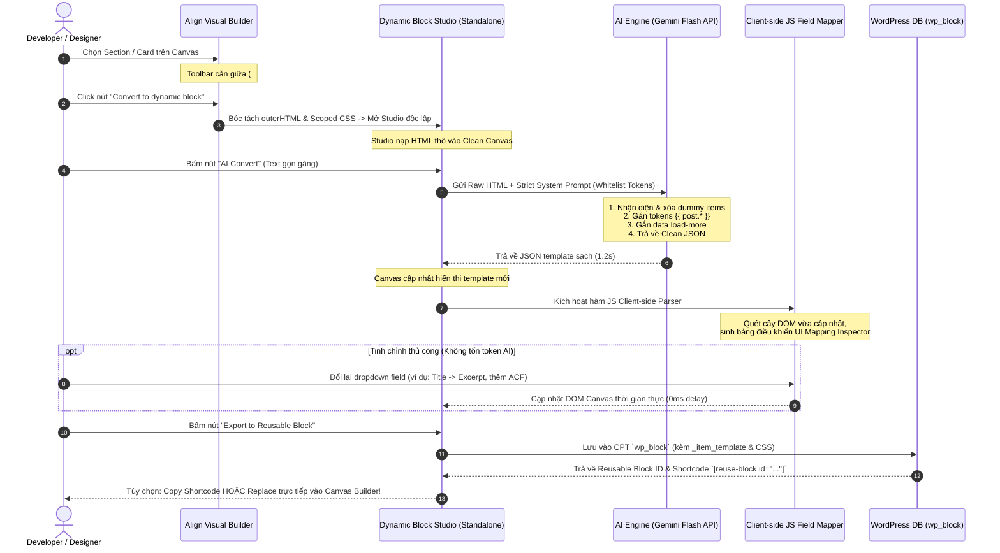

# 🪄 Dynamic Block Studio: AI Auto-Bind & Reusable Block Exporter

> **Tài liệu theo dõi kỹ thuật & kiến trúc hệ thống (Technical Specification & Implementation Plan)**
> **Vị trí lưu trữ**: `align/docs/builder/dynamic-block-studio-plan.md`  
> **Phiên bản**: 1.0.0 (Align Builder Ecosystem)

---

## 1. TỔNG QUAN TÍNH NĂNG (FEATURE OVERVIEW)

Tính năng **Convert to Dynamic Block Studio** cho phép lập trình viên và designer biến đổi bất kỳ đoạn HTML tĩnh (từ Tailwind UI, Figma, v0.dev, Shuffle.dev...) thành một **Gutenberg Dynamic Reusable Block** (`wp_block`) hoạt động hoàn hảo trên WordPress với dữ liệu động thời gian thực (Post Title, Thumbnail, Permalink, ACF Fields, Pagination, AJAX Load More...).

### 🎯 5 Trụ Cột Cốt Lõi:
1. **Nút Toolbar Ngữ Cảnh (`#select-actions`)**: Nằm ngay cạnh badge element trên thanh Topbar giữa của Align Builder, hiển thị tooltip `"Convert to dynamic block"` khi rê chuột.
2. **Không Gian Làm Việc Độc Lập (Standalone Studio)**: Mở một màn hình chuyên biệt (`admin.php?page=align-dynamic-studio`) tách biệt hoàn toàn khỏi full builder, giúp người dùng tập trung 100% vào việc map dữ liệu động.
3. **1-Click AI Convert (Zero Hallucination)**: Nút text gọn gàng `AI Convert` (không dùng icon) được trang bị **System Role Prompt nghiêm ngặt**, ép AI chỉ làm đúng 1 việc là nhận diện vòng lặp, lọc bỏ markup dummy và gán token hợp lệ — tuyệt đối không sửa đổi class CSS hay bịa code.
4. **Client-Side JS Auto-Mapping Inspector**: Sau khi AI chuyển đổi xong, hàm JavaScript phía Client tự động quét template và sinh ra bảng điều khiển Dropdowns cho phép người dùng **tự do chỉnh sửa thủ công 100% trên trình duyệt mà không cần tốn thêm bất kỳ token AI nào**.
5. **Xuất Bản Sang Reusable Block (`wp_block`)**: Lưu trữ chuẩn vào bảng `wp_posts` của WordPress, sinh shortcode `[reuse-block id="..."]` và hỗ trợ thay thế mượt mà vào Canvas của Builder gốc.

---

## 2. SƠ ĐỒ LUỒNG DỮ LIỆU TOÀN DIỆN (END-TO-END DATA FLOW)



---

## 3. THIẾT KẾ CHI TIẾT TỪNG MODULE KỸ THUẬT

### 3.1 Nút Toolbar Ngữ Cảnh trên Builder (`#select-actions`)
* **Vị trí**: Đặt ngay sau `toolbar-divider` trong container `#select-actions` (`core/builder/partials/top-panel.html`).
* **Markup HTML**:
  ```html
  <div id="select-actions" class="align-items-center" style="display:none;">
    <div id="top-select-element-badge" class="element-badge me-2" title="Selected Element">
      <span class="type">DIV</span>
      <span class="name">.container</span>
    </div>
    <div class="toolbar-divider"></div>
    
    <!-- Convert to Dynamic Block Button -->
    <a id="convert-dynamic-btn" href="#" title="Convert to dynamic block" class="btn-action-tool">
      <i class="la la-magic"></i>
    </a>
    
    <a id="toggle-overwrite-btn" href="" ...>
  ```
* **CSS Styling** (`core/builder/css/components/editor-select-actions.css`):
  ```css
  #vvveb-builder #top-panel #select-actions a#convert-dynamic-btn {
    color: #a78bfa; /* Light purple */
  }
  #vvveb-builder #top-panel #select-actions a#convert-dynamic-btn:hover {
    color: #c084fc;
    background-color: rgba(168, 85, 247, 0.2);
  }
  ```
* **Logic JavaScript (`builder-selection-manager.js`)**:
  1. Khi người dùng click `#convert-dynamic-btn`:
  2. Trích xuất mã HTML sạch của phần tử được chọn (`outerHTML`) thông qua `AlignSerializer.cleanDom(node.cloneNode(true))`.
  3. Bóc tách CSS của section hiện tại từ `Vvveb.StyleManager`.
  4. Lưu payload vào `sessionStorage.setItem('align_dynamic_payload', JSON.stringify({ html, css, tagName, sourcePageId }))`.
  5. Mở tab mới: `window.open('admin.php?page=align-dynamic-studio', '_blank')`.

---

### 3.2 Trang Độc Lập "Dynamic Block Studio"
* **Đăng ký Route trong WordPress Admin**:
  Submenu ẩn không hiển thị trên menu chính:
  ```php
  add_submenu_page(
      null, // Ẩn khỏi sidebar menu
      'Dynamic Block Studio',
      'Dynamic Block Studio',
      'edit_posts',
      'align-dynamic-studio',
      'align_render_dynamic_block_studio_page'
  );
  ```
* **Bố cục giao diện Studio**:
  * **Top Control Bar**:
    - Tên Block: `<input type="text" id="studio-block-title" value="Dynamic Card Block">`
    - Content Source: `<select id="studio-content-source"><option value="post">Blog Posts</option><option value="custom">Custom Post Type / ACF</option></select>`
    - Nút **`AI Convert`** (Text button gọn gàng, không dùng icon).
    - Nút **`Export to Reusable Block`** (Primary button màu xanh nổi bật).
  * **Main Split Layout**:
    - **Cột trái (Live Mockup Canvas)**: Sandboxed iframe hiển thị giao diện với dữ liệu thật lấy từ bài viết mới nhất trong DB.
    - **Cột phải (Mapping Inspector Panel)**: Quản lý danh sách các trường dữ liệu do JS Client-side kiểm soát.

---

### 3.3 System Role Prompt cho AI (Zero Hallucination & Strict Rules)

Để tránh tuyệt đối việc AI ảo giác hoặc làm sai lệch class CSS của Tailwind/Bootstrap:

```text
You are a deterministic HTML-to-WordPress Dynamic Block Transpiler.
Your SOLE AND EXCLUSIVE task is to convert static HTML into clean dynamic template markup by replacing dummy text/attributes with whitelisted tokens.

### STRICT BOUNDARY RULES (VIOLATIONS RESULT IN SYSTEM FAILURE):
1. ZERO EXPLANATION: Output ONLY valid, raw JSON. Do NOT write markdown code fences (```json), do NOT include conversational greetings, explanations, or suggestions.
2. ZERO CSS / CLASS / SVG MODIFICATION: Do NOT alter, add, delete, or reformat any Tailwind classes, Bootstrap classes, IDs, inline styles, or SVG vector markup. Preserve 100% of the styling code byte-for-byte.
3. REPEATER & POSTS_PER_PAGE AUTOMATIC DETECTION:
   - Count the number of repetitive sibling cards/items in the input grid/list (e.g. 3 cards => N = 3, 4 cards => N = 4, 8 cards => N = 8).
   - Retain ONLY the FIRST item as the single card template.
   - PURGE all duplicate sibling dummy items.
   - Wrap the single card template in: {{ loop_items posts_per_page="N" }}...{{ /loop_items }}
   - Add data-posts-per-page="N" to the grid container and pagination button.
4. RANKINGS & ORDERED NUMBER COUNTERS:
   - When cards have numbers (#1, #2, 01, 02, Step 1), replace with {{ loop.index }} (1-based counter).
   - Example: <span class="rank-badge">#{{ loop.index }}</span>
5. PAGINATION & LOAD MORE DETECTION:
   - If a "Load More", "Xem thêm", or pagination button exists, add: class="align-load-more-btn" data-page="1" data-max-page="{{ max_pages }}" data-posts-per-page="{{ posts_per_page }}".
6. WHITELISTED TOKENS DICTIONARY:
   - {{ post.id }}: Post numeric ID
   - {{ post.title }}: Post title
   - {{ post.permalink }}: Post URL link
   - {{ post.thumbnail }}: Featured image URL
   - {{ post.thumbnail_alt }}: Image alt text
   - {{ post.excerpt }}: Post summary text
   - {{ post.content }}: Full post content
   - {{ post.reading_time }}: Estimated reading time (e.g. "3 min read")
   - {{ post.comment_count }}: Number of comments
   - {{ post.date }}: Publish date
   - {{ post.modified_date }}: Last updated date
   - {{ post.category }}: Primary category
   - {{ post.category_url }}: Primary category URL
   - {{ post.tag }}: Primary tag / badge text
   - {{ post.tag_url }}: Primary tag URL
   - {{ post.tags }}: Comma-separated tag list
   - {{ post.author_name }}: Author display name
   - {{ post.author_avatar }}: Author avatar URL
   - {{ post.author_url }}: Author archive URL
   - {{ post.author_bio }}: Author bio description
   - {{ post.slug }}: Post slug
   - {{ loop_items }}: Loop placeholder for cloned child cards
   - {{ loop.index }}: Loop counter (#1, #2, 01...) for rankings or step badges
   - {{ max_pages }}: Total query pages for pagination
   - {{ posts_per_page }}: Posts per page query limit (e.g. 6)
   - {{ acf.field_name }}: Custom ACF field
   - {{ meta.meta_key }}: Native post meta key
   - {{ site.name }}: Site title
   - {{ site.url }}: Site home URL
   - {{ site.description }}: Site tagline
   - {{ site.year }}: Current calendar year (e.g. 2026)
   - {{ site.logo }}: Custom site logo URL

### REQUIRED OUTPUT JSON SCHEMA:
{
  "outer_html": "<div class=\"grid\">{{ loop_items }}</div><button class=\"align-load-more-btn\" data-page=\"1\" data-max-page=\"{{ max_pages }}\" data-posts-per-page=\"{{ posts_per_page }}\">Load more</button>",
  "item_template": "<article class=\"card\"><a href=\"{{ post.permalink }}\">{{ post.title }}</a><p>{{ post.excerpt }}</p></article>",
  "bindings": [
    { "target": "item", "selector": "img", "attr": "src", "field": "post.thumbnail" },
    { "target": "item", "selector": "a", "attr": "href", "field": "post.permalink" },
    { "target": "item", "selector": "a", "attr": "text", "field": "post.title" },
    { "target": "item", "selector": "p", "attr": "text", "field": "post.excerpt" }
  ]
}
```

---

### 3.4 JavaScript Client-Side Field Mapper (`dynamic-field-mapper.js`)

Module này đảm bảo tính độc lập: **AI chỉ làm bước ban đầu, người dùng có thể tự do tinh chỉnh thủ công 100% bằng JavaScript**:

1. **`parseTemplateBindings(templateHtml)`**:
   - Sử dụng regex và DOMParser quét tất cả các token `{{ post.* }}` trong text và attributes.
   - Trích xuất vị trí các node con (Heading, Link, Image, Paragraph).
2. **`renderMappingInspectorUI()`**:
   - Tự động sinh danh sách các card điều khiển ở cột phải:
     * Card 1: `Tiêu đề (Heading)` $\rightarrow$ Dropdown: `[post.title | post.excerpt | post.date | custom_field]`
     * Card 2: `Đường dẫn (Link)` $\rightarrow$ Dropdown: `[post.permalink | custom_url]`
     * Card 3: `Hình ảnh (Image)` $\rightarrow$ Dropdown: `[post.thumbnail | post.author_avatar | acf.custom_img]`
3. **`updateBinding(nodeId, newField)`**:
   - Cập nhật trực tiếp token vào template DOM và hydrate lại Canvas ngay lập tức (**0ms delay**, không gọi mạng).

---

### 3.5 Runtime Rendering & AJAX Infinite Loading Ngoài Frontend

Khi Reusable Block động này được nhúng ra ngoài Frontend qua Shortcode `[reuse-block id="..."]` hoặc render trong Blog Page:

1. **Khi tải trang lần đầu (100% SSR)**:
   - PHP đọc `_item_template` từ DB.
   - Chạy `WP_Query` lấy các bài viết đầu tiên.
   - Hàm `strtr()` thay thế các token `{{ post.* }}` thành dữ liệu thật trong vòng lặp.
   - Trả về 100% HTML hoàn chỉnh cho trình duyệt $\rightarrow$ SEO điểm tối đa, LCP tức thì.
2. **Khi bấm "Xem thêm bài viết" (AJAX Load More)**:
   - Frontend JS gửi POST request `{ action: 'align_dyn_load_more', block_id: 152, page: 2 }`.
   - Backend PHP lấy đúng `_item_template` của block đó, query trang 2 và trả về chuỗi HTML của các card mới.
   - Frontend JS chèn HTML mới vào `.align-posts-container` và gọi ngay `window.lazyLoadInstance.update()` để chống lỗi ảnh trắng (tuân thủ chuẩn Gotchas của Theme Align).

---

---

### 3.6 Live Preview & Real WordPress Data Testing (Instant Hydration)

Tính năng xem trước dữ liệu thực và kiểm thử tương tác trực tiếp trong Studio:
1. **Chế độ Preview kép (Live Data vs Template View)**:
   - **Live Data Mode (Mặc định)**: Tự động thay thế toàn bộ token `{{ post.* }}` bằng bài viết thật trong cơ sở dữ liệu WordPress (Title, Thumbnail, Excerpt, Date, Category, Reading time...).
   - **Template Mode**: Hiển thị chính xác cú pháp token thô trong canvas để lập trình viên đối chiếu cấu trúc loop và vị trí đặt token.
2. **0-Roundtrip AI Convert Preview**:
   - Khi bấm "Convert to dynamic with AI", API trả về đồng thời cả `html` (template chứa token) và `rendered_html` (đã hydrate dữ liệu thật).
   - Code editor lập tức cập nhật template, còn canvas preview hiển thị ngay dữ liệu WordPress thật mà không phải tốn thêm roundtrip mạng nào.
3. **300ms Debounced Preview Sync**:
   - Khi gõ trực tiếp trong CodeMirror ở chế độ Live Data, hệ thống debounce 300ms rồi gọi endpoint `POST /wp-json/align-builder/v1/studio-render-preview`.
   - Cập nhật `#align-studio-stage` mà không giật màn hình, không tải lại iframe và bảo toàn vị trí scroll (`scrollTop`).
4. **Interactive Load More Simulation**:
   - Bắt sự kiện click vào `.align-load-more-btn, [data-page]` ngay trong canvas sandbox, kiểm tra logic phân trang động và hiển thị toast xác thực.

---

## 4. CHECKLIST TRIỂN KHAI THEO TỪNG FILE (ROADMAP)

| STT | File liên quan | Thao tác | Mô tả chi tiết | Trạng thái |
| :---: | :--- | :---: | :--- | :---: |
| 1 | `align/core/builder/partials/top-panel.html` | [MODIFY] | Thêm nút `#convert-dynamic-btn` cạnh `#top-select-element-badge`. | ✅ Hoàn thành |
| 2 | `align/core/builder/css/components/editor-select-actions.css` | [MODIFY] | Thêm CSS styling, highlight cyan và tooltip thông minh cho `#convert-dynamic-btn`. | ✅ Hoàn thành |
| 3 | `align/core/builder/js/modules/wp-dynamic-block-converter.js` | [NEW] | Tự động nhận diện block thường vs dynamic block, bóc tách DOM sạch và chuyển hướng Studio (chế độ tạo mới hoặc edit in-place). | ✅ Hoàn thành |
| 4 | `align/core/inc/builder/class-builder-dynamic-studio.php` | [MODIFY] | Đăng ký admin page `align-studio`, canvas sandbox, REST API draft, export block, in-place update và endpoint preview `POST /studio-render-preview`. | ✅ Hoàn thành |
| 5 | `align/core/inc/builder/class-builder-dynamic-ai-binder.php` | [MODIFY] | REST endpoint `/studio-ai-bind`, sanitize prompt, auto-bind tokens và pre-render `rendered_html` cho 0-roundtrip live preview. | ✅ Hoàn thành |
| 6 | `align/core/inc/builder/class-builder-dynamic-renderer.php` | [MODIFY] | Bổ sung pipeline tập trung `render_for_preview`, hydrate dữ liệu thật vào `{{ post.* }}`, `{{ site.* }}`, `{{ loop_items }}` cho preview và SSR runtime. | ✅ Hoàn thành |
| 7 | `align/core/builder/studio/index.php` | [MODIFY] | Giao diện HTML của Studio độc lập, Topbar Mode Toggle (Live Data vs Template), CodeMirror Drawer, Dynamic Tokens Sidebar. | ✅ Hoàn thành |
| 8 | `align/core/builder/studio/studio-preview.js` | [NEW] | Controller Live Preview độc lập, quản lý mode, 300ms debounce sync, scroll preservation và load more interactive testing. | ✅ Hoàn thành |
| 9 | `align/core/builder/studio/studio.js` | [MODIFY] | Controller điều phối Studio, ủy quyền render HTML cho StudioPreview, giữ file <= 490 dòng. | ✅ Hoàn thành |
| 10 | `align/core/builder/studio/studio-tokens.js` | [MODIFY] | Registry quản lý token động, tìm kiếm/lọc real-time, copy token, và forward 0-roundtrip AI result sang StudioPreview. | ✅ Hoàn thành |
| 11 | `align/core/builder/studio/studio.css` | [MODIFY] | Styling cho `.studio-mode-group` và `.studio-mode-btn` tuân thủ Align Button Standard. | ✅ Hoàn thành |
| 12 | `align/core/includes/core/class-align-reusable-block.php` | [MODIFY] | Tích hợp dynamic renderer hook cho shortcode `[reuse-block id="..."]`. | ✅ Hoàn thành |
| 13 | `align/docs/README.md` & `align-studio-guide.md` | [MODIFY] | Cập nhật tài liệu kiến trúc chuyên sâu và hướng dẫn kỹ thuật cho lập trình viên & AI Agent. | ✅ Hoàn thành |

---

## 5. CÁC QUY CHUẨN KỸ THUẬT BẮT BUỘC KHI CODE (CODING GUARDS)

1. **Giới hạn dòng (< 500 dòng/file)**: Mọi file mới (`class-builder-dynamic-studio.php`, `studio.js`, `dynamic-field-mapper.js`) bắt buộc dưới 500 dòng.
2. **Observability Logging**:
   - Backend PHP: `error_log('[Align DynamicStudio] ...')`
   - Frontend JS: `console.log('[Align DynamicStudio] ...')`
   - 100% Comments và Logs viết bằng Tiếng Anh chuẩn.
3. **Pure DB Persistence**: Không tự ý ghi file PHP động lên đĩa. Lưu template và token trực tiếp vào Post Meta của CPT `wp_block`.
4. **Bảo tồn CSS/JS độc lập**: Scoped CSS của dynamic block được lưu trong trường meta `_custom_css`, nạp đúng thẻ `<style id="align-dyn-{id}">` khi render.
