# 📦 Align Builder — Export / Import Page Guide

> [!NOTE]
> Phân hệ **Export / Import Page** trong Align Builder cho phép lập trình viên và quản trị viên xuất bộ file vật lý hoàn chỉnh (`index.html`, `page.css`, `page.js`) của trang đang mở thành file ZIP độc lập, hoặc nạp file ZIP tương ứng vào canvas để xem trước trước khi bấm Save.

---

## 🗺️ 1. Tổng Quan Kiến Trúc & Luồng Dữ Liệu

Toàn bộ phân hệ tuân thủ nghiêm ngặt nguyên tắc Single Responsibility Principle (SRP) và Deterministic State:

```mermaid
graph TD
    subgraph Export Pipeline
        BtnExport[Nút Export trên Toolbar] --> CheckDirty{Có thay đổi chưa Save?}
        CheckDirty -- Có --> NoticeToast[Thông báo xuất bản đã lưu gần nhất]
        CheckDirty -- Không / Tiếp tục --> ReqExport[REST API: GET /align-builder/v1/export-page]
        ReqExport --> LoadSaved[Đọc DB/Disk: post_content, scoped CSS/JS, overrides]
        LoadSaved --> RewriteURL[Chuyển đổi URL tương đối -> URL tuyệt đối]
        RewriteURL --> BuildDoc[Đóng gói index.html, page.css, page.js vào ZIP]
        BuildDoc --> StreamZIP[Tải trực tiếp file align-export-slug.zip về máy]
    end

    subgraph Import Pipeline
        BtnImport[Nút Import trên Toolbar] --> CheckCanvasDirty{Canvas có thay đổi chưa Save?}
        CheckCanvasDirty -- Có --> ConfirmModal[Hộp thoại xác nhận thay thế canvas]
        CheckCanvasDirty -- Đồng ý --> PickFile[Chọn file .zip từ máy]
        PickFile --> UploadReq[REST API: POST /align-builder/v1/import-page]
        UploadReq --> SecZipSlip[Kiểm tra Zip Slip & giới hạn file]
        SecZipSlip --> ExtractPkg[Trích xuất index.html, page.css, page.js, overrides]
        ExtractPkg --> ReturnJSON[Trả về JSON: html, css, js, reusable_overrides]
        ReturnJSON --> HydrateCanvas[Nạp vào Live Canvas & CodeMirror: CHƯA GHI VÀO DATABASE]
        HydrateCanvas --> MarkDirty[Chuyển nút Save sang Dirty: User xem trước và bấm Save]
    end
```

---

## ⚙️ 2. Đặc Tả File Trong Gói ZIP

File ZIP xuất ra (`align-export-{slug}.zip`) chứa 3 file cốt lõi ở thư mục gốc:

1. **`index.html`**:
   - Cấu trúc tài liệu HTML5 hoàn chỉnh (`<!DOCTYPE html><html lang="en"><head>...</head><body>...</body></html>`).
   - Tham chiếu đầy đủ các global stylesheets (`root.css`, dynamic blocks, theme assets) theo URL tuyệt đối để giữ nguyên layout khi mở ngoài site WordPress.
   - Tham chiếu font preloads và các script global với đầy đủ thuộc tính (`defer`, `async`).
   - Liên kết đến CSS riêng của page: `<link rel="stylesheet" href="page.css">`.
   - Chứa body HTML sạch, bảo toàn nguyên vẹn shortcode và wrapper `data-component-shortcode`.
   - Liên kết đến JS riêng của page: ``.
   - Nếu trang có Reusable Block Overrides, dữ liệu được lưu dưới dạng thẻ `<script type="application/json" id="align-reusable-overrides">` bên trong tài liệu HTML (không sinh thêm `manifest.json` độc lập).

2. **`page.css`**:
   - Chứa CSS scoped riêng của trang/template đã lưu.
   - Toàn bộ đường dẫn `url(...)` tương đối được tự động quy đổi thành URL tuyệt đối trỏ về site gốc.

3. **`page.js`**:
   - Chứa JavaScript tùy biến riêng của trang/template đã lưu.

---

## 🔒 3. Bảo Mật & Quy Chuẩn Thực Thi

- **Zip Slip Protection**: Quá trình giải nén kiểm tra nghiêm ngặt mọi tên file trong archive, tự động từ chối bất kỳ entry nào chứa đường dẫn duyệt thư mục ngược (`..`) hoặc dấu `/` ở đầu.
- **KSES & Dual-Storage Guard**: Khi người dùng xem trước và quyết định bấm nút **Save**, toàn bộ quy trình lưu chuẩn của Align Builder (`WpSaveHandler` -> `/save-page` REST API) sẽ được kích hoạt, đồng bộ đồng thời vào Database và file tĩnh trên đĩa (`assets/builder/`).
- **Zero-Auto-Save trên Export**: Thao tác Export tuyệt đối không tự động Save canvas.
- **Zero-Auto-Persist trên Import**: Thao tác Import chỉ nạp dữ liệu vào State bộ nhớ và DOM canvas của trang đang mở để xem trước; không thay đổi ID, slug, title hay trạng thái publish của trang hiện tại cho đến khi bấm Save.

---

## 📂 4. Danh Sách File Liên Quan

| File | Vai Trò |
| :--- | :--- |
| [`class-builder-export-import-handler.php`](../../core/inc/builder/class-builder-export-import-handler.php) | Backend controller: Tạo ZIP export (chuẩn hóa URL, stream file) và giải nén ZIP import (kháng Zip Slip, bóc tách state). |
| [`class-builder-rest-api.php`](../../core/inc/builder/class-builder-rest-api.php) | Đăng ký các endpoint `/export-page` và `/import-page` có xác thực nonce và capability `edit_pages`. |
| [`wp-export-import.js`](../../core/builder/js/modules/wp-export-import.js) | Frontend controller: Xử lý sự kiện click export, kiểm tra unsaved changes, gửi file ZIP và hydrate state vào canvas. |
| [`top-panel.html`](../../core/builder/partials/top-panel.html) | Giao diện toolbar top panel: Bổ sung `#btn-export-page`, `#btn-import-page`, `#align-import-page-file`. |
| [`class-builder-ui-renderer.php`](../../core/inc/builder/class-builder-ui-renderer.php) | Cấu hình REST URLs trong `VvvebWpConfig` và nạp script `wp-export-import.js`. |
