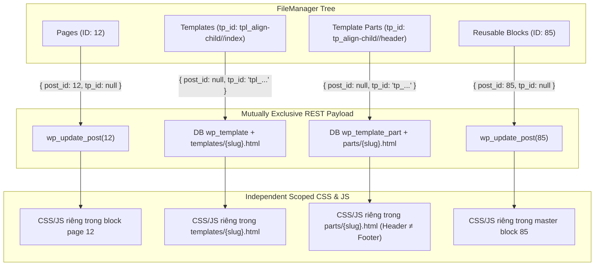
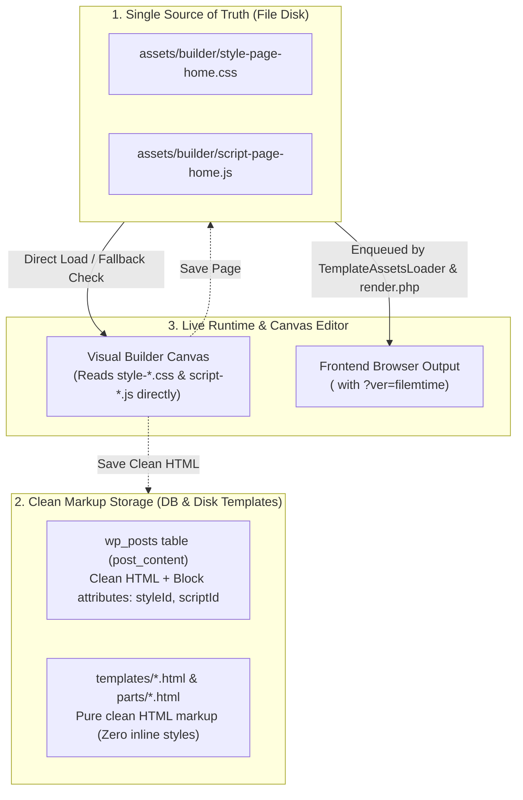

# 🚨 Sổ Tay Các Sự Cố Trọng Yếu & Lưu Ý Kỹ Thuật (Important Issues & Gotchas)

> [!IMPORTANT]
> Tài liệu này tổng hợp các phân tích chuyên sâu về các sự cố kỹ thuật tiềm ẩn, hành vi ngầm của hệ thống (under-the-hood behaviors), và quy chuẩn giải quyết đối với **Align Visual Builder**, **Shortcodes Engine**, **AJAX Dynamic Content Loading**, và **Media/Asset Lifecycle**.

---

## 1. Cơ Chế AJAX Query Page Bằng Shortcode & Rủi Ro Tiềm Ẩn

### 📌 1.1. Bản Chất Lưu Trữ Của Một Page Dựng Bằng Align Builder

Khi một trang được tạo và lưu từ Align Visual Builder:
* **Gói trong Dynamic Gutenberg Block (`align/custom-html`)**:
  ```html
  <!-- wp:align/custom-html {"blockId":"align-xxxx","enableShortcode":true} -->
  <style id="vvvebjs-styles">/* Custom Page CSS */</style>
  <div class="my-builder-content">
      <!-- Khối WP Shortcode con (Zero-Preview-Persistence) -->
      <div data-component-shortcode="" data-shortcode="[contact-form-7 id='12']"></div>
      
      <!-- Khối Reusable Block -->
      [reuse-block id="128"]
  </div>
  <script id="vvvebjs-scripts">(function(){ /* Custom Page JS */ })();</script>
  <!-- /wp:align/custom-html -->
  ```
* **Quy chuẩn Hard-Deferred Lazyload**: Toàn bộ ``, `<picture>`, `<video>`, background-image được tự động chuyển đổi sang thuộc tính `data-src`, `data-srcset`, `data-bg-src` cùng lớp `class="lazy"`.
* **Quy chuẩn Zero-Preview-Persistence**: Khối `[data-component-shortcode]` và `[data-component-wp-block]` hoàn toàn rỗng ruột trong database (`wp_posts.post_content`), chỉ lưu thuộc tính khai báo.

---

### ⚠️ 1.2. Danh Sách 4 Sự Cố Tiềm Ẩn Khi Query Page Qua AJAX

#### 🚨 Sự Cố 1: Bị Bỏ Qua Bộ Lọc Parse Shortcode & Blocks Do Cờ `is_admin()`
* **Hiện tượng**: Trang query bằng AJAX hiển thị chuỗi comment thô `<!-- wp:align/custom-html ... -->` hoặc thẻ div rỗng `<div data-component-shortcode="" data-shortcode="..."></div>`.
* **Nguyên nhân cốt lõi**:
  1. Trong WordPress, các request gửi đến `/wp-admin/admin-ajax.php` mặc định có `is_admin() === true`.
  2. Tại `core/includes/core/content-filters.php`, hàm `align_parse_and_render_builder_components()` có đoạn kiểm tra:
     ```php
     if ( is_admin() || ( defined( 'REST_REQUEST' ) && REST_REQUEST ) ) {
         return $content;
     }
     ```
     Nếu không chú ý xử lý `wp_doing_ajax()`, hàm sẽ bỏ qua việc giải mã component, trả về HTML thô chưa render.
* **Quy chuẩn xử lý**: Khi viết AJAX Handler hoặc Shortcode query page, **bắt buộc** phải render thông qua `apply_filters( 'the_content', ... )` hoặc `do_blocks()` kết hợp gọi trực tiếp `align_parse_and_render_builder_components()`.

---

#### 🚨 Sự Cố 2: Toàn Bộ Ảnh & Video Bị Trắng / Trống Do Lazyload Không Kích Hoạt
* **Hiện tượng**: Khung HTML hiển thị đầy đủ văn bản và cấu trúc, nhưng toàn bộ hình ảnh và video chỉ là khung trong suốt / placeholder SVG rỗng.
* **Nguyên nhân cốt lõi**:
  * Theme Align sử dụng `Align_Lazyload` (`IntersectionObserver` qua `window.lazyLoadInstance`).
  * Khi HTML mới được nạp và chèn vào DOM bằng AJAX (sau khi trang gốc đã tải xong), instance lazyload không tự động quét các phần tử mới này trừ khi được gọi lệnh kích hoạt lại.
* **Quy chuẩn xử lý**: Ngay sau khi chèn HTML vào DOM ở Frontend, gọi hàm cập nhật:
  ```javascript
  if (window.lazyLoadInstance && typeof window.lazyLoadInstance.update === 'function') {
      window.lazyLoadInstance.update();
  }
  ```

---

#### 🚨 Sự Cố 3: Thẻ `<script>` Của Page / Shortcode Con Bị Khóa Không Thực Thi
* **Hiện tượng**: Các tính năng tương tác như slider, popup, form validate, accordion hoặc custom inline script trong `<script id="vvvebjs-scripts">` bị tê liệt.
* **Nguyên nhân cốt lõi**:
  * Theo chuẩn bảo mật W3C / HTML5, khi gán nội dung bằng `element.innerHTML = responseHtml`, trình duyệt **tuyệt đối không tự động thực thi các thẻ `<script>`** nằm bên trong chuỗi HTML đó.
* **Quy chuẩn xử lý**:
  * **Nếu dùng jQuery**: Dùng `$(container).html(responseHtml)` — jQuery tự động bóc tách và thực thi an toàn toàn bộ script tags.
  * **Nếu dùng Vanilla JS**: Khởi tạo lại script element:
    ```javascript
    container.querySelectorAll('script').forEach(oldScript => {
        const newScript = document.createElement('script');
        Array.from(oldScript.attributes).forEach(attr => newScript.setAttribute(attr.name, attr.value));
        newScript.appendChild(document.createTextNode(oldScript.innerHTML));
        oldScript.parentNode.replaceChild(newScript, oldScript);
    });
    ```

---

#### 🚨 Sự Cố 4: Mất Dữ Liệu Ghi Đè (Overrides) Của Reusable Block (`[reuse-block]`)
* **Hiện tượng**: Khối Reusable Block (`[reuse-block id="128"]`) nằm trong page được query chỉ hiển thị nội dung mẫu gốc, mất toàn bộ các nội dung văn bản / hình ảnh đã ghi đè riêng cho page đó.
* **Nguyên nhân cốt lõi**:
  * Hàm `Align_Reusable_Block::render_shortcode()` dùng `$current_page_id = get_the_ID()` để lấy post meta `_align_reusable_overrides`.
  * Trong môi trường AJAX độc lập, nếu không thiết lập context global `$post`, `$current_page_id` sẽ nhận giá trị `0` hoặc sai ID trang mục tiêu.
* **Quy chuẩn xử lý**: Trước khi render nội dung page trong PHP AJAX callback, phải thiết lập context chính xác:
  ```php
  global $post;
  $post = get_post( $target_page_id );
  setup_postdata( $post );
  $rendered_content = apply_filters( 'the_content', $post->post_content );
  wp_reset_postdata();
  ```

---

## 2. Code Mẫu Chuẩn (Gold Standard Boilerplate)

### 🔹 2.1. Backend PHP AJAX Handler Chuẩn (`admin-ajax.php` / REST API)

```php
add_action( 'wp_ajax_align_load_dynamic_page', 'align_ajax_load_dynamic_page_handler' );
add_action( 'wp_ajax_nopriv_align_load_dynamic_page', 'align_ajax_load_dynamic_page_handler' );

function align_ajax_load_dynamic_page_handler() {
    // 1. Kiểm tra Nonce bảo mật
    if ( ! isset( $_POST['nonce'] ) || ! wp_verify_nonce( sanitize_text_field( wp_unslash( $_POST['nonce'] ) ), 'align_ajax_nonce' ) ) {
        wp_send_json_error( array( 'message' => 'Invalid security token' ), 403 );
    }

    $page_id = isset( $_POST['page_id'] ) ? absint( $_POST['page_id'] ) : 0;
    if ( ! $page_id ) {
        wp_send_json_error( array( 'message' => 'Missing page ID' ), 400 );
    }

    $target_post = get_post( $page_id );
    if ( ! $target_post || 'publish' !== $target_post->post_status ) {
        wp_send_json_error( array( 'message' => 'Page not found or not published' ), 404 );
    }

    // 2. Thiết lập Post Context cho Reusable Overrides & Shortcodes
    global $post;
    $post = $target_post;
    setup_postdata( $post );

    // 3. Render nội dung chuẩn hóa qua chuỗi bộ lọc Align Theme
    $html = $post->post_content;
    $html = do_blocks( $html );

    if ( function_exists( 'align_parse_and_render_builder_components' ) ) {
        $html = align_parse_and_render_builder_components( $html );
    } else {
        $html = do_shortcode( $html );
    }

    wp_reset_postdata();

    // 4. Trả về payload an toàn
    wp_send_json_success( array(
        'page_id' => $page_id,
        'title'   => get_the_title( $page_id ),
        'html'    => $html,
    ) );
}
```

### 🔹 2.2. Frontend Client JS AJAX Loader Chuẩn

```javascript
/**
 * Load Dynamic Page via AJAX with Full Script & Lazyload Re-initialization
 * @param {number} pageId Target Page ID
 * @param {HTMLElement} targetContainer DOM container element
 */
async function alignLoadPageViaAjax(pageId, targetContainer) {
    if (!targetContainer) return;

    try {
        targetContainer.classList.add('is-loading');

        const formData = new FormData();
        formData.append('action', 'align_load_dynamic_page');
        formData.append('page_id', pageId);
        formData.append('nonce', window.alignAjaxObj ? window.alignAjaxObj.nonce : '');

        const response = await fetch(window.alignAjaxObj ? window.alignAjaxObj.ajax_url : '/wp-admin/admin-ajax.php', {
            method: 'POST',
            body: formData
        });

        const res = await response.json();
        if (res.success && res.data && res.data.html) {
            // 1. Chèn HTML vào container
            targetContainer.innerHTML = res.data.html;

            // 2. Kích hoạt lại các thẻ <script> bên trong nội dung vừa tải
            targetContainer.querySelectorAll('script').forEach(oldScript => {
                const newScript = document.createElement('script');
                Array.from(oldScript.attributes).forEach(attr => {
                    newScript.setAttribute(attr.name, attr.value);
                });
                newScript.appendChild(document.createTextNode(oldScript.innerHTML));
                oldScript.parentNode.replaceChild(newScript, oldScript);
            });

            // 3. Cập nhật Instance Lazyload để tải ảnh/video
            if (window.lazyLoadInstance && typeof window.lazyLoadInstance.update === 'function') {
                window.lazyLoadInstance.update();
            }

            // 4. Bắn Custom Event thông báo trang đã nạp xong
            document.dispatchEvent(new CustomEvent('align:page_ajax_loaded', {
                detail: { pageId: pageId, container: targetContainer }
            }));
        } else {
            console.error('AJAX Load Error:', res.data ? res.data.message : 'Unknown error');
        }
    } catch (err) {
        console.error('Network Error while loading page:', err);
    } finally {
        targetContainer.classList.remove('is-loading');
    }
}
```

---

## 3. Bảng Checklist Kiểm Tra Nhanh Trước Khi Triển Khai (Pre-Flight Checklist)

| STT | Hạng mục kiểm tra | Tiêu chí đạt chuẩn (Pass Criteria) |
| :---: | :--- | :--- |
| 1 | **Post Context** | Đã gọi `setup_postdata($post)` trước khi parse content để Reusable Overrides nhận đúng ID? |
| 2 | **Content Parsing** | Đã chạy qua `do_blocks()` và `align_parse_and_render_builder_components()` để giải mã hết shortcode/block con? |
| 3 | **Lazyload Re-init** | Đã gọi `window.lazyLoadInstance.update()` sau khi chèn HTML vào DOM chưa? |
| 4 | **Script Execution** | Các đoạn JS inline trong thẻ `<script id="vvvebjs-scripts">` hoặc widget script có được kích hoạt lại không? |
| 5 | **Style Conflicts** | Thẻ `<style id="vvvebjs-styles">` của trang nạp mới có bị đè hoặc xung đột selector với trang cha không? |

---

## 4. Quy Chuẩn Định Danh ID/tp_id, Phòng Chống Xung Đột Dữ Liệu & Độc Lập CSS/JS Tuyệt Đối

> [!CAUTION]
> Khi quản lý và lưu trữ 4 nhóm thực thể trên cây thư mục (**Pages**, **Templates**, **Template Parts**, **Reusable Blocks**), lập trình viên phải tuân thủ nghiêm ngặt các quy tắc định danh ID, cơ chế loại trừ payload và nguyên tắc độc lập CSS/JS để tránh hoàn toàn việc ghi đè chéo bản ghi hoặc rò rỉ CSS/JS giữa các trang.

### 4.1 Ma Trận Định Danh & URL Routing



### 4.2 Bảng Quy Chuẩn Định Danh 4 Thư Mục

1. **Pages (`post_type = 'page'`)**:
   - **ID format**: Numeric ID (ví dụ: `12`).
   - **Filemanager name**: `page_12`.
   - **REST params**: `?id=12` (hoặc `post_id=12`).
   - **Save payload**: `{ post_id: 12, tp_id: null, template_type: 'page', html: '...' }`.
   - **Phạm vi CSS/JS**: Độc lập trong thẻ `<style id="vvvebjs-styles">` và `<script id="vvvebjs-scripts">` của trang đó.
2. **Templates (`post_type = 'wp_template'`)**:
   - **ID format**: `tpl_{theme}//{slug}` (ví dụ: `tpl_align-child//index`).
   - **Filemanager name**: `tpl_index`.
   - **REST params**: `?tp_id=tpl_align-child%2F%2Findex`.
   - **Save payload**: `{ post_id: null, tp_id: 'tpl_align-child//index', template_type: 'template', html: '...' }`.
   - **Lưu trữ & CSS/JS**: Cập nhật CPT `wp_template` và ghi ra `templates/{slug}.html`. CSS/JS lưu riêng trong file template.
3. **Template Parts (`post_type = 'wp_template_part'`)**:
   - **ID format**: `tp_{theme}//{slug}` (ví dụ: `tp_align-child//header`, `tp_align-child//footer`).
   - **Filemanager name**: `tp_header`, `tp_footer`.
   - **REST params**: `?tp_id=tp_align-child%2F%2Fheader`.
   - **Save payload**: `{ post_id: null, tp_id: 'tp_align-child//header', template_type: 'template_part', html: '...' }`.
   - **Lưu trữ & CSS/JS**: CPT `wp_template_part` + taxonomy `wp_template_part_area` và ghi ra `parts/{slug}.html`. Header và Footer hoàn toàn độc lập, không dùng chung CSS/JS.
4. **Reusable Blocks (`post_type = 'wp_block'`)**:
   - **ID format**: Numeric ID (ví dụ: `85`).
   - **Filemanager name**: `block_85`.
   - **Shortcode**: `[reuse-block id="85"]`.
   - **REST params**: `?id=85` (hoặc `post_id=85`).
   - **Save payload**: `{ post_id: 85, tp_id: null, template_type: 'reusable_block', html: '...' }`.
   - **Phạm vi CSS/JS**: Độc lập trong nội dung master block `wp_block`. Khi nhúng vào page con, chỉ đồng bộ text/media theo override, không phá vỡ cấu trúc class CSS hay thẻ HTML master.

### 4.3 Ba Nguyên Tắc Bất Di Bất Dịch Về Độc Lập CSS/JS
1. **Không Dùng Chung CSS / JS Giữa Các Nơi**: Mỗi trang, template, header, footer hay reusable block đều có bộ quy tắc CSS riêng (trong `<style id="vvvebjs-styles">`) và mã JS riêng (trong `<script id="vvvebjs-scripts">`). Không có tình trạng CSS của Header bị nhúng chung vào Footer hay CSS của Page bị thừa kế sang Template khác.
2. **Reset Toàn Bộ Bộ Nhớ Khi Chuyển Tab/Trang**: Khi người dùng click chọn trang khác trong cây File Manager, Canvas iframe được tải lại mới 100% qua API `/page-content`. `Vvveb.StyleManager` và `Vvveb.JsManager` giải phóng toàn bộ CSS rules và script cũ, chỉ nạp đúng CSS/JS của trang mục tiêu.
3. **Bóc Tách Sạch Thẻ Preview Khi Lưu**: Mọi style/script dùng chung của Theme hoặc Admin (`align-global-custom-css`, `align-global-custom-js`) chỉ được nạp tạm thời trên iframe với cờ `data-align-preview="1"` và tự động bóc tách sạch sẽ khi lưu, đảm bảo cơ sở dữ liệu và file tĩnh của từng nơi chỉ chứa mã độc lập của chính nó.

---

## 5. Sự Cố Xung Đột Vòng Lặp & Live Sync Debounce Timer Giữa Tree Navigator & Code Editor

> [!WARNING]
> Khi phát triển hoặc sửa đổi các module có cơ chế đồng bộ đa chiều (**Tree Navigator**, **Code Editor / CodeMirror**, **Iframe Canvas**, **AST Parser**), luôn có nguy cơ phát sinh **Race Condition** và **Vòng Lặp Vô Tận (Ping-Pong Loop)** nếu không kiểm soát chặt chẽ Debounce Timer và trạng thái Internal Updating.

### 📌 5.1. Bản Chất Rủi Ro (The Debounce Timer Stale Overwrite Race)
* **Kịch bản lỗi**:
  1. Người dùng đang gõ mã trong Code Editor ➔ Sự kiện `on("change")` kích hoạt Debounce Timer `self._timer = setTimeout(..., 500)` để chuẩn bị đẩy sang Canvas (`flush()`).
  2. Trong khoảng thời gian 500ms chờ đó, người dùng tương tác kéo thả / xóa / nhân bản trên **Tree Navigator**.
  3. Tree Navigator xử lý xong, gọi `Vvveb.CodeEditor.setValue(newCleanHtml)` để cập nhật lại Code Editor.
  4. **Hậu quả nếu không clear timer**: Sau 500ms, timer cũ của Code Editor kích hoạt hàm `flush()`. Lúc này `flush()` lấy giá trị mã cũ/dở dang từ trước đó và ghi đè ngược lại Canvas + Tree Navigator, **làm mất hoàn toàn thay đổi vừa thực hiện trên Tree Navigator**!

### 📌 5.2. Bản Chất Rủi Ro Vòng Lặp Phản Hồi (Ping-Pong Cyclic Feedback Loop)
* `Tree Navigator` thay đổi ➔ gọi `CodeEditor.setValue()` ➔ `CodeEditor` phát event `change` ➔ gọi `Builder.setHtml()` ➔ `Builder` gọi `TreeList.loadComponents()` ➔ `TreeList` phát event thay đổi ➔ Lặp vô tận hoặc làm nhảy con trỏ chuột (`cursor jumping`) / mất vị trí cuộn (`scroll jump`) của lập trình viên.

### 🛡️ 5.3. Quy Chuẩn 3 Lớp Bảo Vệ Bắt Buộc Khi Đồng Bộ Lập Trình:
1. **Lớp 1: Hủy Ngay Debounce Timer Đang Chờ Trong `setValue()`**:
   ```javascript
   setValue: function(value) {
       if (this._timer) {
           clearTimeout(this._timer);
           this._timer = null;
           updateSyncBadge(false);
       }
       // ... thực hiện cập nhật code
   }
   ```
2. **Lớp 2: Khóa Re-entrancy Bằng Cờ `_isInternalUpdating`**:
   ```javascript
   this._isInternalUpdating = true;
   let scrollInfo = this.codemirror.getScrollInfo();
   let cursor = this.codemirror.getCursor();
   this.codemirror.setValue(currentHtml);
   this.codemirror.scrollTo(scrollInfo.left, scrollInfo.top);
   if (cursor) this.codemirror.setCursor(cursor);
   this._isInternalUpdating = false;
   ```
3. **Lớp 3: Bỏ Qua Event Trigger Khi `origin === "setValue"`**:
   ```javascript
   this.codemirror.on("change", function(cm, v) {
       if (v.origin !== "setValue" && !self._isInternalUpdating) {
           // Chỉ debounce flush khi người dùng gõ phím trực tiếp
       }
   });
   ```

---

### 📌 5.4. Xử Lý Dynamic SOT Giữa Non-Tech (Tree-first) & Dev (Code-first) Khi Đóng Modal Code Editor
* **Tình huống thực tế**:
  * Người dùng Non-tech chỉnh sửa bố cục trên **Tree Navigator** (Tree là SOT).
  * Lập trình viên (Dev) mở modal Code Editor để xem code rồi bấm đóng modal mà không chỉnh sửa gì.
  * **Vấn đề tiềm ẩn**: Sự kiện `hidden.bs.modal` mặc định kích hoạt `CodeEditor.flush()`. Nếu không kiểm tra trạng thái bẩn (`isDirty`), `flush()` sẽ gán đè lại Canvas và Tree Navigator một cách không cần thiết, làm mất các state tạm thời hoặc re-parse lại AST.
* **Quy chuẩn Intent-Based SOT (Last-Interaction Dirty Tracking)**:
  1. Khi mở modal: Nạp mã mới nhất từ Tree/Canvas (`setValue()`) và đặt `isDirty = false`, lưu `lastCleanValue`.
  2. Khi đóng modal: `flush()` kiểm tra `isDirty` và `lastCleanValue`. Nếu mã không đổi ➔ **Bỏ qua 100% không chạy lại `setHtml()`**.
  3. Chỉ khi Dev thực sự gõ phím trong Code Editor (`isDirty = true`) thì khi đóng modal mới đồng bộ ngược lại Tree Navigator.

---

## 6. Sự Cố Race Condition & Script Timing Khởi Tạo Slider (Splide/Swiper) Khi Thư Viện Load Defer

> [!WARNING]
> Khi sử dụng các thư viện JavaScript bên ngoài như **Splide.js** hay **Swiper.js** được nạp dạng `defer` ở footer, việc khởi tạo slider từ inline script hoặc file asset page/block (`assets/builder/script-page-*.js`) luôn tiềm ẩn nguy cơ **Race Condition** và **Syntax Errors do bộ lọc WordPress**.

### 📌 6.1. Ba Nguyên Nhân Cốt Lõi Khiến Slider Không Chạy & Bị Trắng Màn Hình

1. **Race Condition giữa Defer Library và Inline Script**:
   - Thư viện `splide.min.js` nạp ở footer với `defer` (chỉ chạy sau khi parse DOM xong).
   - Đoạn script khởi tạo slider chạy đồng bộ trước khi parser chạm tới footer.
   - Khi gặp guard clause `if (typeof Splide === "undefined") return;`, script thoát ngay lập tức và không bao giờ được gọi lại.
2. **Cơ chế ẩn mặc định của Splide CSS (`visibility: hidden`)**:
   - Trong `splide.min.css`, `.splide` có `visibility: hidden;` để chống giật layout (FOUC). Chỉ khi gọi `new Splide(...).mount()` thành công thì class `.is-initialized` mới được thêm để hiển thị `visibility: visible;`.
   - Do thư viện không mount được, toàn bộ card bên trong slider bị ẩn hoàn toàn (khoảng trắng tinh).
3. **Lỗi Syntax do WordPress Entity Encoding (`&&` ➔ `&#038;&#038;`)**:
   - Khi lưu nội dung block HTML trong `wp_posts`, hàm `the_content` / `wptexturize` của WordPress tự động chuyển đổi các toán tử logic `&&` thành `&#038;&#038;`, dẫn tới lỗi cú pháp `Uncaught SyntaxError: Invalid or unexpected token '&'`.
4. **Lỗi Kích Thước Slider Trong Tab Ẩn (`display: none`)**:
   - Khi slider nằm trong các tab panel ẩn, Splide không thể đo kích thước container (0x0px). Nếu không gọi `splide.refresh()` khi chuyển tab, slider sẽ bị co cụm hoặc không cuộn được.

### 🛡️ 6.2. Quy Chuẩn Khởi Tạo Slider An Toàn (Gold Standard Slider Initialization)

```javascript
(function () {
    'use strict';

    /**
     * Helper: Wait for external library to be defined and DOM ready before executing callback.
     * Prevents race conditions when libraries (Splide, Swiper) are loaded with defer or async.
     */
    function onSplideReady(callback, maxAttempts, intervalMs) {
        maxAttempts = maxAttempts || 200; // 10 seconds max wait
        intervalMs = intervalMs || 50;

        function runWhenDOMReady() {
            if (typeof window.Splide !== 'undefined') {
                callback(window.Splide);
                return;
            }

            var attempts = 0;
            var timer = setInterval(function () {
                attempts++;
                if (typeof window.Splide !== 'undefined') {
                    clearInterval(timer);
                    callback(window.Splide);
                } else if (attempts >= maxAttempts) {
                    clearInterval(timer);
                    console.warn('[Splide Loader] Splide library was not loaded within timeout.');
                }
            }, intervalMs);
        }

        if (document.readyState === 'loading') {
            document.addEventListener('DOMContentLoaded', runWhenDOMReady);
        } else {
            runWhenDOMReady();
        }
    }

    // Khởi tạo an toàn cho section
    onSplideReady(function (SplideClass) {
        var section = document.getElementById('my-slider-section');
        if (!section) return;

        var sliderEl = section.querySelector('.splide');
        if (!sliderEl) return;

        var instance = new SplideClass(sliderEl, {
            type: 'slide',
            perPage: 3,
            gap: '24px'
        }).mount();

        // Xử lý khi tab thay đổi (nếu có tab panels)
        document.querySelectorAll('[data-tab]').forEach(function (tabBtn) {
            tabBtn.addEventListener('click', function () {
                window.requestAnimationFrame(function () {
                    if (instance) instance.refresh();
                });
            });
        });
    });
})();
```

---

## 7. Hướng Dẫn Quy Chuẩn Debug Cho AI & Developers: Cơ Chế File-First SOT (File Cứng `assets/builder/` & Database Clean HTML)

> [!IMPORTANT]
> **ĐẶC THÙ KIẾN TRÚC ALIGN BUILDER**: Align Visual Builder sử dụng cơ chế lưu trữ **File-First Single Source of Truth (SOT)**:
> 1. **File vật lý tĩnh (`assets/builder/`)**: Là nguồn SOT số 1 cho CSS (`style-*.css`) và JS (`script-*.js`). Visual Builder Canvas và Frontend luôn ưu tiên đọc trực tiếp từ đây.
> 2. **Cơ sở dữ liệu (`wp_posts.post_content`) & File Template đĩa (`templates/*.html`, `parts/*.html`)**: Chỉ lưu trữ cấu trúc HTML thuần (Clean Markup) và metadata block attributes (`styleId`, `scriptId`), không nhúng inline style/script rác.
> 3. **Backward Compatibility Guard**: Đối với web cũ còn `<style>`/`<script>` trong DB: Nếu file disk có $\to$ strip inline và nạp file ngoài; nếu file disk mất $\to$ giữ nguyên inline `<style>` làm fallback an toàn.



### 📌 7.1. Quy Trình 3 Bước Bắt Buộc Cho AI Khi Debug & Sửa Code

Khi phát hiện lỗi giao diện (CSS), tương tác (JS), slider, form hay popup trên các trang dựng bằng Align Builder, **AI tuyệt đối không chỉ kiểm tra một file duy nhất** mà bắt buộc thực hiện đủ 3 bước kiểm tra đối soát sau:

#### 🔹 Bước 1: Truy Vấn Cơ Sở Dữ Liệu (`wp_posts.post_content`)
- **Vì sao bắt buộc?** WordPress render trang ra frontend dựa trên `post_content` trong bảng `wp_posts`. Nếu bạn chỉ sửa file tĩnh trên đĩa mà không cập nhật DB, thay đổi sẽ không có tác dụng hoặc bị ghi đè khi người dùng mở Visual Builder lưu lại.
- **Cách thực hiện:** Chạy script PHP kết nối trực tiếp MySQL (ví dụ qua PDO/mysqli trên cổng MySQL của Local/Server):
  ```php
  $mysqli = new mysqli('127.0.0.1', 'root', 'root', 'local', 10040);
  $res = $mysqli->query("SELECT ID, post_title, post_name, post_content FROM wp_posts WHERE ID = 496");
  $row = $res->fetch_assoc();
  // Trích xuất và kiểm tra nội dung trong <style> hoặc <script>
  ```

#### 🔹 Bước 2: Kiểm Tra File Vật Lý Cứng Trên Đĩa (`assets/builder/`)
- **Vị trí file:** `wp-content/themes/align-child/assets/builder/`
  - Trang con (Pages): `style-page-{slug}.css` và `script-page-{slug}.js`
  - Header / Footer: `style-part-header.css`, `script-part-footer.js`
  - Reusable Blocks: `style-block-{slug}.css`, `script-block-{slug}.js`
- **Cách thực hiện:** 
  1. Đọc nội dung file cứng để kiểm tra logic.
  2. Đối soát SHA256 / Checksum giữa nội dung trong DB và file cứng để phát hiện lệch đồng bộ (Drift).
  3. **Khi sửa code: BẮT BUỘC cập nhật đồng bộ CẢ HAI NƠI (file tĩnh trên đĩa + trường `post_content` trong DB)**.

#### 🔹 Bước 3: Kiểm Chứng Đầu Ra Rendered Frontend (Live Output Verification)
- **Vì sao bắt buộc?** Ngay cả khi code trong DB và File đúng, khi WordPress in ra ngoài HTML thông qua các bộ lọc (`the_content`, `wptexturize`), có thể phát sinh các vấn đề:
  1. **Lỗi HTML Entity Encoding**: Ký tự `&&` trong JS bị đổi thành `&#038;&#038;` gây lỗi `SyntaxError`.
  2. **Lỗi Timing Defer/Async**: Script inline chạy trước khi thư viện vendor (`splide.min.js`, `swiper.min.js`) tải xong.
  3. **Lỗi Class Trạng Thái**: Thiếu `.is-initialized` do slider chưa mount khiến CSS ẩn (`visibility: hidden`).
- **Cách thực hiện:** Gửi request HTTP (`Invoke-WebRequest` / `curl` đến `http://localhost:...`) và bóc tách đoạn script/style trên HTML trả về để kiểm chứng cú pháp (`node --check`).

---

### 📋 7.2. Bảng Tóm Tắt Tra Cứu Nhanh Cho AI Debugger

| Hạng mục cần kiểm tra | Nguồn lưu trữ 1 (Database) | Nguồn lưu trữ 2 (File đĩa) | Nguồn kiểm chứng 3 (Frontend Output) |
| :--- | :--- | :--- | :--- |
| **Trang chủ (Home Page)** | `wp_posts` (ID: 496) | `assets/builder/script-page-home.js`<br>`assets/builder/style-page-home.css` | `http://localhost:.../` (HTML response) |
| **Trang tĩnh (Pages)** | `wp_posts` (ID tương ứng) | `assets/builder/script-page-{slug}.js`<br>`assets/builder/style-page-{slug}.css` | `http://localhost:.../{slug}/` |
| **Header** | `wp_posts` (`post_type = 'wp_template_part'`) | `assets/builder/script-part-header.js`<br>`assets/builder/style-part-header.css` | Thẻ `<header>` & script header trong live DOM |
| **Footer** | `wp_posts` (`post_type = 'wp_template_part'`) | `assets/builder/script-part-footer.js`<br>`assets/builder/style-part-footer.css` | Thẻ `<footer>` & script footer trong live DOM |
| **Reusable Blocks** | `wp_posts` (`post_type = 'wp_block'`) | `assets/builder/script-block-{slug}.js`<br>`assets/builder/style-block-{slug}.css` | Khối `[reuse-block]` render trong live DOM |

---

### 🚨 7.3. Cạm Bẫy Trọng Yếu: Empty CSS From A Sync Path Must Never Delete Files

> [!CAUTION]
> **QUY TẮC SỐNG CÒN**: Một chuỗi CSS/JS rỗng (`''`) trích xuất từ nội dung trang trong quá trình đồng bộ (Sync/Migration) **TUYỆT ĐỐI KHÔNG ĐƯỢC PHÉP XÓA TỆP VẬT LÝ TRÊN ĐĨA**.

#### 1. Bản chất hiểm họa
- Trong kiến trúc File-First SOT, `post_content` chỉ lưu mã HTML sạch, không chứa inline `<style id="...">` hay `<script id="...">`.
- Khi người dùng bấm **Save/Update trên Gutenberg**, WordPress kích hoạt hook `save_post` $\to$ gọi `sync_post_assets_from_content()`.
- Do `post_content` không có inline `<style>`, regex trích xuất trả về chuỗi rỗng (`$css = ''`, `$js = ''`).
- Nếu hàm đồng bộ chuyển chuỗi rỗng này xuống API ghi tệp có cờ xóa (`$allow_delete = true`), hệ thống sẽ hiểu lầm là người dùng muốn xóa stylesheet và thực hiện `unlink()` tệp `assets/builder/style-*.css` thật trên đĩa! Lỗi này đã từng làm mất 8162 bytes CSS của trang 52 (`Gói Subscription`).

#### 2. Kiến trúc giải pháp chuẩn (2-Tier Write Separation)
1. **Destructive API (`Align_Builder_Assets::save_external_assets`)**:
   - Chỉ dùng cho Visual Builder Canvas save khi người dùng có chủ đích xóa CSS/JS.
   - Luôn tự động chụp snapshot lưu vào `assets/builder/.history/` trước khi `unlink`.
2. **Non-Destructive API (`Align_Builder_Assets::sync_external_assets`)**:
   - Dùng cho mọi luồng đồng bộ từ `post_content`, Gutenberg hooks, và Align Agent tools (`patch_content`).
   - Tham số `$allow_delete = false`: Khi CSS/JS rỗng, bỏ qua thao tác xóa và ghi log `[Align Assets] Skip delete (non-destructive sync)`.
   - Nếu cả CSS và JS đều không có inline tag trong `post_content`: Return sớm không chạm vào đĩa, ghi log `[Align Persistence] Skip asset sync (File-First, no inline assets)`.
3. **Phục hồi khẩn cấp**:
   - Thư mục `assets/builder/.history/` lưu trữ tối đa 5 snapshot gần nhất của từng tệp CSS/JS.
   - Khôi phục tức thì qua CLI/PHP `Align_Builder_Asset_History::restore('style-page-xxx.css')` hoặc Align Agent tool `restore_asset_history`.


## 8. Post báo không hỗ trợ Align block sau khi nâng cấp theme

- **Nguyên nhân đã xác minh**: Watcher trong `core/builder/gutenberg/align-site-editor-integration.js` gọi `unregisterBlockType()` mỗi khi phát hiện editor đang sửa `post`. Dữ liệu Blog cũ vẫn chứa `align/element`, nên editor mất định nghĩa block ngay sau khi nạp.
- **Cách xử lý**: Không hủy đăng ký block trong watcher. Giữ `allowed_block_types_all` trong `core/blocks/index.php` để chặn chèn Align block mới vào Blog; giữ định nghĩa block để đọc được dữ liệu cũ. Không tự động chuyển đổi hoặc ghi lại nội dung bài viết.
- **Kiểm chứng local**: Post 787 — trước sửa Console báo gỡ 10 block, `getBlockType('align/element')` trả về rỗng; sau sửa block còn đăng ký, nội dung hiển thị trong Gutenberg, và `allowedBlockTypes` vẫn không chứa `align/element`.

> **Cập nhật chính sách dán HTML:** Theo yêu cầu mới, Post cũng sử dụng API để tạo Align blocks. Filter chặn Align blocks mới và ẩn category ở Post đã được bỏ; cơ chế giữ đăng ký block vẫn áp dụng. Xem [luồng dán HTML qua API](../api/align-cloud-api-reference.md#221-tự-chuyển-html-khi-dán-trong-gutenberg).

---

## 9. Cạm Bẫy Parser libxml HTML4 Trong PHP `DOMDocument` Khi Xử Lý Thẻ `<source>` Của Thẻ `<picture>`

### 📌 9.1. Hiện Tượng & Nguyên Nhân
- **Vấn đề**: Khi bóc tách hoặc thao tác trên cây DOM chứa thẻ `<picture>` bằng PHP `DOMDocument::loadHTML()`:
  ```html
  <picture>
    <source media="(max-width: 599px)" srcset="...">
    <source media="(max-width: 992px)" srcset="...">
    
  </picture>
  ```
- **Hành vi ngầm của libxml (HTML4 Standard)**:
  `DOMDocument::loadHTML()` trong PHP sử dụng bộ phân tích cú pháp HTML4 của thư viện libxml. Chuẩn HTML4 **hoàn toàn không định nghĩa thẻ `<source>` là thẻ tự đóng (void element)** như chuẩn HTML5.
  Hệ quả: libxml tự động hiểu mỗi thẻ `<source>` mở ra một container lồng nhau, biến cây DOM thành:
  ```text
  <picture>
    └─ <source media="(max-width: 599px)">
         └─ <source media="(max-width: 992px)">
              └─ 
  ```
- **Hậu quả nghiêm trọng**:
  Nếu code thực hiện kiểm tra cha trực tiếp:
  ```php
  if ( $node->parentNode && 'picture' === strtolower( $node->parentNode->nodeName ) )
  ```
  Điều kiện này **luôn luôn `false`** vì `$node->parentNode` thực chất là `<source>`, không phải `<picture>`! Do đó, các tác vụ dọn dẹp thẻ source cũ hoặc thay thế ảnh trong Reusable Block sẽ bị bỏ qua âm thầm, khiến thiết bị di động đọc phải `<source>` cũ từ master template.

### 📌 9.2. Quy Chuẩn Bắt Buộc Khi Thao Tác Với `<picture>` Trong Backend PHP
1. **Bắt buộc duyệt Ancestor Traversal thay vì `parentNode`**:
   ```php
   $pic = null;
   $current = $node->parentNode;
   while ( $current && 'div' !== strtolower( $current->nodeName ) ) {
       if ( 'picture' === strtolower( $current->nodeName ) ) {
           $pic = $current;
           break;
       }
       $current = $current->parentNode;
   }
   ```
2. **Dọn dẹp triệt để các thẻ `<source>` cũ**:
   Khi ghi đè ảnh mới (`src` mới) cho một phần tử ``, bắt buộc tìm và xóa toàn bộ thẻ `<source>` con bên trong `$pic` qua XPath `.//source`, đồng thời gắn trực tiếp `` làm con cấp 1 của `$pic`:
   ```php
   if ( $pic ) {
       foreach ( $xpath->query( './/source', $pic ) as $source_node ) {
           $source_node->parentNode->removeChild( $source_node );
       }
       $pic->appendChild( $node );
   }
   ```
3. **Nội suy lại responsive sources sau khi override**:
   Sau khi hoàn tất thay thế `src` và Attachment ID, luôn chuyển giao markup cho `Align_Builder_Image_Resolver::resolve_dynamic_image_srcset( $rendered )` để tự động tái tạo bộ thẻ `<source>` chuẩn kích thước mới cho Mobile/Tablet.

---

## 10. Tối Ưu Hóa Slot-Aware Art Direction & Ngăn Chặn Phình Tải Trọng Desktop Fallback (`data-slot-width`)

### 📌 10.1. Hiện Tượng & Nguyên Nhân
- **Vấn đề tải trọng Desktop (> 992px)**: Thẻ `<picture>` thông thường chỉ định nghĩa `<source media="(max-width: 599px)">` và `<source media="(max-width: 992px)">`. Khi người dùng xem trên màn hình Desktop (> 992px), toàn bộ media queries của `<source>` không khớp, trình duyệt bắt buộc sử dụng thuộc tính `src` của thẻ `` fallback.
- **Rủi ro phình tải trọng (Payload Bloat)**: Nếu thẻ `` trỏ đến file ảnh upload gốc nguyên bản (`fullUrl` - ví dụ ảnh 4096px, nặng 1.5 MB), một trang danh mục gồm 12 ô card nhỏ (kích thước render chỉ 312px) sẽ tải về tới **1.75 MB** ảnh không cần thiết, làm suy giảm nghiêm trọng chỉ số Largest Contentful Paint (LCP).

### 📌 10.2. Quy Chuẩn Kỹ Thuật Slot-Aware Image Rendering
1. **Frontend (`wp-media-modal.js`)**:
   - Tự động đo đạc kích thước thực tế của thẻ ảnh trên canvas (`targetImg.getBoundingClientRect().width` hoặc `targetImg.offsetWidth`).
   - Gắn thuộc tính `data-slot-width="{width}"` lên thẻ `<picture>` (ví dụ `data-slot-width="312"` hoặc `data-slot-width="644"`).
   - Chọn sub-size sắc nét chuẩn 2x Retina (`slot * 2`, ví dụ `624x624`) để gán vào `` src fallback thay vì ảnh gốc 4096px.
2. **Backend Resolver (`class-builder-image-resolver.php`)**:
   - Trích xuất `data-slot-width` từ `<picture>` hoặc `width` trên ``.
   - Áp dụng bộ lọc `MIN_VALID_SIZE = 150px` để loại bỏ triệt để các ảnh thumbnail swatch nhỏ li ti của WooCommerce.
    - Tính toán ngưỡng chuẩn:
      - Khi có slot width: Mobile = $\min(\text{slot}, 599\text{px})$, Tablet = $\min(\text{slot}, 992\text{px})$, Desktop = $\min(\text{full\_w}, \text{slot} \times 2)$.
      - Khi không có slot width (ảnh full/hero layout): Mobile = 599px, Tablet = 992px, Desktop = 1440px.

### 📌 10.3. Cạm Bẫy Bộ Lọc Giới Hạn Cứng (`<= 600`, `<= 992`) & Thuật Toán Tiệm Cận Khoảng Cách (Closest Distance Scoring)
- **Cạm bẫy của bộ lọc cứng (Rigid `<= Thresholds`)**:
  Trước đây code sử dụng các bộ lọc như `pool.filter(s => s.width <= 600)` và `pool.filter(s => s.width <= 992)`. Điều này dẫn đến 2 lỗi nghiêm trọng:
  1. Với breakpoint `media="(max-width: 992px)"`: Size WordPress chuẩn `large` (1024x1024) bị **loại bỏ hoàn toàn** chỉ vì $1024 > 992$ (lệch đúng 32px), khiến hệ thống tụt xuống chọn size `644x644` (bị hụt tới **348px** so với màn hình tablet 992px!).
  2. Với breakpoint `media="(max-width: 599px)"`: Khi ảnh có các size `420x380` và `644x644`, thuật toán chọn `420x380` (hụt **179px**), trong khi size `644x644` tiệm cận mốc 599px hơn rất nhiều (chênh lệch chỉ **45px**) và hiển thị sắc nét hơn trên màn hình Retina.
- **Quy chuẩn bắt buộc: Thuật toán Closest Distance Scoring**:
  Tất cả các module resolver (cả PHP backend và JS frontend) **bắt buộc** sử dụng hàm tính điểm tiệm cận khoảng cách thay vì lọc cứng:
  ```php
  $diff = abs( $w - $target_width );
  $penalty = ( $w < $target_width ) ? 1.25 : 1.0; // Phạt size nhỏ hơn target để chống mờ hình
  $aspect_diff = abs( $w - (int) ( $s['height'] ?? $w ) ) * 0.01; // Ưu tiên ảnh vuông khi cùng width
  $score = ( $diff * $penalty ) + $aspect_diff;
  ```
  Nhờ đó:
  - Mobile (599px) luôn chọn size tiệm cận nhất với 599px (ví dụ 644x644 hoặc 624x624).
  - Tablet (992px) luôn chọn size tiệm cận nhất với 992px (ví dụ 1024x1024).
  - Desktop (> 992px) luôn chọn size tiệm cận nhất với 1440px (hoặc 2x Retina theo slot).

---
---

## 11. FluentCart Admin SPA Blank / Black Screen & Thiếu Database Migrations Khi Import Site

### 📌 11.1. Hiện Tượng & Nguyên Nhân
- **Hiện tượng**: Khi vào các màn hình quản trị của FluentCart (`admin.php?page=fluent-cart#/products` hoặc orders, customers...), trang web hoàn toàn trống rỗng và có màu đen kịt.
- **Nguyên nhân cốt lõi**:
  1. Thiếu bảng cơ sở dữ liệu `wp_fct_shipping_methods`. Trong `FluentCart\App\Hooks\Handlers\MenuHandler::enqueueAssets()`, truy vấn `ShippingMethod::query()->where('is_enabled', '1')->count()` bị lỗi SQL Exception do bảng không tồn tại.
  2. Bẫy cập nhật/restore database: Khi restore site từ file backup (All-in-One WP Migration, Duplicator...) hoặc cập nhật plugin thủ công, hook `register_activation_hook` không được kích hoạt. Hơn nữa, `_fluent_cart_db_version` trong `wp_options` có thể đã trùng version hiện tại, khiến cơ chế tự động migrate `maybeMigrateDBChanges()` bị bỏ qua.
  3. Lỗi Fatal ngắt luồng PHP trước khi in thẻ DOM container `#fct_admin_app_wrapper` và trước khi localize script `fluentCartAdminApp`. Kết hợp với script inline dark mode ở `<head>`, màn hình bị biến thành đen rỗng.

### 📌 11.2. Cách Kiểm Tra & Khắc Phục Nhanh
- **Kiểm tra thiếu bảng**:
  ```php
  // Chạy CLI hoặc script PHP
  global $wpdb;
  $table = $wpdb->prefix . 'fct_shipping_methods';
  $exists = $wpdb->get_var("SHOW TABLES LIKE '$table'");
  ```
- **Chạy bù migration trực tiếp**:
  ```php
  \FluentCart\Database\Migrations\ShippingMethodsMigrator::migrate();
  ```
- **Hoặc kích hoạt lại toàn bộ bảng FluentCart**:
  ```php
  \FluentCart\Database\DBMigrator::migrate();
  ```

---

## 12. Image Resolver: Cơ Chế Bỏ Qua Picture Cho Thumbnail Nhỏ (`data-skip-picture="true"`) & Bẫy Biến `$is_icon`

### 📌 12.1. Cạm Bẫy Thẻ `<picture>` Bọc Thumbnail Nhỏ (48x48px) & Cơ Chế `data-skip-picture="true"`
- **Hiện tượng**:
  Các thành phần giao diện nhỏ như Swatch Option Cards (`.option-card`), Thumbnail Carousel strip (`#thumbnail-carousel`), hoặc Color Tiles chỉ có kích thước hiển thị cố định $48 \times 48\text{px}$.
  Tuy nhiên, khi đi qua `Align_Builder_Image_Resolver`, resolver mặc định bọc thẻ `<picture>` 3-tier art-direction hoặc áp dụng ngưỡng slot-width tối thiểu $150\text{px}$ (`$pool >= 150px`), khiến URL ảnh bị nâng lên `-150x150.webp` hoặc tạo cấu trúc DOM `<picture>` dư thừa không cần thiết.
- **Cơ chế xử lý chuẩn (`data-skip-picture="true"` / `thumb-preview`)**:
  - Tại `class-builder-image-resolver.php`, cả `resolve_picture_tag()` và `resolve_image_tag()` được trang bị cơ chế nhận diện cờ:
    ```php
    $skip_picture = preg_match( '/\bdata-skip-picture\s*=\s*[\'"]?true[\'"]?/i', $tag ) || preg_match( '/\bthumb-preview\b/i', $tag );
    ```
  - Khi phát hiện cờ này:
    1. Resolver hoàn toàn bỏ qua việc tạo `<picture>` đa breakpoint và trả về thẻ `` đơn độc lập sạch sẽ.
    2. Nếu URL truyền vào đã là crop nhỏ chuẩn (như `-48x48.webp`), resolver giữ nguyên URL sạch này thay vì ghi đè bằng full image hay size $\ge 150\text{px}$.
    3. Trả về đúng kích thước `width="48" height="48"` định sẵn.

### 📌 12.2. Cạm Bẫy Biến `$is_icon` Trong `resolve_picture_tag()` (PHP Warning Line 192)
- **Hiện tượng**: PHP ném cảnh báo lặp lại trên toàn trang: `Warning: Undefined variable $is_icon in .../class-builder-image-resolver.php on line 192`.
- **Nguyên nhân cốt lõi**:
  Khi sửa đổi logic lọc `data-skip-picture`, dòng khai báo:
  ```php
  $is_icon = $is_svg || ( $data['width'] > 0 && $data['width'] <= 150 && $data['height'] > 0 && $data['height'] <= 150 );
  ```
  bị xóa hoặc đặt sau vị trí sử dụng `if ( $is_icon )`.
- **Quy chuẩn bắt buộc**:
  Luôn giữ nguyên khai báo `$is_icon` ngay sau `$is_svg` và trước bất kỳ câu lệnh rẽ nhánh logic nào trong `resolve_picture_tag()`. Luôn kiểm tra cú pháp `php -l` và chạy `curl -s ... | grep -iE "Warning|Notice"` sau mỗi lần chỉnh sửa resolver.

---

## 13. Third-Party Embed Scripts Stripped on 2nd Save (reCAPTCHA, HubSpot, Calendly)

### 13.1. Symptom & Root Cause

- **Symptom**: User embeds a third-party form (Google reCAPTCHA, HubSpot, Calendly, Typeform...) directly into the Builder canvas. It renders correctly on first page load, but breaks after a second save.
- **Root cause**: `class-builder-crud-handler.php` L43 strips **all** `<script>` tags from the HTML body before saving to DB — including external embed scripts (`<script src="...">`):
  ```php
  // L43 — strips everything, no exceptions:
  $clean_html = preg_replace( array(
      '/\<style\b[^>]*>[\s\S]*?\<\/style>/is',
      '/\<script\b[^>]*>[\s\S]*?\<\/script>/is'
  ), '', $clean_html );
  ```
- **Why regex-patching is risky**: HubSpot, reCAPTCHA v3, and most embed systems require **both** an external `<script src="...">` AND an inline `<script>` init block. A "preserve src-based scripts only" regex still strips the inline init — embed still broken.

### 13.2. Architectural Rule (Mandatory)

> **All third-party embed code (forms, widgets, chatbots, captcha) MUST be created via Align Studio and exported as a Reuse Block. NEVER paste embed code directly into the Builder canvas.**

### 13.3. Why Align Studio is Safe

| Step | What happens | Scripts stripped? |
|---|---|---|
| Paste HTML in Studio editor | Raw HTML stored in `currentPayload.html` | No |
| Click "Export Block" | `handle_export_reusable_block()` → `minify_html()` tokenizes `<script>` blocks then restores them | No |
| `wp_update_post(wp_block)` | `kses_remove_filters()` called before — KSES bypassed | No |
| Frontend render via `[reuse-block]` | `$raw = $post->post_content` → output verbatim | No |

`minify_html()` in [`class-builder-minifier.php`](../../core/inc/builder/class-builder-minifier.php) L27–37 tokenizes `<script>`, `<style>`, `<pre>`, `<svg>` before whitespace processing and restores them intact. Scripts are never lost.

### 13.4. Correct Workflow for Devs

```
1. Go to Align Studio (/wp-admin/admin.php?page=align-studio)
2. Paste full embed code (external <script src> + inline init <script>) into the HTML tab
3. Click "Export Block" → wp_block created safely
4. Copy generated shortcode: [reuse-block id="xxx"]
5. In Builder canvas: insert shortcode, paste [reuse-block id="xxx"]
6. Save page — embed preserved across unlimited saves
```

### 13.5. WARNING: Do NOT Edit Reuse Block via Builder Canvas

If a dev opens a `wp_block` in the Align Builder and re-saves, the save goes through `save_page()` → L43 strip → scripts lost again.

- **Edit embed HTML**: Always via Align Studio (`?page=align-studio&post_id=xxx`)
- **Edit CSS/JS**: Also via Align Studio — separate tabs

### 13.6. Affected Embed Types

| Service | Needs inline init? | Safe via Studio |
|---|---|---|
| Google reCAPTCHA v2 | No | Yes |
| Google reCAPTCHA v3 | Yes — `grecaptcha.ready(...)` | Yes |
| HubSpot Forms | Yes — `hbspt.forms.create({...})` | Yes |
| Calendly | Yes | Yes |
| Typeform, Tally, Jotform, Pardot | Varies | Yes |

---

## 14. UTF-8 BOM & Invisible Text Node Spacing Issue

### 14.1. Symptom & Root Cause
- **Symptom**: Unwanted blank gap or spacing appearing above the top section / navbar or between sections on the frontend or inside the builder canvas. In Chrome DevTools Elements inspector, an invisible `""` (empty text node / zero-width whitespace) appears as the very first child of `<body>` or between block containers.
- **Root Cause**:
  1. **Source file BOM**: A PHP file (e.g. child theme file or template part) was saved with UTF-8 BOM (`0xEF, 0xBB, 0xBF`). When included/required by PHP, the 3 bytes are immediately emitted into the HTTP output buffer before WordPress headers or DOCTYPE, creating an invisible DOM text node.
  2. **Database content contamination**: When content containing BOM is saved via REST API or Builder save actions, `wp_posts.post_content` stores `0xEFBBBF` at the start of block markup (`<!-- wp:align/custom-html -->`). When output, browsers render this zero-width character as an inline text node, triggering line-height and layout shifts.

### 14.2. Resolution & Core Theme Guard
1. **Clean Source Files**: Strip BOM from all PHP source files. The first byte must be strictly `<?php` (`0x3C, 0x3F, 0x70, 0x68, 0x70`).
2. **Database Sanitization**:
   ```sql
   UPDATE wp_posts 
   SET post_content = SUBSTRING(post_content, 2) 
   WHERE LEFT(CONVERT(post_content USING binary), 3) = 0xEFBBBF;
   ```
3. **Core Theme Ingestion Guards**:
   - `Align_Builder_Crud_Handler::strip_bom()` automatically detects and strips `\xEF\xBB\xBF` upon incoming REST payloads (`save_page`, `create_item`) with error logging:
     ```php
     public static function strip_bom( ?string $string ): string {
         if ( ! empty( $string ) && str_starts_with( $string, "\xEF\xBB\xBF" ) ) {
             error_log( '[Align CrudHandler] UTF-8 BOM detected and stripped from input payload.' );
             return substr( $string, 3 );
         }
         return (string) $string;
     }
     ```
   - `Align_Builder_Content_Handler::strip_bom()` strips BOM when querying `post_content` from the database or disk template files before injecting into canvas body HTML.
   - `Align_Builder_Persistence_Service::clean_html_body()` strips BOM before packaging blocks.

---

## 15. Nonce Expiry on Read-Only AJAX Endpoints (Kit Builder Intermittent 403)

### Problem
WordPress nonces expire after 12–24 hours. When a page is served from full-page cache (server or CDN) or a visitor leaves a tab open overnight, the `align_kit_builder_nonce` embedded in the initial HTML becomes stale. All `fetch()` calls that pass the nonce receive HTTP `403 Forbidden`. Because `fetch()` does **not** reject on 4xx/5xx (only on network errors), callers that skip `res.ok` validation silently parse the 403 HTML body as JSON, producing `SyntaxError` or empty data — and the product catalog grid appears blank with no user feedback.

### Root Cause Analysis
Three interconnected failures:

| Layer | Issue |
|-------|-------|
| **PHP** | `check_ajax_referer()` enforced on **read-only, public** catalog endpoints (`get_step_options`, `get_vehicle_preview`, `get_component_variations`) |
| **JS (HTTP)** | `fetch().then(res => res.json())` never checked `res.ok`, so a `403` was silently parsed as if it were valid JSON |
| **JS (UX)** | No retry mechanism and no user-facing feedback when data failed to load |

### Resolution (2-Layer Fix)

#### Layer 1 — PHP: Remove nonce from read-only GET endpoints
Nonce verification was removed from three read-only endpoints that serve public catalog data:
- `Align_Kit_Builder_Step_Options::handle_request()` — Steps 2/3/4/5/6 product catalog
- `Align_Kit_Builder_Vehicle_Handler::get_vehicle_preview()` — Vehicle preview image
- `Align_Kit_Builder_Ajax::get_component_variations()` — Step 5 variation swatches

Write endpoints (`add_to_cart`, `submit_quote`) **retain** `check_ajax_referer` enforcement.

#### Layer 2 — JS: `resilientFetch()` + retry UI
- `kit-builder-utils.js` exposes `resilientFetch(url, options)`: validates `res.ok`, auto-retries once on 403/5xx/network error with 1.5s delay, and logs attempts with `[Align KitBuilder]` tags.
- `showRetryNotice(container, retryFn)` renders an inline "Unable to load options. **Try Again**" card inside the empty grid, giving the customer a manual recovery path.
- All 6 step modules (Steps 2–6 + vehicle loader) were updated from raw `fetch().then(r => r.json())` to `resilientFetch()` with `showRetryNotice()` in the `.catch()`.

### Key Takeaway
**Nonce is a CSRF protection for state-changing actions, not an access-control gate.** Read-only endpoints serving public product catalog data should not require nonces, as the data is identical for all visitors. Reserve `check_ajax_referer` for write operations (`POST` mutations, cart additions, form submissions).

---

## 16. FluentCart Admin Order View Single-Thumbnail Limitation & Custom Upload Multi-Photo Gallery

### Problem
In FluentCart Admin Order Detail (`admin.php?page=fluent-cart#/orders/{id}`), only 1 thumbnail photo was displayed per line item row. When a customer submitted multiple custom reference photos (e.g. 2 photos for "Request a Custom Style" and 2 photos for "Request a Custom Leather" = 4 photos total), only the first photo of Style and the first photo of Leather were visible in the admin UI (1 + 1 = 2 photos). The 2nd photo of Style, 2nd photo of Leather, and customer notes were nowhere to be found in FluentCart's native order screen. Additionally, the non-custom Vehicle model row was mistakenly displaying an "Uploaded Reference Photos (1)" gallery, and accent colors clashed with FluentCart's dark theme.

### Root Cause Analysis

1. **FluentCart Vue Template Constraint (`SingleOrder` in `assets/app.js`)**:
   FluentCart's order item table (`table.fct-media-content-list`) only defines a single `` tag inside `<div class="product-thumbnail w-[46px]">`:
   ```html
   
   ```
   FluentCart has no native repeater or gallery component for line items with multi-file uploads.

2. **Network Layer Gotcha (`Rest.js` Uses `XMLHttpRequest`)**:
   FluentCart's internal API client (`Rest.js`) uses native `new XMLHttpRequest()`, not `window.fetch`. Any network-interception helper must monkey-patch `XMLHttpRequest.prototype.open` and `send` to reliably capture `/fluent-cart/v2/orders/:id` responses.

3. **Ghost Items False Positive on Vehicle Row**:
   Kit Builder configuration items (like Vehicle: 1966-1977 Ford Bronco) are saved as $0 dynamic ghost line items with `is_custom: true`. A naive check on `is_custom: true` in `inject_admin_order_thumbnails` caused the vehicle to have `images = [$thumb]` and injected a duplicate "Uploaded Reference Photos (1)" on the vehicle row even though the user never uploaded any reference photos for vehicle selection.

4. **Image Stem Duplication & Scaled Variants**:
   WordPress media uploads create scaled versions (`-77x77`, `-150x150`) and format variations (`.jpg` vs `.webp`). Without canonical filename stem deduplication, gallery renderers risk showing the same image multiple times in different resolutions.

5. **Theme Styling Mismatch**:
   Hardcoded cyan/blue accent colors (`#0284c7`, `#38bdf8`) conflicted with FluentCart's native dark mode table layout.

### Multi-Layer Resolution

#### Layer 1: Backend Kit Builder Helper (`class-kit-builder-custom-request-helper.php`)
- Added explicit `is_vehicle` exclusion: `(isset($other_info['config_label']) && strtolower($other_info['config_label']) === 'vehicle') || (strpos($title, 'Vehicle:') === 0)`.
- Prevents injecting `images` or `reference_photos` on vehicle rows while preserving the vehicle's 48x48 thumbnail.
- Maintained strict file limit (< 500 lines: 496 lines).

#### Layer 2: Order View Resolver (`fluentcart-order-thumbnail-helper.php`)
- Filtered `fluent_cart/order/view` hook (Priority 25).
- Excluded Vehicle from `is_custom` and sanitized stray `Reference Photo #1` or `images` keys from `other_info`.
- Applied filename stem deduplication via `pathinfo` to strip scaled suffix (`-77x77`) and converter variants (`.jpg` vs `.webp`).
- Formatted canonical full-size URLs into `other_info['Reference Photo #1']`, `Reference Photo #2`, etc., and injected `other_info['Custom Notes']`.
- Enqueued modular admin CSS (`fluentcart-admin-order-enhancer.css`) and JS (`fluentcart-admin-order-enhancer.js`) with cache-busting `filemtime`.
- Maintained strict file limit (< 500 lines: 303 lines).

#### Layer 3: Admin Enhancer Script (`fluentcart-admin-order-enhancer.js`)
- Intercepts both `XMLHttpRequest` and `window.fetch` for `/fluent-cart/v2/orders/`.
- Implements active route detection on hash change (`#/orders/:id`) and initial page load with `currentOrderId` state management.
- Evaluates DOM rows in `table.fct-media-content-list tr.align-top`. Explicitly skips Vehicle rows (`rowText.indexOf('vehicle:') !== -1`).
- Accurately matches Custom Style and Custom Leather items by `custom_type` and variation title keywords.
- Injects:
  - Multi-photo gallery preview cards (`Photo #1 ↗`, `Photo #2 ↗`) linking directly to full-resolution images (`target="_blank"`).
  - Customer notes callout box (`Customer Notes: <text>`).
  - Overlay count badge (`2 photos`) on the main 48x48px thumbnail box.
- Observes DOM mutations with `MutationObserver` to re-enhance on Vue virtual DOM updates.
- Observability logs prefixed with `[Align OrderEnhancer]` in English.
- Maintained strict file limit (< 500 lines: 270 lines).

#### Layer 4: Monochrome Design System (`fluentcart-admin-order-enhancer.css`)
- Replaced bright blue/cyan accents with crisp white (`#ffffff`), off-white (`#e2e8f0`, `#cbd5e1`), and subtle semi-transparent borders (`rgba(255, 255, 255, 0.15)`).
- Full Light Mode and Dark Mode support with smooth micro-interactions on hover.
- Maintained strict file limit (< 500 lines: 175 lines).

#### Layer 5: Customer My Account Synchronization (`class-my-account-helper.php`)
- Synchronized filename stem deduplication in `format_custom_specs()` so customer order history at `/my-account/orders/` also displays all 4 canonical photos without duplicates.

### Key Takeaway
When working with SPA/Vue-driven WordPress plugins (FluentCart, FluentCRM, FluentForms):
1. Never assume the plugin uses `window.fetch`; check for `new XMLHttpRequest()` in minified bundles.
2. In multi-photo upload workflows, differentiate between **configuration selection items** (e.g. Vehicle model selection) and **custom request upload items** (e.g. Custom Style / Leather reference photos).
3. Always implement filename stem deduplication to prevent showing thumbnail variants (`-77x77`) alongside full-size photos.
4. Keep all custom enhancements decoupled into standalone, modular files under 500 lines.

---

## 17. FluentCart Admin Order View Variation Subtitle Suppression (`title === post_title`) & Carpet Specs Resolution

### Context
In FluentCart Admin CMS Order View (`admin.php?page=fluent-cart#/orders/{id}`), flooring / carpet line items (such as `Chilewich Flooring` or `Squareweave Flooring`) previously only showed the parent product title with no color or coverage variation subtitle, even though the frontend checkout page and customer receipt displayed full specs (`Material: Chilewich | Color: Mini Basketweave Scarlet | Coverage: Full Flooring | Vehicle: Ford Bronco (1966-1977)`).

### Root Cause Analysis
1. **FluentCart Vue SingleOrder Subtitle Guard (`SingleOrder` in `assets/app.js`)**:
   FluentCart renders each line item's subtitle conditionally:
   ```javascript
   (L != null && L.variation_display_title || L != null && L.title) && (L == null ? void 0 : L.title) !== (L == null ? void 0 : L.post_title) ? 
       (r(), h("div", mQ, " – " + m((L == null ? void 0 : L.variation_display_title) || (L == null ? void 0 : L.title)), 1)) : 
       x("", !0)
   ```
   Crucially, FluentCart **only** renders the subtitle if `item.title !== item.post_title`.
2. **Cart Creation Flaw in Kit Builder (`class-kit-builder-ajax.php`)**:
   When normalizing flooring cart items, `$entry['product_title']` (`"Chilewich Flooring"`) was passed as the `$variation_title` argument to `normalize_cart_item_schema()`. This caused `item.title` to equal `item.post_title` (`"Chilewich Flooring"`), leaving `variation_display_title` empty or equal to `post_title`. Because `title === post_title`, FluentCart treated it as a simple product without variation and suppressed the subtitle.

### Multi-Layer Resolution
- **Layer 1: Cart Creation Normalization (`class-kit-builder-ajax.php`)**:
  When processing `flooring_option` or color addons, compute `$item_var_title = !empty($c_name) ? ($f_name . ' – ' . $c_name) : $f_name` (e.g. `"Full Flooring – Mini Basketweave Scarlet"`). Explicitly assign `$item['title']`, `$item['variation_title']`, and `$item['variation_display_title']` to `$item_var_title` so `title !== post_title` is permanently saved in `wp_fct_order_items`.
- **Layer 2: REST Payload Filter (`fluentcart-order-thumbnail-helper.php`)**:
  In `filter_order_view()`, if an item has `title === post_title` or empty `variation_display_title` and contains `Carpet Color` in `other_info`, resolve `$resolved_var_title` (e.g. `"Full Flooring – Mini Basketweave Scarlet"`), and assign to `title`, `variation_display_title`, and `variation_title`. This immediately restores the variation subtitle for all existing orders in the database.
- **Layer 3: Frontend Enhancer Fallback (`fluentcart-admin-order-enhancer.js`)**:
  In `enhanceAdminOrderView()`, detect any flooring/carpet row. If `.product-variation-title` is absent or lacks the carpet color, inject or update `<div class="product-variation-title m-0"> – {Coverage – Color}</div>`.
- **Layer 4: Neutral Typography Styling (`fluentcart-admin-order-enhancer.css`)**:
  Ensured `.product-variation-title` is styled with `#cbd5e1` in dark mode and `#475569` in light mode for seamless theme integration.

---

## 18. Align Builder Link Inspector External URL Truncation & Undo/Save State Synchronization

### Context
In Align Builder, the Link component inspector (`<a>` tag) provides an autocomplete post search and a text input for URLs (`align/core/builder/libs/builder/inputs/input-link.js` and `align/core/builder/js/modules/reuse-block/reuse-block-link-picker.js`).
Two major issues were reported:
1. Entering external URLs (e.g. `https://www.instagram.com/palmettobroncos/`) resulted in the domain being stripped, leaving only `/palmettobroncos/`.
2. Selecting a post from the autocomplete search properly switched the inspector to **Locked View** (`#<id> <title>`), but refreshing the page (F5) reverted the inspector back to **Unlocked View** with raw URL text.

### Root Cause Analysis

1. **Blind Origin Stripping in `toRelativeUrl()`**:
   The function previously called:
   ```javascript
   let parsed = new URL(trimmed, window.location.origin);
   return parsed.pathname + parsed.search + parsed.hash;
   ```
   When given an absolute external URL (`https://www.instagram.com/palmettobroncos/`), `new URL()` successfully parsed it, but returning `parsed.pathname` discarded `parsed.origin` entirely.
2. **Missing Dirty State on Selection & Scope of Undo CustomEvent**:
   - In `onItemSelect()`, `element.setAttribute("data-align-link-id", item.id)` updated DOM in the iframe, but did not register an undo mutation for `data-align-link-id`.
   - `Vvveb.Undo.addMutation()` dispatched the custom event `vvveb.undo.add` to `Vvveb.Builder.frameBody` without `{ bubbles: true }`.
   - `WpSaveHandler` listened for `vvveb.undo.add` on `window`, meaning it never received the event from inside the iframe canvas body, leaving the Save button in a clean/dormant state.
   - When the user refreshed (F5) without manually triggering a save, the unpersisted `data-align-link-id` was lost, causing `LinkInput.setValue()` to fall back to `setUnlockedView`.

### Multi-Layer Resolution

1. **Origin Verification in `toRelativeUrl()`**:
   - Compare `parsed.origin !== currentOrigin`. If the URL belongs to an external host, return `trimmed` intact.
   - Only convert to relative paths when `parsed.origin === currentOrigin`.
   - Applied in both `input-link.js` and `reuse-block-link-picker.js`.
2. **Undo & Direct Save Button State Activation**:
   - In `input-link.js`:
     - Added `Vvveb.Undo.addMutation({ type: "attributes", target: element, attributeName: "data-align-link-id", ... })`.
     - Explicitly called `window.WpSaveHandler.setButtonState("dirty")` on selection, manual change, and disconnect.
     - Isolated configuration object with `data = Object.assign({}, data || {})` to prevent prototype pollution across element inspections.
   - In `undo.js`:
     - Enhanced `addMutation()` and `restore()` to dispatch custom events with `bubbles: true` and fired directly to both `frameBody` and top-level `window`.
3. **Verification**:
   - Retains 100% of external URLs, protocol-relative URLs (`//cdn...`), `mailto:`, `tel:`, and `#anchors`.
   - Selecting a post triggers `dirty` immediately, saves `data-align-link-id` to the database, and retains Locked View upon page reload (F5).


## 8. Post báo không hỗ trợ Align block sau khi nâng cấp theme

- **Nguyên nhân đã xác minh**: Watcher trong `core/builder/gutenberg/align-site-editor-integration.js` gọi `unregisterBlockType()` mỗi khi phát hiện editor đang sửa `post`. Dữ liệu Blog cũ vẫn chứa `align/element`, nên editor mất định nghĩa block ngay sau khi nạp.
- **Cách xử lý**: Không hủy đăng ký block trong watcher. Giữ `allowed_block_types_all` trong `core/blocks/index.php` để chặn chèn Align block mới vào Blog; giữ định nghĩa block để đọc được dữ liệu cũ. Không tự động chuyển đổi hoặc ghi lại nội dung bài viết.
- **Kiểm chứng local**: Post 787 — trước sửa Console báo gỡ 10 block, `getBlockType('align/element')` trả về rỗng; sau sửa block còn đăng ký, nội dung hiển thị trong Gutenberg, và `allowedBlockTypes` vẫn không chứa `align/element`.

> **Cập nhật chính sách dán HTML:** Theo yêu cầu mới, Post cũng sử dụng API để tạo Align blocks. Filter chặn Align blocks mới và ẩn category ở Post đã được bỏ; cơ chế giữ đăng ký block vẫn áp dụng. Xem [luồng dán HTML qua API](../api/align-cloud-api-reference.md#221-tự-chuyển-html-khi-dán-trong-gutenberg).

---

## 9. Cạm Bẫy Parser libxml HTML4 Trong PHP `DOMDocument` Khi Xử Lý Thẻ `<source>` Của Thẻ `<picture>`

### 📌 9.1. Hiện Tượng & Nguyên Nhân
- **Vấn đề**: Khi bóc tách hoặc thao tác trên cây DOM chứa thẻ `<picture>` bằng PHP `DOMDocument::loadHTML()`:
  ```html
  <picture>
    <source media="(max-width: 599px)" srcset="...">
    <source media="(max-width: 992px)" srcset="...">
    
  </picture>
  ```
- **Hành vi ngầm của libxml (HTML4 Standard)**:
  `DOMDocument::loadHTML()` trong PHP sử dụng bộ phân tích cú pháp HTML4 của thư viện libxml. Chuẩn HTML4 **hoàn toàn không định nghĩa thẻ `<source>` là thẻ tự đóng (void element)** như chuẩn HTML5.
  Hệ quả: libxml tự động hiểu mỗi thẻ `<source>` mở ra một container lồng nhau, biến cây DOM thành:
  ```text
  <picture>
    └─ <source media="(max-width: 599px)">
         └─ <source media="(max-width: 992px)">
              └─ 
  ```
- **Hậu quả nghiêm trọng**:
  Nếu code thực hiện kiểm tra cha trực tiếp:
  ```php
  if ( $node->parentNode && 'picture' === strtolower( $node->parentNode->nodeName ) )
  ```
  Điều kiện này **luôn luôn `false`** vì `$node->parentNode` thực chất là `<source>`, không phải `<picture>`! Do đó, các tác vụ dọn dẹp thẻ source cũ hoặc thay thế ảnh trong Reusable Block sẽ bị bỏ qua âm thầm, khiến thiết bị di động đọc phải `<source>` cũ từ master template.

### 📌 9.2. Quy Chuẩn Bắt Buộc Khi Thao Tác Với `<picture>` Trong Backend PHP
1. **Bắt buộc duyệt Ancestor Traversal thay vì `parentNode`**:
   ```php
   $pic = null;
   $current = $node->parentNode;
   while ( $current && 'div' !== strtolower( $current->nodeName ) ) {
       if ( 'picture' === strtolower( $current->nodeName ) ) {
           $pic = $current;
           break;
       }
       $current = $current->parentNode;
   }
   ```
2. **Dọn dẹp triệt để các thẻ `<source>` cũ**:
   Khi ghi đè ảnh mới (`src` mới) cho một phần tử ``, bắt buộc tìm và xóa toàn bộ thẻ `<source>` con bên trong `$pic` qua XPath `.//source`, đồng thời gắn trực tiếp `` làm con cấp 1 của `$pic`:
   ```php
   if ( $pic ) {
       foreach ( $xpath->query( './/source', $pic ) as $source_node ) {
           $source_node->parentNode->removeChild( $source_node );
       }
       $pic->appendChild( $node );
   }
   ```
3. **Nội suy lại responsive sources sau khi override**:
   Sau khi hoàn tất thay thế `src` và Attachment ID, luôn chuyển giao markup cho `Align_Builder_Image_Resolver::resolve_dynamic_image_srcset( $rendered )` để tự động tái tạo bộ thẻ `<source>` chuẩn kích thước mới cho Mobile/Tablet.

---

## 10. Tối Ưu Hóa Slot-Aware Art Direction & Ngăn Chặn Phình Tải Trọng Desktop Fallback (`data-slot-width`)

### 📌 10.1. Hiện Tượng & Nguyên Nhân
- **Vấn đề tải trọng Desktop (> 992px)**: Thẻ `<picture>` thông thường chỉ định nghĩa `<source media="(max-width: 599px)">` và `<source media="(max-width: 992px)">`. Khi người dùng xem trên màn hình Desktop (> 992px), toàn bộ media queries của `<source>` không khớp, trình duyệt bắt buộc sử dụng thuộc tính `src` của thẻ `` fallback.
- **Rủi ro phình tải trọng (Payload Bloat)**: Nếu thẻ `` trỏ đến file ảnh upload gốc nguyên bản (`fullUrl` - ví dụ ảnh 4096px, nặng 1.5 MB), một trang danh mục gồm 12 ô card nhỏ (kích thước render chỉ 312px) sẽ tải về tới **1.75 MB** ảnh không cần thiết, làm suy giảm nghiêm trọng chỉ số Largest Contentful Paint (LCP).

### 📌 10.2. Quy Chuẩn Kỹ Thuật Slot-Aware Image Rendering
1. **Frontend (`wp-media-modal.js`)**:
   - Tự động đo đạc kích thước thực tế của thẻ ảnh trên canvas (`targetImg.getBoundingClientRect().width` hoặc `targetImg.offsetWidth`).
   - Gắn thuộc tính `data-slot-width="{width}"` lên thẻ `<picture>` (ví dụ `data-slot-width="312"` hoặc `data-slot-width="644"`).
   - Chọn sub-size sắc nét chuẩn 2x Retina (`slot * 2`, ví dụ `624x624`) để gán vào `` src fallback thay vì ảnh gốc 4096px.
2. **Backend Resolver (`class-builder-image-resolver.php`)**:
   - Trích xuất `data-slot-width` từ `<picture>` hoặc `width` trên ``.
   - Áp dụng bộ lọc `MIN_VALID_SIZE = 150px` để loại bỏ triệt để các ảnh thumbnail swatch nhỏ li ti của WooCommerce.
    - Tính toán ngưỡng chuẩn:
      - Khi có slot width: Mobile = $\min(\text{slot}, 599\text{px})$, Tablet = $\min(\text{slot}, 992\text{px})$, Desktop = $\min(\text{full\_w}, \text{slot} \times 2)$.
      - Khi không có slot width (ảnh full/hero layout): Mobile = 599px, Tablet = 992px, Desktop = 1440px.

### 📌 10.3. Cạm Bẫy Bộ Lọc Giới Hạn Cứng (`<= 600`, `<= 992`) & Thuật Toán Tiệm Cận Khoảng Cách (Closest Distance Scoring)
- **Cạm bẫy của bộ lọc cứng (Rigid `<= Thresholds`)**:
  Trước đây code sử dụng các bộ lọc như `pool.filter(s => s.width <= 600)` và `pool.filter(s => s.width <= 992)`. Điều này dẫn đến 2 lỗi nghiêm trọng:
  1. Với breakpoint `media="(max-width: 992px)"`: Size WordPress chuẩn `large` (1024x1024) bị **loại bỏ hoàn toàn** chỉ vì $1024 > 992$ (lệch đúng 32px), khiến hệ thống tụt xuống chọn size `644x644` (bị hụt tới **348px** so với màn hình tablet 992px!).
  2. Với breakpoint `media="(max-width: 599px)"`: Khi ảnh có các size `420x380` và `644x644`, thuật toán chọn `420x380` (hụt **179px**), trong khi size `644x644` tiệm cận mốc 599px hơn rất nhiều (chênh lệch chỉ **45px**) và hiển thị sắc nét hơn trên màn hình Retina.
- **Quy chuẩn bắt buộc: Thuật toán Closest Distance Scoring**:
  Tất cả các module resolver (cả PHP backend và JS frontend) **bắt buộc** sử dụng hàm tính điểm tiệm cận khoảng cách thay vì lọc cứng:
  ```php
  $diff = abs( $w - $target_width );
  $penalty = ( $w < $target_width ) ? 1.25 : 1.0; // Phạt size nhỏ hơn target để chống mờ hình
  $aspect_diff = abs( $w - (int) ( $s['height'] ?? $w ) ) * 0.01; // Ưu tiên ảnh vuông khi cùng width
  $score = ( $diff * $penalty ) + $aspect_diff;
  ```
  Nhờ đó:
  - Mobile (599px) luôn chọn size tiệm cận nhất với 599px (ví dụ 644x644 hoặc 624x624).
  - Tablet (992px) luôn chọn size tiệm cận nhất với 992px (ví dụ 1024x1024).
  - Desktop (> 992px) luôn chọn size tiệm cận nhất với 1440px (hoặc 2x Retina theo slot).

---
---

## 11. FluentCart Admin SPA Blank / Black Screen & Thiếu Database Migrations Khi Import Site

### 📌 11.1. Hiện Tượng & Nguyên Nhân
- **Hiện tượng**: Khi vào các màn hình quản trị của FluentCart (`admin.php?page=fluent-cart#/products` hoặc orders, customers...), trang web hoàn toàn trống rỗng và có màu đen kịt.
- **Nguyên nhân cốt lõi**:
  1. Thiếu bảng cơ sở dữ liệu `wp_fct_shipping_methods`. Trong `FluentCart\App\Hooks\Handlers\MenuHandler::enqueueAssets()`, truy vấn `ShippingMethod::query()->where('is_enabled', '1')->count()` bị lỗi SQL Exception do bảng không tồn tại.
  2. Bẫy cập nhật/restore database: Khi restore site từ file backup (All-in-One WP Migration, Duplicator...) hoặc cập nhật plugin thủ công, hook `register_activation_hook` không được kích hoạt. Hơn nữa, `_fluent_cart_db_version` trong `wp_options` có thể đã trùng version hiện tại, khiến cơ chế tự động migrate `maybeMigrateDBChanges()` bị bỏ qua.
  3. Lỗi Fatal ngắt luồng PHP trước khi in thẻ DOM container `#fct_admin_app_wrapper` và trước khi localize script `fluentCartAdminApp`. Kết hợp với script inline dark mode ở `<head>`, màn hình bị biến thành đen rỗng.

### 📌 11.2. Cách Kiểm Tra & Khắc Phục Nhanh
- **Kiểm tra thiếu bảng**:
  ```php
  // Chạy CLI hoặc script PHP
  global $wpdb;
  $table = $wpdb->prefix . 'fct_shipping_methods';
  $exists = $wpdb->get_var("SHOW TABLES LIKE '$table'");
  ```
- **Chạy bù migration trực tiếp**:
  ```php
  \FluentCart\Database\Migrations\ShippingMethodsMigrator::migrate();
  ```
- **Hoặc kích hoạt lại toàn bộ bảng FluentCart**:
  ```php
  \FluentCart\Database\DBMigrator::migrate();
  ```

---

## 12. Image Resolver: Cơ Chế Bỏ Qua Picture Cho Thumbnail Nhỏ (`data-skip-picture="true"`) & Bẫy Biến `$is_icon`

### 📌 12.1. Cạm Bẫy Thẻ `<picture>` Bọc Thumbnail Nhỏ (48x48px) & Cơ Chế `data-skip-picture="true"`
- **Hiện tượng**:
  Các thành phần giao diện nhỏ như Swatch Option Cards (`.option-card`), Thumbnail Carousel strip (`#thumbnail-carousel`), hoặc Color Tiles chỉ có kích thước hiển thị cố định $48 \times 48\text{px}$.
  Tuy nhiên, khi đi qua `Align_Builder_Image_Resolver`, resolver mặc định bọc thẻ `<picture>` 3-tier art-direction hoặc áp dụng ngưỡng slot-width tối thiểu $150\text{px}$ (`$pool >= 150px`), khiến URL ảnh bị nâng lên `-150x150.webp` hoặc tạo cấu trúc DOM `<picture>` dư thừa không cần thiết.
- **Cơ chế xử lý chuẩn (`data-skip-picture="true"` / `thumb-preview`)**:
  - Tại `class-builder-image-resolver.php`, cả `resolve_picture_tag()` và `resolve_image_tag()` được trang bị cơ chế nhận diện cờ:
    ```php
    $skip_picture = preg_match( '/\bdata-skip-picture\s*=\s*[\'"]?true[\'"]?/i', $tag ) || preg_match( '/\bthumb-preview\b/i', $tag );
    ```
  - Khi phát hiện cờ này:
    1. Resolver hoàn toàn bỏ qua việc tạo `<picture>` đa breakpoint và trả về thẻ `` đơn độc lập sạch sẽ.
    2. Nếu URL truyền vào đã là crop nhỏ chuẩn (như `-48x48.webp`), resolver giữ nguyên URL sạch này thay vì ghi đè bằng full image hay size $\ge 150\text{px}$.
    3. Trả về đúng kích thước `width="48" height="48"` định sẵn.

### 📌 12.2. Cạm Bẫy Biến `$is_icon` Trong `resolve_picture_tag()` (PHP Warning Line 192)
- **Hiện tượng**: PHP ném cảnh báo lặp lại trên toàn trang: `Warning: Undefined variable $is_icon in .../class-builder-image-resolver.php on line 192`.
- **Nguyên nhân cốt lõi**:
  Khi sửa đổi logic lọc `data-skip-picture`, dòng khai báo:
  ```php
  $is_icon = $is_svg || ( $data['width'] > 0 && $data['width'] <= 150 && $data['height'] > 0 && $data['height'] <= 150 );
  ```
  bị xóa hoặc đặt sau vị trí sử dụng `if ( $is_icon )`.
- **Quy chuẩn bắt buộc**:
  Luôn giữ nguyên khai báo `$is_icon` ngay sau `$is_svg` và trước bất kỳ câu lệnh rẽ nhánh logic nào trong `resolve_picture_tag()`. Luôn kiểm tra cú pháp `php -l` và chạy `curl -s ... | grep -iE "Warning|Notice"` sau mỗi lần chỉnh sửa resolver.

---

## 13. Third-Party Embed Scripts Stripped on 2nd Save (reCAPTCHA, HubSpot, Calendly)

### 13.1. Symptom & Root Cause

- **Symptom**: User embeds a third-party form (Google reCAPTCHA, HubSpot, Calendly, Typeform...) directly into the Builder canvas. It renders correctly on first page load, but breaks after a second save.
- **Root cause**: `class-builder-crud-handler.php` L43 strips **all** `<script>` tags from the HTML body before saving to DB — including external embed scripts (`<script src="...">`):
  ```php
  // L43 — strips everything, no exceptions:
  $clean_html = preg_replace( array(
      '/\<style\b[^>]*>[\s\S]*?\<\/style>/is',
      '/\<script\b[^>]*>[\s\S]*?\<\/script>/is'
  ), '', $clean_html );
  ```
- **Why regex-patching is risky**: HubSpot, reCAPTCHA v3, and most embed systems require **both** an external `<script src="...">` AND an inline `<script>` init block. A "preserve src-based scripts only" regex still strips the inline init — embed still broken.

### 13.2. Architectural Rule (Mandatory)

> **All third-party embed code (forms, widgets, chatbots, captcha) MUST be created via Align Studio and exported as a Reuse Block. NEVER paste embed code directly into the Builder canvas.**

### 13.3. Why Align Studio is Safe

| Step | What happens | Scripts stripped? |
|---|---|---|
| Paste HTML in Studio editor | Raw HTML stored in `currentPayload.html` | No |
| Click "Export Block" | `handle_export_reusable_block()` → `minify_html()` tokenizes `<script>` blocks then restores them | No |
| `wp_update_post(wp_block)` | `kses_remove_filters()` called before — KSES bypassed | No |
| Frontend render via `[reuse-block]` | `$raw = $post->post_content` → output verbatim | No |

`minify_html()` in [`class-builder-minifier.php`](../../core/inc/builder/class-builder-minifier.php) L27–37 tokenizes `<script>`, `<style>`, `<pre>`, `<svg>` before whitespace processing and restores them intact. Scripts are never lost.

### 13.4. Correct Workflow for Devs

```
1. Go to Align Studio (/wp-admin/admin.php?page=align-studio)
2. Paste full embed code (external <script src> + inline init <script>) into the HTML tab
3. Click "Export Block" → wp_block created safely
4. Copy generated shortcode: [reuse-block id="xxx"]
5. In Builder canvas: insert shortcode, paste [reuse-block id="xxx"]
6. Save page — embed preserved across unlimited saves
```

### 13.5. WARNING: Do NOT Edit Reuse Block via Builder Canvas

If a dev opens a `wp_block` in the Align Builder and re-saves, the save goes through `save_page()` → L43 strip → scripts lost again.

- **Edit embed HTML**: Always via Align Studio (`?page=align-studio&post_id=xxx`)
- **Edit CSS/JS**: Also via Align Studio — separate tabs

### 13.6. Affected Embed Types

| Service | Needs inline init? | Safe via Studio |
|---|---|---|
| Google reCAPTCHA v2 | No | Yes |
| Google reCAPTCHA v3 | Yes — `grecaptcha.ready(...)` | Yes |
| HubSpot Forms | Yes — `hbspt.forms.create({...})` | Yes |
| Calendly | Yes | Yes |
| Typeform, Tally, Jotform, Pardot | Varies | Yes |

---

## 14. UTF-8 BOM & Invisible Text Node Spacing Issue

### 14.1. Symptom & Root Cause
- **Symptom**: Unwanted blank gap or spacing appearing above the top section / navbar or between sections on the frontend or inside the builder canvas. In Chrome DevTools Elements inspector, an invisible `""` (empty text node / zero-width whitespace) appears as the very first child of `<body>` or between block containers.
- **Root Cause**:
  1. **Source file BOM**: A PHP file (e.g. child theme file or template part) was saved with UTF-8 BOM (`0xEF, 0xBB, 0xBF`). When included/required by PHP, the 3 bytes are immediately emitted into the HTTP output buffer before WordPress headers or DOCTYPE, creating an invisible DOM text node.
  2. **Database content contamination**: When content containing BOM is saved via REST API or Builder save actions, `wp_posts.post_content` stores `0xEFBBBF` at the start of block markup (`<!-- wp:align/custom-html -->`). When output, browsers render this zero-width character as an inline text node, triggering line-height and layout shifts.

### 14.2. Resolution & Core Theme Guard
1. **Clean Source Files**: Strip BOM from all PHP source files. The first byte must be strictly `<?php` (`0x3C, 0x3F, 0x70, 0x68, 0x70`).
2. **Database Sanitization**:
   ```sql
   UPDATE wp_posts 
   SET post_content = SUBSTRING(post_content, 2) 
   WHERE LEFT(CONVERT(post_content USING binary), 3) = 0xEFBBBF;
   ```
3. **Core Theme Ingestion Guards**:
   - `Align_Builder_Crud_Handler::strip_bom()` automatically detects and strips `\xEF\xBB\xBF` upon incoming REST payloads (`save_page`, `create_item`) with error logging:
     ```php
     public static function strip_bom( ?string $string ): string {
         if ( ! empty( $string ) && str_starts_with( $string, "\xEF\xBB\xBF" ) ) {
             error_log( '[Align CrudHandler] UTF-8 BOM detected and stripped from input payload.' );
             return substr( $string, 3 );
         }
         return (string) $string;
     }
     ```
   - `Align_Builder_Content_Handler::strip_bom()` strips BOM when querying `post_content` from the database or disk template files before injecting into canvas body HTML.
   - `Align_Builder_Persistence_Service::clean_html_body()` strips BOM before packaging blocks.

---

## 15. Nonce Expiry on Read-Only AJAX Endpoints (Kit Builder Intermittent 403)

### Problem
WordPress nonces expire after 12–24 hours. When a page is served from full-page cache (server or CDN) or a visitor leaves a tab open overnight, the `align_kit_builder_nonce` embedded in the initial HTML becomes stale. All `fetch()` calls that pass the nonce receive HTTP `403 Forbidden`. Because `fetch()` does **not** reject on 4xx/5xx (only on network errors), callers that skip `res.ok` validation silently parse the 403 HTML body as JSON, producing `SyntaxError` or empty data — and the product catalog grid appears blank with no user feedback.

### Root Cause Analysis
Three interconnected failures:

| Layer | Issue |
|-------|-------|
| **PHP** | `check_ajax_referer()` enforced on **read-only, public** catalog endpoints (`get_step_options`, `get_vehicle_preview`, `get_component_variations`) |
| **JS (HTTP)** | `fetch().then(res => res.json())` never checked `res.ok`, so a `403` was silently parsed as if it were valid JSON |
| **JS (UX)** | No retry mechanism and no user-facing feedback when data failed to load |

### Resolution (2-Layer Fix)

#### Layer 1 — PHP: Remove nonce from read-only GET endpoints
Nonce verification was removed from three read-only endpoints that serve public catalog data:
- `Align_Kit_Builder_Step_Options::handle_request()` — Steps 2/3/4/5/6 product catalog
- `Align_Kit_Builder_Vehicle_Handler::get_vehicle_preview()` — Vehicle preview image
- `Align_Kit_Builder_Ajax::get_component_variations()` — Step 5 variation swatches

Write endpoints (`add_to_cart`, `submit_quote`) **retain** `check_ajax_referer` enforcement.

#### Layer 2 — JS: `resilientFetch()` + retry UI
- `kit-builder-utils.js` exposes `resilientFetch(url, options)`: validates `res.ok`, auto-retries once on 403/5xx/network error with 1.5s delay, and logs attempts with `[Align KitBuilder]` tags.
- `showRetryNotice(container, retryFn)` renders an inline "Unable to load options. **Try Again**" card inside the empty grid, giving the customer a manual recovery path.
- All 6 step modules (Steps 2–6 + vehicle loader) were updated from raw `fetch().then(r => r.json())` to `resilientFetch()` with `showRetryNotice()` in the `.catch()`.

### Key Takeaway
**Nonce is a CSRF protection for state-changing actions, not an access-control gate.** Read-only endpoints serving public product catalog data should not require nonces, as the data is identical for all visitors. Reserve `check_ajax_referer` for write operations (`POST` mutations, cart additions, form submissions).

---

## 16. FluentCart Admin Order View Single-Thumbnail Limitation & Custom Upload Multi-Photo Gallery

### Problem
In FluentCart Admin Order Detail (`admin.php?page=fluent-cart#/orders/{id}`), only 1 thumbnail photo was displayed per line item row. When a customer submitted multiple custom reference photos (e.g. 2 photos for "Request a Custom Style" and 2 photos for "Request a Custom Leather" = 4 photos total), only the first photo of Style and the first photo of Leather were visible in the admin UI (1 + 1 = 2 photos). The 2nd photo of Style, 2nd photo of Leather, and customer notes were nowhere to be found in FluentCart's native order screen. Additionally, the non-custom Vehicle model row was mistakenly displaying an "Uploaded Reference Photos (1)" gallery, and accent colors clashed with FluentCart's dark theme.

### Root Cause Analysis

1. **FluentCart Vue Template Constraint (`SingleOrder` in `assets/app.js`)**:
   FluentCart's order item table (`table.fct-media-content-list`) only defines a single `` tag inside `<div class="product-thumbnail w-[46px]">`:
   ```html
   
   ```
   FluentCart has no native repeater or gallery component for line items with multi-file uploads.

2. **Network Layer Gotcha (`Rest.js` Uses `XMLHttpRequest`)**:
   FluentCart's internal API client (`Rest.js`) uses native `new XMLHttpRequest()`, not `window.fetch`. Any network-interception helper must monkey-patch `XMLHttpRequest.prototype.open` and `send` to reliably capture `/fluent-cart/v2/orders/:id` responses.

3. **Ghost Items False Positive on Vehicle Row**:
   Kit Builder configuration items (like Vehicle: 1966-1977 Ford Bronco) are saved as $0 dynamic ghost line items with `is_custom: true`. A naive check on `is_custom: true` in `inject_admin_order_thumbnails` caused the vehicle to have `images = [$thumb]` and injected a duplicate "Uploaded Reference Photos (1)" on the vehicle row even though the user never uploaded any reference photos for vehicle selection.

4. **Image Stem Duplication & Scaled Variants**:
   WordPress media uploads create scaled versions (`-77x77`, `-150x150`) and format variations (`.jpg` vs `.webp`). Without canonical filename stem deduplication, gallery renderers risk showing the same image multiple times in different resolutions.

5. **Theme Styling Mismatch**:
   Hardcoded cyan/blue accent colors (`#0284c7`, `#38bdf8`) conflicted with FluentCart's native dark mode table layout.

### Multi-Layer Resolution

#### Layer 1: Backend Kit Builder Helper (`class-kit-builder-custom-request-helper.php`)
- Added explicit `is_vehicle` exclusion: `(isset($other_info['config_label']) && strtolower($other_info['config_label']) === 'vehicle') || (strpos($title, 'Vehicle:') === 0)`.
- Prevents injecting `images` or `reference_photos` on vehicle rows while preserving the vehicle's 48x48 thumbnail.
- Maintained strict file limit (< 500 lines: 496 lines).

#### Layer 2: Order View Resolver (`fluentcart-order-thumbnail-helper.php`)
- Filtered `fluent_cart/order/view` hook (Priority 25).
- Excluded Vehicle from `is_custom` and sanitized stray `Reference Photo #1` or `images` keys from `other_info`.
- Applied filename stem deduplication via `pathinfo` to strip scaled suffix (`-77x77`) and converter variants (`.jpg` vs `.webp`).
- Formatted canonical full-size URLs into `other_info['Reference Photo #1']`, `Reference Photo #2`, etc., and injected `other_info['Custom Notes']`.
- Enqueued modular admin CSS (`fluentcart-admin-order-enhancer.css`) and JS (`fluentcart-admin-order-enhancer.js`) with cache-busting `filemtime`.
- Maintained strict file limit (< 500 lines: 303 lines).

#### Layer 3: Admin Enhancer Script (`fluentcart-admin-order-enhancer.js`)
- Intercepts both `XMLHttpRequest` and `window.fetch` for `/fluent-cart/v2/orders/`.
- Implements active route detection on hash change (`#/orders/:id`) and initial page load with `currentOrderId` state management.
- Evaluates DOM rows in `table.fct-media-content-list tr.align-top`. Explicitly skips Vehicle rows (`rowText.indexOf('vehicle:') !== -1`).
- Accurately matches Custom Style and Custom Leather items by `custom_type` and variation title keywords.
- Injects:
  - Multi-photo gallery preview cards (`Photo #1 ↗`, `Photo #2 ↗`) linking directly to full-resolution images (`target="_blank"`).
  - Customer notes callout box (`Customer Notes: <text>`).
  - Overlay count badge (`2 photos`) on the main 48x48px thumbnail box.
- Observes DOM mutations with `MutationObserver` to re-enhance on Vue virtual DOM updates.
- Observability logs prefixed with `[Align OrderEnhancer]` in English.
- Maintained strict file limit (< 500 lines: 270 lines).

#### Layer 4: Monochrome Design System (`fluentcart-admin-order-enhancer.css`)
- Replaced bright blue/cyan accents with crisp white (`#ffffff`), off-white (`#e2e8f0`, `#cbd5e1`), and subtle semi-transparent borders (`rgba(255, 255, 255, 0.15)`).
- Full Light Mode and Dark Mode support with smooth micro-interactions on hover.
- Maintained strict file limit (< 500 lines: 175 lines).

#### Layer 5: Customer My Account Synchronization (`class-my-account-helper.php`)
- Synchronized filename stem deduplication in `format_custom_specs()` so customer order history at `/my-account/orders/` also displays all 4 canonical photos without duplicates.

### Key Takeaway
When working with SPA/Vue-driven WordPress plugins (FluentCart, FluentCRM, FluentForms):
1. Never assume the plugin uses `window.fetch`; check for `new XMLHttpRequest()` in minified bundles.
2. In multi-photo upload workflows, differentiate between **configuration selection items** (e.g. Vehicle model selection) and **custom request upload items** (e.g. Custom Style / Leather reference photos).
3. Always implement filename stem deduplication to prevent showing thumbnail variants (`-77x77`) alongside full-size photos.
4. Keep all custom enhancements decoupled into standalone, modular files under 500 lines.

---

## 17. FluentCart Admin Order View Variation Subtitle Suppression (`title === post_title`) & Carpet Specs Resolution

### Context
In FluentCart Admin CMS Order View (`admin.php?page=fluent-cart#/orders/{id}`), flooring / carpet line items (such as `Chilewich Flooring` or `Squareweave Flooring`) previously only showed the parent product title with no color or coverage variation subtitle, even though the frontend checkout page and customer receipt displayed full specs (`Material: Chilewich | Color: Mini Basketweave Scarlet | Coverage: Full Flooring | Vehicle: Ford Bronco (1966-1977)`).

### Root Cause Analysis
1. **FluentCart Vue SingleOrder Subtitle Guard (`SingleOrder` in `assets/app.js`)**:
   FluentCart renders each line item's subtitle conditionally:
   ```javascript
   (L != null && L.variation_display_title || L != null && L.title) && (L == null ? void 0 : L.title) !== (L == null ? void 0 : L.post_title) ? 
       (r(), h("div", mQ, " – " + m((L == null ? void 0 : L.variation_display_title) || (L == null ? void 0 : L.title)), 1)) : 
       x("", !0)
   ```
   Crucially, FluentCart **only** renders the subtitle if `item.title !== item.post_title`.
2. **Cart Creation Flaw in Kit Builder (`class-kit-builder-ajax.php`)**:
   When normalizing flooring cart items, `$entry['product_title']` (`"Chilewich Flooring"`) was passed as the `$variation_title` argument to `normalize_cart_item_schema()`. This caused `item.title` to equal `item.post_title` (`"Chilewich Flooring"`), leaving `variation_display_title` empty or equal to `post_title`. Because `title === post_title`, FluentCart treated it as a simple product without variation and suppressed the subtitle.

### Multi-Layer Resolution
- **Layer 1: Cart Creation Normalization (`class-kit-builder-ajax.php`)**:
  When processing `flooring_option` or color addons, compute `$item_var_title = !empty($c_name) ? ($f_name . ' – ' . $c_name) : $f_name` (e.g. `"Full Flooring – Mini Basketweave Scarlet"`). Explicitly assign `$item['title']`, `$item['variation_title']`, and `$item['variation_display_title']` to `$item_var_title` so `title !== post_title` is permanently saved in `wp_fct_order_items`.
- **Layer 2: REST Payload Filter (`fluentcart-order-thumbnail-helper.php`)**:
  In `filter_order_view()`, if an item has `title === post_title` or empty `variation_display_title` and contains `Carpet Color` in `other_info`, resolve `$resolved_var_title` (e.g. `"Full Flooring – Mini Basketweave Scarlet"`), and assign to `title`, `variation_display_title`, and `variation_title`. This immediately restores the variation subtitle for all existing orders in the database.
- **Layer 3: Frontend Enhancer Fallback (`fluentcart-admin-order-enhancer.js`)**:
  In `enhanceAdminOrderView()`, detect any flooring/carpet row. If `.product-variation-title` is absent or lacks the carpet color, inject or update `<div class="product-variation-title m-0"> – {Coverage – Color}</div>`.
- **Layer 4: Neutral Typography Styling (`fluentcart-admin-order-enhancer.css`)**:
  Ensured `.product-variation-title` is styled with `#cbd5e1` in dark mode and `#475569` in light mode for seamless theme integration.

---

## 18. Align Builder Link Inspector External URL Truncation & Undo/Save State Synchronization

### Context
In Align Builder, the Link component inspector (`<a>` tag) provides an autocomplete post search and a text input for URLs (`align/core/builder/libs/builder/inputs/input-link.js` and `align/core/builder/js/modules/reuse-block/reuse-block-link-picker.js`).
Two major issues were reported:
1. Entering external URLs (e.g. `https://www.instagram.com/palmettobroncos/`) resulted in the domain being stripped, leaving only `/palmettobroncos/`.
2. Selecting a post from the autocomplete search properly switched the inspector to **Locked View** (`#<id> <title>`), but refreshing the page (F5) reverted the inspector back to **Unlocked View** with raw URL text.

### Root Cause Analysis

1. **Blind Origin Stripping in `toRelativeUrl()`**:
   The function previously called:
   ```javascript
   let parsed = new URL(trimmed, window.location.origin);
   return parsed.pathname + parsed.search + parsed.hash;
   ```
   When given an absolute external URL (`https://www.instagram.com/palmettobroncos/`), `new URL()` successfully parsed it, but returning `parsed.pathname` discarded `parsed.origin` entirely.
2. **Missing Dirty State on Selection & Scope of Undo CustomEvent**:
   - In `onItemSelect()`, `element.setAttribute("data-align-link-id", item.id)` updated DOM in the iframe, but did not register an undo mutation for `data-align-link-id`.
   - `Vvveb.Undo.addMutation()` dispatched the custom event `vvveb.undo.add` to `Vvveb.Builder.frameBody` without `{ bubbles: true }`.
   - `WpSaveHandler` listened for `vvveb.undo.add` on `window`, meaning it never received the event from inside the iframe canvas body, leaving the Save button in a clean/dormant state.
   - When the user refreshed (F5) without manually triggering a save, the unpersisted `data-align-link-id` was lost, causing `LinkInput.setValue()` to fall back to `setUnlockedView`.

### Multi-Layer Resolution

1. **Origin Verification in `toRelativeUrl()`**:
   - Compare `parsed.origin !== currentOrigin`. If the URL belongs to an external host, return `trimmed` intact.
   - Only convert to relative paths when `parsed.origin === currentOrigin`.
   - Applied in both `input-link.js` and `reuse-block-link-picker.js`.
2. **Undo & Direct Save Button State Activation**:
   - In `input-link.js`:
     - Added `Vvveb.Undo.addMutation({ type: "attributes", target: element, attributeName: "data-align-link-id", ... })`.
     - Explicitly called `window.WpSaveHandler.setButtonState("dirty")` on selection, manual change, and disconnect.
     - Isolated configuration object with `data = Object.assign({}, data || {})` to prevent prototype pollution across element inspections.
   - In `undo.js`:
     - Enhanced `addMutation()` and `restore()` to dispatch custom events with `bubbles: true` and fired directly to both `frameBody` and top-level `window`.
3. **Verification**:
   - Retains 100% of external URLs, protocol-relative URLs (`//cdn...`), `mailto:`, `tel:`, and `#anchors`.
   - Selecting a post triggers `dirty` immediately, saves `data-align-link-id` to the database, and retains Locked View upon page reload (F5).

---

## 19. Runtime Animation Spacers (`.pin-spacer`), Horizontal Clipping, and Universal Dynamic FSE Layout

### Context & Symptom
Khi import trang web từ file ZIP (hoặc chỉnh sửa và Save từ Align Builder), các thành phần ngang như chữ chạy (`thepeopleare`), huy hiệu header (`*work`), hoặc banner trượt ngang bị cắt cụt (Horizontal Clipping) ở mép phải hoặc mép trái khi xem trên màn hình lớn (> 1200px hoặc 1440px).

### Root Cause Analysis

1. **Lọt Runtime Container Spacers Vào Database (`wp_posts.post_content`)**:
   Khi một trang web có chứa GSAP ScrollTrigger, ScrollMagic hoặc Locomotive Scroll chạy trong live canvas, script tự động bọc thẻ `<section>` vào một container giữ chỗ để thực hiện hiệu ứng ghim (pinning):
   ```html
   <div class="pin-spacer" style="order: 0; position: relative; width: 1159px; height: 3236px; padding: 0px 0px 2500px;">
       <section class="horizontal-words-section content-section">...</section>
   </div>
   ```
   Nếu Serializer không unwrap thẻ này, toàn bộ khối `.pin-spacer` kèm theo giá trị cứng `width: 1159px` (đúng bằng chiều rộng iframe lúc bấm Save) sẽ bị lưu vĩnh viễn vào Database.
   Khi ra Frontend, `.pin-spacer` giữ nguyên `width: 1159px`. Thẻ `<section>` bên trong có thuộc tính `overflow: hidden; width: 100%`, dẫn đến bất kỳ phần tử nào chuyển động vượt quá tọa độ $x = 1159\text{px}$ đều bị xén cụt lập tức trên màn hình 1440px hoặc 1920px.

2. **Ràng Buộc Layout Mặc Định Của WordPress FSE (`{"layout":{"type":"constrained"}}`)**:
   Block theme WordPress FSE mặc định đặt cấu hình `<!-- wp:post-content {"layout":{"type":"constrained"}} /-->`. Thuộc tính này tạo ra một CSS container cục bộ (khoảng 1100px - 1280px) ép vào phần nội dung trang, triệt tiêu khả năng hiển thị tràn viền (full-bleed) của các thiết kế Awwwards hoặc Webflow.

3. **Ô Nhiễm CSS Cũ Do Xóa Thiếu Đệ Quy Trong Importer**:
   Khi import đè một website mới, hàm dọn dẹp trước đó (`cleanup_directory_files_only`) chỉ xóa các file ở root `assets/`, bỏ qua các thư mục con như `assets/css/`. Kết quả là các file CSS của website cũ (`tokens.css`, `base.css`, `components.css`, `sections.css`) vẫn tồn tại trên đĩa và bị trình duyệt nạp đè lên CSS mới, gây xung đột style và vỡ giao diện.

4. **Ký Tự Thực Thể HTML Trong Inline Style (`&#x27;`)**:
   Các đường dẫn trong inline style như `background-image: url(&#x27;...&#x27;)` bị mã hóa thực thể HTML khiến Media Rewriter không nhận diện được đường dẫn để nạp vào Media Library.

### Universal Multi-Layer Resolution (100% Core Engine)

Giải pháp được thiết kế tổng quát (Library-Agnostic), đảm bảo hoạt động tự động cho mọi website mà **không cần viết code riêng trong Child Theme**:

1. **Frontend Serializer Unwrap (Bước 1b trong `align-serializer.js`)**:
   Trước khi serialize DOM, tự động quét và unwrap mọi container `.pin-spacer`:
   ```javascript
   let pinSpacers = rootNode.querySelectorAll('.pin-spacer');
   while (pinSpacers.length > 0) {
       pinSpacers.forEach(spacer => {
           if (spacer.parentNode) {
               while (spacer.firstChild) {
                   spacer.parentNode.insertBefore(spacer.firstChild, spacer);
               }
               spacer.remove();
           }
       });
       pinSpacers = rootNode.querySelectorAll('.pin-spacer');
   }
   ```
   Toàn bộ thẻ con được đưa trở về vị trí cha nguyên bản, toàn bộ inline geometry rác (`width`, `height`, `padding`) bị xóa sạch.

2. **Backend Persistence Sanitization (`class-builder-persistence-service.php`)**:
   - Bổ sung `unwrap_runtime_spacers()` trong `clean_html_body()` sử dụng `DOMDocument` để bóc tách triệt để mọi thẻ `.pin-spacer` trước khi lưu vào Database, đảm bảo an toàn ngay cả khi dữ liệu đến từ REST API hoặc ZIP Importer.
   - Chuẩn hoá `restore_post_content_block()` thành `<!-- wp:post-content /-->` full-width (loại bỏ hoàn toàn `{"layout":{"type":"constrained"}}`).

3. **Unconstrained Post-Content Template Standard**:
   Tất cả các file FSE templates trong theme (`index.html`, `page.html`, `search.html`) và importer được chuyển sang:
   ```html
   <!-- wp:post-content /-->
   ```
   Để toàn quyền kiểm soát độ rộng và responsive breakpoints cho file CSS của chính website đó.

4. **Recursive Clean-Slate Wipe (`class-align-zip-importer.php`)**:
   Thay thế việc xóa file bề mặt bằng `cleanup_directory()` đệ quy xóa sạch các thư mục con trong `assets/` (`css/`, `js/`, `images/`, `fonts/`), bảo đảm mỗi lần import là một môi trường hoàn toàn tinh khôi (Clean Slate).

5. **Universal Media & Entity Decoding (`class-align-zip-media-rewriter.php`)**:
   Tự động `html_entity_decode()` và `rawurldecode()` các đường dẫn asset trong cả HTML và CSS trước khi resolve vào Media Library.

6. **Numeric Slug Filter Hỗ Trợ Độc Lập (`align/functions.php`)**:
   Bộ lọc cho phép page slug dạng số như `404` được đặt trực tiếp trong Core `functions.php`, bảo toàn nguyên tắc Child Theme `functions.php` luôn sạch 100%.


